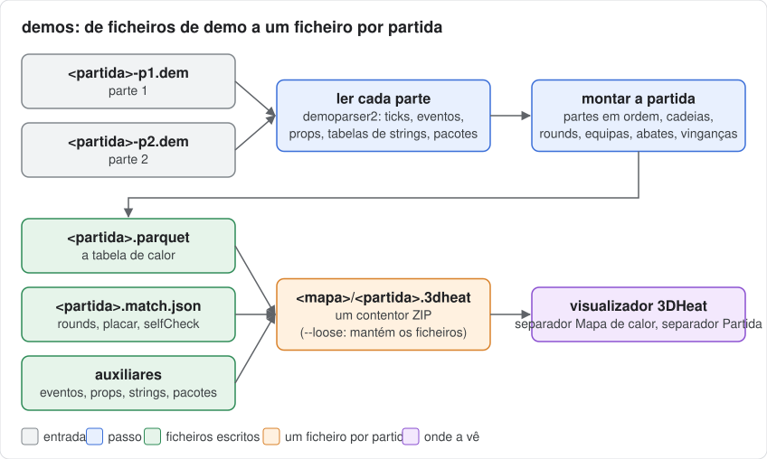

# 3DHeat CS2 {#dheat-cs2}

**O que é?** O Counter-Strike 2 pode salvar a gravação de uma partida, chamada de
*demo*. Esta ferramenta transforma uma demo em arquivos que o visualizador 3DHeat
consegue mostrar em 3D: onde cada jogador ficou, morreu, arremessou e plantou, round a round.
Ela também pode transformar um mapa do CS2 em um modelo 3D para mostrar essas coisas sobre ele.

**Para que eu usaria?** Para revisar as suas próprias partidas, para sobrepor muitas partidas de um
mesmo mapa como um só mapa de calor, e para estatísticas de partida como o ADR (dano médio por round) e o
KAST (a fração de rounds em que um jogador matou, deu assistência, sobreviveu ou foi vingado).

**Exemplo:** `alpha-vs-bravo-m1.dem` entra, `out/de_x/alpha-vs-bravo-m1.3dheat`
sai (`de_x` é um nome de mapa inventado).



Com mais detalhes: o 3DHeat CS2 transforma **demos do Counter-Strike 2** em uma tabela de mapa de calor e um
documento de partida por partida, e um **mapa do CS2** em geometria de nível. As saídas são feitas
para o visualizador de telemetria [3DHeat](https://holdi601.github.io/3DHeat/)
([código](https://github.com/Holdi601/3DHeat)), mas são arquivos comuns - Parquet, JSON e glTF
binário - que qualquer outro programa também pode ler.

É um pequeno pacote Python, `heat3d_cs2`, executado pela linha de comando. Ele lê as
demos do disco (não baixa nenhuma) com o [demoparser2](https://github.com/LaihoE/demoparser), e exporta
mapas do jogo instalado com a versão de linha de comando do Source2Viewer
([ValveResourceFormat](https://github.com/ValveResourceFormat/ValveResourceFormat)).

## Início rápido {#quick-start}

Nunca usou a linha de comando? Leia primeiro [Antes de começar](before-you-start.md).

```bash
pip install -r requirements.txt
python -m heat3d_cs2 demos <arquivos de demo ou pastas> -o out   # cada partida que houver neles
python -m heat3d_cs2 map <mapa> -o out/<mapa>/<mapa>.glb         # o mapa do jogo instalado
python -m heat3d_cs2 scoreboard out/<mapa>/<partida>.3dheat      # o placar de uma partida em texto
```

Você deve ver `1 match(es), 1 at a time ...` e depois uma linha por partida
(veja [Comandos](../commands.md#what-is-printed)).

`demos` grava, para cada partida, um arquivo em uma pasta com o nome do mapa:
`out/<mapa>/<partida>.3dheat`, um [contêiner `.3dheat`](../output-container.md) - o
formato de um arquivo por partida do visualizador ([especificação](https://holdi601.github.io/3DHeat/container.html)).
Ele traz estes membros; `--loose` os grava como arquivos separados:

| Membro | O que traz | Carregado em |
|---|---|---|
| `<partida>.parquet` (papel `table`) | cada jogador vivo oito vezes por segundo, com o seu estado (vida, dinheiro, flash, mira, zona, inventário...), e cada evento no momento em que ocorreu (abate, morte, dano, tiro, arremesso, detonações de granada, cegueira, plantio, desarme, explosão, e um fim de round por jogador com o que o round lhe pagou), uma linha cada | aba Mapa de calor |
| `<partida>.match.json` (papel `match`, o documento da partida) | equipes, placar, cada round (vencedor, como, economia, plantio, abates em ordem, clutches, sobreviventes) e a linha do placar de cada jogador | aba Partida |
| `<partida>.events/props/strings/packets.parquet` | tudo o mais que a demo traz, inteiro (auxiliares) | guardado para completude |

`map` grava `<mapa>.glb`: a malha de colisão do mapa - pisos, paredes, caixas, sem decoração -
dividida em solo e estrutura, no mesmo quadro e unidades das tabelas, então ela fica exatamente
sob o mapa de calor (painel Fundo / nível).

## Mapa desta documentação {#map-of-this-documentation}

| Página | O que cobre |
|---|---|
| [Antes de começar](before-you-start.md) | Python, um terminal, marcadores, como são o sucesso e os erros comuns |
| [Instalação](../installing.md) | Python, os pacotes, a CLI do Source2Viewer, onde o CS2 precisa estar |
| [Comandos](../commands.md) | `demos`, `map`, `scoreboard`: cada opção, o que é impresso, códigos de saída |
| [Lendo uma demo](../reading-demos.md) | o que é lido de um arquivo de demo: ticks amostrados, propriedades de jogador, regras do jogo, eventos |
| [Montando uma partida](../building-matches.md) | partes e cadeias, o relógio da partida, rounds, equipes e lados, linhas, abates, vinganças, aberturas, dano, flashes, economia |
| [Estatísticas](../statistics.md) | o placar: K/D/A, ADR, KAST, HS%, aberturas, vinganças, multi-abates, clutches, utilitários, flashes |
| [A tabela do mapa de calor](../output-table.md) | o arquivo Parquet: cada coluna, seu tipo, quais eventos a preenchem, as dicas do rodapé `heat3d`, os eixos |
| [O documento da partida](../output-match-json.md) | o documento `.match.json`, campo a campo |
| [Um arquivo por partida](../output-container.md) | o contêiner `.3dheat` que `demos` grava por padrão, `--loose` |
| [Exportação de mapa](../map-export.md) | como a malha de colisão de um mapa é exportada, o quadro, a nomeação dos nós, as unidades |
| [Usando com o 3DHeat](../using-with-3dheat.md) | carregar tabelas, documentos de partida e mapas nas abas Mapa de calor e Partida do visualizador |
| [Limites](../limits.md) | o que é assumido, o que não é tratado, o que não foi verificado |
| [Atualizações](../updates.md) | a verificação de lançamento na inicialização e `python -m heat3d_update` |
| [Desenvolvimento](../development.md) | estrutura do código, testes, o fixture de demo sintética |
| [Referência de comandos](../cli-reference.md) | o `--help` de cada comando, gerado a partir do código |
| [Manutenção](../maintaining.md) | a lista de verificação de lançamento destas páginas |

## Com o que é conferido {#what-it-is-checked-against}

Demos do mundo real não são um arquivo limpo por partida. O conversor lida com uma partida dividida em
arquivos em qualquer ordem, um servidor reiniciado no meio da partida, duas partidas diferentes
guardadas sob um mesmo nome, rounds restaurados de um backup, uma gravação que começa tarde ou
termina cedo, pausas, e treinadores no lado de uma equipe - veja
[Montando uma partida](../building-matches.md). Verificado sobre uma grande coleção de demos de
torneios: em cada partida o placar acompanha os vencedores dos rounds, os abates de cada lado são as mortes
do outro, e cada round começa com cinco contra cinco.

## Para o que apontar {#what-to-point-it-at}

Demos das suas próprias partidas, demos que você baixou à mão de um site de torneios, ou demos de uma
API à qual você tem acesso. Uma demo é uma gravação cujo conteúdo pertence à sua editora e aos
organizadores: use o que sai para a sua própria análise, e não redistribua demos nem dados derivados
delas. Sites que oferecem demos costumam proibir o download automatizado nos seus termos, por isso a
ferramenta lê as demos do disco e não baixa nenhuma.

## Parte do 3DHeat {#part-of-3dheat}

O 3DHeat CS2 é uma das ferramentas gratuitas em torno do visualizador 3DHeat, cada uma com o seu
próprio repositório, lançamentos e licença:

| Ferramenta | O que faz | Documentação |
|---|---|---|
| [3DHeat](https://github.com/Holdi601/3DHeat) | o visualizador: mapas de calor, análise de corrida e revisão de partidas em 3D | [site](https://holdi601.github.io/3DHeat/) |
| [GameFiles](https://github.com/Holdi601/3DHeat-GameFiles) | percursos e níveis a partir dos arquivos que os jogos trazem, como modelos 3D | [site](https://holdi601.github.io/3DHeat-GameFiles/) |
| [GameCapture](https://github.com/Holdi601/3DHeat-GameCapture) | telemetria de voltas de jogos de corrida; níveis reconstruídos a partir de vídeo de jogo | [site](https://holdi601.github.io/3DHeat-GameCapture/) |
| [Unreal Exporter](https://github.com/Holdi601/3DHeat-UnrealExporter) | um plugin do Unreal Editor que exporta um nível como um modelo 3D | [site](https://holdi601.github.io/3DHeat-UnrealExporter/) |
| [CS2](https://github.com/Holdi601/3DHeat-CS2) | demos do Counter-Strike 2 em tabelas e documentos de partida; mapas em modelos 3D | [site](https://holdi601.github.io/3DHeat-CS2/) |
| [Watcher](https://github.com/Holdi601/3DHeat-Watcher) | registra, em segundo plano, o que os jogos publicam sobre a sua jogatina | [site](https://holdi601.github.io/3DHeat-Watcher/) |
| [Ext-WarThunder](https://github.com/Holdi601/3DHeat-Ext-WarThunder) | repetições do War Thunder em tabelas e documentos de partida | [site](https://holdi601.github.io/3DHeat-Ext-WarThunder/) |
| [Ext-WoT](https://github.com/Holdi601/3DHeat-Ext-WoT) | repetições do World of Tanks em tabelas e documentos de partida | [site](https://holdi601.github.io/3DHeat-Ext-WoT/) |
| [Ext-WoWs](https://github.com/Holdi601/3DHeat-Ext-WoWs) | repetições do World of Warships em tabelas e documentos de partida | [site](https://holdi601.github.io/3DHeat-Ext-WoWs/) |
| [Ext-Squad](https://github.com/Holdi601/3DHeat-Ext-Squad) | demos de servidores do Squad em tabelas e documentos de partida | [site](https://holdi601.github.io/3DHeat-Ext-Squad/) |
| [Ext-DCS](https://github.com/Holdi601/3DHeat-Ext-DCS) | mapas do DCS World em modelos 3D | [site](https://holdi601.github.io/3DHeat-Ext-DCS/) |
| [Ext-IL2](https://github.com/Holdi601/3DHeat-Ext-IL2) | mapas do IL-2 Sturmovik em modelos 3D | [site](https://holdi601.github.io/3DHeat-Ext-IL2/) |

## Licença {#licence}

MIT - veja [`LICENSE`](https://github.com/Holdi601/3DHeat-CS2/blob/main/LICENSE),
e [`LICENSES.md`](https://github.com/Holdi601/3DHeat-CS2/blob/main/LICENSES.md)
para os pacotes de terceiros e o que os jogos que ela lê exigem.
