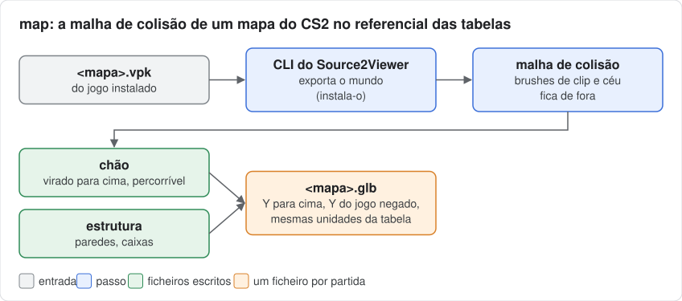

# Exportar o mapa (`map`) {#map-export-map}

`python -m heat3d_cs2 map <mapa> -o <ficheiro.glb>` escreve um mapa de CS2 como geometria de nível: a
**malha de colisão** do mundo, no referencial e nas unidades em que as [tabelas de calor](output-table.md)
são desenhadas. Código:
[`heat3d_cs2/mapexport.py`](https://github.com/Holdi601/3DHeat-CS2/blob/main/heat3d_cs2/mapexport.py),
[`heat3d_cs2/glb.py`](https://github.com/Holdi601/3DHeat-CS2/blob/main/heat3d_cs2/glb.py).
Opções e mensagens: [Comandos](commands.md#map---a-maps-geometry-as-glb).



## Por que a malha de colisão {#why-the-collision-mesh}

A malha de colisão é aquilo sobre que os jogadores andam e atrás de que se escondem - pisos, paredes,
escadas, caixas - sem a decoração: sem adereços que só parecem alguma coisa, sem texturas, com muito
menos triângulos do que as malhas de renderização. É isso que um mapa de calor precisa por baixo:
algo contra que ler posições, não uma renderização do mapa.

## Como é obtida {#how-it-is-obtained}

1. **Encontrar o mapa.** Um caminho que acaba em `.vpk` e que existe é usado tal como está. Senão, é
   procurado `<nome>.vpk` em `<pasta do CS2>\game\csgo\maps\`, onde a pasta do CS2 é `--game`, ou
   `steamapps\common\Counter-Strike Global Offensive` em cada biblioteca do Steam encontrada (ver [Instalação](installing.md#where-cs2-is-looked-for)).
2. **Encontrar a CLI do Source2Viewer**: `--source2viewer`, depois `HEAT3D_SOURCE2VIEWER`, depois
   `Source2Viewer-CLI` / `Source2Viewer-CLI.exe` no `PATH`.
3. **Exportar a física do mundo.** O Source2Viewer é executado como

   ```text
   Source2Viewer-CLI -i <mapa>.vpk -d -f maps/<mapa>/world_physics.vmdl_c --gltf_export_format glb -o <pasta temporária>
   ```

   Decodifica a física compilada do Source 2 a partir do próprio ficheiro do mapa e escreve o modelo
   (vazio: o mundo não tem malha de renderização própria) e a sua física ao lado. O maior `.glb`
   escrito é a física. Se o Source2Viewer falhar ou não escrever nenhum `.glb`, o comando para e
   mostra os últimos 800 caracteres da sua saída e dos seus erros.
4. **Ler.** Cada nó da cena é percorrido com a sua transformação (matriz, ou translação-rotação-escala),
   e cada primitiva de triângulos é tomada, com ou sem buffer de índices, em posições do mundo.
5. **Deixar de fora o que não é parede nem chão.** Um nó cujo nome contém `clip` - clips de jogadores,
   clips de NPCs, clips de granadas: as paredes invisíveis que param jogadores e granadas - ou `sky`,
   em qualquer maiúscula ou minúscula, é descartado.
6. **Dar nome à superfície.** Os grupos de física são nomeados pela sua superfície; o nome em
   minúsculas, sem o prefixo `physics`, `physics_group` ou `physics_passbullets` (e o underscore a
   seguir), é a superfície: `physics_group_concrete` é `concrete`, `physics_passbullets_chainlink` é
   `chainlink`, um `physics_group` simples é `world`. As superfícies que as balas atravessam são
   mantidas.
7. **De volta ao referencial do jogo.** O Source2Viewer escreve glTF em metros com Y para cima: (Y, Z,
   X) do jogo multiplicado por 0,0254. Isso é desfeito - cada ponto passa a ser (X, Y, Z) do jogo em
   polegadas.
8. **Separar chão de estrutura**, triângulo a triângulo: uma face cuja normal aponta para cima com pelo
   menos 0,7 (a sua componente Z, normalizada) - inclinações até cerca de 45 graus, aproximadamente o
   mais íngreme por onde um jogador de CS2 anda - é **chão**; tudo o resto, paredes e tetos incluídos,
   é **estrutura**.
9. **Para o referencial do visualizador.** Cada ponto é escrito como (X, Z, -Y): Y para cima, o Y do
   jogo negado - o referencial em que o visualizador desenha as tabelas, quando segue as suas
   indicações `heat3d`. Uma rotação, não um espelho.
10. **Escrever o `.glb`.** Se não sobrar nada (só clip brushes), o comando para com um erro. Senão,
    imprime o ficheiro, o mapa, a contagem de triângulos, quantos são chão, e o número de partes.

Nada disto lê outra coisa além do `.vpk` do próprio mapa, e nada do Source2Viewer é incluído ou
copiado.

## O ficheiro {#the-file}

Um glTF 2.0 binário (`.glb`), um buffer, escrito pelo `heat3d_cs2` (o `asset.generator`):

| Aspeto | O quê |
|---|---|
| Nós | um por parte, todos na raiz, sem transformações, cada um com a sua própria malha com o mesmo nome |
| Nomes dos nós | `ground:<superfície>` ou `structure:<superfície>` (`ground:concrete`, `structure:metal`, `structure:world`), ordenados pelo nome |
| Primitivas | uma por malha, triângulos, `POSITION` (float32, com min/max) e `NORMAL` (float32), índices `uint32` |
| Sombreado | plano: um vértice por canto de triângulo, cada um com a normal do seu triângulo |
| Materiais, texturas, UVs, cores | nenhum |
| Unidades | unidades do jogo (**polegadas**), não metros - ao contrário do que o glTF assume |
| Referencial | (X, Z, -Y) do jogo: o Y do glTF é a altura do jogo, o Z do glTF é o -Y do jogo |

O prefixo `ground:` / `structure:` é a convenção de todos os exportadores de níveis do 3DHeat: o
visualizador aceita uma parte com esse nome tal como ela é, em vez de adivinhar a partir da
geometria, por isso os pisos recebem o sombreado de chão e as paredes o desenho de estrutura, sem
nenhum passo de classificação.

Como as unidades são polegadas, outro visualizador de glTF mostra o mapa cerca de 39 vezes maior
(lê-as como metros); multiplique por 0,0254 aí, se for importante. No 3DHeat fica exatamente por
baixo da tabela, que está nas mesmas unidades com escala 1.

## A verificação de que o referencial está certo {#the-check-that-the-frame-is-right}

O teste `test_players_stand_on_the_exported_floor` (executado só quando uma demo e o Source2Viewer são
indicados, ver [Desenvolvimento](development.md#tests)) exporta o mapa em que uma demo foi jogada,
toma 300 amostras aleatórias de posição da partida, e para cada uma olha diretamente para baixo à
procura do triângulo de chão mais alto a no máximo 4 unidades acima dos pés do jogador. Exige que pelo
menos 98% das amostras encontrem chão, e que a altura mediana acima dele seja inferior a 5
unidades. Um mapa espelhado falha: num mapa espelhado pelo eixo errado, uma grande parte dos jogadores
fica por cima de nada. O README indica os números desta verificação nos mapas do pool competitivo
atual.

## O que não faz {#what-it-does-not-do}

- Nenhuma geometria de renderização, texturas ou decoração - ver o *porquê* acima.
- Só o que está no modelo `world_physics` do mapa é exportado. Não foi verificado se as partes móveis
  (portas) ou os objetos destrutíveis estão nele.
- Nenhuma simplificação: o visualizador do 3DHeat simplifica na importação com a sua definição
  **Objetivo de simplificação**.
- Os mapas que não estão no jogo instalado (mapas da oficina em outro lugar do disco) funcionam quando o
  seu `.vpk` é passado como caminho e tem `maps/<nome>/world_physics.vmdl_c`; não verificado.
