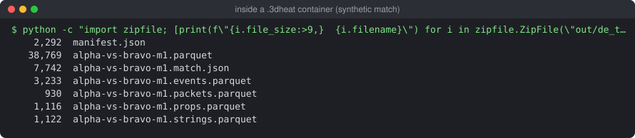

# Um ficheiro por partida (`<partida>.3dheat`) {#one-file-a-match-3dheat}

Por padrão, `demos` junta cada partida num só ficheiro, `out/<mapa>/<partida>.3dheat`: a tabela
de calor, o documento da partida e os quatro ficheiros auxiliares juntos - uma partida, um ficheiro,
para copiar, guardar ou partilhar. É o formato de contentor do visualizador 3DHeat, especificado na
documentação do visualizador:
[Um ficheiro por partida (.3dheat)](https://holdi601.github.io/3DHeat/container.html)
([fonte](https://github.com/Holdi601/3DHeat/blob/main/docs/container.md)).
Código: [`heat3d_cs2/container.py`](https://github.com/Holdi601/3DHeat-CS2/blob/main/heat3d_cs2/container.py).

## Passo a passo {#step-by-step}

1. Converta como de costume; não há nada a definir:

   ```bash
   python -m heat3d_cs2 demos <ficheiros ou pastas de demos> -o out
   ```

2. Cada partida é um ficheiro na pasta do seu mapa:

   

3. Abra-o no visualizador (separador Mapa de calor ou Partida), ou leia-o por si próprio: é um ZIP comum.

   

Para guardar os ficheiros separados - para ferramentas que querem um ficheiro Parquet no disco - acrescente
`--loose`:


## O que está dentro {#what-is-inside}

Um ZIP cujo primeiro membro é `manifest.json`, seguido dos restantes membros. Os membros Parquet são
*guardados sem compressão* (o Parquet já está comprimido, e um membro guardado é um intervalo de bytes
que um leitor pode usar no lugar); os membros JSON são comprimidos com deflate.

| Papel | Membro | O quê |
|---|---|---|
| `table` | `<partida>.parquet` | [A tabela de calor](output-table.md) (esquema `heat3d-table`) |
| `match` | `<partida>.match.json` | [O documento da partida](output-match-json.md) (esquema `heat3d-cs2-match`) |
| `events` | `<partida>.events.parquet` | cada evento do jogo que o analisador lê, inteiro |
| `props` | `<partida>.props.parquet` | cada alteração de propriedade que o analisador lê |
| `strings` | `<partida>.strings.parquet` | cada entrada da tabela de strings |
| `packets` | `<partida>.packets.parquet` | cada outro quadro e mensagem de rede, inteiros |

O manifesto indica o formato e a versão, o jogo (`cs2`), a origem (`demo`), o conversor e a sua versão,
a partida, o mapa, quando foi escrito, um mapa `roles` de papel para membro, e para cada membro o seu tipo de mídia, compressão, tamanho, SHA-256, número de linhas e, quando tem, o seu esquema. Na demo
sintética dos testes (resumida):

```json
{
  "format": "3dheat",
  "format_version": "1.0",
  "game": "cs2",
  "source": "demo",
  "converter": { "name": "heat3d_cs2", "version": "1.0.2" },
  "match": "alpha-vs-bravo-m1",
  "map": "de_test",
  "roles": {
    "table": "alpha-vs-bravo-m1.parquet",
    "match": "alpha-vs-bravo-m1.match.json",
    "events": "alpha-vs-bravo-m1.events.parquet",
    "packets": "alpha-vs-bravo-m1.packets.parquet",
    "props": "alpha-vs-bravo-m1.props.parquet",
    "strings": "alpha-vs-bravo-m1.strings.parquet"
  },
  "members": [
    {
      "name": "alpha-vs-bravo-m1.parquet",
      "role": "table",
      "media_type": "application/vnd.apache.parquet",
      "compression": "stored",
      "bytes": 38769,
      "sha256": "1b7b7d16...",
      "rows": 2655,
      "schema": { "id": "heat3d-table", "version": "1" }
    }
  ]
}
```

## Ler um sem o visualizador {#reading-one-without-the-viewer}

```python
import io, json, zipfile
import pandas as pd

with zipfile.ZipFile("out/de_test/alpha-vs-bravo-m1.3dheat") as z:
    manifest = json.loads(z.read("manifest.json"))
    table = pd.read_parquet(io.BytesIO(z.read(manifest["roles"]["table"])))
    match_document = json.loads(z.read(manifest["roles"]["match"]))
```

O comando `scoreboard` lê o documento da partida diretamente do contentor (ou de um `.match.json`
solto).

## Saltar e reescrever {#skipping-and-rewriting}

Um contentor é escrito por inteiro ou não é escrito, por isso um `.3dheat` dentro de `--out` conta como
partida feita; `--force` reescreve-o. Uma partida convertida antes com `--loose` também conta como feita.
