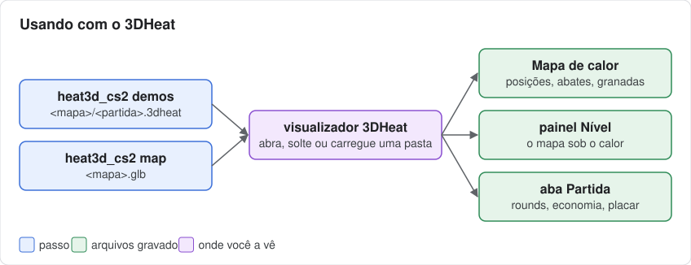

# Usar com o 3DHeat {#using-it-with-3dheat}

As saídas vão para estes lugares do
[visualizador 3DHeat](https://holdi601.github.io/3DHeat):

| Ficheiro | Onde | O que dá |
|---|---|---|
| `<partida>.3dheat` (o padrão) | separador **Mapa de calor**, painel **Origem**, ou separador **Partida** | a tabela e o documento da partida juntos, um ficheiro por partida ([contentor](https://holdi601.github.io/3DHeat/container.html)) |
| `<partida>.parquet` | separador **Mapa de calor**, painel **Origem** | posições e eventos como mapa de calor, replay em caixas, rotas |
| `<partida>.match.json` | separador **Partida**, **Carregar ficheiros de partida…** | o placar, os rounds, o feed de mortes, estatísticas entre partidas, ligações para o mapa de calor |
| `<mapa>.glb` | painel **Fundo / nível**, **Modelo 3D…** | o mapa por baixo do mapa de calor |

A documentação do próprio visualizador descreve cada separador por completo: as suas páginas
[Análise de partida](https://holdi601.github.io/3DHeat/match-analysis.html),
[Carregar ficheiros](https://holdi601.github.io/3DHeat/loading-files.html),
[Mapeamento de colunas](https://holdi601.github.io/3DHeat/column-mapping.html) e
[Replay em caixas](https://holdi601.github.io/3DHeat/box-replay.html). Esta página é o lado CS2 disso.



O visualizador: [github.com/Holdi601/3DHeat](https://github.com/Holdi601/3DHeat), documentação
[holdi601.github.io/3DHeat](https://holdi601.github.io/3DHeat/).

## Uma sessão típica {#a-typical-session}

```bash
python -m heat3d_cs2 demos D:\Demos\evento -o out
python -m heat3d_cs2 map <mapa> -o out/<mapa>/<mapa>.glb
```

1. **Separador Mapa de calor -> Origem:** escolha a pasta `out/<mapa>` (ou arraste-a).
   Cada `.parquet` nela torna-se um conjunto de dados; os ficheiros `.json` e `.glb` na mesma pasta são
   saltados como "não é um ficheiro csv/parquet". Carregue.
2. **Fundo / nível -> Modelo 3D…:** escolha `out/<mapa>/<mapa>.glb`. **Guardar na biblioteca** guarda-o no
   navegador para a próxima vez.
3. **Separador Partida -> Carregar ficheiros de partida…:** escolha os ficheiros `.match.json` da mesma
   pasta (vários de uma vez), ou arraste-os para a vista enquanto o separador Partida estiver aberto.

Carregue só as tabelas de um mapa de cada vez: as coordenadas de mapas diferentes se sobrepõem, e um mapa
de calor de dois mapas ao mesmo tempo não quer dizer nada. A pasta por mapa existe para isso.

## A tabela abre sem nada para definir {#the-table-opens-with-nothing-to-set}

O visualizador lê a entrada `heat3d` do rodapé do primeiro ficheiro selecionado
([A tabela de calor](output-table.md#the-heat3d-footer-hints)) e sobrepõe-na às suas próprias
suposições:

| Definição do visualizador | Valor |
|---|---|
| Posição | `x`, `y`, `z` |
| Eixo vertical na origem | Z é para cima |
| Inverter Y | ligado - para o mapa ficar do lado certo, não espelhado |
| Escala de unidades | 1 - distâncias em unidades do jogo (rotuladas "m"; 1 unidade = 1 polegada) |
| Tempo | `time`, segundos |
| Pessoa | `player` |
| Grupo | `side` (T / CT) |
| Sessão | `roundId` - cada round é uma sessão, `<partida> #NN` |
| Direção do olhar | vetor, `dirX` / `dirY` / `dirZ` |
| Colunas de filtro | `event`, `match`, `round`, `roundTime`, `phase`, `weapon`, `place`, `won`, `buy`, `opening`, `team` |
| Tamanho da entidade | 32 - o replay em caixas desenha um jogador com 32 unidades de largura, com um raio de olhar de 4 x 32 |

Cada valor indicado continua visível no mapeamento de colunas e pode ser alterado. As outras colunas
(`headshot`, `traded`, `other`, `steamid`, `health`, `money`, `damage`, `duration`, ...) podem ser
adicionadas aí como filtros, manualmente.

Mantenha a escala de unidades em 1 quando um mapa está carregado: o `.glb` está nas mesmas unidades do
jogo, e o nível não é redimensionado com a tabela.

### Filtros úteis {#useful-filters}

- `event` = `position` para onde estavam os jogadores; `kill` / `death` para onde os duelos foram ganhos e
  perdidos; `smoke`, `flash`, `molotov`, `he` para onde caiu o utilitário; `throw` para de onde foi
  lançado; `plant` para os locais das plantas.
- `side` (o grupo) = `T` ou `CT`, `phase` = `live` para deixar de fora a fase after, `buy` = `eco` / `force` /
  `full` para os rounds de uma economia, `won` = 1 para os rounds que o lado da linha ganhou.
- `opening` = 1 com `kill` e `death` para os duelos de abertura.
- `roundTime` como um intervalo para um momento do round: os primeiros 20 segundos, o pós-planta.

## O separador Partida {#the-match-tab}

O separador Partida aceita um ficheiro JSON cujo `format` é `heat3d-cs2-match` e que tem as listas `rounds`,
`players` e `teams` ([O documento da partida](output-match-json.md)). Mostra o resultado e as metades, uma
faixa de rounds colorida pelo lado vencedor com uma marca para a forma como cada um acabou, a economia de
cada round, a planta, o feed de mortes, os clutches e os sobreviventes, o placar, e estatísticas entre todas
as partidas carregadas.

Os seus links **Mostrar no mapa de calor** não carregam nada: definem filtros na tabela já carregada no
separador Mapa de calor - `match`, `round` (e a sessão do round `<partida> #NN`), `event`, o jogador, o
lado. Isso funciona porque o documento da partida e a tabela trazem os mesmos nomes de partida, números de
round, nomes de jogadores e lados. **Repetir ronda** muda o mapa de calor para replay em caixas e reproduz
a sessão do round desde o início.

Por isso carregue as duas coisas: as tabelas de um mapa no separador Mapa de calor, e os documentos das
partidas no separador Partida. Um documento de partida sem a sua tabela continua a mostrar o placar e os
rounds, e as ligações dizem que não há dados de mapa de calor carregados.

## Sem o 3DHeat {#without-3dheat}

- A tabela é Parquet simples: pandas, Polars, DuckDB, Spark, o `arrow` do R a leem; a entrada `heat3d` é
  ignorada, e as colunas de texto leem-se como strings ou categorias.
- O documento da partida é JSON simples.
- O mapa é um glTF binário válido, em polegadas e não em metros: multiplique por 0,0254 para ferramentas que
  assumem metros. O seu referencial é o próprio do glTF (Y para cima), por isso, para sobrepor a tabela noutro
  lado, desenhe o (x, y, z) de cada linha como (x, z, -y), como o 3DHeat faz.
