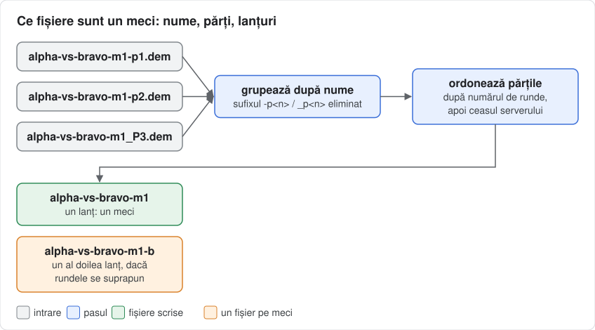

# Cum se construiește un meci {#building-a-match}

Cum se face un meci din părțile sale demo: ce fișiere aparțin împreună, un
singur ceas pentru toate, rundele și cum a fost câștigată fiecare, echipele și
părțile lor, precum și fiecare rând din tabelul hărții termice, cu eliminări,
răzbunări, deschideri, daune, flash-uri și economie. Cod:
[`heat3d_cs2/match.py`](https://github.com/Holdi601/3DHeat-CS2/blob/main/heat3d_cs2/match.py).
Tabelul de scor calculat din el este pe pagina [Statistici](statistics.md).

## Prezentare generală {#overview}

1. Fiecare fișier al unui nume de meci este citit ([Citirea unui demo](reading-demos.md)).
2. Rândurile duplicate ale jucătorilor din fiecare fișier (runde restaurate) sunt rezolvate.
3. Fișierele sunt sortate în **lanțuri** - meciuri - iar fiecare lanț este pus în ordine.
4. Fiecare parte este așezată pe **ceasul meciului**.
5. **Rundele** sunt găsite în fiecare parte; relatarea unei părți ulterioare despre o rundă
   o înlocuiește pe cea a unei părți anterioare.
6. **Jucătorii** și **echipele** sunt numiți, iar părțile și scorul fiecărei runde sunt date
   după numele echipei. Odată cunoscute părțile, urmează lungimea reprizei, rundele de pistol
   și **cumpărarea** fiecărei părți.
7. **Rândurile** sunt construite: poziții, focuri, aruncări, detonări, plantări,
   dezamorsări, eliminări, morți, lovituri, orbiri, explozii.
8. Fiecare rând primește runda, faza, timpul din rundă, dacă partea sa a câștigat și
   cumpărarea părții sale; rândurile din afara oricărei runde sunt înlăturate.

## Runde restaurate: un rând pentru fiecare jucător la fiecare tick {#restored-rounds-one-row-per-player-per-tick}

Când o rundă este restaurată dintr-o copie de siguranță în interiorul unui fișier,
demo-ul păstrează, câteva secunde, și corpurile vechi ale jucătorilor alături de cele
noi: două rânduri pentru un jucător la același tick, unul unde l-a lăsat runda anulată,
unul la apariția din runda restaurată. Pentru fiecare astfel de jucător, tick-urile
duplicate sunt parcurse **înapoi**, pornind de la primul rând unic de după ele: la
fiecare tick, candidatul cel mai apropiat de poziția care urmează este păstrat, și
acesta devine punctul de referință pentru tick-ul dinainte. Dacă nu există un rând unic
după ele, ultimul candidat este păstrat. Astfel, fiecare jucător păstrează rândul care
duce mai departe, spre locul unde merge apoi.

## Partea live a unui fișier {#the-live-part-of-a-file}

**Începutul live** al unui fișier este tick-ul ultimului eveniment
`round_announce_match_start`, sau tick-ul 0 dacă nu are niciunul (o parte ulterioară a
unui meci împărțit are de obicei unul). Tot ce este înainte de începutul live este lăsat
deoparte, la fel și tot ce este marcat cu `is_warmup_period`. O rundă cu cuțitul sau o
repornire înainte de anunț sunt deci lăsate deoparte; o rundă cu cuțitul care *nu* este
urmată de un anunț de începere a meciului nu este recunoscută ca atare (vezi [Limite](limits.md)).

**Rundele** unui fișier sunt evenimentele `round_freeze_end` de la începutul live încolo,
în afara încălzirii, identificate prin `total_rounds_played` (indexul de la 0 al rundei
care urmează, numărat de joc). Un fișier fără niciuna nu are runde și nu aparține niciunui meci.

## Ceasul {#the-clock}

Timpii sunt în secunde. În interiorul unui fișier, timpul se numără în **tick-uri**:
`game_time` al serverului la primul tick eșantionat, plus tick-urile trecute de atunci / 64.
Ceasul propriu al serverului stă pe loc în timpul unei pauze, în timp ce tick-urile
continuă; citit prin ceas, două momente ale unui meci pus pe pauză ar avea același timp.

Fiecare fișier are un *prim ceas* (timpul la începutul său live) și un *ultim ceas*
(la ultimul tick eșantionat).

### Părți și lanțuri {#parts-and-chains}

Fișierele numite ca un singur meci ([Comenzi](commands.md#which-files-are-one-match))
sunt mai întâi sortate după indexul primei runde, apoi după primul ceas. Apoi, pe rând,
fiecare intră în primul lanț pe care îl continuă sau pornește un lanț nou. O parte
continuă un lanț când indexul primei sale runde este cel puțin egal cu indexul ultimei
runde a ultimei părți din lanț, **și** fie

- ceasul serverului merge mai departe: primul său ceas nu este mai devreme decât ultimul
  ceas al lanțului minus 5 s; fie
- numărarea rundelor merge mai departe: indexul primei sale runde este indexul ultimei
  runde a lanțului sau cel de după.

Numărarea decide, iar ceasul rupe egalitățile, pentru că un server repornit ca să
restaureze o rundă își pornește din nou ceasul, în timp ce două meciuri diferite sub
același nume (aceleași echipe pe aceeași hartă la două evenimente) au numere de runde
care se suprapun. Lanțurile sunt ordonate după numărul de runde pe care îl acoperă, cele
mai multe întâi; primul păstrează numele meciului, celelalte sunt scrise `<nume>-b`,
`<nume>-c` și așa mai departe.

### Ceasul meciului {#the-match-clock}

Zero-ul meciului este primul ceas al primei părți: **timpul de meci 0 este începutul live
al primului fișier**. Fiecare parte ulterioară este așezată pe el:

- acolo unde ceasul serverului merge mai departe (primul său ceas nu este mai devreme decât
  ultimul ceas al părții anterioare minus 5 s), se folosește ceasul serverului așa cum este;
- acolo unde a fost repornit, partea este așezată ca să urmeze **o secundă** după ce s-a
  terminat partea anterioară.

## Runde {#rounds}

Pentru fiecare `round_freeze_end` al unei părți (în ordinea tick-urilor), fereastra
rundei merge până la următorul freeze end din aceeași parte sau până la sfârșitul
fișierului. În ea, runda este **decisă** la primul eșantion în care starea jocului arată
`total_rounds_played` = indexul rundei + 1 și `round_win_status` 1 (egalitate), 2 (a
câștigat T) sau 3 (a câștigat CT). O rundă fără un astfel de eșantion în fereastra sa a
fost întreruptă de sfârșitul fișierului; numărul ei intră în lista `incomplete` a
meciului (cu excepția cazului în care o altă parte are runda completă).

| Câmpul rundei | Din |
|---|---|
| `number` | indexul + 1 (de la 1, cum numără jocul) |
| `start` | timpul de meci al sfârșitului timpului de îngheț - jucătorii pot să se miște |
| `end` | timpul de meci al primului eșantion care arată runda decisă |
| `until` | timpul de meci al următorului `round_prestart` după `end`, dacă este în fereastră; altfel sfârșitul ferestrei sau ultimul tick al fișierului, care vine primul (și niciodată înainte de `end`) |
| `winner` | `T` pentru statusul 2, `CT` pentru 3, gol pentru 1: o egalitate este decisă, fără câștigător |
| `reason` | `round_win_reason` la acel eșantion, numit ca mai jos |
| `score` | numele echipei -> runde câștigate după aceasta: `team_rounds_total` al fiecărei părți la eșantionul decisiv; unde demo-ul nu are acest câmp, scorul rundei anterioare plus unu pentru câștigător |
| `sides` | numele echipei -> `T` / `CT` în această rundă |
| `equipment` | parte -> suma `current_equip_value` a jucătorilor **în viață** ai părții, la primul eșantion de la sau după freeze end |
| `buy` | parte -> `pistol`, `eco`, `force` sau `full` ([Economia și tipurile de cumpărare](#economy-and-buy-types)) |
| `plant` | primul `bomb_planted` după freeze end și până la `end`, sau nimic |
| `exploded` | timpul de meci al primului `bomb_exploded` după acea plantare și înainte de următorul freeze end, dacă există (nu este în documentul meciului; cronometrează rândul `explode`) |

`reason`, din `CSRoundEndReason` al jocului:

| Cod | `reason` |
|---|---|
| 1 | `bomb` (ținta a fost bombardată) |
| 7 | `defuse` |
| 8, 9 | `elimination` (CT câștigă / T câștigă prin eliminare) |
| 10 | `draw` |
| 12 | `time` (ținta salvată) |
| 17, 18 | `surrender` |
| orice altceva | `other` |

Când mai multe părți au aceeași rundă (după index), se păstrează versiunea părții
ulterioare. Rundele sunt apoi enumerate după index. Un meci a cărui primă rundă nu este
runda 1 notează numerele lipsă (`missing` în documentul meciului); linia de comandă
spune *înregistrat de la runda N*.

### Plantarea {#the-plant}

| Câmpul | Din |
|---|---|
| `site` | `A` sau `B`: zona bombei în care jocul spune că a stat plantatorul (`which_bomb_zone`, 1 A, 2 B); fără el, numele locului plantatorului (`BombsiteA`, `BombsiteB`); fără nici acesta, litera pe care a dat-o o altă plantare din același fișier în aceeași zonă (site-ul evenimentului este numărul de entitate al zonei). Gol când nimic nu spune - niciodată numărul. |
| `time` | secunde **în interiorul rundei** (de la freeze end-ul ei), ca timpul unei eliminări |
| `player`, `steamid` | plantatorul |
| `x`, `y`, `z` | poziția plantatorului, în unități de joc: unde stă bomba |
| `place` | numele locului plantatorului la plantare |

### Fazele {#the-phases}

Timpul de la `start` la `end` este faza **live** a rundei; de la `end` la `until` este
faza sa **după**, în care câștigătorii vânează, iar cei care pierd economisesc. Un rând
aparține rundei al cărei interval `[start, until)` îl conține pe timpul său și este
`after` când timpul său este mai târziu decât `end`. Timpul de îngheț se află între runde
și nu aparține niciunei.

## Jucători și echipe {#players-and-teams}

Un **jucător** este oricine a fost în viață cel puțin o dată de partea unei tabere
(echipa 2 sau 3), în afara timpului de îngheț și a încălzirii, după începutul live. Un
antrenor sau un comentator de pe partea unei echipe nu este niciodată în viață și nu este
jucător. Fiecare jucător este identificat după ID-ul Steam; numele este ultimul văzut.

**Echipa** unui jucător este numele de clan pe care i l-a dat jocul părții sale
(`team_clan_name`), cel văzut cel mai des pentru el - demo-ul îl șterge chiar la final.
Un meci jucat fără nume de clan își numește echipele după partea pe care au început:
`Started T` și `Started CT`.

**Părțile** fiecărei runde vin din cine a fost pe ce parte între freeze end și sfârșitul
rundei: fiecărei părți i se dă eticheta de echipă pe care o poartă cei mai mulți dintre
jucătorii săi. Lista `teams` a meciului este în ordinea apariției, rundă cu rundă, partea
T înaintea CT; de obicei echipa care a început pe T este prima.

## Rândurile {#the-rows}

Fiecare eșantion de poziție și fiecare eveniment devine un rând al [tabelului hărții
termice](output-table.md). Jucătorii sunt pe o parte doar când `team_num` lor este 2 sau 3.

### Poziții {#positions}

Din rândurile eșantionate ale jucătorilor în viață de pe o parte, în afara timpului de
îngheț și a încălzirii, după începutul live: poziția, direcția privirii, sănătatea,
armura, banii, valoarea echipamentului, arma ținută, locul.

Direcția privirii este un vector unitar în sistemul de coordonate al jocului:
`(cos pitch * cos yaw, cos pitch * sin yaw, -sin pitch)` - pitch-ul jocului este pozitiv
când privește în jos, deci privirea în jos dă o Z negativă.

Arma ținută este `active_weapon_name` așa cum o numește jocul, cu excepția faptului că orice
nume care conține `Knife`, `Bayonet`, `Karambit` sau `Daggers` devine `Knife`.

### Focuri și aruncări {#shots-and-throws}

Din `weapon_fire`, la poziția trăgătorului. Cuțitele (`knife`, `bayonet` în id-ul armei)
și C4 sunt lăsate deoparte. Grenadele (`smokegrenade`, `flashbang`, `hegrenade`,
`molotov`, `incgrenade`, `decoy`) sunt rânduri **throw** (aruncare), tot restul sunt
rânduri **shot** (foc). Arma este numită așa cum o arată jocul (mai jos).

### Detonările grenadelor {#grenade-detonations}

| Eveniment | Rând | `weapon` |
|---|---|---|
| `smokegrenade_detonate` | `smoke` | Smoke Grenade |
| `flashbang_detonate` | `flash` | Flashbang |
| `hegrenade_detonate` | `he` | High Explosive Grenade |
| `inferno_startburn` (molotov și incendiară) | `molotov` | Molotov |
| `decoy_detonate` | `decoy` | Decoy Grenade |

Poziția este **unde a explodat grenada** (`x`, `y`, `z` ale evenimentului); jucătorul și
partea sunt ai aruncătorului. Demo-ul nu numește niciun loc pentru o grenadă, doar pentru
jucători, deci `place` rămâne gol: un rând nu pretinde un loc în care nu a fost. Locul
aruncătorului în acel moment este păstrat ca `throwerPlace`.

### Plantări și dezamorsări {#plants-and-defuses}

Rânduri `plant` și `defuse` la poziția jucătorului, arma `C4 Explosive`. O bombă plantată
care a explodat primește un rând **explode**: la poziția plantării, la timpul evenimentului
`bomb_exploded`, cu plantatorul ca jucător (cu ID-ul său Steam), partea `T`, echipa T a
rundei ca `team` și locul plantării. Aceasta include o bombă care explodează după ce Ts
au câștigat deja prin eliminare. Unde demo-ul nu are `bomb_exploded`, o rundă câștigată
de bombă (`reason` = `bomb`) cu o plantare primește rândul la `end` al rundei.

### Eliminări și morți {#kills-and-deaths}

Fiecare `player_death` dintr-o rundă dă o **înregistrare de eliminare** (tabelul `kills`
al meciului) cu:

| Câmpul | Este |
|---|---|
| attacker, victim, assister | nume, ID-uri Steam, părți; atacatorul este gol pentru lume (căderea, bomba) |
| `weapon` | arma evenimentului, numită așa cum o arată jocul |
| `headshot` | indicatorul evenimentului |
| `wallbang` | `penetrated` > 0 |
| `throughSmoke` | `thrusmoke` |
| `flashAssist` | `assistedflash` |
| `noscope`, `attackerBlind` | indicatorii evenimentului (`noscope`, `attackerblind`); coloane ale rândurilor `kill` și `death` și ale eliminărilor din documentul meciului |
| `suicide` | atacatorul și victima sunt același jucător: o grenadă proprie, de exemplu |
| `teamkill` | atacatorul și victima sunt de aceeași parte, cu un atacator, și nu o sinucidere |
| `opening` | prima eliminare a unui inamic din rundă (mai jos) |
| `traded`, `trade` | mai jos |
| poziții | poziția și locul atacatorului și ale victimei |

Din fiecare înregistrare, tabelul primește un rând **death** la poziția victimei (fiecare
moarte, inclusiv cele provocate de lume, de coechipieri sau de sinucideri) și - pentru
eliminările făcute de un inamic (un atacator, fără teamkill, fără sinucidere) - un rând
**kill** la poziția ucigașului.

**Deschiderea.** Prima eliminare a unui inamic din fiecare rundă, cât timp este live, este
duelul ei de deschidere. O eliminare de coechipier, o sinucidere sau o moarte provocată
de lume înainte de ea este ignorată, astfel că deschiderea este tot primul duel al rundei;
o rundă fără nicio eliminare de inamic cât timp este live nu are deschidere.

**Răzbunată** și **răzbunare.** O moarte provocată de un inamic este **răzbunată** când
ucigașul său este eliminat de cineva din partea victimei în **5 secunde** după aceea (mai
mult de 0 și cel mult 5 s mai târziu, în aceeași rundă); prima astfel de eliminare este o
**eliminare de răzbunare**. În tabel, coloana `traded` a unui rând `kill` este 1 pentru o
eliminare de răzbunare; a unui rând `death` este 1 pentru o moarte care a fost răzbunată.
Eliminările din faza după contează și ele.

### Daune {#damage}

Din `player_hurt`, doar între **inamici** (ambii pe o parte, părți diferite). Daunele
sunt sănătatea efectiv **pierdută**: pentru fiecare victimă din fiecare rundă, sănătatea
începe de la 100; fiecare lovitură numără `min(dmg_health, sănătatea de dinainte)`, iar
`health` al evenimentului (ce a rămas) devine „de dinainte” pentru lovitura următoare. O
lovitură în cap de 137 de daune asupra unui jucător cu 40 de sănătate numără 40, cum
numără tabelul de scor al jocului. Loviturile date de `hegrenade`, `inferno`, `molotov` și
`incgrenade` sunt daune de **utilitare**. Fiecare lovitură este un rând **hurt** la
poziția victimei, atacatorul fiind `other`. Daunele între coechipieri și cele asupra
sie însuși nu intră nici în tabel, nici în statistici.

### Flash-uri {#flashes}

Din `player_blind`, doar **inamici** (nu coechipieri și nu un antrenor sau un comentator
care urmărește): un rând **blind** pentru fiecare jucător orbit, la poziția jucătorului
orbit, cel care a aruncat flash-ul fiind `other`, durata orbirii în secunde fiind
`duration`. Fiecare durată este păstrată; statisticile numără doar orbirile de cel puțin o
secundă.

## Numele armelor {#weapon-names}

Un id de armă dintr-un eveniment (`ak47`, `weapon_ak47`, `knife_karambit`) este arătat
așa cum o numește jocul în `active_weapon_name` al jucătorilor, astfel că arma unei
eliminări și arma ținută se citesc la fel: `ak47` -> `AK-47`, `m4a1` -> `M4A4`,
`m4a1_silencer` -> `M4A1-S`, `hkp2000` -> `P2000`, `taser` -> `Zeus x27`,
`inferno` și `molotov` -> `Molotov`, `incgrenade` -> `Incendiary Grenade`,
`c4` și `planted_c4` -> `C4 Explosive`, `world` -> `World`, și așa mai departe pentru
fiecare armă și grenadă (tabelul `WEAPONS` din `match.py`). Orice are `knife` sau
`bayonet` în id este `Knife`. Un id care nu este în tabel este păstrat așa cum este.

## Economia și tipurile de cumpărare {#economy-and-buy-types}

La sfârșitul timpului de îngheț, valoarea echipamentului fiecărei părți este însumată
peste jucătorii săi în viață, la primul eșantion de atunci încolo, și împărțită la numărul
lor:

| Runda | Echipament mediu pe jucător | `buy` |
|---|---|---|
| o rundă de pistol (prima din fiecare repriză regulamentară) | oricare | `pistol` |
| altele | sub 1.500 $ | `eco` |
| altele | de la 1.500 $ până sub 4.000 $ | `force` |
| altele | 4.000 $ sau mai mult | `full` |

Rundele de pistol urmează repriza în care s-a jucat meciul, nu un format fix. Repriza se
încheie acolo unde taberele schimbă prima dată părțile între două runde consecutive,
ambele în regulament: lungimea sa (`halfLength` în documentul meciului) este runda de
dinaintea schimbării - 12 în formatul de 24 de runde, 15 în cel de 30. Runda 1 și runda
de după repriză sunt rundele de pistol. O rundă este prelungire când numărul de
prelungiri al jocului (`m_nOvertimePlaying`) este peste 0 la freeze end-ul ei; acolo unde
un demo nu are un astfel de număr, fiecare rundă de după două reprize este. Reprizele de
prelungire încep cu banii setați de server și nu au rundă de pistol, deși părțile lor
tot se schimbă. O înregistrare care nu arată niciodată schimbarea de la pauză - începe
după ea sau se termină înainte - lasă repriza necunoscută, iar doar runda 1 este rundă de pistol.

## Etichetare și ordine {#labelling-and-order}

În final, fiecare rând primește:

- `match` - numele meciului; `map` - harta din antetul demo-ului;
- `round` și `roundId` (`<match> #NN`, două cifre);
- `phase` - `live` sau `after`;
- `roundTime` - secunde de la încheierea timpului de îngheț al rundei;
- `won` - 1 dacă partea rândului a câștigat runda, 0 dacă nu, gol pentru un rând fără parte;
- `buy` - cumpărarea părții rândului în runda respectivă;
- `team` - echipa jucătorului rândului, după ID-ul Steam.

Rândurile al căror timp nu se află în nicio rundă - înainte de freeze end-ul primei runde,
în timpul înghețului, după ultima rundă - sunt înlăturate. Rândurile sunt sortate după
timp, iar la același timp, după numele evenimentului.
