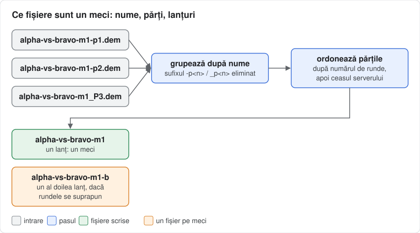

# Comenzi {#commands}

Nu ești obișnuit cu linia de comandă? Citește mai întâi [Înainte de a începe](before-you-start.md).
Scrie aceste comenzi într-un terminal deschis în folderul în care ai dezarhivat sau
clonat proiectul; `<...>` sunt locuri de completat, iar o cale cu spații se pune între ghilimele.

```text
python -m heat3d_cs2 demos <fișiere demo sau foldere> -o <folder> [--every 8] [--jobs N] [--map TEXT] [--force] [--no-bulk] [--loose]
python -m heat3d_cs2 map <numele hărții sau calea către fișierul .vpk> -o <fișier.glb> [--game FOLDER] [--source2viewer EXE]
python -m heat3d_cs2 scoreboard <match.3dheat | match.json>
```

`python -m heat3d_cs2 --help` și `python -m heat3d_cs2 <verb> --help` arată aceleași
opțiuni; [Pagina de referință a comenzilor](../cli-reference.md) le arată pe toate. Fiecare
pornire rulează mai întâi verificarea de versiune descrisă în [Actualizări](updates.md)
(se oprește cu `HEAT3D_NO_UPDATE=1`).

Cod: [`heat3d_cs2/cli.py`](https://github.com/Holdi601/3DHeat-CS2/blob/main/heat3d_cs2/cli.py).

## `demos` - demo-uri în tabele și documente de meci {#demos---demos-into-tables-and-match-documents}

```powershell
python -m heat3d_cs2 demos D:\Demos\event -o out
python -m heat3d_cs2 demos alpha-vs-bravo-m1-p1.dem alpha-vs-bravo-m1-p2.dem -o out
python -m heat3d_cs2 demos D:\Demos -o out --map final --jobs 4
```

| Argument | Implicit | Face |
|---|---|---|
| `paths` (unul sau mai multe) | - | fișiere și foldere demo. Un fișier este luat când extensia sa este `.dem` (oricare ar fi majusculele). Un folder este căutat **recursiv** după fișiere care se termină în `.dem`, în orice formă de litere, în ordine sortată. Demo-urile comprimate (`.dem.zst`, `.dem.bz2`, arhive) nu sunt citite: dezarhivează-le mai întâi. |
| `-o`, `--out` | obligatoriu | folderul în care se scrie; se creează la nevoie |
| `--every N` | `8` | eșantionează fiecare jucător la fiecare *N* tick-uri. Demo-urile CS2 rulează la 64 de tick-uri pe secundă, deci 8 înseamnă opt eșantioane pe secundă, 4 înseamnă șaisprezece, 64 înseamnă unul. Evenimentele sunt citite mereu la propriul lor tick, oricare ar fi *N*. |
| `--jobs N` | `0` = jumătate din nucleele procesorului | câte meciuri sunt convertite simultan, fiecare în propriul proces. Niciodată mai puțin de 1, niciodată mai mult decât meciuri de făcut. |
| `--map TEXT` | - | doar meciurile al căror **nume** conține *TEXT*, fără diferență între majuscule și minuscule (`--map final`). Filtrează după numele fișierului, nu după harta pe care o conține demo-ul. |
| `--force` | oprit | convertește meciurile deja scrise, suprascriindu-le |
| `--loose` | oprit | păstrează fiecare meci ca fișiere separate - tabel, `.match.json`, fișiere anexe - în loc să le împacheteze într-un singur container `.3dheat`. Vezi [Un fișier pentru fiecare meci](output-container.md). |
| `--container` | pornit | împachetează fiecare meci într-un singur fișier `.3dheat`; este implicit, deci există doar ca să fie explicit |
| `--no-bulk` | oprit | lasă afară fluxul de entități, comenzile jucătorilor și fluxul de animație din fișierul anexă cu pachete - peste jumătate din dimensiunea unui demo, chiar comprimat. Autoverificarea documentului meciului le numără atunci ca `lost`, pe nume. |


### Ce fișiere sunt un singur meci {#which-files-are-one-match}



Numele meciului este numele fișierului demo fără extensie și fără sufixul de parte:
`-p<cifre>` sau `_p<cifre>` la sfârșit, oricare ar fi majusculele. Așadar
`alpha-vs-bravo-m1-p1.dem`, `alpha-vs-bravo-m1-p2.dem` și
`alpha-vs-bravo-m1_P3.dem` sunt părțile aceluiași meci, `alpha-vs-bravo-m1`.
Fișierele sunt grupate doar după acest nume - două fișiere cu același nume în foldere
diferite sunt și ele grupate.

Sufixul nu spune nimic despre ordine: un `-p2` poate fi jumătatea de dinainte. Părțile
sunt puse în ordine după numărul de runde pe care le conțin, apoi după ceasul
serverului, iar un grup care se dovedește că ține două meciuri diferite (aceleași
echipe pe aceeași hartă, la două evenimente, de exemplu) este împărțit în **lanțuri**:
lanțul cu cele mai multe runde se scrie sub numele însuși, următorul ca `<nume>-b`, apoi
`<nume>-c`, și așa mai departe. Un fișier fără nicio rundă (doar încălzire, o pauză) nu
aparține niciunui lanț. Cum sunt găsite lanțurile este descris în
[Cum se construiește un meci](building-matches.md#parts-and-chains).

### Ce se scrie {#what-is-written}

Pentru fiecare meci, într-un folder numit după harta pe care o indică antetul demo-ului
(`unknown` când nu indică niciuna), un fișier `.3dheat`:

```text
out/
  de_x/
    alpha-vs-bravo-m1.3dheat
    alpha-vs-bravo-m2.3dheat
  de_y/
    ...
```

Pe demo-ul sintetic cu două runde din teste:


Cu `--loose`, fiecare meci este tabelul, documentul său de meci și patru fișiere anexe
una lângă alta ([Un fișier pentru fiecare meci](output-container.md)):


O hartă termică este pentru o singură hartă, deci încărcarea unui folder în vizualizator
înseamnă încărcarea meciurilor unei singure hărți. Vezi [Tabelul hărții termice](output-table.md)
și [Documentul meciului](output-match-json.md).

### Ce se omite {#what-is-skipped}

Înainte ca ceva să fie citit, fiecare `*.3dheat` de oriunde sub `--out` (un container se
scrie întreg sau deloc) și fiecare `*.parquet` care are alături documentul meciului
(`<nume>.match.json`) sunt enumerate, iar un meci al cărui nume este egal cu unul dintre
numele acestor fișiere (fără extensie) este omis, în afară de cazul în care se folosește
`--force`. Un tabel fără documentul meciului - o rulare oprită între scrierea celor două -
nu contează, deci meciul acela este convertit din nou. Verificarea se face doar după nume:
un meci convertit într-un alt folder de hartă, sau cu un alt `--every`, tot contează ca
terminat. Când nu mai este nimic de făcut:

```text
nothing to do: no demos found, or every match already written (--force redoes them)
```

### Ce se afișează {#what-is-printed}

Întâi cantitatea de lucru, apoi o linie pentru fiecare meci pe măsură ce se termină (în
ordinea în care se termină, nu în ordinea fișierelor):

```text
3 match(es), 3 at a time
alpha-vs-bravo-m1: de_x, 21 rounds (Alpha 13 Bravo 8), 412,377 rows, lost 0
alpha-vs-bravo-m2: de_y, 30 rounds (Bravo 16 Alpha 14), 598,104 rows, 1 incomplete round(s) left out, lost 0
alpha-vs-bravo-m3: de_y, 18 rounds (Alpha 13 Bravo 5), 330,981 rows, recorded from round 3, lost 1,204,331 (svc_PacketEntities, svc_UserCmds, DEM_AnimationData)
```

(Numerele sunt cu titlu de exemplu.) Scorul este cel al ultimei runde, echipă cu echipă,
în ordinea în care le listează documentul meciului. *incomplete round(s) left out*
numără rundele pe care un demo le-a întrerupt înainte să fie decise; *recorded from round N*
spune că înregistrarea începe târziu; *lost* este autoverificarea documentului meciului -
câte elemente din demo nu au ajuns nicăieri și de ce fel (`--no-bulk` face ca fluxul
voluminos să fie pierdut). Un meci care nu produce nimic spune de ce:

```text
alpha-vs-bravo-m4: no round in 1 file(s) - nothing written
alpha-vs-bravo-m4-b: no complete round in 1 file(s) - nothing written
```

O eroare într-un meci nu oprește celelalte; este afișată ca
`<nume>: failed - <eroare>`.

### Codul de ieșire {#exit-code}

`0` când fiecare meci a fost convertit (sau nu era nimic de făcut), `1` când cel puțin
unul a eșuat.

### Cât durează {#how-long-it-takes}

Fiecare meci este citit și construit într-un proces de lucru. Un folder cu câteva sute de
demo-uri durează minute cu `--jobs` implicit. Memoria pentru fiecare job crește odată cu
lungimea meciului și cu un `--every` mai mic: fiecare lucrător ține fiecare rând de
jucător eșantionat al meciului său (cam zece jucători înmulțit cu 64 / *N* rânduri pe
secundă de înregistrare) înainte de a scrie.

Fișierele anexe durează mai mult decât tabelul: fiecare proprietate pe care o citește
parserul este citită la fiecare tick, o fereastră de tick-uri o dată (cam două minute
pentru un demo de 40 de minute, cel mult aproape 3 GB de memorie pentru fiecare job),
apoi demo-ul este parcurs încă o dată pentru cadrele și mesajele sale.

## `map` - geometria unei hărți ca `.glb` {#map---a-maps-geometry-as-glb}


```powershell
python -m heat3d_cs2 map <map> -o out/<map>/<map>.glb
python -m heat3d_cs2 map <map> -o <map>.glb --game "D:\Games\Steam\steamapps\common\Counter-Strike Global Offensive"
python -m heat3d_cs2 map "D:\maps\<map>.vpk" -o <map>.glb --source2viewer C:\Tools\Source2Viewer-CLI.exe
```

| Argument | Implicit | Face |
|---|---|---|
| `name` | - | numele hărții (ca `de_x`), sau calea către `.vpk`-ul ei. O cale care se termină în `.vpk` și există este folosită așa cum este; orice altceva este căutat după numele fișierului în jocul instalat. |
| `-o`, `--out` | obligatoriu | `.glb`-ul de scris; folderul său se creează la nevoie |
| `--game FOLDER` | bibliotecile Steam | folderul de instalare CS2 (cel care conține `game\csgo`), când Steam nu îl cunoaște. Cu `--game`, se caută doar în acel folder. |
| `--source2viewer EXE` | `HEAT3D_SOURCE2VIEWER`, apoi `PATH` | executabilul CLI al Source2Viewer |

Afișat la succes:

```text
out/de_x/de_x.glb: de_x, 412,880 triangles (151,204 ground) in 14 parts
```

(numere cu titlu de exemplu). Scrierea `.glb`-ului lângă tabelele hărții
(`out/<map>/<map>.glb`) păstrează datele și geometria unei hărți într-un singur folder.
Cum funcționează exportul: [Exportul hărții](map-export.md).

Erorile, fiecare afișată ca `error: ...` cu codul de ieșire `2`:

| Mesaj | Înseamnă |
|---|---|
| `no de_x.vpk found in an installed CS2 - pass --game <CS2 folder> or the .vpk path` | harta nu este în nicio bibliotecă Steam găsită, sau numele este greșit |
| `Source2Viewer-CLI not found: ...` | niciunul dintre `--source2viewer`, `HEAT3D_SOURCE2VIEWER`, `PATH` nu dă un fișier existent |
| `Source2Viewer did not export de_x's collision mesh:` urmat de finalul rezultatului său | a eșuat sau nu a scris niciun `.glb` |
| `de_x's collision mesh has nothing but clip brushes` | după ce s-au lăsat deoparte clipurile și cerul nu a mai rămas nimic |

## `scoreboard` - un meci ca text {#scoreboard---a-match-as-text}

```bash
python -m heat3d_cs2 scoreboard out/de_x/alpha-vs-bravo-m1.3dheat
python -m heat3d_cs2 scoreboard out/de_x/alpha-vs-bravo-m1.match.json   # după demos --loose
```

Afișează tabelul de scor al meciului din [documentul său de meci](output-match-json.md),
fără a deschide vizualizatorul. Citește documentul din interiorul unui container
`.3dheat` sau dintr-un `<meci>.match.json` separat.
Pe demo-ul sintetic cu două runde din teste:


```text
alpha-vs-bravo-m1 - de_test  Alpha 2  Bravo 0

Alpha
player                 K   D   A  +/-    ADR   KAST   HS%  OK-OD  clutch
ash                    1   0   0   +1   50.0 100.0%    0%   0-0     1/1
ace                    1   1   0   +0   50.0 100.0%  100%   1-0     0/0

Bravo
player                 K   D   A  +/-    ADR   KAST   HS%  OK-OD  clutch
ben                    1   1   0   +0   50.0 100.0%    0%   0-0     0/1
bob                    0   1   0   -1    0.0 100.0%    0%   0-1     0/0

rounds  1:TK 2:TB
```

- Prima linie: numele meciului, harta și scorul final pe fiecare echipă.
- Un tabel pentru fiecare echipă, în ordinea `teams` din documentul meciului; jucătorii
  în ordinea documentului (după eliminări minus morți, apoi după eliminări, cel mai bun
  întâi). Numele sunt tăiate la 19 caractere.
- Coloanele: **K** eliminări, **D** morți, **A** asistențe *inclusiv* asistențele de flash,
  **+/-** eliminări minus morți, **ADR**, **KAST** (%), **HS%** (rotunjit la procente
  întregi), **OK-OD** deschideri câștigate - deschideri pierdute, **clutch** clutch-uri
  câștigate / clutch-uri jucate. Definiții: [Statistici](statistics.md).
- Șirul rundelor: `<rundă>:<partea câștigătoare><cum>`, cu **B** bombă explodată,
  **D** dezamorsată, **K** eliminare, **T** timpul a expirat, și **?** pentru orice altceva
  (egalitate, capitulare, altceva). O egalitate nu are parte câștigătoare: `<rundă>:?`.

Un fișier care nu este JSON valid sau nu este găsit oprește totul cu o eroare; un document
JSON fără câmpurile documentului de meci eșuează cu o eroare Python (nu este validat mai departe).
