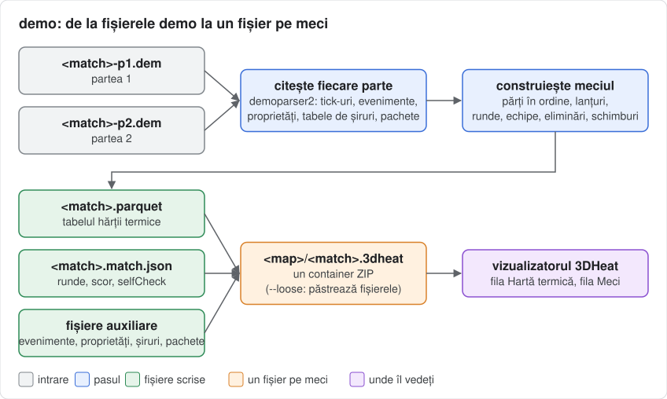

# 3DHeat CS2 {#dheat-cs2}

**Ce este?** Counter-Strike 2 poate salva o înregistrare a unui meci, numită *demo*. Acest
instrument transformă un demo în fișiere pe care vizualizatorul 3DHeat le poate arăta în 3D:
unde a stat fiecare, unde a murit, a aruncat și a plantat, rundă cu rundă. Poate transforma și o
hartă CS2 într-un model 3D, peste care aceste date să fie arătate.

**De ce l-aș folosi?** Ca să revizuiți propriile meciuri, ca să suprapuneți multe meciuri de pe aceeași
hartă într-o singură hartă termică și pentru statistici de meci, precum ADR (daunele medii pe rundă) și
KAST (procentul de runde în care un jucător a eliminat, a asistat, a supraviețuit sau a fost răzbunat).

**Exemplu:** `alpha-vs-bravo-m1.dem` intră, `out/de_x/alpha-vs-bravo-m1.3dheat` iese
(`de_x` este un nume de hartă inventat).



Mai în detaliu: 3DHeat CS2 transformă **demo-urile Counter-Strike 2** într-un tabel de hartă termică și
un document de meci pentru fiecare meci, iar o **hartă CS2** într-o geometrie de nivel. Rezultatele sunt
făcute pentru [3DHeat](https://holdi601.github.io/3DHeat/), vizualizatorul de telemetrie
([sursa](https://github.com/Holdi601/3DHeat)), dar sunt fișiere obișnuite - Parquet, JSON și glTF binar - pe care
le poate citi orice alt program.

Este un pachet Python mic, `heat3d_cs2`, rulat din linia de comandă. Citește demo-urile de pe disc (nu descarcă
niciunul) cu [demoparser2](https://github.com/LaihoE/demoparser), și exportă hărțile din jocul instalat cu
versiunea de linie de comandă a Source2Viewer ([ValveResourceFormat](https://github.com/ValveResourceFormat/ValveResourceFormat)).

## Pornire rapidă {#quick-start}

Nu ați mai lucrat în linia de comandă? Citiți mai întâi [Înainte de a începe](before-you-start.md).

```bash
pip install -r requirements.txt
python -m heat3d_cs2 demos <demo files or folders> -o out   # every match in them
python -m heat3d_cs2 map <map> -o out/<map>/<map>.glb       # the map from the installed game
python -m heat3d_cs2 scoreboard out/<map>/<match>.3dheat    # a match's scoreboard as text
```

Ar trebui să vedeți `1 match(es), 1 at a time ...` și apoi câte o linie pentru fiecare meci
(vezi [Comenzi](../commands.md#what-is-printed)).

`demos` scrie, pentru fiecare meci, un fișier într-un dosar care poartă numele hărții:
`out/<map>/<match>.3dheat`, un [container `.3dheat`](../output-container.md) - formatul vizualizatorului
pentru un fișier pe meci ([specificația](https://holdi601.github.io/3DHeat/container.html)).
El conține aceste membre; `--loose` le scrie ca fișiere separate:

| Membru | Ce conține | Încărcat în |
|---|---|---|
| `<match>.parquet` (rolul `table`) | fiecare jucător în viață de opt ori pe secundă, cu starea sa (sănătate, bani, orbire, lunetă, zonă, inventar, ...), și fiecare eveniment în momentul în care a avut loc (eliminare, moarte, rănire, foc, aruncare, detonări de grenade, orbire, plantare, dezamorsare, explozie, iar sfârșitul fiecărei runde pentru fiecare jucător cu ce i-a plătit runda), câte un rând fiecare | fila Hartă termică |
| `<match>.match.json` (rolul `match`, documentul de meci) | echipe, scor, fiecare rundă (câștigător, cum, economie, plantare, eliminări în ordine, clutch-uri, supraviețuitori) și linia de scor a fiecărui jucător | fila Meci |
| `<match>.events/props/strings/packets.parquet` | tot restul pe care îl conține demo-ul, întreg (fișiere auxiliare) | păstrat pentru completitudine |

`map` scrie `<map>.glb`: plasa de coliziune a hărții - podele, pereți, cutii, fără decor - împărțită în
sol și structură, în același sistem de coordonate și unități ca tabelele, deci stă exact sub harta termică
(panoul Fundal / nivel).

## Harta acestei documentații {#map-of-this-documentation}

| Pagina | Ce acoperă |
|---|---|
| [Înainte de a începe](before-you-start.md) | Python, un terminal, locurile rezervate, cum arată succesul și erorile frecvente |
| [Instalarea](../installing.md) | Python, pachetele, linia de comandă a Source2Viewer, unde trebuie să fie CS2 |
| [Comenzi](../commands.md) | `demos`, `map`, `scoreboard`: fiecare opțiune, ce se afișează, codurile de ieșire |
| [Citirea unui demo](../reading-demos.md) | ce se citește dintr-un fișier demo: tick-uri eșantionate, proprietățile jucătorilor, regulile jocului, evenimentele |
| [Construirea unui meci](../building-matches.md) | părți și lanțuri, ceasul meciului, rundele, echipele și taberele, rândurile, eliminările, schimburile, deschiderile, daunele, orbirile, economia |
| [Statistici](../statistics.md) | scorul: K/D/A, ADR, KAST, HS%, deschideri, schimburi, multi-eliminări, clutch-uri, utilitare, orbiri |
| [Tabelul hărții termice](../output-table.md) | fișierul Parquet: fiecare coloană, tipul ei, ce evenimente o umplu, indiciile din subsolul `heat3d`, axele |
| [Documentul de meci](../output-match-json.md) | documentul `.match.json`, câmp cu câmp |
| [Un fișier pe meci](../output-container.md) | containerul `.3dheat` pe care îl scrie `demos` implicit, `--loose` |
| [Exportul hărții](../map-export.md) | cum se exportă plasa de coliziune a unei hărți, sistemul de coordonate, numirea nodurilor, unitățile |
| [Folosirea cu 3DHeat](../using-with-3dheat.md) | încărcarea tabelelor, a documentelor de meci și a hărților în filele Heatmap și Match ale vizualizatorului |
| [Limite](../limits.md) | ce se presupune, ce nu este tratat, ce nu este verificat |
| [Actualizări](../updates.md) | verificarea lansării la pornire și `python -m heat3d_update` |
| [Dezvoltare](../development.md) | structura codului, teste, fixture-ul de demo sintetic |
| [Referința comenzilor](../cli-reference.md) | `--help` al fiecărei comenzi, generat din cod |
| [Întreținerea](../maintaining.md) | lista de verificare pentru lansarea acestor pagini |

## Față de ce este verificat {#what-it-is-checked-against}

Demo-urile din natură nu sunt câte un fișier curat pentru fiecare meci. Convertorul tratează un meci
împărțit în mai multe fișiere, în orice ordine, un server repornit în mijlocul meciului, două meciuri
diferite salvate sub același nume, runde restaurate dintr-o copie de rezervă, o înregistrare care începe
târziu sau se termină devreme, pauze și antrenori în tabăra unei echipe - vezi [Construirea unui meci](../building-matches.md).
Verificat pe o colecție mare de demo-uri de turneu: în fiecare meci scorul urmează câștigătorii rundelor,
eliminările unei tabere sunt morțile celeilalte, iar fiecare rundă începe cinci contra cinci.

## Ce să îi dați {#what-to-point-it-at}

Demo-urile meciurilor dumneavoastră, demo-uri descărcate manual de pe un site de turneu sau demo-uri
dintr-un API la care aveți acces. Un demo este o înregistrare al cărui conținut aparține editorului și
organizatorilor săi: folosiți ce iese pentru propria analiză și nu redistribuiți demo-urile sau datele
derivate din ele. Site-urile care oferă demo-uri interzic adesea în termenii lor descărcarea automată,
motiv pentru care instrumentul citește demo-urile de pe disc și nu descarcă niciunul.

## Parte din 3DHeat {#part-of-3dheat}

3DHeat CS2 este unul dintre instrumentele gratuite din jurul vizualizatorului 3DHeat, fiecare cu propriul
depozit, propriile lansări și propria licență:

| Instrument | Ce face | Documentație |
|---|---|---|
| [3DHeat](https://github.com/Holdi601/3DHeat) | vizualizatorul: hărți termice, analiza cursei și revizuirea meciului în 3D | [site](https://holdi601.github.io/3DHeat/) |
| [GameFiles](https://github.com/Holdi601/3DHeat-GameFiles) | circuite și nivele din fișierele livrate de jocuri, ca modele 3D | [site](https://holdi601.github.io/3DHeat-GameFiles/) |
| [GameCapture](https://github.com/Holdi601/3DHeat-GameCapture) | telemetria turelor din jocurile de curse; nivele reconstruite din videoclipuri de joc | [site](https://holdi601.github.io/3DHeat-GameCapture/) |
| [Unreal Exporter](https://github.com/Holdi601/3DHeat-UnrealExporter) | un plugin pentru Unreal Editor care exportă un nivel ca un singur model 3D | [site](https://holdi601.github.io/3DHeat-UnrealExporter/) |
| [CS2](https://github.com/Holdi601/3DHeat-CS2) | demo-uri Counter-Strike 2 în tabele și documente de meci; hărți în modele 3D | [site](https://holdi601.github.io/3DHeat-CS2/) |
| [Watcher](https://github.com/Holdi601/3DHeat-Watcher) | înregistrează, în fundal, ce publică jocurile despre jocul dumneavoastră | [site](https://holdi601.github.io/3DHeat-Watcher/) |
| [Ext-WarThunder](https://github.com/Holdi601/3DHeat-Ext-WarThunder) | replay-uri War Thunder în tabele și documente de meci | [site](https://holdi601.github.io/3DHeat-Ext-WarThunder/) |
| [Ext-WoT](https://github.com/Holdi601/3DHeat-Ext-WoT) | replay-uri World of Tanks în tabele și documente de meci | [site](https://holdi601.github.io/3DHeat-Ext-WoT/) |
| [Ext-WoWs](https://github.com/Holdi601/3DHeat-Ext-WoWs) | replay-uri World of Warships în tabele și documente de meci | [site](https://holdi601.github.io/3DHeat-Ext-WoWs/) |
| [Ext-Squad](https://github.com/Holdi601/3DHeat-Ext-Squad) | demo-uri de server Squad în tabele și documente de meci | [site](https://holdi601.github.io/3DHeat-Ext-Squad/) |
| [Ext-DCS](https://github.com/Holdi601/3DHeat-Ext-DCS) | hărțile DCS World în modele 3D | [site](https://holdi601.github.io/3DHeat-Ext-DCS/) |
| [Ext-IL2](https://github.com/Holdi601/3DHeat-Ext-IL2) | hărțile IL-2 Sturmovik în modele 3D | [site](https://holdi601.github.io/3DHeat-Ext-IL2/) |

## Licență {#licence}

MIT - vezi [`LICENSE`](https://github.com/Holdi601/3DHeat-CS2/blob/main/LICENSE),
și [`LICENSES.md`](https://github.com/Holdi601/3DHeat-CS2/blob/main/LICENSES.md)
pentru pachetele terțe și pentru ce obligă jocurile pe care le citește.
