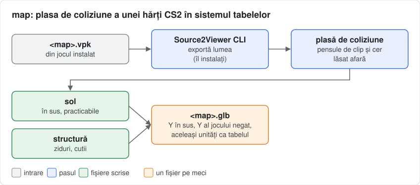

# Exportul hărții (`map`) {#map-export-map}

`python -m heat3d_cs2 map <map> -o <file.glb>` scrie o hartă CS2 ca geometrie de nivel:
**plasa de coliziune** a lumii, în sistemul de coordonate și unitățile în care sunt
desenate [tabelele hărții termice](output-table.md). Cod:
[`heat3d_cs2/mapexport.py`](https://github.com/Holdi601/3DHeat-CS2/blob/main/heat3d_cs2/mapexport.py),
[`heat3d_cs2/glb.py`](https://github.com/Holdi601/3DHeat-CS2/blob/main/heat3d_cs2/glb.py).
Opțiuni și mesaje: [Comenzi](commands.md#map---a-maps-geometry-as-glb).



## De ce plasa de coliziune {#why-the-collision-mesh}

Plasa de coliziune este ceea ce jucătorii calcă și în spatele căreia se ascund - podele,
pereți, scări, cutii - fără decorul: fără recuzită care doar arată a ceva, fără texturi, cu
mult mai puține triunghiuri decât plasele de randare. Asta are nevoie o hartă termică dedesubt:
ceva de care să se raporteze pozițiile, nu o randare a hărții.

## Cum se obține {#how-it-is-obtained}

1. **Găsește harta.** O cale care se termină în `.vpk` și există este folosită așa cum este.
   Altfel, `<name>.vpk` este căutat în `<folder CS2>\game\csgo\maps\`, unde folderul CS2 este
   `--game`, sau `steamapps\common\Counter-Strike Global Offensive` în fiecare bibliotecă
   Steam găsită (vezi [Instalare](installing.md#where-cs2-is-looked-for)).
2. **Găsește CLI-ul Source2Viewer**: `--source2viewer`, apoi `HEAT3D_SOURCE2VIEWER`, apoi
   `Source2Viewer-CLI` / `Source2Viewer-CLI.exe` în `PATH`.
3. **Exportă fizica lumii.** Source2Viewer este rulat astfel:

   ```text
   Source2Viewer-CLI -i <map>.vpk -d -f maps/<map>/world_physics.vmdl_c --gltf_export_format glb -o <folder temporar>
   ```

   Decodează fizica compilată Source 2 din propria arhivă a hărții și scrie modelul (gol:
   lumea nu are o plasă de randare proprie) și fizica sa alături. Cel mai mare `.glb` scris
   este fizica. Dacă Source2Viewer eșuează sau nu scrie niciun `.glb`, comanda se oprește și
   arată ultimele 800 de caractere din ieșirea și erorile sale.
4. **Citește-l.** Fiecare nod al scenei este parcurs cu transformarea sa (matrice, sau
   translație-rotație-scară), iar fiecare primitivă de triunghiuri este luată, cu sau fără
   buffer de indici, în poziții din lume.
5. **Lasă deoparte ce nu este perete sau podea.** Un nod al cărui nume conține `clip` -
   clipurile pentru jucători, clipurile pentru NPC-uri, clipurile pentru grenade: pereții
   invizibili care opresc jucătorii și grenadele - sau `sky`, oricare ar fi majusculele, este
   aruncat.
6. **Numește suprafața.** Grupurile de fizică sunt numite după suprafața lor; numele cu
   litere mici, fără prefixul `physics`, `physics_group` sau `physics_passbullets` (și
   subliniatul de după el), este suprafața: `physics_group_concrete` este `concrete`,
   `physics_passbullets_chainlink` este `chainlink`, iar un `physics_group` simplu este
   `world`. Suprafețele prin care trec gloanțele sunt păstrate.
7. **Înapoi în sistemul jocului.** Source2Viewer scrie glTF în metri, cu Y în sus: (Y, Z, X)
   ale jocului înmulțit cu 0,0254. Asta se anulează - fiecare punct devine (X, Y, Z) ale
   jocului, în inchi.
8. **Împarte solul de structură**, triunghi cu triunghi: o față a cărei normală arată în sus
   cu cel puțin 0,7 (componenta sa Z, normalizată) - pante de până la aproximativ 45 de grade,
   cam cea mai abruptă pantă pe care o urcă un jucător CS2 - este **sol**; orice altceva,
   inclusiv pereții și tavanele, este **structură**.
9. **În sistemul vizualizatorului.** Fiecare punct este scris ca (X, Z, -Y): Y în sus, Y al
   jocului negat - sistemul în care vizualizatorul desenează tabelele, când urmează sugestiile
   lor `heat3d`. O rotație, nu o oglindire.
10. **Scrie `.glb`-ul.** Dacă nu rămâne nimic (doar clipuri de coliziune), comanda se oprește
    cu o eroare. Altfel afișează fișierul, harta, numărul de triunghiuri, câte sunt sol și
    numărul de părți.

Nimic de aici nu citește altceva decât `.vpk`-ul propriu al hărții, iar nimic din
Source2Viewer nu este inclus sau copiat.

## Fișierul {#the-file}

Un glTF 2.0 binar (`.glb`), un singur buffer, scris de `heat3d_cs2` (`asset.generator`):

| Aspect | Ce este |
|---|---|
| Noduri | unul pentru fiecare parte, toate în rădăcină, fără transformări, fiecare cu propria plasă cu același nume |
| Numele nodurilor | `ground:<suprafață>` sau `structure:<suprafață>` (`ground:concrete`, `structure:metal`, `structure:world`), sortate după nume |
| Primitive | una pentru fiecare plasă, triunghiuri, `POSITION` (float32, cu min/max) și `NORMAL` (float32), indici `uint32` |
| Umbrire | plată: un vârf pentru fiecare colț de triunghi, fiecare cu normala triunghiului său |
| Materiale, texturi, UV-uri, culori | niciuna |
| Unități | unități de joc (**inchi**), nu metri - spre deosebire de ce presupune glTF |
| Sistem de coordonate | (X, Z, -Y) ale jocului: Y-ul glTF este înălțimea jocului, Z-ul glTF este -Y-ul jocului |

Prefixul `ground:` / `structure:` este convenția tuturor exportatorilor de nivel 3DHeat:
vizualizatorul ia o parte numită așa drept adevărată, în loc să ghicească după geometrie,
astfel că podelele primesc umbrirea de sol, iar pereții desenul de structură, fără niciun pas
de clasificare.

Pentru că unitățile sunt inchi, un alt vizualizator glTF arată harta de aproximativ 39 de ori
prea mare (o citește ca metri); dacă contează, înmulțește cu 0,0254 acolo. În 3DHeat se
află exact sub tabel, care este în aceleași unități cu scara 1.

## Verificarea că sistemul de coordonate este corect {#the-check-that-the-frame-is-right}

Testul `test_players_stand_on_the_exported_floor` (rulat doar când sunt date un demo și
Source2Viewer, vezi [Dezvoltare](development.md#tests)) exportă harta pe care s-a jucat un demo,
ia 300 de eșantioane aleatoare de poziție ale meciului și, pentru fiecare, se uită drept în
jos după cel mai înalt triunghi de sol aflat cel mult 4 unități deasupra picioarelor
jucătorului. Cere ca cel puțin 98 % din eșantioane să găsească sol și ca înălțimea mediană
deasupra lui să fie sub 5 unități. O hartă oglindită pică testul: pe o hartă oglindită pe
axa greșită, o mare parte a jucătorilor stau deasupra nimicului. README-ul raportează cifrele
acestei verificări pentru hărțile actualului pool competitiv.

## Ce nu face {#what-it-does-not-do}

- Nicio geometrie de randare, texturi sau decor - vezi *de ce* de mai sus.
- Doar ce există în modelul `world_physics` al hărții este exportat. Dacă piesele mobile
  (uși) sau cele care se sparg sunt în el, nu a fost verificat.
- Nicio simplificare: vizualizatorul 3DHeat simplifică la import cu setarea sa **Ținta
  simplificării**.
- Hărțile care nu sunt în jocul instalat (hărți de atelier aflate în alt loc pe disc)
  funcționează când `.vpk`-ul lor este dat ca cale și conține
  `maps/<name>/world_physics.vmdl_c`; nu este verificat.
