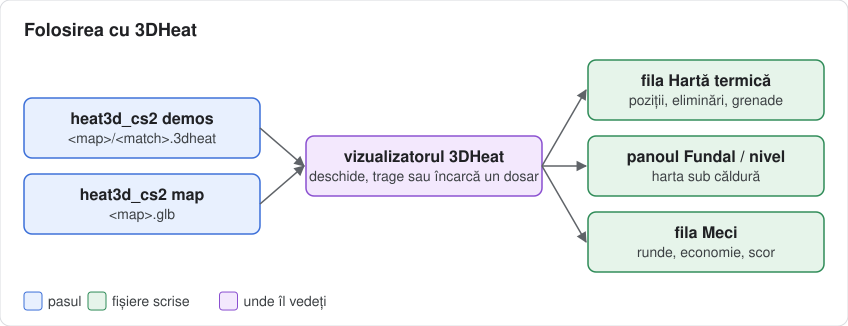

# Utilizarea cu 3DHeat {#using-it-with-3dheat}

Rezultatele intră în aceste locuri ale
[vizualizatorului 3DHeat](https://holdi601.github.io/3DHeat):

| Fișier | Unde | Ce oferă |
|---|---|---|
| `<meci>.3dheat` (implicit) | fila **Hartă termică**, panoul **Sursă**, sau fila **Meci** | tabelul și documentul meciului împreună, un fișier pentru fiecare meci ([container](https://holdi601.github.io/3DHeat/container.html)) |
| `<meci>.parquet` | fila **Hartă termică**, panoul **Sursă** | pozițiile și evenimentele ca hartă termică, replay în cutie, trasee |
| `<meci>.match.json` | fila **Meci**, **Încărcați fișiere de meci…** | tabelul de scor, rundele, fluxul eliminărilor, statistici între meciuri, legături către harta termică |
| `<map>.glb` | panoul **Fundal / nivel**, **Model 3D…** | harta sub harta termică |

Documentația vizualizatorului descrie fiecare filă în întregime: paginile sale
[Analiza meciului](https://holdi601.github.io/3DHeat/match-analysis.html),
[Încărcarea fișierelor](https://holdi601.github.io/3DHeat/loading-files.html),
[Maparea coloanelor](https://holdi601.github.io/3DHeat/column-mapping.html) și
[Replay în cutie](https://holdi601.github.io/3DHeat/box-replay.html). Această pagină este
partea CS2 a ei.



Vizualizatorul: [github.com/Holdi601/3DHeat](https://github.com/Holdi601/3DHeat),
documentația [holdi601.github.io/3DHeat](https://holdi601.github.io/3DHeat/).

## O sesiune tipică {#a-typical-session}

```bash
python -m heat3d_cs2 demos D:\Demos\event -o out
python -m heat3d_cs2 map <map> -o out/<map>/<map>.glb
```

1. **Fila Hartă termică -> Sursă:** alege folderul `out/<map>` (sau trage-l acolo).
   Fiecare `.parquet` din el devine un set de date; fișierele `.json` și `.glb` din același
   folder sunt sărite ca „not a csv/parquet file”. Încarcă-l.
2. **Fundal / nivel -> Model 3D…:** alege `out/<map>/<map>.glb`.
   **Salvează în bibliotecă** îl păstrează în browser pentru data viitoare.
3. **Fila Meci -> Încărcați fișiere de meci…:** alege fișierele `.match.json` din același
   folder (mai multe deodată), sau trage-le pe vizualizare cât timp fila Meci este deschisă.

Încarcă doar tabelele unei singure hărți odată: coordonatele hărților diferite se suprapun, iar o
hartă termică a două hărți deodată nu înseamnă nimic. Folderul pe hartă există tocmai pentru asta.

## Tabelul se deschide fără nimic de setat {#the-table-opens-with-nothing-to-set}

Vizualizatorul citește intrarea `heat3d` din subsolul primului fișier selectat
([Tabelul hărții termice](output-table.md#the-heat3d-footer-hints)) și o așterne peste propriile
sale presupuneri:

| Setare a vizualizatorului | Se setează la |
|---|---|
| Poziție | `x`, `y`, `z` |
| Axa verticală în sursă | Z este în sus |
| Inversează Y | pornit - harta este în sensul corect, nu oglindită |
| Scara unităților | 1 - distanțele în unități de joc (etichetate „m”; 1 unitate = 1 inch) |
| Timp | `time`, secunde |
| Persoană | `player` |
| Grup | `side` (T / CT) |
| Sesiune | `roundId` - fiecare rundă este o sesiune, `<match> #NN` |
| Direcția privirii | vector, `dirX` / `dirY` / `dirZ` |
| Coloane de filtrare | `event`, `match`, `round`, `roundTime`, `phase`, `weapon`, `place`, `won`, `buy`, `opening`, `team` |
| Dimensiunea entității | 32 - replay-ul în cutie desenează un jucător de 32 de unități lățime, cu o rază de privire de 4 x 32 |

Fiecare valoare sugerată apare încă în maparea coloanelor și poate fi schimbată. Celelalte
coloane (`headshot`, `traded`, `other`, `steamid`, `health`, `money`, `damage`, `duration`, ...)
pot fi adăugate ca filtre acolo, manual.

Ține scara unităților la 1 când este încărcată o hartă: `.glb` este în aceleași unități ale jocului,
iar nivelul nu este redimensionat odată cu tabelul.

### Filtre utile {#useful-filters}

- `event` = `position` pentru unde erau jucătorii; `kill` / `death` pentru unde s-au câștigat și
  pierdut duelurile; `smoke`, `flash`, `molotov`, `he` pentru unde a aterizat utilitarul;
  `throw` pentru de unde a fost aruncat; `plant` pentru locurile de plantare.
- `side` (grupul) = `T` sau `CT`, `phase` = `live` ca să lași afară faza după, `buy` =
  `eco` / `force` / `full` pentru runde dintr-o singură economie, `won` = 1 pentru rundele pe
  care partea rândului le-a câștigat.
- `opening` = 1 cu `kill` și `death` pentru duelurile de deschidere.
- `roundTime` ca un interval pentru un moment al rundei: primele 20 de secunde, post-plantarea.

## Fila Meci {#the-match-tab}

Fila Meci acceptă un fișier JSON al cărui `format` este `heat3d-cs2-match` și care are
șirurile `rounds`, `players` și `teams` ([Documentul meciului](output-match-json.md)). Arată
scorul și reprizele, o bandă de runde colorată după partea câștigătoare, cu un semn pentru cum
s-a încheiat fiecare, economia fiecărei runde, plantarea, fluxul eliminărilor, clutch-urile și
supraviețuitorii, tabelul de scor și statistici peste toate meciurile încărcate.

Legăturile sale **Arată pe harta termică** nu încarcă nimic. Ele setează filtre pe tabelul deja
încărcat în fila Hartă termică - `match`, `round` (și sesiunea rundei `<match> #NN`), `event`,
jucătorul, partea. Asta merge pentru că documentul meciului și tabelul poartă aceleași nume de
meciuri, numere de runde, nume de jucători și părți. **Reluare rundă** trece harta termică pe
replay în cutie și redă sesiunea rundei de la început.

Așadar încarcă amândouă: tabelele unei hărți în fila Hartă termică, documentele lor de meci în
fila Meci. Un document de meci fără tabelul său arată în continuare tabelul de scor și rundele,
iar legăturile spun că nu sunt date de hartă termică încărcate.

## Fără 3DHeat {#without-3dheat}

- Tabelul este Parquet simplu: pandas, Polars, DuckDB, Spark, `arrow` din R îl citesc cu toții,
  intrarea `heat3d` este ignorată, iar coloanele de text se citesc ca șiruri sau ca date categoriale.
- Documentul meciului este JSON simplu.
- Harta este un glTF binar valid, în inchi în loc de metri: înmulțește cu 0,0254 pentru
  instrumentele care presupun metri. Sistemul său de coordonate este cel propriu glTF (Y în sus),
  deci ca să suprapui tabelul în altă parte desenează fiecare rând (x, y, z) ca (x, z, -y), așa
  cum face 3DHeat.
