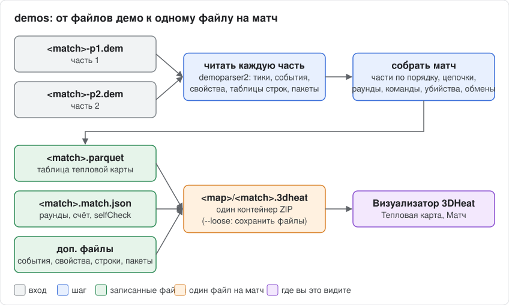

# 3DHeat CS2 {#dheat-cs2}

**Что это?** Counter-Strike 2 может сохранить запись матча, которая называется *демо*. Этот
инструмент превращает демо в файлы, которые просмотрщик 3DHeat может показать в 3D: где стоял каждый
игрок, где погибал, бросал гранаты, ставил и обезвреживал бомбу, раунд за раундом. Он также может
превратить карту CS2 в 3D-модель, на которой эти события будут показаны.

**Зачем это нужно?** Чтобы разбирать свои матчи, накладывать много матчей одной карты друг на друга
как одну тепловую карту, и для статистики матчей, например ADR (средний урон за раунд) и KAST (доля
раундов, в которых игрок убил, помог, выжил или был отомщён).

**Пример:** `alpha-vs-bravo-m1.dem` на входе, `out/de_x/alpha-vs-bravo-m1.3dheat` на выходе (`de_x` —
выдуманное название карты).



Подробнее: 3DHeat CS2 превращает **демо Counter-Strike 2** в таблицу тепловой карты и документ матча
на каждый матч, а **карту CS2** — в геометрию уровня. Результаты сделаны для просмотрщика
[3DHeat](https://holdi601.github.io/3DHeat/) ([исходный код](https://github.com/Holdi601/3DHeat)), но это
обычные файлы — Parquet, JSON и двоичный glTF, — которые может прочитать и что-то другое.

Это небольшой пакет Python `heat3d_cs2`, который запускается из командной строки. Он читает демо с
диска (ничего не скачивает) с помощью [demoparser2](https://github.com/LaihoE/demoparser), а карты
экспортирует из установленной игры командной сборкой Source2Viewer
([ValveResourceFormat](https://github.com/ValveResourceFormat/ValveResourceFormat)).

## Быстрый старт {#quick-start}

Впервые в командной строке? Сначала прочитайте [С чего начать](before-you-start.md).

```bash
pip install -r requirements.txt
python -m heat3d_cs2 demos <demo files or folders> -o out   # каждый матч в них
python -m heat3d_cs2 map <map> -o out/<map>/<map>.glb       # карта из установленной игры
python -m heat3d_cs2 scoreboard out/<map>/<match>.3dheat    # таблица счёта матча как текст
```

Вы увидите `1 match(es), 1 at a time ...` и затем по строке на матч
(см. [Команды](../commands.md#what-is-printed)).

`demos` записывает на каждый матч один файл в папку, названную по карте:
`out/<map>/<match>.3dheat`, [контейнер `.3dheat`](../output-container.md) — формат просмотрщика «один файл
на матч» ([спецификация](https://holdi601.github.io/3DHeat/container.html)). Он содержит такие части;
`--loose` записывает их отдельными файлами:

| Часть | Что в ней | Загружается на |
|---|---|---|
| `<match>.parquet` (роль `table`) | каждый живой игрок восемь раз в секунду с его состоянием (здоровье, деньги, вспышка, прицел, зона, инвентарь, ...), и каждое событие там, где оно произошло (убийство, смерть, урон, выстрел, бросок, взрывы гранат, ослепление, закладка, обезвреживание, взрыв, а также конец раунда для каждого игрока с тем, что раунд ему принёс), по одной строке | вкладка «Тепловая карта» |
| `<match>.match.json` (роль `match`, документ матча) | команды, счёт, каждый раунд (победитель, как, экономика, закладка, убийства по порядку, клатчи, выжившие) и строка счёта каждого игрока | вкладка «Матч» |
| `<match>.events/props/strings/packets.parquet` | всё остальное, что содержит демо, целиком (вспомогательные файлы) | сохраняются для полноты |

`map` записывает `<map>.glb`: сетку коллизий карты CS2 — полы, стены, коробки, без декора — разделённую
на землю и постройки, в той же системе и единицах, что и таблицы, поэтому она точно лежит под тепловой
картой (панель «Фон / уровень»).

## Карта документации {#map-of-this-documentation}

| Страница | Что в ней |
|---|---|
| [С чего начать](before-you-start.md) | Python, терминал, заполнители, как выглядят успех и частые ошибки |
| [Установка](../installing.md) | Python, пакеты, CLI Source2Viewer, где должна быть CS2 |
| [Команды](../commands.md) | `demos`, `map`, `scoreboard`: каждый параметр, что печатается, коды выхода |
| [Чтение демо](../reading-demos.md) | что читается из файла демо: тики, свойства игроков, правила игры, события |
| [Сборка матча](../building-matches.md) | части и цепочки, игровые часы, раунды, команды и стороны, строки, убийства, обмены, открытия, урон, вспышки, экономика |
| [Статистика](../statistics.md) | таблица счёта: K/D/A, ADR, KAST, HS%, открытия, обмены, мультиубийства, клатчи, утилита, вспышки |
| [Таблица тепловой карты](../output-table.md) | файл Parquet: каждый столбец, его тип, какие события его заполняют, подсказки подвала `heat3d`, оси |
| [Документ матча](../output-match-json.md) | документ `.match.json`, поле за полем |
| [Один файл на матч](../output-container.md) | контейнер `.3dheat`, который `demos` пишет по умолчанию, и `--loose` |
| [Экспорт карты](../map-export.md) | как экспортируется сетка коллизий карты, система координат, именование узлов, единицы |
| [Использование с 3DHeat](../using-with-3dheat.md) | загрузка таблиц, документов матча и карт во вкладки «Тепловая карта» и «Матч» просмотрщика |
| [Ограничения](../limits.md) | что предполагается, что не обрабатывается, что не проверено |
| [Обновления](../updates.md) | проверка релиза при запуске и `python -m heat3d_update` |
| [Разработка](../development.md) | структура кода, тесты, синтетическая фикстура демо |
| [Справка по командам](../cli-reference.md) | `--help` каждой команды, создано из кода |
| [Сопровождение](../maintaining.md) | контрольный список выпуска для этих страниц |

## Что это проверено {#what-it-is-checked-against}

Демо из реального мира — это не один чистый файл на матч. Преобразователь справляется с матчем, разбитым по
нескольким файлам в любом порядке, с сервером, перезапущенным посреди матча, с двумя разными матчами
под одним именем, с раундами, восстановленными из резервной копии, с записью, которая начинается
поздно или заканчивается рано, с паузами и тренерами на стороне команды — см.
[Сборка матча](../building-matches.md). Проверено на большом наборе демо турниров: в каждом матче счёт
следует за победителями раундов, убийства каждой стороны — это смерти другой, и каждый раунд начинается
пять на пять.

## На что его направлять {#what-to-point-it-at}

На демо ваших собственных матчей, демо, которые вы скачали вручную с турнирного сайта, или демо из API,
к которому у вас есть доступ. Демо — это запись, содержание которой принадлежит её издателю и
организаторам: используйте результат для собственного анализа и не распространяйте демо или данные,
полученные из них. Сайты, которые предлагают демо, часто запрещают автоматическую загрузку в своих
условиях, поэтому инструмент читает демо с диска и ничего не скачивает.

## Часть 3DHeat {#part-of-3dheat}

3DHeat CS2 — один из бесплатных инструментов вокруг просмотрщика 3DHeat; у каждого свой репозиторий,
свои выпуски и своя лицензия:

| Инструмент | Что делает | Документация |
|---|---|---|
| [3DHeat](https://github.com/Holdi601/3DHeat) | просмотрщик: тепловые карты, анализ заездов и разбор матчей в 3D | [сайт](https://holdi601.github.io/3DHeat/) |
| [GameFiles](https://github.com/Holdi601/3DHeat-GameFiles) | трассы и уровни из файлов, которые поставляют игры, как 3D-модели | [сайт](https://holdi601.github.io/3DHeat-GameFiles/) |
| [GameCapture](https://github.com/Holdi601/3DHeat-GameCapture) | телеметрия кругов из гоночных игр; уровни, восстановленные по видео игры | [сайт](https://holdi601.github.io/3DHeat-GameCapture/) |
| [Unreal Exporter](https://github.com/Holdi601/3DHeat-UnrealExporter) | плагин редактора Unreal, который экспортирует уровень как одну 3D-модель | [сайт](https://holdi601.github.io/3DHeat-UnrealExporter/) |
| [CS2](https://github.com/Holdi601/3DHeat-CS2) | демо Counter-Strike 2 в таблицы и документы матчей; карты в 3D-модели | [сайт](https://holdi601.github.io/3DHeat-CS2/) |
| [Watcher](https://github.com/Holdi601/3DHeat-Watcher) | записывает то, что игры публикуют о вашей игре, в фоне | [сайт](https://holdi601.github.io/3DHeat-Watcher/) |
| [Ext-WarThunder](https://github.com/Holdi601/3DHeat-Ext-WarThunder) | реплеи War Thunder в таблицы и документы матчей | [сайт](https://holdi601.github.io/3DHeat-Ext-WarThunder/) |
| [Ext-WoT](https://github.com/Holdi601/3DHeat-Ext-WoT) | реплеи World of Tanks в таблицы и документы матчей | [сайт](https://holdi601.github.io/3DHeat-Ext-WoT/) |
| [Ext-WoWs](https://github.com/Holdi601/3DHeat-Ext-WoWs) | реплеи World of Warships в таблицы и документы матчей | [сайт](https://holdi601.github.io/3DHeat-Ext-WoWs/) |
| [Ext-Squad](https://github.com/Holdi601/3DHeat-Ext-Squad) | демо серверов Squad в таблицы и документы матчей | [сайт](https://holdi601.github.io/3DHeat-Ext-Squad/) |
| [Ext-DCS](https://github.com/Holdi601/3DHeat-Ext-DCS) | карты DCS World в 3D-модели | [сайт](https://holdi601.github.io/3DHeat-Ext-DCS/) |
| [Ext-IL2](https://github.com/Holdi601/3DHeat-Ext-IL2) | карты IL-2 Sturmovik в 3D-модели | [сайт](https://holdi601.github.io/3DHeat-Ext-IL2/) |

## Лицензия {#licence}

MIT — см. [`LICENSE`](https://github.com/Holdi601/3DHeat-CS2/blob/main/LICENSE), а также
[`LICENSES.md`](https://github.com/Holdi601/3DHeat-CS2/blob/main/LICENSES.md) о сторонних пакетах и о
том, что требуют игры, которые он читает.
