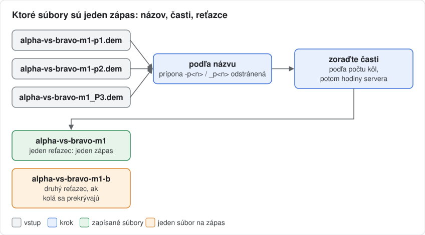

# Zostavenie zápasu {#building-a-match}

Ako vzniká zápas z jeho častí demo: ktoré súbory patria k sebe, jeden čas
pre všetky, kolá a ako sa v každom vyhralo, tímy a ich strany a každý riadok
tabuľky heatmapy so zabitiami, odvetami, otváracími zabitiami, poškodením,
oslepeniami a ekonomikou. Kód:
[`heat3d_cs2/match.py`](https://github.com/Holdi601/3DHeat-CS2/blob/main/heat3d_cs2/match.py).
Štatistika z neho spočítaná je na stránke [Štatistika](statistics.md).

## Prehľad {#overview}

1. Načíta sa každý súbor s menom zápasu ([Čítanie dema](reading-demos.md)).
2. Vyriešia sa duplicitné riadky hráčov každého súboru (obnovené kolá).
3. Súbory sa zoradia do **reťazcov** - zápasov - a každý reťazec sa dá do
   poradia.
4. Každá časť sa zaradí na **zápasové hodiny**.
5. V každej časti sa nájdu **kolá**; neskoršia časť prepíše zápis kola z
   predchádzajúcej.
6. Pomenujú sa **hráči** a **tímy** a strany a skóre každého kola sa uvedú
   podľa názvu tímu. Keď sú známe strany, dá sa určiť dĺžka polčasu, pistolové
   kolá a **nákup** každej strany.
7. Vytvoria sa **riadky**: pozície, výstrely, hody, výbuchy, položenia bomby,
   zneškodnenia, zabitia, smrti, zranenia, oslepenia, explózie.
8. Každý riadok dostane svoje kolo, fázu, čas v kole, informáciu, či jeho strana
   kolo vyhrala, a nákup svojej strany; riadky mimo všetkých kôl sa vynechajú.

## Obnovené kolá: jeden riadok na hráča a tik {#restored-rounds-one-row-per-player-per-tick}

Keď sa kolo obnoví zo zálohy v rámci jedného súboru, demo nesie staré telá
hráčov spolu s novými niekoľko sekúnd: dva riadky pre jedného hráča v jednom
tiku - jeden tam, kde ho zrušené kolo nechalo, a jeden na mieste oživenia v
obnovenom kole. Pre každého takého hráča sa zdvojené tiky prechádzajú
**spätne** od prvého jedinečného riadku za nimi: v každom tiku sa ponechá
kandidát najbližší k pozícii, ktorá nasleduje, a ten sa stane referenciou pre
predchádzajúci tik. Ak za nimi nie je jedinečný riadok, ponechá sa posledný
kandidát. Každý hráč teda zostane s riadkom, ktorý vedie ďalej, kam pôjde.

## Živá časť súboru {#the-live-part-of-a-file}

**Živý začiatok** súboru je tik jeho poslednej udalosti
`round_announce_match_start`, alebo tik 0, ak žiadnu nemá (neskoršia časť
rozdeleného zápasu zvyčajne žiadnu nemá). Všetko pred živým začiatkom sa
vynechá, a rovnako všetko označené `is_warmup_period`. Nožové kolo alebo
reštart pred oznámením sa preto vynechajú; nožové kolo, za ktorým *nenasleduje*
oznámenie začiatku zápasu, sa nerozpozná ako nožové (pozrite [Obmedzenia](limits.md)).

**Kolá** súboru sú udalosti `round_freeze_end` od živého začiatku, mimo
rozcvičky, identifikované podľa `total_rounds_played` (0-základný index kola,
ktoré sa má hrať, ako ho počíta hra). Súbor bez nich nemá kolá a nepatrí do
žiadneho zápasu.

## Hodiny {#the-clock}

Časy sú v sekundách. V rámci súboru sa čas počíta v **tikoch**: `game_time`
servera v prvom vzorkovanom tiku plus tiky od neho / 64. Čas samotného servera
pri pauze stojí, zatiaľ čo tiky bežia ďalej; keby sa čítal z hodín, dva
okamihy pozastavenia zápasu by mali rovnaký čas.

Každý súbor má *prvé hodiny* (čas v jeho živom začiatku) a *posledné hodiny*
(v jeho poslednom vzorkovanom tiku).

### Časti a reťazce {#parts-and-chains}

Súbory pomenované ako jeden zápas ([Príkazy](commands.md#which-files-are-one-match))
sa najprv zoradia podľa indexu ich prvého kola a potom podľa prvých hodín. Potom
sa každý v tomto poradí pripojí k prvému reťazcu, ktorý pokračuje, alebo
začne nový reťazec. Časť pokračuje reťazec, keď index jej prvého kola je aspoň
posledný index poslednej časti reťazca **a zároveň** platí jedno z toho:

- beží hodiny servera: jej prvé hodiny nie sú skôr ako posledné hodiny reťazca
  mínus 5 s; alebo
- beží počet kôl: jej prvý index kola je posledný index reťazca alebo ten
  nasledujúci.

Rozhoduje počet kôl a hodiny rozhodnú zhody, lebo server reštartovaný kvôli
obnove kola začne hodiny odznova, kým dva rôzne zápasy pod jedným menom (tie
isté tímy na tej istej mape na dvoch podujatiach) majú prekrývajúce sa počty
kôl. Reťazce sa radia podľa počtu kôl, ktoré pokrývajú, od najväčšieho; prvý si
ponechá názov zápasu, ostatné sa zapíšu ako `<názov>-b`, `<názov>-c`, ...

### Hodiny zápasu {#the-match-clock}

Nula zápasu je prvé hodiny prvej časti: **čas zápasu 0 je živý začiatok prvého
súboru**. Každá ďalšia časť sa zaradí k nemu takto:

- kde hodiny servera bežia ďalej (jeho prvé hodiny nie sú skôr ako posledné
  hodiny predchádzajúcej časti mínus 5 s), použijú sa hodiny servera tak, ako
  sú;
- kde boli reštartované, časť sa zaradí tak, aby nasledovala **jednu sekundu**
  po skončení predchádzajúcej časti.

## Kolá {#rounds}

Pre každý `round_freeze_end` časti (v poradí tikov) okno kola končí pri
ďalšom konci zmrazenia v tej istej časti, alebo na konci súboru. V ňom sa kolo
**rozhodne** v prvom vzorkovanom tiku, kde herný stav ukazuje
`total_rounds_played` = index kola + 1 a `round_win_status` 1 (remíza), 2 (T
vyhrali) alebo 3 (CT vyhrali). Kolo bez takejto vzorky vo svojom okne bolo
prerušené koncom súboru; jeho číslo sa zapíše do zoznamu **neúplných** kôl
zápasu (pokiaľ iná časť nemá kolo úplné).

| Pole kola | Z čoho |
|---|---|
| `number` | index + 1 (od 1, ako ho počíta hra) |
| `start` | čas zápasu, keď sa skončil čas zmrazenia - hráči sa môžu hýbať |
| `end` | čas zápasu prvej vzorky, ktorá ukazuje kolo rozhodnuté |
| `until` | čas zápasu nasledujúceho `round_prestart` po `end`, ak je v okne; inak koniec okna alebo posledný tik súboru, podľa toho, čo nastane skôr (a nikdy skôr ako `end`) |
| `winner` | `T` pre stav výhry 2, `CT` pre 3, prázdne pre 1: remíza je rozhodnutá, bez víťaza |
| `reason` | `round_win_reason` v tej vzorke, pomenovaný ako nižšie |
| `score` | názov tímu -> kolá vyhraté po tomto: `team_rounds_total` každej strany v rozhodujúcej vzorke; kde ho demo nemá, skóre predchádzajúceho kola plus jedna pre víťaza |
| `sides` | názov tímu -> `T` / `CT` v tomto kole |
| `equipment` | strana -> súčet `current_equip_value` **živých** hráčov tej strany v prvej vzorke na konci zmrazenia alebo po ňom |
| `buy` | strana -> `pistol`, `eco`, `force` alebo `full` ([Ekonomika](#economy-and-buy-types)) |
| `plant` | prvé `bomb_planted` po konci zmrazenia a až do `end`, alebo žiadne |
| `exploded` | čas zápasu prvého `bomb_exploded` po tom položení a pred ďalším koncom zmrazenia, ak nejaký je (nie je v dokumente zápasu; časuje riadok `explode`) |

`reason`, z `CSRoundEndReason` hry:

| Kód | `reason` |
|---|---|
| 1 | `bomb` (cieľ vybuchol) |
| 7 | `defuse` (zneškodnenie) |
| 8, 9 | `elimination` (CT vyhrali / T vyhrali likvidáciou) |
| 10 | `draw` (remíza) |
| 12 | `time` (cieľ zachránený) |
| 17, 18 | `surrender` (vzdanie) |
| čokoľvek iné | `other` |

Keď viac častí obsahuje to isté kolo (podľa indexu), ponechá sa verzia z
neskoršej časti. Kolá sa potom vypíšu podľa indexu. Zápas, ktorého prvé kolo
nie je kolo 1, zaznamená chýbajúce čísla (`missing` v dokumente zápasu); riadok
príkazu hovorí *zaznamenané od kola N*.

### Položenie bomby {#the-plant}

| Pole | Z čoho |
|---|---|
| `site` | `A` alebo `B`: bombová zóna, v ktorej podľa hry stál kladač (`which_bomb_zone`, 1 A, 2 B); bez nej názov miesta kladača (`BombsiteA`, `BombsiteB`); bez toho písmeno, ktoré dalo iné položenie v tom istom súbore na tej istej zóne (`site` udalosti je číslo entity zóny). Prázdne, keď nič nehovorí - nikdy nie číslo. |
| `time` | sekundy **v kole** (od jeho konca zmrazenia), ako čas zabitia |
| `player`, `steamid` | kladač |
| `x`, `y`, `z` | pozícia kladača v herných jednotkách: kde bomba leží |
| `place` | názov miesta kladača pri položení |

### Fázy {#the-phases}

Čas od `start` do `end` je **živá** fáza kola; od `end` do `until` jeho
**fáza po skončení**, keď víťazi hľadajú a porazení zachraňujú. Riadok patrí
kolu, ktorého `[start, until)` obsahuje jeho čas, a je `after`, keď jeho čas je
neskorší ako `end`. Čas zmrazenia leží medzi kolami a nepatrí do žiadneho.

## Hráči a tímy {#players-and-teams}

**Hráč** je každý, kto bol aspoň raz nažive na niektorej strane (tím 2 alebo
3), mimo času zmrazenia a rozcvičky, po živom začiatku. Tréner alebo
komentátor na strane tímu nikdy nie je nažive a nie je hráč. Každý hráč je
kľúčovaný Steam ID; meno je to, ktoré sa naposledy videlo.

**Tím** hráča je názov klanu, ktorý hra dala jeho strane (`team_clan_name`),
ten, ktorý sa pri ňom videl najčastejšie - demo ho na samom konci vymaže. Zápas
hraný bez názvov klanov pomenuje tímy podľa strany, na ktorej začali:
`Started T` a `Started CT`.

**Strany** každého kola vyplynú z toho, kto bol na ktorej strane od konca
zmrazenia po koniec kola: každá strana dostane označenie tímu, ktoré nesie
väčšina jej hráčov. Zoznam `teams` zápasu je v poradí výskytu, kolo po kole,
strana T pred CT; zvyčajne je prvý tím, ktorý začal na T.

## Riadky {#the-rows}

Každá vzorka pozície a každá udalosť sa stane jedným riadkom
[tabuľky heatmapy](output-table.md). Hráči sú na strane len vtedy, keď ich
`team_num` je 2 alebo 3.

### Pozície {#positions}

Z vzorkovaných riadkov živých hráčov na jednej strane, mimo času zmrazenia a
rozcvičky, po živom začiatku: pozícia, smer pohľadu, zdravie, pancier, peniaze,
hodnota výbavy, držaná zbraň, miesto.

Smer pohľadu je jednotkový vektor v rámci hry:
`(cos pitch * cos yaw, cos pitch * sin yaw, -sin pitch)` - pitch hry je kladný,
keď sa hráč pozerá nadol, takže pohľad nadol dá zápornú Z.

Držaná zbraň je `active_weapon_name` tak, ako ju hra pomenúva, s jedinou
výnimkou: každý názov obsahujúci `Knife`, `Bayonet`, `Karambit` alebo `Daggers`
sa stane `Knife`.

### Výstrely a hody {#shots-and-throws}

Z `weapon_fire`, na pozícii strelca. Nože (`knife`, `bayonet` v identifikátore
zbrane) a C4 sa vynechajú. Granáty (`smokegrenade`, `flashbang`, `hegrenade`,
`molotov`, `incgrenade`, `decoy`) sú riadky **hodu**, všetko ostatné riadky
**výstrelu**. Zbraň sa uvádza tak, ako ju hra ukazuje (nižšie).

### Výbuchy granátov {#grenade-detonations}

| Udalosť | Riadok | `weapon` |
|---|---|---|
| `smokegrenade_detonate` | `smoke` | Smoke Grenade |
| `flashbang_detonate` | `flash` | Flashbang |
| `hegrenade_detonate` | `he` | High Explosive Grenade |
| `inferno_startburn` (molotov a zápalná) | `molotov` | Molotov |
| `decoy_detonate` | `decoy` | Decoy Grenade |

Pozícia je **kde granát vybuchol** (udalosťové `x`, `y`, `z`); hráč a strana sú
hádzajúceho. Demo pre granát nepomenúva miesto, iba pre hráčov, takže `place`
zostane prázdne: riadok nepripisuje miesto, na ktorom nebol. Miesto hádzajúceho
v tom okamihu sa uloží ako `throwerPlace`.

### Položenia a zneškodnenia {#plants-and-defuses}

Riadky `plant` a `defuse` na pozícii hráča, zbraň `C4 Explosive`. Položená
bomba, ktorá vybuchla, dostane riadok **explode**: na pozícii položenia, v čase
`bomb_exploded`, kladač ako hráč (s jeho Steam ID), strana `T`, tím T kola ako
`team` a miesto položenia. Patrí sem aj bomba, ktorá vybuchne potom, čo T už
vyhrali likvidáciou. Kde demo nemá `bomb_exploded`, kolo vyhrané bombou
(`reason` = `bomb`) s položením dostane riadok na `end` kola.

### Zabitia a smrti {#kills-and-deaths}

Každý `player_death` v kole dá jeden **záznam o zabití** (tabuľka `kill`
zápasu) s:

| Pole | Je |
|---|---|
| attacker, victim, assister | mená, Steam ID, strany; útočník je prázdny pre svet (pád, bomba) |
| `weapon` | zbraň udalosti, pomenovaná tak, ako ju hra ukazuje |
| `headshot` | príznak udalosti |
| `wallbang` | `penetrated` > 0 |
| `throughSmoke` | `thrusmoke` |
| `flashAssist` | `assistedflash` |
| `noscope`, `attackerBlind` | príznaky udalosti (`noscope`, `attackerblind`); stĺpce riadkov `kill` a `death` a v zabitiach dokumentu zápasu |
| `suicide` | útočník a obeť sú ten istý hráč: napríklad vlastný granát |
| `teamkill` | útočník a obeť na tej istej strane, s útočníkom, a nie samovražda |
| `opening` | prvé zabitie nepriateľa v kole (nižšie) |
| `traded`, `trade` | nižšie |
| pozície | pozícia a miesto útočníka a obete |

Z každého záznamu dostane tabuľka riadok **death** na pozícii obete (každú
smrť, aj smrť spôsobenú svetom, tímovým zabitím a samovraždou) a - pri
zabitiach nepriateľom (je útočník, nie tímové zabitie, nie samovražda) - riadok
**kill** na pozícii zabijaka.

**Otvorenie.** Prvé zabitie nepriateľa v každom kole, kým je kolo živé, je jeho
otváracia dvojboj. Tímové zabitie, samovražda alebo smrť spôsobená svetom pred
ním sa preskočí, takže otvorenie je stále prvý dvojboj kola; kolo bez zabitia
nepriateľa počas živej fázy žiadne otvorenie nemá.

**Odveta (traded) a odvetné zabitie (trade).** Smrť nepriateľom je **odvetená**
(`traded`), keď jej zabijaka zabije niekto zo strany obete do **5 sekúnd** po
nej (viac ako 0 a najviac 5 s neskôr, v tom istom kole); prvé takéto zabitie je
**odvetné zabitie** (`trade`). V tabuľke je stĺpec `traded` riadku `kill` 1 pre
odvetné zabitie; riadku `death` 1 pre smrť, ktorá bola odvetená. Rátajú sa aj
zabitia z fázy po skončení.

### Poškodenie {#damage}

Z `player_hurt`, len medzi **nepriateľmi** (obaja na strane, rôzne strany).
Poškodenie je zdravie skutočne **stratené**: pre každú obeť v každom kole
zdravie začína na 100; každý zásah sa počíta ako `min(dmg_health, zdravie pred
zásahom)` a `health` z udalosti (čo zostalo) sa stane "pred" pre ďalší zásah.
Zásah 137 poškodením hlavou na hráča s 40 zdravia sa počíta ako 40, ako to
počíta hrací výsledok hry. Zásahy z `hegrenade`, `inferno`, `molotov` a
`incgrenade` sú **poškodenie výbušninou**. Každý zásah je riadok **hurt** na
pozícii obete, útočník ako `other`. Poškodenie spojencov a sebapoškodenie nie
sú ani v tabuľke, ani v štatistike.

### Oslepenia {#flashes}

Z `player_blind`, len **nepriatelia** (nie spoluhráči a nie tréner ani
komentátor, ktorý sleduje): jeden riadok **blind** na každého oslepeného
hráča, na pozícii oslepeného hráča, bleskovač ako `other`, dĺžka oslepenia v
sekundách ako `duration`. Každá dĺžka sa zachová; štatistika počíta len
oslepenia aspoň jednu sekundu.

## Názvy zbraní {#weapon-names}

Identifikátor zbrane z udalosti (`ak47`, `weapon_ak47`, `knife_karambit`) sa
zobrazí tak, ako ho hra pomenúva v poli `active_weapon_name` hráčov, takže
zabíjacia zbraň a držaná zbraň sa čítajú rovnako: `ak47` -> `AK-47`, `m4a1` ->
`M4A4`, `m4a1_silencer` -> `M4A1-S`, `hkp2000` -> `P2000`, `taser` -> `Zeus
x27`, `inferno` a `molotov` -> `Molotov`, `incgrenade` -> `Incendiary Grenade`,
`c4` a `planted_c4` -> `C4 Explosive`, `world` -> `World`, a tak ďalej pre každú
zbraň a granát (tabuľka `WEAPONS` v `match.py`). Čokoľvek s `knife` alebo
`bayonet` v identifikátore je `Knife`. Identifikátor, ktorý nie je v tabuľke,
sa zachová tak, ako je.

## Ekonomika a typy nákupu {#economy-and-buy-types}

Na konci času zmrazenia sa hodnota výbavy každej strany sčíta cez jej živých
hráčov v prvej vzorke od tohto okamihu a vydelí počtom hráčov:

| Kolo | Priemerná výbava na hráča | `buy` |
|---|---|---|
| pistolové kolo (prvé v každom riadnom polčase) | akákoľvek | `pistol` |
| ostatné | pod 1 500 $ | `eco` |
| ostatné | od 1 500 $ do pod 4 000 $ | `force` |
| ostatné | 4 000 $ a viac | `full` |

Pistolové kolá nasledujú polčas, v ktorom sa zápas hral, a nie pevný formát.
Polčas končí tam, kde sa strany prvýkrát vymenia medzi dvoma po sebe idúcimi
kolami, obe v riadnom hraní: jeho dĺžka (`halfLength` v dokumente zápasu) je
kolo pred výmenou - 12 vo formáte 24 kôl, 15 vo formáte 30 kôl. Kolo 1 a kolo po
polčase sú pistolové kolá. Kolo je predĺžením, keď počet predĺžení hry
(`m_nOvertimePlaying`) je na konci jeho zmrazenia vyšší ako 0; kde demo takýto
počet nemá, je predĺžením každé kolo po dvoch polčasoch. Polčasy predĺženia
začínajú s peniazmi, ktoré nastaví server, a nemajú pistolové kolo, hoci sa
strany aj tam vymieňajú. Nahrávka, ktorá sa výmenu v polovici nikdy neukáže -
začína po nej alebo končí pred ňou - nechá polčas neznámy a pistolové kolo je
iba kolo 1.

## Označenie a poradie {#labelling-and-order}

Nakoniec každý riadok dostane:

- `match` - názov zápasu; `map` - mapa z hlavičky dema;
- `round` a `roundId` (`<zápas> #NN`, dve číslice);
- `phase` - `live` alebo `after`;
- `roundTime` - sekundy od konca času zmrazenia kola;
- `won` - 1, ak strana riadku kolo vyhrala, 0 ak nie, prázdne pre riadok bez
  strany;
- `buy` - nákup strany riadku v tom kole;
- `team` - tím hráča riadku, podľa Steam ID.

Riadky, ktorých čas nepatrí do žiadneho kola - pred koncom zmrazenia prvého
kola, počas zmrazenia, po poslednom kole - sa zahodia. Riadky sa zoradia podľa
času a podľa názvu udalosti v rámci rovnakého času.
