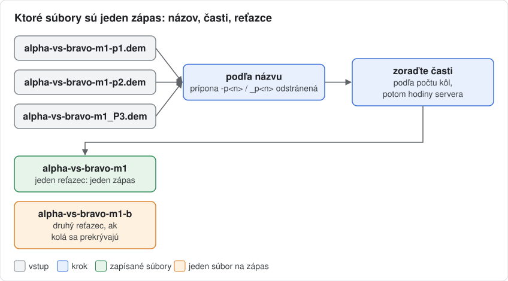

# Príkazy {#commands}

Nový v príkazovom riadku? Najprv si prečítajte [Ako začať](before-you-start.md).
Tieto príkazy píšte do terminálu otvoreného v priečinku, do ktorého ste
rozbalili alebo naklonovali program; `<...>` sú zástupné znaky a cesta s
medzerami patrí do úvodzoviek.

```text
python -m heat3d_cs2 demos <demo files or folders> -o <folder> [--every 8] [--jobs N] [--map TEXT] [--force] [--no-bulk] [--loose]
python -m heat3d_cs2 map <map name | path to its .vpk> -o <file.glb> [--game FOLDER] [--source2viewer EXE]
python -m heat3d_cs2 scoreboard <match.3dheat | match.json>
```

`python -m heat3d_cs2 --help` a `python -m heat3d_cs2 <príkaz> --help` vypíšu
tie isté možnosti; [Prehľad príkazov](../cli-reference.md) ukazuje všetky. Každé
spustenie najprv vykoná kontrolu vydania popísanú na stránke
[Aktualizácie](updates.md) (vypnutie: `HEAT3D_NO_UPDATE=1`).

Kód: [`heat3d_cs2/cli.py`](https://github.com/Holdi601/3DHeat-CS2/blob/main/heat3d_cs2/cli.py).

## `demos` - dema na tabuľky a dokumenty zápasov {#demos---demos-into-tables-and-match-documents}

```powershell
python -m heat3d_cs2 demos D:\Demos\event -o out
python -m heat3d_cs2 demos alpha-vs-bravo-m1-p1.dem alpha-vs-bravo-m1-p2.dem -o out
python -m heat3d_cs2 demos D:\Demos -o out --map final --jobs 4
```

| Argument | Predvolené | Čo robí |
|---|---|---|
| `paths` (jeden alebo viac) | - | súbory dema a priečinky. Súbor sa vezme, ak má príponu `.dem` (ľubovoľné veľké či malé písmená). Priečinok sa prehľadáva **rekurzívne** a hľadajú sa súbory končiace na `.dem`, bez ohľadu na veľkosť písmen, v zoradenom poradí. Komprimované demá (`.dem.zst`, `.dem.bz2`, archívy) sa nečítajú: najprv ich rozbaľte. |
| `-o`, `--out` | povinné | priečinok, do ktorého sa zapisuje; vytvorí sa podľa potreby |
| `--every N` | `8` | vzorkuje každého hráča každých *N* tikov. Demá CS2 bežia na 64 tikoch za sekundu, takže 8 je osem vzoriek za sekundu, 4 šestnásť, 64 jedna. Udalosti sa vždy čítajú v ich vlastnom tiku, bez ohľadu na *N*. |
| `--jobs N` | `0` = polovica jadier procesora | koľko zápasov sa konvertuje naraz, každý vo vlastnom procese. Nikdy menej ako 1, nikdy viac, než je zápasov na spracovanie. |
| `--map TEXT` | - | iba zápasy, ktorých **názov** obsahuje *TEXT*, bez ohľadu na veľkosť písmen (`--map final`). Filtruje podľa názvu súboru, nie podľa mapy, ktorú demo nakoniec obsahuje. |
| `--force` | vypnuté | konvertuje zápasy, ktoré už sú zapísané, a prepíše ich |
| `--loose` | vypnuté | ponechá každý zápas ako samostatné súbory - tabuľku, `.match.json` a pomocné súbory - namiesto zbalenia do jedného kontajnera `.3dheat`. Pozrite [Jeden súbor na zápas](output-container.md). |
| `--container` | zapnuté | zbalí každý zápas do jedného súboru `.3dheat`; je to predvolené, takže je tu iba pre istotu |
| `--no-bulk` | vypnuté | vynechá prúd entít, príkazy hráčov a prúd animácií z pomocného súboru paketov - je to viac než polovica veľkosti dema aj po kompresii. Kontrola vlastnej úplnosti dokumentu zápasu ich potom spočíta ako `lost` podľa názvu. |


### Ktoré súbory sú jeden zápas {#which-files-are-one-match}



Názov zápasu je názov súboru dema bez prípony a bez označenia časti: `-p<číslice>`
alebo `_p<číslice>` na konci, bez ohľadu na veľkosť písmen. Takže
`alpha-vs-bravo-m1-p1.dem`, `alpha-vs-bravo-m1-p2.dem` a
`alpha-vs-bravo-m1_P3.dem` sú časti jedného zápasu, `alpha-vs-bravo-m1`.
Súbory sa zoskupujú iba podľa tohto názvu - dva súbory s rovnakým názvom v
rôznych priečinkoch sa zoskupia tiež.

Označenie nehovorí nič o poradí: `-p2` môže byť skorší polčas. Časti sa radia
podľa počtu kôl, ktoré obsahujú, a potom podľa hodín servera; skupina, ktorá sa
ukáže ako dva rôzne zápasy (napríklad tie isté tímy na tej istej mape na dvoch
podujatiach), sa rozdelí na **reťazce**: reťazec s najväčším počtom kôl sa
zapíše pod samotným názvom, ďalší ako `<názov>-b`, potom `<názov>-c` a tak
ďalej. Súbor bez kola (iba rozcvička, pauza) nepatrí do žiadneho reťazca. Ako sa
reťazce hľadajú, je popísané na stránke [Zostavenie zápasu](building-matches.md#parts-and-chains).

### Čo sa zapíše {#what-is-written}

Pre každý zápas do priečinka pomenovaného podľa mapy, ktorú uvádza hlavička
dema (`unknown`, ak žiadnu neuvádza), jeden súbor `.3dheat`:

```text
out/
  de_x/
    alpha-vs-bravo-m1.3dheat
    alpha-vs-bravo-m2.3dheat
  de_y/
    ...
```

Na syntetickom dvojkolovom deme z testov:


S `--loose` je každý zápas tabuľka, jeho dokument zápasu a štyri pomocné súbory
vedľa seba ([Jeden súbor na zápas](output-container.md)):


Heatmapa je jednej mapy, takže načítanie jedného priečinka v prehliadači je
načítanie zápasov jednej mapy. Pozrite [Tabuľka heatmapy](output-table.md) a
[Dokument zápasu](output-match-json.md).

### Čo sa preskočí {#what-is-skipped}

Skôr než sa čokoľvek načíta, sa zostaví zoznam každého `*.3dheat` kdekoľvek pod
`--out` (kontajner sa zapíše celý, alebo vôbec) a každého `*.parquet`, ktorý má
vedľa seba svoj dokument zápasu (`<názov>.match.json`). Zápas, ktorého názov sa
rovná jednému z ich názvov súborov (bez prípony), sa preskočí, pokiaľ nie je
zadané `--force`. Tabuľka bez svojho dokumentu zápasu - beh zastavený medzi
zápisom oboch - sa nepočíta, takže sa tento zápas konvertuje znova. Kontrola je
iba podľa názvu: zápas prevedený do iného priečinka mapy alebo s iným
`--every` sa stále počíta ako hotový. Keď nie je čo robiť:

```text
nothing to do: no demos found, or every match already written (--force redoes them)
```

### Čo sa vypíše {#what-is-printed}

Najprv množstvo práce, potom jeden riadok na každý zápas, keď skončí (v poradí,
v akom skončia, nie v poradí súborov):

```text
3 match(es), 3 at a time
alpha-vs-bravo-m1: de_x, 21 rounds (Alpha 13 Bravo 8), 412,377 rows, lost 0
alpha-vs-bravo-m2: de_y, 30 rounds (Bravo 16 Alpha 14), 598,104 rows, 1 incomplete round(s) left out, lost 0
alpha-vs-bravo-m3: de_y, 18 rounds (Alpha 13 Bravo 5), 330,981 rows, recorded from round 3, lost 1,204,331 (svc_PacketEntities, svc_UserCmds, DEM_AnimationData)
```

(Čísla sú ilustratívne.) Skóre je skóre posledného kola, tím po tíme v poradí,
v akom ho dokument zápasu uvádza. *incomplete round(s) left out* počíta kolá,
ktoré demo prerušilo skôr, než sa rozhodli; *recorded from round N* hovorí, že
nahrávka začína neskoro; *lost* je vlastná kontrola dokumentu zápasu - koľko
položiek dema sa nikam nedostalo a akých druhov (`--no-bulk` spôsobí, že
hromadné dáta sú stratené). Zápas, ktorý nevyprodukuje nič, uvedie prečo:

```text
alpha-vs-bravo-m4: no round in 1 file(s) - nothing written
alpha-vs-bravo-m4-b: no complete round in 1 file(s) - nothing written
```

Chyba v jednom zápase nezastaví ostatné; vypíše sa ako
`<názov>: failed - <error>`.

### Návratový kód {#exit-code}

`0`, keď bol prevedený každý zápas (alebo nebolo čo robiť), `1`, keď zlyhal
aspoň jeden.

### Ako dlho to trvá {#how-long-it-takes}

Každý zápas sa číta a zostavuje v pracovnom procese. Priečinok s niekoľkými
stovkami dem trvá minúty pri predvolenom `--jobs`. Pamäť na jednu úlohu rastie
s dĺžkou zápasu a s menším `--every`: každý pracovný proces drží každý vzorkovaný
riadok hráča zo svojho zápasu (zhruba desať hráčov krát 64 / *N* riadkov za
sekundu nahrávky), kým zapíše.

Pomocné súbory trvajú dlhšie ako tabuľka: každá vlastnosť, ktorú parser číta,
sa číta v každom tiku, po oknách tikov (asi dve minúty pri 40-minútovom deme, s
najviac asi 3 GB pamäte na úlohu), a potom sa demo prejde ešte raz kvôli
snímkam a správam.

## `map` - geometria mapy ako `.glb` {#map---a-maps-geometry-as-glb}


```powershell
python -m heat3d_cs2 map <map> -o out/<map>/<map>.glb
python -m heat3d_cs2 map <map> -o <map>.glb --game "D:\Games\Steam\steamapps\common\Counter-Strike Global Offensive"
python -m heat3d_cs2 map "D:\maps\<map>.vpk" -o <map>.glb --source2viewer C:\Tools\Source2Viewer-CLI.exe
```

| Argument | Predvolené | Čo robí |
|---|---|---|
| `name` | - | názov mapy (ako `de_x`), alebo cesta k jej `.vpk`. Cesta končiaca na `.vpk`, ktorá existuje, sa použije tak, ako je; čokoľvek iné sa hľadá podľa názvu súboru v nainštalovanej hre. |
| `-o`, `--out` | povinné | `.glb`, ktorý sa zapíše; jeho priečinok sa vytvorí podľa potreby |
| `--game FOLDER` | knižnice Steamu | priečinok inštalácie CS2 (ten, ktorý obsahuje `game\csgo`), ak Steam nevie, kde je. S `--game` sa prehľadá iba tento priečinok. |
| `--source2viewer EXE` | `HEAT3D_SOURCE2VIEWER`, potom `PATH` | spustiteľný súbor príkazového riadka Source2Viewer |

Pri úspechu sa vypíše:

```text
out/de_x/de_x.glb: de_x, 412,880 triangles (151,204 ground) in 14 parts
```

(čísla sú ilustratívne). Zápis `.glb` vedľa tabuliek mapy (`out/<map>/<map>.glb`)
drží dáta a geometriu mapy v jednom priečinku. Ako export funguje: [Export mapy](map-export.md).

Chyby, každá vypísaná ako `error: ...` s návratovým kódom `2`:

| Hlásenie | Znamená |
|---|---|
| `no de_x.vpk found in an installed CS2 - pass --game <CS2 folder> or the .vpk path` | mapa nie je v žiadnej nájdenej knižnici Steamu, alebo je názov zlý |
| `Source2Viewer-CLI not found: ...` | ani `--source2viewer`, ani `HEAT3D_SOURCE2VIEWER`, ani `PATH` neukázali na existujúci súbor |
| `Source2Viewer did not export de_x's collision mesh:` a za ním koniec jeho výstupu | zlyhal, alebo nezapísal žiadny `.glb` |
| `de_x's collision mesh has nothing but clip brushes` | po vynechaní clip a oblohy nezostalo nič |

## `scoreboard` - zápas ako text {#scoreboard---a-match-as-text}

```bash
python -m heat3d_cs2 scoreboard out/de_x/alpha-vs-bravo-m1.3dheat
python -m heat3d_cs2 scoreboard out/de_x/alpha-vs-bravo-m1.match.json   # after demos --loose
```

Vypíše výsledkovú tabuľku zápasu z jeho [dokumentu zápasu](output-match-json.md),
bez otvorenia prehliadača. Číta dokument vo vnútri kontajnera `.3dheat`, alebo
samostatný `<zápas>.match.json`. Na syntetickom dvojkolovom deme z testov:


```text
alpha-vs-bravo-m1 - de_test  Alpha 2  Bravo 0

Alpha
player                 K   D   A  +/-    ADR   KAST   HS%  OK-OD  clutch
ash                    1   0   0   +1   50.0 100.0%    0%   0-0     1/1
ace                    1   1   0   +0   50.0 100.0%  100%   1-0     0/0

Bravo
player                 K   D   A  +/-    ADR   KAST   HS%  OK-OD  clutch
ben                    1   1   0   +0   50.0 100.0%    0%   0-0     0/1
bob                    0   1   0   -1    0.0 100.0%    0%   0-1     0/0

rounds  1:TK 2:TB
```

- Prvý riadok: názov zápasu, mapa a konečné skóre po tímoch.
- Tabuľka pre každý tím, v poradí `teams` dokumentu zápasu; hráči v poradí
  dokumentu zápasu (podľa zabití mínus smrti, potom zabití, od najlepšieho).
  Mená sa skrátia na 19 znakov.
- Stĺpce: **K** zabitia, **D** smrti, **A** asistencie *vrátane* asistencií
  bleskom, **+/-** zabitia mínus smrti, **ADR**, **KAST** (%), **HS%**
  (zaokrúhlené na celé percentá), **OK-OD** otváracie zabitia - otváracie
  smrti, **clutch** vyhrané clutche / odohrané clutche. Definície: [Štatistika](statistics.md).
- Pás kôl: `<kolo>:<strana víťaza><ako>`, s **B** bomba explodovala, **D**
  zneškodnená, **K** likvidácia, **T** došiel čas, a **?** pre všetko ostatné
  (remíza, vzdanie, iné). Remíza nemá stranu víťaza: `<kolo>:?`.

Súbor, ktorý nie je platný JSON, alebo sa nenašiel, skončí chybou; dokument
JSON bez polí dokumentu zápasu zlyhá Python chybou (ďalej sa neoveruje).
