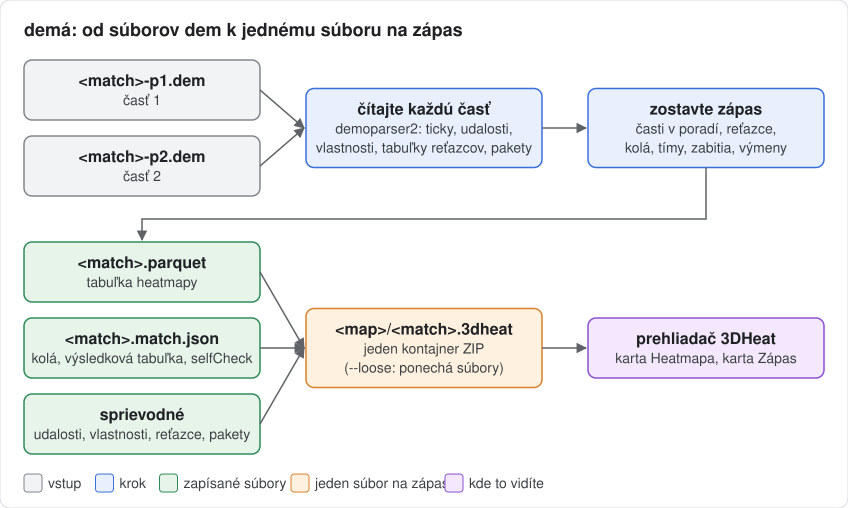

# 3DHeat CS2 {#dheat-cs2}

**Čo to je?** Counter-Strike 2 dokáže uložiť záznam zápasu, nazývaný
*demo*. Tento nástroj premení demo na súbory, ktoré prehliadač 3DHeat dokáže
zobraziť v 3D: kde kto stál, zomrel, hodil granát a položil alebo zneškodnil bombu, kolo po kole. Dokáže tiež
premeniť mapu CS2 na 3D model, na ktorom ich zobrazí.

**Prečo by som ho použil?** Na prehľad vlastných zápasov, na položenie viacerých zápasov
jednej mapy na seba ako jednej heatmapy a na štatistiky zápasov, napríklad ADR
(priemerné poškodenie za kolo) a KAST (podiel kôl, v ktorých hráč zabil, asistoval, prežil alebo bol vymenený).

**Príklad:** `alpha-vs-bravo-m1.dem` vstúpi, `out/de_x/alpha-vs-bravo-m1.3dheat`
vystúpi (`de_x` je vymyslený názov mapy).



Podrobnejšie: 3DHeat CS2 premieňa **demá Counter-Strike 2** na tabuľku heatmapy a dokument
zápasu pre každý zápas a **mapu CS2** na geometriu úrovne. Výstupy sú vytvorené
pre telemetrický prehliadač [3DHeat](https://holdi601.github.io/3DHeat/)
([zdroj](https://github.com/Holdi601/3DHeat)), ale sú to obyčajné súbory – Parquet, JSON a
binárny glTF –, ktoré dokáže prečítať aj čokoľvek iné.

Je to malý balík Python, `heat3d_cs2`, spúšťaný z príkazového riadku. Číta
demá z disku (žiadne nesťahuje) pomocou
[demoparser2](https://github.com/LaihoE/demoparser) a exportuje mapy z
nainštalovanej hry pomocou verzie Source2Viewer pre príkazový riadok
([ValveResourceFormat](https://github.com/ValveResourceFormat/ValveResourceFormat)).

## Rýchly štart {#quick-start}

Nikdy ste nepracovali s príkazovým riadkom? Najprv si prečítajte [Ako začať](before-you-start.md).

```bash
pip install -r requirements.txt
python -m heat3d_cs2 demos <demo files or folders> -o out   # každý zápas v nich
python -m heat3d_cs2 map <map> -o out/<map>/<map>.glb       # mapa z nainštalovanej hry
python -m heat3d_cs2 scoreboard out/<map>/<match>.3dheat    # výsledková tabuľka zápasu ako text
```

Mali by ste vidieť `1 match(es), 1 at a time ...` a potom jeden riadok na zápas
(pozrite [Príkazy](commands.md#what-is-printed)).

`demos` zapíše pre každý zápas jeden súbor do priečinka pomenovaného podľa mapy:
`out/<map>/<match>.3dheat`, [kontajner `.3dheat`](output-container.md) – formát prehliadača
jeden súbor na zápas ([špecifikácia](https://holdi601.github.io/3DHeat/container.html)).
Obsahuje tieto časti; `--loose` ich zapíše ako samostatné súbory:

| Časť | Čo obsahuje | Načíta sa v |
|---|---|---|
| `<match>.parquet` (rola `table`) | každý živý hráč osemkrát za sekundu s jeho stavom (zdravie, peniaze, oslepenie, zameranie, zóna, inventár, ...) a každá udalosť, kde sa stala (zabitie, smrť, zásah, výstrel, hod, výbuchy granátov, oslepenie, položenie, zneškodnenie, výbuch, a koniec kola pre každého hráča s tým, čo mu kolo vyplatilo), po jednom riadku | karta Heatmapa |
| `<match>.match.json` (rola `match`, dokument zápasu) | tímy, skóre, každé kolo (víťaz, ako, ekonomika, položenie bomby, zabitia v poradí, clutche, prežívajúci) a riadok výsledkovej tabuľky každého hráča | karta Zápas |
| `<match>.events/props/strings/packets.parquet` | všetko ostatné, čo demo obsahuje, celé (sprievodné súbory) | uchované pre úplnosť |

`map` zapíše `<map>.glb`: sieť kolízie mapy – podlahy, steny, škatule,
bez dekorácií – rozdelenú na zem a stavby, v rovnakom rámci a
jednotkách ako tabuľky, takže presne leží pod heatmapou (panel Pozadie / level).

## Prehľad tejto dokumentácie {#map-of-this-documentation}

| Stránka | Čo obsahuje |
|---|---|
| [Ako začať](before-you-start.md) | Python, terminál, zástupné znaky, ako vyzerá úspech a bežné chyby |
| [Inštalácia](installing.md) | Python, balíky, príkazový riadok Source2Viewer, kde musí byť CS2 |
| [Príkazy](commands.md) | `demos`, `map`, `scoreboard`: každá možnosť, čo sa vypisuje, stavové kódy |
| [Čítanie dema](reading-demos.md) | čo sa číta zo súboru dema: vzorkované ticky, vlastnosti hráčov, pravidlá hry, udalosti |
| [Zostavenie zápasu](building-matches.md) | časti a reťazce, herný čas, kolá, tímy a strany, riadky, zabitia, výmeny, otvorenia, poškodenie, záblesky, ekonomika |
| [Štatistiky](statistics.md) | výsledková tabuľka: K/D/A, ADR, KAST, HS%, otvorenia, výmeny, multizabitia, clutche, utility, záblesky |
| [Tabuľka heatmapy](output-table.md) | súbor Parquet: každý stĺpec, jeho typ, ktoré udalosti ho napĺňajú, nápovedy v pätičke `heat3d`, osi |
| [Dokument zápasu](output-match-json.md) | dokument `.match.json`, pole po poli |
| [Jeden súbor na zápas](output-container.md) | kontajner `.3dheat`, ktorý `demos` zapisuje štandardne, `--loose` |
| [Export mapy](map-export.md) | ako sa exportuje sieť kolízie mapy, rámec, pomenovanie uzlov, jednotky |
| [Použitie s 3DHeat](using-with-3dheat.md) | načítanie tabuliek, dokumentov zápasov a máp do kariet Heatmapa a Zápas prehliadača |
| [Obmedzenia](limits.md) | čo sa predpokladá, čo sa nerieši, čo nie je overené |
| [Aktualizácie](updates.md) | kontrola vydania pri štarte a `python -m heat3d_update` |
| [Vývoj](development.md) | rozloženie kódu, testy, syntetický testovací demo súbor |
| [Referencia príkazov](../cli-reference.md) | `--help` každého príkazu, generované z kódu |
| [Údržba](maintaining.md) | kontrolný zoznam vydania pre tieto stránky |

## Overenie {#what-it-is-checked-against}

Demá zo sveta nie sú jeden čistý súbor na zápas. Konvertor zvládne zápas rozdelený do súborov v ľubovoľnom
poradí, server reštartovaný uprostred zápasu, dva rôzne zápasy uložené pod jedným názvom, kolá obnovené zo zálohy, záznam, ktorý začína neskoro alebo končí skoro, pauzy a trénerov na strane tímu –
pozrite [Zostavenie zápasu](building-matches.md). Overené na veľkej zbierke turnajových
dem: v každom zápase skóre zodpovedá víťazom kôl, zabitia každej strany sú smrťami druhej strany
a každé kolo začína piati proti piatim.

## Na čo to použiť {#what-to-point-it-at}

Demá z vlastných zápasov, demá, ktoré ste stiahli ručne z turnajovej stránky,
alebo demá z API, ku ktorému máte prístup. Demo je záznam, ktorého obsah patrí
jeho vydavateľovi a organizátorom: výsledok použite na vlastnú analýzu a nešírte
demá ani dáta z nich odvodené. Nástroj číta demá z disku a žiadne nesťahuje a nič
z hry sa s ním nedodáva: žiadne herné súbory, žiadny herný kód, žiadne DLL.

3DHeat CS2 nie je spojený so spoločnosťou Valve ani ňou schválený. Counter-Strike
2 a súvisiace názvy a ochranné známky patria ich vlastníkom. Držitelia práv:
založte issue na
[github.com/Holdi601/3DHeat-CS2/issues](https://github.com/Holdi601/3DHeat-CS2/issues) -
odpovedáme rýchlo a na požiadanie čokoľvek odstránime.

## Súčasť 3DHeat {#part-of-3dheat}

3DHeat CS2 je jeden z bezplatných nástrojov okolo prehliadača 3DHeat, každý vo
vlastnom repozitári s vlastnými vydaniami a licenciou:

| Nástroj | Čo robí | Dokumentácia |
|---|---|---|
| [3DHeat](https://github.com/Holdi601/3DHeat) | prehliadač: heatmapy, analýza pretekov a prehľad zápasov v 3D | [stránka](https://holdi601.github.io/3DHeat/) |
| [GameFiles](https://github.com/Holdi601/3DHeat-GameFiles) | trate a úrovne zo súborov, ktoré hry dodávajú, ako 3D modely | [stránka](https://holdi601.github.io/3DHeat-GameFiles/) |
| [GameCapture](https://github.com/Holdi601/3DHeat-GameCapture) | telemetria kôl z pretekárskych hier; úrovne zrekonštruované z videa hry | [stránka](https://holdi601.github.io/3DHeat-GameCapture/) |
| [Unreal Exporter](https://github.com/Holdi601/3DHeat-UnrealExporter) | plugin pre Unreal Editor, ktorý exportuje úroveň ako jeden 3D model | [stránka](https://holdi601.github.io/3DHeat-UnrealExporter/) |
| [CS2](https://github.com/Holdi601/3DHeat-CS2) | dema Counter-Strike 2 do tabuliek a dokumentov zápasov; mapy do 3D modelov | [stránka](https://holdi601.github.io/3DHeat-CS2/) |
| [Watcher](https://github.com/Holdi601/3DHeat-Watcher) | zaznamenáva, čo hry zverejňujú o vašej hre, na pozadí | [stránka](https://holdi601.github.io/3DHeat-Watcher/) |
| [Ext-WarThunder](https://github.com/Holdi601/3DHeat-Ext-WarThunder) | replaye War Thunder do tabuliek a dokumentov zápasov | [stránka](https://holdi601.github.io/3DHeat-Ext-WarThunder/) |
| [Ext-WoT](https://github.com/Holdi601/3DHeat-Ext-WoT) | replaye World of Tanks do tabuliek a dokumentov zápasov | [stránka](https://holdi601.github.io/3DHeat-Ext-WoT/) |
| [Ext-WoWs](https://github.com/Holdi601/3DHeat-Ext-WoWs) | replaye World of Warships do tabuliek a dokumentov zápasov | [stránka](https://holdi601.github.io/3DHeat-Ext-WoWs/) |
| [Ext-Squad](https://github.com/Holdi601/3DHeat-Ext-Squad) | dema zo serverov Squad do tabuliek a dokumentov zápasov | [stránka](https://holdi601.github.io/3DHeat-Ext-Squad/) |
| [Ext-DCS](https://github.com/Holdi601/3DHeat-Ext-DCS) | mapy DCS World do 3D modelov | [stránka](https://holdi601.github.io/3DHeat-Ext-DCS/) |
| [Ext-IL2](https://github.com/Holdi601/3DHeat-Ext-IL2) | mapy IL-2 Sturmovik do 3D modelov | [stránka](https://holdi601.github.io/3DHeat-Ext-IL2/) |

## Licencia {#licence}

MIT – pozrite [`LICENSE`](https://github.com/Holdi601/3DHeat-CS2/blob/main/LICENSE)
a [`LICENSES.md`](https://github.com/Holdi601/3DHeat-CS2/blob/main/LICENSES.md) pre
balíky tretích strán.
