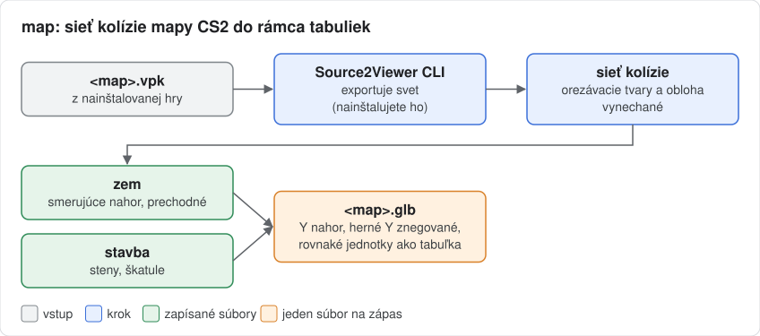

# Export mapy (`map`) {#map-export-map}

`python -m heat3d_cs2 map <map> -o <file.glb>` zapíše mapu CS2 ako geometriu
úrovne: **kolíziu sieť** sveta v rámci a jednotkách, v ktorých sa kreslia
[tabuľky heatmapy](output-table.md). Kód:
[`heat3d_cs2/mapexport.py`](https://github.com/Holdi601/3DHeat-CS2/blob/main/heat3d_cs2/mapexport.py),
[`heat3d_cs2/glb.py`](https://github.com/Holdi601/3DHeat-CS2/blob/main/heat3d_cs2/glb.py).
Možnosti a hlásenia: [Príkazy](commands.md#map---a-maps-geometry-as-glb).



## Prečo kolízna sieť {#why-the-collision-mesh}

Kolízna sieť je to, na čom hráči stoja a za čím sa schovávajú - podlahy, steny,
schody, debny - bez dekorácie: žiadne rekvizity, ktoré iba vyzerajú ako niečo,
žiadne textúry, výrazne menej trojuholníkov než renderovacie siete. Heatmapa
potrebuje práve toto pod sebou: niečo, voči čomu sa čítajú pozície, nie
vykreslenie mapy.

## Ako sa získava {#how-it-is-obtained}

1. **Nájsť mapu.** Cesta končiaca na `.vpk`, ktorá existuje, sa použije tak,
   ako je. Inak sa hľadá `<name>.vpk` v `<priečinok CS2>\game\csgo\maps\`, kde
   priečinok CS2 je `--game`, alebo `steamapps\common\Counter-Strike Global Offensive`
   v každej nájdenej knižnici Steamu (pozrite [Inštalácia](installing.md#where-cs2-is-looked-for)).
2. **Nájsť CLI Source2Viewer**: `--source2viewer`, potom `HEAT3D_SOURCE2VIEWER`,
   potom `Source2Viewer-CLI` / `Source2Viewer-CLI.exe` v `PATH`.
3. **Exportovať fyziku sveta.** Source2Viewer sa spustí takto:

   ```text
   Source2Viewer-CLI -i <map>.vpk -d -f maps/<map>/world_physics.vmdl_c --gltf_export_format glb -o <temporary folder>
   ```

   Dekóduje skompilovanú fyziku Source 2 z vlastného archívu mapy a zapíše model
   (prázdny: svet nemá vlastnú renderovaciu sieť) a jeho fyziku vedľa neho.
   Najväčší zapísaný `.glb` je fyzika. Ak Source2Viewer zlyhá alebo nezapíše
   žiadny `.glb`, príkaz sa zastaví a ukáže posledných 800 znakov jeho výstupu
   a chýb.
4. **Prečítať ho.** Každý uzol scény sa prejde s jeho transformáciou (matica,
   alebo posun-rotácia-mierka) a berie sa každý trojuholníkový primitív, s
   indexovým bufferom alebo bez neho, vo svetových pozíciách.
5. **Vynechať, čo nie je stena ani podlaha.** Uzol, ktorého názov obsahuje
   `clip` - clip hráčov, clip NPC, clip granátov: neviditeľné steny, ktoré
   zastavujú hráčov a granáty - alebo `sky`, bez ohľadu na veľkosť písmen, sa
   zahodí.
6. **Pomenovať povrch.** Fyzikálne skupiny sú pomenované podľa svojho povrchu;
   názov malými písmenami bez úvodného `physics`, `physics_group` alebo
   `physics_passbullets` (a podčiarkovníka za ním) je povrch:
   `physics_group_concrete` je `concrete`, `physics_passbullets_chainlink` je
   `chainlink`, holé `physics_group` je `world`. Povrchy, cez ktoré prechádzajú
   guľky, sa zachovajú.
7. **Späť do rámca hry.** Source2Viewer zapisuje glTF v metroch s osou Y nahor:
   (Y, Z, X) hry vynásobené 0,0254. To sa vráti - každý bod sa stane (X, Y, Z)
   hry v palcoch.
8. **Oddeliť zem od konštrukcie**, trojuholník po trojuholníku: plocha, ktorej
   normála smeruje nahor aspoň o 0,7 (jej zložka Z, normalizovaná) - sklony až
   do asi 45 stupňov, približne najstrmšie, po čom hráč CS2 chodí - je **zem**;
   všetko ostatné, steny a stropy vrátane, je **konštrukcia**.
9. **Do rámca prehliadača.** Každý bod sa zapíše ako (X, Z, -Y): Y nahor,
   Y hry sa zneguje - rámec, v ktorom prehliadač kreslí tabuľky, keď sa riadi
   ich nápovedami `heat3d`. Je to rotácia, nie zrkadlenie.
10. **Zapísať `.glb`.** Ak nezostalo nič (iba clip tehly), príkaz sa zastaví
    chybou. Inak vypíše súbor, mapu, počet trojuholníkov, koľko ich je zeme a
    počet častí.

Nič tu nečíta nič iné než vlastný `.vpk` mapy a nič zo Source2Viewer sa
nepriloží ani nekopíruje.

## Súbor {#the-file}

Binárny glTF 2.0 (`.glb`), jeden buffer, zapísaný `heat3d_cs2` (`asset.generator`):

| Aspekt | Čo |
|---|---|
| Uzly | jeden na časť, všetky v koreni, bez transformácií, každý so svojou sieťou rovnakého názvu |
| Názvy uzlov | `ground:<surface>` alebo `structure:<surface>` (`ground:concrete`, `structure:metal`, `structure:world`), zoradené podľa názvu |
| Primitívy | jeden na sieť, trojuholníky, `POSITION` (float32, s min/max) a `NORMAL` (float32), indexy `uint32` |
| Tieňovanie | ploché: jeden vrchol na roh trojuholníka, každý nesie normálu svojho trojuholníka |
| Materiály, textúry, UV, farby | žiadne |
| Jednotky | herné jednotky (**palce**), nie metre - na rozdiel od toho, čo glTF predpokladá |
| Rámec | (X, Z, -Y) hry: Y glTF je výška hry, Z glTF je -Y hry |

Predpona `ground:` / `structure:` je konvencia všetkých exportérov úrovní 3DHeat:
prehliadač berie časť pomenovanú takto doslova namiesto hádania z geometrie, takže
podlahy dostanú tieňovanie zeme a steny kreslenie konštrukcie bez akéhokoľvek
kroku klasifikácie.

Pretože jednotky sú palce, iný prehliadač glTF zobrazí mapu asi 39-krát väčšiu
(číta ich ako metre); ak na tom záleží, tam použite mierku 0,0254. V 3DHeat leží
presne pod tabuľkou, ktorá je v tých istých jednotkách s mierkou 1.

## Kontrola, že rámec je správny {#the-check-that-the-frame-is-right}

Test `test_players_stand_on_the_exported_floor` (spúšťa sa, iba keď sú dané demo a
Source2Viewer, pozrite [Vývoj](development.md#tests)) exportuje mapu, na ktorej
bolo demo hrané, vezme 300 náhodných vzoriek pozícií zápasu a pre každú sa pozrie
priamo nadol na najvyšší trojuholník zeme najviac 4 jednotky nad chodidlami
hráča. Vyžaduje, aby aspoň 98 % vzoriek našlo zem a aby medián výšky nad ňou bol
menší ako 5 jednotiek. Zrkadlená mapa to neprejde: na mape zrkadlenej zlou osou
stojí veľký podiel hráčov nad ničím. README uvádza čísla tejto kontroly pre mapy
aktuálneho súťažného výberu.

## Čo nerobí {#what-it-does-not-do}

- Žiadna renderovacia geometria, textúry ani dekorácia - pozrite *prečo* vyššie.
- Iba to, čo je v modeli `world_physics` mapy. Či sú v ňom pohyblivé časti
  (dvere) alebo rozbiteľné veci, sa neoverilo.
- Žiadne zjednodušenie: prehliadač 3DHeat zjednodušuje pri importe pomocou
  nastavenia **Cieľ zjednodušenia**.
- Mapy, ktoré nie sú v nainštalovanej hre (workshop mapy inde na disku), fungujú,
  keď sa ich `.vpk` zadá ako cesta a obsahuje `maps/<name>/world_physics.vmdl_c`;
  neoverené.
