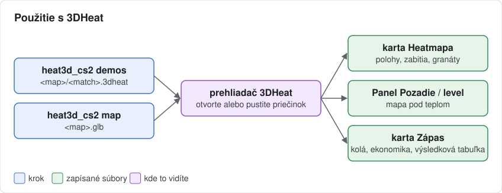

# Používanie s 3DHeat {#using-it-with-3dheat}

Výstupy idú na tieto miesta v
[prehliadači 3DHeat](https://holdi601.github.io/3DHeat):

| Súbor | Kde | Čo dáva |
|---|---|---|
| `<match>.3dheat` (predvolené) | karta **Heatmapa**, panel **Zdroj**, alebo karta **Zápas** | tabuľku a dokument zápasu spolu, jeden súbor na zápas ([kontajner](https://holdi601.github.io/3DHeat/container.html)) |
| `<match>.parquet` | karta **Heatmapa**, panel **Zdroj** | pozície a udalosti ako heatmapa, box replay, trasy |
| `<match>.match.json` | karta **Zápas**, **Načítať súbory zápasov…** | výsledková tabuľka, kolá, prehľad zabití, štatistika naprieč zápasmi, odkazy do heatmapy |
| `<map>.glb` | panel **Pozadie / level**, **3D model…** | mapa pod heatmapou |

Dokumentácia prehliadača popisuje každú kartu v plnom rozsahu na svojich
stránkach
[Analýza zápasu](https://holdi601.github.io/3DHeat/match-analysis.html),
[Načítavanie súborov](https://holdi601.github.io/3DHeat/loading-files.html),
[Mapovanie stĺpcov](https://holdi601.github.io/3DHeat/column-mapping.html)
a [Box replay](https://holdi601.github.io/3DHeat/box-replay.html). Táto stránka je
časť pre CS2.



Prehliadač: [github.com/Holdi601/3DHeat](https://github.com/Holdi601/3DHeat),
dokumentácia [holdi601.github.io/3DHeat](https://holdi601.github.io/3DHeat/).

## Typické sedenie {#a-typical-session}

```bash
python -m heat3d_cs2 demos D:\Demos\event -o out
python -m heat3d_cs2 map <map> -o out/<map>/<map>.glb
```

1. **Karta Heatmapa -> Zdroj:** vyberte priečinok `out/<map>` (alebo ho
   presuňte). Každý `.parquet` v ňom sa stane jedným datasetom; súbory `.json`
   a `.glb` v tom istom priečinku sa preskočia ako „not a csv/parquet file“.
   Načítajte ho.
2. **Pozadie / level -> 3D model…:** vyberte `out/<map>/<map>.glb`.
   **Uložiť do knižnice** ho uchová v prehliadači na nabudúce.
3. **Karta Zápas -> Načítať súbory zápasov…:** vyberte súbory `.match.json`
   z toho istého priečinka (naraz viac), alebo ich presuňte na zobrazenie, kým je
   karta Zápas otvorená.

Načítajte naraz iba tabuľky jednej mapy: súradnice rôznych máp sa prekrývajú a
heatmapa dvoch máp naraz nemá zmysel. Priečinok na každú mapu je tu práve preto.

## Tabuľka sa otvorí bez akéhokoľvek nastavenia {#the-table-opens-with-nothing-to-set}

Prehliadač prečíta záznam `heat3d` v päte prvého vybraného súboru
([Tabuľka heatmapy](output-table.md#the-heat3d-footer-hints)) a položí ho na
svoje vlastné odhady:

| Nastavenie prehliadača | Nastavte na |
|---|---|
| Pozícia | `x`, `y`, `z` |
| Os nahor v zdroji | Z je nahor |
| Otočiť Y | zapnuté - aby mapa bola správne, nie zrkadlene |
| Mierka jednotiek | 1 - vzdialenosti v herných jednotkách (označené „m“; 1 jednotka = 1 palec) |
| Čas | `time`, sekundy |
| Osoba | `player` |
| Skupina | `side` (T / CT) |
| Relácia | `roundId` - každé kolo je relácia, `<match> #NN` |
| Smer pohľadu | vektor, `dirX` / `dirY` / `dirZ` |
| Filtračné stĺpce | `event`, `match`, `round`, `roundTime`, `phase`, `weapon`, `place`, `won`, `buy`, `opening`, `team` |
| Veľkosť entity | 32 - box replay kreslí hráča 32 jednotiek široko, s lúčom pohľadu 4 x 32 |

Každá hodnota z nápovedí sa stále ukazuje v mapovaní stĺpcov a dá sa zmeniť.
Ostatné stĺpce (`headshot`, `traded`, `other`, `steamid`, `health`, `money`,
`damage`, `duration`, ...) sa tam dajú pridať ako filtre ručne.

Mierku jednotiek nechajte na 1, keď sa načíta mapa: `.glb` je v tých istých
herných jednotkách a úroveň sa nepreškáluje spolu s tabuľkou.

### Užitočné filtre {#useful-filters}

- `event` = `position` pre to, kde boli hráči; `kill` / `death` pre to, kde sa
  vyhrávali a prehrávali dvojboje; `smoke`, `flash`, `molotov`, `he` pre to, kde
  pristála pomocná výbava; `throw` pre to, odkiaľ bola hodená; `plant` pre
  miesta položenia.
- `side` (skupina) = `T` alebo `CT`, `phase` = `live`, aby sa vynechala fáza po
  skončení, `buy` = `eco` / `force` / `full` pre kolá s jednou ekonomikou, `won` =
  1 pre kolá, ktoré strana riadku vyhrala.
- `opening` = 1 s `kill` a `death` pre otváracie dvojboje.
- `roundTime` ako rozsah pre okamih kola: prvých 20 sekúnd, po položení bomby.

## Karta Zápas {#the-match-tab}

Karta Zápas prijme JSON súbor, ktorého `format` je `heat3d-cs2-match` a ktorý
má polia `rounds`, `players` a `teams` ([Dokument zápasu](output-match-json.md)).
Ukazuje skóre a polčasy, pás kôl zafarbený podľa víťaznej strany s označením, ako
každé skončilo, ekonomiku každého kola, položenie, prehľad zabití, clutche a
preživších, výsledkovú tabuľku a štatistiku naprieč všetkými načítanými zápasmi.

Jej odkazy **Zobraziť v heatmape** nič nenačítavajú. Iba nastavia filtre na
tabuľke, ktorá je už načítaná v karte Heatmapa - `match`, `round` (a relácia
kola `<match> #NN`), `event`, hráč, strana. To funguje preto, lebo dokument
zápasu a tabuľka nesú tie isté názvy zápasov, čísla kôl, mená hráčov a strany.
**Prehrať kolo** prepne heatmapu do box replay a prehrá reláciu kola od jej
začiatku.

Načítajte preto obe: tabuľky mapy v karte Heatmapa a ich dokumenty zápasov v
karte Zápas. Dokument zápasu bez svojej tabuľky ukáže stále výsledkovú
tabuľku a kolá, a odkazy napíšu, že nie sú načítané žiadne dáta heatmapy.

## Bez 3DHeat {#without-3dheat}

- Tabuľka je obyčajný Parquet: pandas, Polars, DuckDB, Spark, `arrow` v R ju
  všetky čítajú, záznam `heat3d` ignorujú a textové stĺpce sa čítajú ako
  reťazce alebo kategórie.
- Dokument zápasu je obyčajný JSON.
- Mapa je platný binárny glTF, v palcoch, nie v metroch: na nástroje, ktoré
  predpokladajú metre, použite mierku 0,0254. Jej rámec je vlastný rámec glTF (Y
  nahor), takže ak chcete tabuľku prekryť inde, vykreslite (x, y, z) každého
  riadku ako (x, z, -y), ako to robí 3DHeat.
