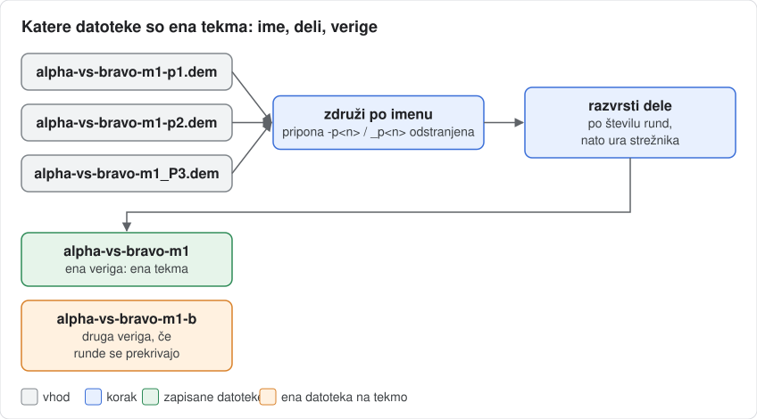

# Gradnja tekme {#building-a-match}

Kako iz delov dema nastane tekma: katere datoteke spadajo skupaj, ena ura za vse, runde in kako je bila vsaka
dobljena, ekipe in njihove strani ter vsaka vrstica tabele toplotnega zemljevida z ubijanji, maščevanji,
prvimi ubijanji, škodo, bliskovkami in ekonomijo. Koda:
[`heat3d_cs2/match.py`](https://github.com/Holdi601/3DHeat-CS2/blob/main/heat3d_cs2/match.py).
Lestvica, izračunana iz nje, je na strani [Statistika](statistics.md).

## Pregled {#overview}

1. Prebere se vsaka datoteka imena tekme ([Branje dema](reading-demos.md)).
2. Podvojene vrstice igralcev (obnovljene runde) v vsaki datoteki se razrešijo.
3. Datoteke se razvrstijo v **verige** – tekme – in vsaka veriga se postavi v pravi vrstni red.
4. Vsak del se postavi na **uro tekme**.
5. **Runde** se najdejo v vsakem delu; pozneje razvrščen del zamenja razlago runde iz prejšnjega dela.
6. **Igralci** in **ekipe** dobijo imena, strani in rezultat vsake runde pa se navedeta po imenu ekipe. Ko so
   strani znane, sledijo dolžina polčasa, pištolske runde in **nakup** vsake strani.
7. Zgrajene so **vrstice**: položaji, streli, meti, detonacije, postavitve, deaktivacije, uboji, smrti,
   zadetki, oslepitve, eksplozije.
8. Vsaka vrstica dobi oznako runde, faze, časa v rundi, ali je njena stran zmagala, in nakup njene strani;
   vrstice zunaj vseh rund se izpustijo.

## Obnovljene runde: ena vrstica na igralca na takt {#restored-rounds-one-row-per-player-per-tick}

Ko se runda obnovi iz varnostne kopije znotraj ene datoteke, demo nekaj sekund hrani stara telesa igralcev
poleg novih: dve vrstici za enega igralca v istem taktu – ena tam, kjer ga je preklicana runda pustila, druga
na mestu, kjer se obnovljena runda začne. Za vsakega takega igralca se podvojeni takti pregledajo **nazaj**,
začenši pri prvi enojni vrstici za njimi: pri vsakem taktu se obdrži kandidat, ki je najbližje položaju, kamor
gre igralec potem, in ta postane referenca za takt pred njim. Če enojne vrstice za njimi ni, se obdrži zadnji
kandidat. Tako vsak igralec obdrži vrstico, ki vodi naprej, tja kamor gre.

## Živi del datoteke {#the-live-part-of-a-file}

**Živi začetek** datoteke je takt njenega zadnjega dogodka `round_announce_match_start`, ali takt 0, če ga
nima (pozneje del razdeljene tekme ga ponavadi nima). Vse pred živim začetkom se izpusti, prav tako vse, kar je
označeno z `is_warmup_period`. Nož-runda ali ponovni zagon pred napovedjo začetka se torej izpusti; nož-runda,
**ki ji ne sledi** napoved začetka tekme, ni prepoznana kot taka (glejte [Omejitve](limits.md)).

**Runde** datoteke so dogodki `round_freeze_end` od živega začetka naprej, zunaj ogrevanja, prepoznani po svojem
`total_rounds_played` (0-indeksirano število runde, ki je na vrsti). Datoteka brez njih nima rund in ne spada
v nobeno tekmo.

## Ura {#the-clock}

Časi so v sekundah. Znotraj datoteke se čas šteje v **taktih**: `game_time` strežnika pri prvem vzorčenem taktu
plus takti od takrat / 64. Strežnikova lastna ura med premorom miruje, takti pa tečejo naprej; če bi brali po uri,
bi imela dva trenutka med premorom isti čas.

Vsaka datoteka ima *prvo uro* (čas na njenem živem začetku) in *zadnjo uro* (na njenem zadnjem vzorčenem taktu).

### Deli in verige {#parts-and-chains}

Datoteke z imenom iste tekme ([Ukazi](commands.md#which-files-are-one-match)) se najprej razvrstijo po indeksu
prve runde, nato po prvi uri. Potem se vsaka po vrsti pridruži prvi verigi, ki se nadaljuje z njo, ali začne
novo verigo. Del se nadaljuje verigo, če je indeks njegove prve runde vsaj enak indeksu zadnje runde zadnjega
dela verige **in** velja vsaj eno od naslednjega:

- strežnikova ura teče naprej: njegova prva ura ni zgodnejša od zadnje ure verige, zmanjšane za 5 s; ali
- šteje runde teče naprej: indeks njegove prve runde je indeks zadnje runde verige ali naslednji.

Odloča število rund, ura pa prekine neodločenost, ker se strežnik, ponovno zagnan za obnovitev runde, začne šteti
znova, dve različni tekmi pod istim imenom (iste ekipe na isti karti na dveh dogodkih) pa imata prekrivajoča se
števila rund. Verige se uredijo po številu rund, ki jih obsegajo, največ najprej; prva obdrži ime tekme, ostale
se zapišejo kot `<ime>-b`, `<ime>-c` ...

### Ura tekme {#the-match-clock}

Ničla tekme je prva ura prvega dela: **čas tekme 0 je živi začetek prve datoteke**. Vsak naslednji del se postavi
nanjo:

- kjer strežnikova ura teče naprej (njena prva ura ni zgodnejša od zadnje ure prejšnjega dela, zmanjšane za
  5 s), se uporabi strežnikova ura, kakršna je;
- kjer je bil ponovno zagnan, se del postavi tako, da sledi **eno sekundo** po koncu prejšnjega dela.

## Runde {#rounds}

Za vsak `round_freeze_end` dela (po vrstnem redu taktov) okno runde teče do naslednjega konca zamrznitve v tem
delu ali do konca datoteke. Znotraj njega je runda **odločena** pri prvem vzorčenem taktu, kjer stanje igre
kaže `total_rounds_played` = indeks runde + 1 in `round_win_status` 1 (remi), 2 (zmagali T) ali 3 (zmagali CT).
Runda brez takega vzorca v svojem oknu je bila prekinjena s koncem datoteke; njena številka gre na seznam
**nedokončanih** rund tekme (razen če ima drug del to rundo dokončano).

| Polje runde | Iz česa |
|---|---|
| `number` | indeks + 1 (1-indeksirano, kot šteje igra) |
| `start` | čas tekme ob koncu zamrznitve – igralci se lahko premikajo |
| `end` | čas tekme prvega vzorca, ki kaže rundo odločeno |
| `until` | čas tekme naslednjega `round_prestart` po `end`, če je znotraj okna; sicer konec okna ali zadnji takt datoteke, kar pride prej (in nikoli pred `end`) |
| `winner` | `T` za stanje 2, `CT` za 3, prazno za 1: remi je odločen, brez zmagovalca |
| `reason` | `round_win_reason` pri tem vzorcu, poimenovan spodaj |
| `score` | ime ekipe -> število dobljenih rund po tej: vsaka stran `team_rounds_total` pri odločilnem vzorcu; če demo tega nima, rezultat prejšnje runde plus ena za zmagovalca |
| `sides` | ime ekipe -> `T` / `CT` v tej rundi |
| `equipment` | stran -> seštevek `current_equip_value` **živih** igralcev te strani pri prvem vzorcu ob koncu zamrznitve ali po njem |
| `buy` | stran -> `pistol`, `eco`, `force` ali `full` ([Ekonomija](#economy-and-buy-types)) |
| `plant` | prvi `bomb_planted` po koncu zamrznitve in do `end`, ali nič |
| `exploded` | čas tekme prvega `bomb_exploded` po tej postavitvi in pred naslednjim koncem zamrznitve, če obstaja (ni v dokumentu tekme; določa vrstico `explode`) |

`reason`, iz igrine `CSRoundEndReason`:

| Koda | `reason` |
|---|---|
| 1 | `bomb` (cilj je bil bombardiran) |
| 7 | `defuse` (deaktivirana) |
| 8, 9 | `elimination` (CT zmagajo / T zmagajo z izločitvijo) |
| 10 | `draw` (remi) |
| 12 | `time` (cilj rešen) |
| 17, 18 | `surrender` (predaja) |
| karkoli drugega | `other` |

Ko več delov vsebuje isto rundo (po indeksu), ostane različica poznejšega dela. Runde se nato navedejo po
indeksu. Tekma, katere prva runda ni runda 1, zabeleži manjkajoče številke (`missing` v dokumentu tekme); v
ukazni vrstici piše *recorded from round N* (zabeleženo od runde N).

### Postavitev {#the-plant}

| Polje | Iz česa |
|---|---|
| `site` | `A` ali `B`: bombno območje, za katero igra pove, da je v njem stal postavljalec (`which_bomb_zone`, 1 A, 2 B); brez tega ime kraja postavljalca (`BombsiteA`, `BombsiteB`); brez tega pa črka, ki jo je druga postavitev iste datoteke na istem območju dala (dogodkov `site` je številka entitete območja). Prazno, kadar nič ne pove – nikoli številka. |
| `time` | sekunde **v rundi** (od konca zamrznitve), kot pri uboju |
| `player`, `steamid` | postavljalec |
| `x`, `y`, `z` | položaj postavljalca, enote igre: kje bomba leži |
| `place` | ime kraja postavljalca ob postavitvi |

### Faze {#the-phases}

Čas od `start` do `end` je **živa** faza runde; od `end` do `until` je njena faza **po**, kjer zmagovalci lovijo,
poraženci pa varčujejo. Vrstica pripada rundi, katere `[start, until)` vsebuje njen čas, in je `after`, kadar je
njen čas kasnejši od `end`. Čas zamrznitve leži med rundama in ne pripada nobeni.

## Igralci in ekipe {#players-and-teams}

**Igralec** je vsak, ki je bil vsaj enkrat živ na eni strani (ekipa 2 ali 3), zunaj časa zamrznitve in ogrevanja,
po živem začetku. Trener ali kaster na strani ekipe nikoli ni živ in ni igralec. Vsak igralec je določen z
Steam ID-jem; ime je zadnje videno.

**Ekipa** igralca je klanski naziv, ki ga igra dala njegovi strani (`team_clan_name`), tisti, ki se mu je pri
njem največkrat pojavil – demo ga ob samem koncu počisti. Tekma, igrana brez klanskih nazivov, poimenuje ekipi
po strani, na kateri sta začeli: `Started T` in `Started CT`.

**Strani** runde izhajajo iz tega, kdo je bil na kateri strani med koncem zamrznitve in koncem runde: vsaki strani
se dodeli ekipna oznaka, ki jo nosi večina njenih igralcev. Seznam `teams` tekme je v vrstnem redu pojavitve, runda
za rundo, stran T pred CT; ponavadi je ekipa, ki je začela na T, prva.

## Vrstice {#the-rows}

Vsak vzorec položaja in vsak dogodek postane ena vrstica [tabele toplotnega zemljevida](output-table.md).
Igralci so na strani samo, kadar je njihov `team_num` 2 ali 3.

### Položaji {#positions}

Iz vzorčenih vrstic živih igralcev na strani, zunaj časa zamrznitve in ogrevanja, po živem začetku: položaj, smer
pogleda, zdravje, oklep, denar, vrednost opreme, orožje v roki, kraj.

Smer pogleda je enotski vektor v igrinem koordinatnem sistemu:
`(cos pitch * cos yaw, cos pitch * sin yaw, -sin pitch)` – igrin naklon je pozitiven, kadar gledate navzdol,
zato pogled navzdol da negativen Z.

Orožje v roki je `active_weapon_name`, kakor ga igra imenuje, razen da vsako ime, ki vsebuje `Knife`, `Bayonet`,
`Karambit` ali `Daggers`, postane `Knife`.

### Streli in meti {#shots-and-throws}

Iz `weapon_fire`, na položaju strelca. Noži (`knife`, `bayonet` v ID-ju orožja) in C4 se izpustijo. Granate
(`smokegrenade`, `flashbang`, `hegrenade`, `molotov`, `incgrenade`, `decoy`) so vrstice **meta**, vse ostalo so
vrstice **strela**. Orožje je poimenovano, kakor ga prikaže igra (spodaj).

### Detonacije granat {#grenade-detonations}

| Dogodek | Vrstica | `weapon` |
|---|---|---|
| `smokegrenade_detonate` | `smoke` | Smoke Grenade |
| `flashbang_detonate` | `flash` | Flashbang |
| `hegrenade_detonate` | `he` | High Explosive Grenade |
| `inferno_startburn` (molotovka in zažigalna bomba) | `molotov` | Molotov |
| `decoy_detonate` | `decoy` | Decoy Grenade |

Položaj je **kje je granata eksplodirala** (dogodkovi `x`, `y`, `z`); igralec in stran sta metalčeva. Demo za
granato ne navaja kraja, le za igralce, zato je `place` prazen: vrstica ne trdi kraja, kjer ni bila. Kraj metalca
v tistem trenutku je ohranjen kot `throwerPlace`.

### Postavitve in deaktivacije {#plants-and-defuses}

Vrstici `plant` in `defuse` na položaju igralca, orožje `C4 Explosive`. Postavljena bomba, ki je eksplodirala,
dobi vrstico **explode**: na položaju postavitve, ob času `bomb_exploded`, postavljalec kot igralec (z njegovim
Steam ID-jem), stran `T`, T-ekipa runde kot `team` in kraj postavitve. Vključeno je tudi, ko bomba eksplodira
potem, ko so T-ji že zmagali z izločitvijo. Kjer demo nima `bomb_exploded`, runda, ki jo je dobila bomba
(`reason` = `bomb`) s postavitvijo, dobi vrstico ob `end` runde.

### Uboji in smrti {#kills-and-deaths}

Vsak `player_death` v rundi da en **zapis ubijanja** (tabela `kills` tekme) z:

| Polje | Je |
|---|---|
| attacker, victim, assister | imena, Steam ID-ji, strani; napadalec je prazen za svet (padec, bomba) |
| `weapon` | dogodkovo orožje, poimenovano, kakor ga prikaže igra |
| `headshot` | zastavica dogodka |
| `wallbang` | `penetrated` > 0 |
| `throughSmoke` | `thrusmoke` |
| `flashAssist` | `assistedflash` |
| `noscope`, `attackerBlind` | zastavici dogodka (`noscope`, `attackerblind`); stolpca vrstic `kill` in `death` ter v ubijanjih dokumenta tekme |
| `suicide` | napadalec in žrtev sta isti igralec: na primer lastna granata |
| `teamkill` | napadalec in žrtev na isti strani, z napadalcem in ne samomor |
| `opening` | prvi sovražnikov uboj v rundi (spodaj) |
| `traded`, `trade` | spodaj |
| položaji | položaj in kraj napadalca in žrtve |

Iz vsakega zapisa dobi tabela vrstico **death** na položaju žrtve (vsaka smrt, tudi tiste zaradi sveta, prijateljskih
ubijanj in samomorov) in – za uboje sovražnika (napadalec, ni prijateljski uboj, ni samomor) – vrstico **kill** na
položaju ubijalca.

**Prvi uboj.** Prvi sovražnikov uboj v vsaki rundi, dokler je živa, je njen prvi dvoboj. Prijateljski uboj, samomor
ali smrt zaradi sveta pred njim se preskoči, tako da je prvi uboj še vedno prvi dvoboj runde; runda brez
sovražnikovega uboja, dokler je živa, nima prvega uboja.

**Maščevanje** in **maščevalni uboj.** Smrt od sovražnika je **maščevana**, če njen ubijalec v **5 sekundah** po njej
pade od roke enega od žrtvinih sotrajnikov (več kot 0 in največ 5 s kasneje, v isti rundi); prvi tak uboj je
**maščevalni uboj**. V tabeli je stolpec `traded` vrstice `kill` 1 za maščevalni uboj; stolpec vrstice `death` je 1
za smrt, ki je bila maščevana. Štejejo tudi uboji po fazi po koncu.

### Škoda {#damage}

Iz `player_hurt`, samo med **sovražniki** (oba na strani, različni strani). Škoda je zdravje dejansko **izgubljeno**:
za vsako žrtev v vsaki rundi se zdravje začne pri 100; vsak zadetek šteje `min(dmg_health, zdravje pred njim)`, dogodkov
`health` (kar ostane) pa postane »pred« za naslednji zadetek. Glavni zadetek s škodo 137 na igralca z 40 zdravja
šteje 40, kakor jo šteje igrina lestvica. Zadetki od `hegrenade`, `inferno`, `molotov` in `incgrenade` so
**škoda od pripomočkov**. Vsak zadetek je vrstica **hurt** na položaju žrtve, napadalec kot `other`. Škoda
sosedov in samopoškodbe nista niti v tabeli niti v statistiki.

### Bliskovke {#flashes}

Iz `player_blind`, samo **sovražniki** (ne soigralci in ne trener ali kaster, ki gleda): ena vrstica **blind** na
igralca, ki je bil oslepljen, na položaju oslepljenega igralca, bliskovalec kot `other`, čas oslepitve v sekundah kot
`duration`. Vsako trajanje je ohranjeno; statistika šteje samo oslepitve vsaj ene sekunde.

## Imena orožij {#weapon-names}

ID orožja iz dogodka (`ak47`, `weapon_ak47`, `knife_karambit`) je prikazan, kakor ga igra imenuje v
`active_weapon_name` igralcev, tako da se orožje ubijanja in orožje v roki beresta enako: `ak47` -> `AK-47`,
`m4a1` -> `M4A4`, `m4a1_silencer` -> `M4A1-S`, `hkp2000` -> `P2000`, `taser` -> `Zeus x27`, `inferno` in `molotov`
-> `Molotov`, `incgrenade` -> `Incendiary Grenade`, `c4` in `planted_c4` -> `C4 Explosive`, `world` -> `World`, in
tako dalje za vsako pištolo in granato (tabela `WEAPONS` v `match.py`). Vse z `knife` ali `bayonet` v ID-ju je
`Knife`. ID, ki ga ni v tabeli, ostane takšen, kakršen je.

## Ekonomija in vrste nakupa {#economy-and-buy-types}

Ob koncu zamrznitve se vrednost opreme vsake strani sešteje po njenih **živih** igralcih pri prvem vzorcu od
takrat naprej in deli s številom igralcev:

| Runda | Povprečna oprema na igralca | `buy` |
|---|---|---|
| pištolska runda (prva vsakega rednega polčasa) | katerakoli | `pistol` |
| druga | pod 1500 $ | `eco` |
| druga | od 1500 $ do pod 4000 $ | `force` |
| druga | 4000 $ ali več | `full` |

Pištolske runde sledijo polčasu, ki je bil igran, ne fiksnemu formatu. Polčas se konča tam, kjer se strani prvič
zamenjata med dvema zaporednima rundama, obe v rednem igranju: njegova dolžina (`halfLength` v dokumentu tekme) je
runda pred zamenjavo – 12 v formatu 24 rund, 15 v formatu 30 rund. Runda 1 in runda po polčasu sta pištolski rundi.
Runda je podaljšek, kadar je število podaljškov igre (`m_nOvertimePlaying`) ob koncu njene zamrznitve večje od 0;
kjer demo tega števila nima, je vsaka runda po dveh polčasih podaljšek. Polčasi podaljška začnejo z denarjem, ki ga
določi strežnik, in nimajo pištolske runde, čeprav se tudi v njih strani zamenjata. Posnetek, ki zamenjave na
polovici nikoli ne kaže – se začne po njej ali konča pred njo –, pusti polčas neznan, pištolska je le runda 1.

## Oznake in vrstni red {#labelling-and-order}

Na koncu dobi vsaka vrstica:

- `match` – ime tekme; `map` – karta iz glave dema;
- `round` in `roundId` (`<match> #NN`, dve števki);
- `phase` – `live` ali `after`;
- `roundTime` – sekunde od konca zamrznitve runde;
- `won` – 1, če je stran vrstice zmagala v rundi, 0, če ne, prazno za vrstico brez strani;
- `buy` – nakup strani vrstice v tej rundi;
- `team` – ekipa igralca vrstice, po Steam ID-ju.

Vrstice, katerih čas ni v nobeni rundi – pred zamrznitvijo prve runde, med zamrznitvijo, po zadnji rundi – se
izpustijo. Vrstice se uredijo po času, pri istem času pa po imenu dogodka.
