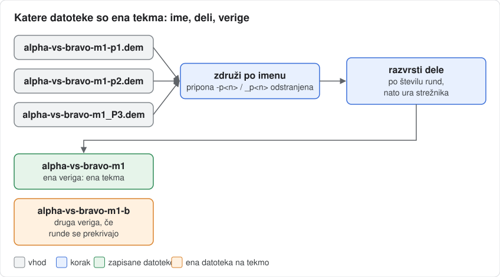

# Ukazi {#commands}

Prvič v ukazni vrstici? Najprej preberite [Preden začneš](before-you-start.md). Ukaze vtipkajte v terminal, odprt v
mapi, ki ste jo razpakirali ali klonirali; `<...>` so nadomestila, pot s presledki pa gre v narekovaje.

```text
python -m heat3d_cs2 demos <datoteke demo ali mape> -o <mapa> [--every 8] [--jobs N] [--map TEXT] [--force] [--no-bulk] [--loose]
python -m heat3d_cs2 map <ime karte ali pot do njene .vpk> -o <datoteka.glb> [--game MAPA] [--source2viewer EXE]
python -m heat3d_cs2 scoreboard <tekma.3dheat | tekma.json>
```

`python -m heat3d_cs2 --help` in `python -m heat3d_cs2 <ukaz> --help` izpišeta iste možnosti; [Referenca ukazov](../cli-reference.md)
jih prikaže vse. Vsak zagon najprej opravi preverjanje izdaje, opisano na [Posodobitve](updates.md) (izklopi se z
`HEAT3D_NO_UPDATE=1`).

Koda: [`heat3d_cs2/cli.py`](https://github.com/Holdi601/3DHeat-CS2/blob/main/heat3d_cs2/cli.py).

## `demos` – demoji v tabele in dokumente tekem {#demos---demos-into-tables-and-match-documents}

```powershell
python -m heat3d_cs2 demos D:\Demos\dogodek -o out
python -m heat3d_cs2 demos alpha-vs-bravo-m1-p1.dem alpha-vs-bravo-m1-p2.dem -o out
python -m heat3d_cs2 demos D:\Demos -o out --map final --jobs 4
```

| Argument | Privzeto | Naredi |
|---|---|---|
| `paths` (ena ali več) | – | datoteke in mape z demoji. Datoteka se vzame, če ima končnico `.dem` (katerekoli velikosti črk). Mapa se pregleda **rekurzivno** za datotekami, ki se končajo z `.dem`, katerekoli velikosti črk, po vrstnem redu. Stisnjeni demoji (`.dem.zst`, `.dem.bz2`, arhivi) se ne berejo: najprej jih razpakirajte. |
| `-o`, `--out` | obvezno | mapa za zapis; ustvari se po potrebi |
| `--every N` | `8` | vzorči vsakega igralca na vsakih *N* taktov. Demoji CS2 tečejo s 64 takti na sekundo, zato je 8 osem vzorcev na sekundo, 4 šestnajst, 64 ena. Dogodki se vedno berejo na svojem taktu, ne glede na *N*. |
| `--jobs N` | `0` = polovica jeder procesorja | koliko tekem se pretvori hkrati, vsaka v svojem procesu. Nikoli manj kot 1, nikoli več, kot je tekem za narediti. |
| `--map TEXT` | – | samo tekme, katerih **ime** vsebuje *TEXT*, brez razlikovanja velikih in malih črk (`--map final`). Filtrira po imenu datoteke, ne po karti, ki jo demo dejansko vsebuje. |
| `--force` | izključeno | pretvori tekme, ki so že zapisane, in jih prepiše |
| `--loose` | izključeno | ohrani vsako tekmo kot ločene datoteke – tabelo, `.match.json` in spremljevalne datoteke – namesto da jih spakira v eno datoteko `.3dheat`. Glejte [Ena datoteka na tekmo](output-container.md). |
| `--container` | vklopljeno | spakira vsako tekmo v eno datoteko `.3dheat`; privzeto, zato je navedeno le za jasnost |
| `--no-bulk` | izključeno | izpusti tok entitet, ukaze igralcev in tok animacij iz spremljevalne datoteke paketov – tudi stisnjeno je to več kot polovica velikosti demoja. Samopreverjanje dokumenta tekme jih nato šteje kot `lost`, po imenu. |


### Katere datoteke so ena tekma {#which-files-are-one-match}



Ime tekme je ime datoteke demo brez končnice in brez oznake dela: `-p<števke>` ali `_p<števke>` na koncu, katerekoli
velikosti črk. Tako so `alpha-vs-bravo-m1-p1.dem`, `alpha-vs-bravo-m1-p2.dem` in `alpha-vs-bravo-m1_P3.dem` deli ene
tekme, `alpha-vs-bravo-m1`. Datoteke se združujejo samo po imenu – dve datoteki z istim imenom v različnih mapah
se prav tako združita.

Oznaka dela ne pove ničesar o vrstnem redu: `-p2` je lahko prejšnji polčas. Deli se uredijo po številu rund, ki jih
vsebujejo, nato po uri strežnika, skupina, za katero se izkaže, da vsebuje dve različni tekmi (na primer iste ekipe
na isti karti na dveh dogodkih), pa se razdeli na **verige**: veriga z največ rundami se zapiše pod samim imenom,
naslednja kot `<ime>-b`, nato `<ime>-c` in tako dalje. Datoteka brez runde (samo ogrevanje, premor) ne pripada
nobeni verigi. Kako se verige najdejo, je opisano v [Gradnja tekme](building-matches.md#parts-and-chains).

### Kaj se zapiše {#what-is-written}

Za vsako tekmo v mapo, poimenovano po karti iz glave dema (`unknown`, če je ne navaja), ena datoteka `.3dheat`:

```text
out/
  de_x/
    alpha-vs-bravo-m1.3dheat
    alpha-vs-bravo-m2.3dheat
  de_y/
    ...
```

Na sintetičnem demu z dvema rundama iz testov:


Z `--loose` je vsaka tekma tabela, njen dokument tekme in štiri spremljevalne datoteke drugo ob drugi
([Ena datoteka na tekmo](output-container.md)):


Toplotni zemljevid je ene karte, zato je nalaganje ene mape v pregledovalnik nalaganje tekem ene karte. Glejte
[Toplotna tabela](output-table.md) in [Dokument tekme](output-match-json.md).

### Kaj se preskoči {#what-is-skipped}

Preden se kaj prebere, se popišejo vse datoteke `*.3dheat` kjerkoli pod `--out` (vsebnik se zapiše celoten ali
pa nič), in vsaka datoteka `*.parquet`, ki ima poleg sebe dokument tekme (`<ime>.match.json`). Tekma, katere ime je
enako eni od teh imen datotek (brez končnice), se preskoči, razen če je `--force`. Tabela brez dokumenta tekme – zagon,
ustavljen med zapisom obeh – se ne šteje, zato se ta tekma pretvori znova. Preverjanje gre samo po imenu: tekma,
zapisana v drugo mapo karte ali z drugim `--every`, se še vedno šteje kot opravljena. Če ni ničesar za narediti:

```text
nothing to do: no demos found, or every match already written (--force redoes them)
```

### Kaj se izpiše {#what-is-printed}

Najprej količina dela, nato po ena vrstica za vsako tekmo, ko je končana (v vrstnem redu končanja, ne vrstnem redu
datotek):

```text
3 match(es), 3 at a time
alpha-vs-bravo-m1: de_x, 21 rounds (Alpha 13 Bravo 8), 412,377 rows, lost 0
alpha-vs-bravo-m2: de_y, 30 rounds (Bravo 16 Alpha 14), 598,104 rows, 1 incomplete round(s) left out, lost 0
alpha-vs-bravo-m3: de_y, 18 rounds (Alpha 13 Bravo 5), 330,981 rows, recorded from round 3, lost 1,204,331 (svc_PacketEntities, svc_UserCmds, DEM_AnimationData)
```

(Števila so ponazorilna.) Rezultat je rezultat zadnje runde, ekipa za ekipo, v vrstnem redu, ki ga navaja dokument
tekme. *incomplete round(s) left out* šteje runde, ki jih je demo prekinil, preden so bile odločene; *recorded from
round N* pove, da se posnetek začne pozno; *lost* je samopreverjanje dokumenta tekme – koliko delov demoja nikamor ni
šlo in katerih vrst (`--no-bulk` naredi tok `lost`). Tekma, ki ne da ničesar, pove zakaj:

```text
alpha-vs-bravo-m4: no round in 1 file(s) - nothing written
alpha-vs-bravo-m4-b: no complete round in 1 file(s) - nothing written
```

Napaka v eni tekmi ne ustavi drugih; izpiše se kot `<ime>: failed - <napaka>`.

### Izhodna koda {#exit-code}

`0`, ko so bile vse tekme pretvorjene (ali ni bilo kaj za narediti), `1`, ko je vsaj ena spodletela.

### Koliko traja {#how-long-it-takes}

Vsaka tekma se prebere in zgradi v delovnem procesu. Mapa nekaj sto demojev vzame minute s privzetim `--jobs`.
Pomnilnik na delo raste z dolžino tekme in z manjšim `--every`: vsak delovni proces hrani vsako vzorčeno vrstico
igralca svoje tekme (približno deset igralcev krat 64 / *N* vrstic na sekundo posnetka), preden zapiše.

Spremljevalne datoteke trajajo dlje kot tabela: vsaka lastnost, ki jo razčleni, se prebere pri vsakem taktu, po
oknih taktov (približno dve minuti za 40-minutni demo, največ okoli 3 GB pomnilnika na delo), nato se demo še enkrat
prehodi za okvirje in sporočila.

## `map` – geometrija karte kot `.glb` {#map---a-maps-geometry-as-glb}


```powershell
python -m heat3d_cs2 map <karta> -o out/<karta>/<karta>.glb
python -m heat3d_cs2 map <karta> -o <karta>.glb --game "D:\Games\Steam\steamapps\common\Counter-Strike Global Offensive"
python -m heat3d_cs2 map "D:\maps\<karta>.vpk" -o <karta>.glb --source2viewer C:\Tools\Source2Viewer-CLI.exe
```

| Argument | Privzeto | Naredi |
|---|---|---|
| `name` | – | ime karte (kot `de_x`) ali pot do njene `.vpk`. Pot, ki se konča z `.vpk` in obstaja, se uporabi kakor je; vse drugo se poišče po imenu datoteke v nameščeni igri. |
| `-o`, `--out` | obvezno | `.glb`, ki se zapiše; njegova mapa se ustvari po potrebi |
| `--game MAPA` | knjižnice Steama | mapa namestitve CS2 (tista, ki vsebuje `game\csgo`), kadar Steam je ne pozna. Z `--game` se išče samo v tej mapi. |
| `--source2viewer EXE` | `HEAT3D_SOURCE2VIEWER`, nato `PATH` | izvršljiva datoteka Source2Viewer CLI |

Ob uspehu se izpiše:

```text
out/de_x/de_x.glb: de_x, 412,880 triangles (151,204 ground) in 14 parts
```

(števila so ponazorilna). Zapis `.glb` poleg tabel karte (`out/<karta>/<karta>.glb`) drži podatke in geometrijo
karte v eni mapi. Kako deluje izvoz: [Izvoz karte](map-export.md).

Napake, vsaka izpisana kot `error: ...` z izhodno kodo `2`:

| Sporočilo | Pomeni |
|---|---|
| `no de_x.vpk found in an installed CS2 - pass --game <CS2 folder> or the .vpk path` | karta ni v nobeni najdeni knjižnici Steama ali je ime napačno |
| `Source2Viewer-CLI not found: ...` | nobena od `--source2viewer`, `HEAT3D_SOURCE2VIEWER`, `PATH` ne da obstoječe datoteke |
| `Source2Viewer did not export de_x's collision mesh:` in za njim konec njegovega izpisa | ni uspel ali ni zapisal `.glb` |
| `de_x's collision mesh has nothing but clip brushes` | po izpustu clipov in neba ni ostalo ničesar |

## `scoreboard` – tekma kot besedilo {#scoreboard---a-match-as-text}

```bash
python -m heat3d_cs2 scoreboard out/de_x/alpha-vs-bravo-m1.3dheat
python -m heat3d_cs2 scoreboard out/de_x/alpha-vs-bravo-m1.match.json   # po demos --loose
```

Izpiše lestvico tekme iz njenega [dokumenta tekme](output-match-json.md), brez odpiranja pregledovalnika. Prebere
dokument znotraj vsebnika `.3dheat` ali samostojen `<tekma>.match.json`. Na sintetičnem demu z dvema rundama iz
testov:


```text
alpha-vs-bravo-m1 - de_test  Alpha 2  Bravo 0

Alpha
player                 K   D   A  +/-    ADR   KAST   HS%  OK-OD  clutch
ash                    1   0   0   +1   50.0 100.0%    0%   0-0     1/1
ace                    1   1   0   +0   50.0 100.0%  100%   1-0     0/0

Bravo
player                 K   D   A  +/-    ADR   KAST   HS%  OK-OD  clutch
ben                    1   1   0   +0   50.0 100.0%    0%   0-0     0/1
bob                    0   1   0   -1    0.0 100.0%    0%   0-1     0/0

rounds  1:TK 2:TB
```

- Prva vrstica: ime tekme, karta in končni rezultat za vsako ekipo.
- Tabela za vsako ekipo, v vrstnem redu `teams` dokumenta tekme; igralci v vrstnem redu dokumenta tekme (po ubojih
  minus smrtih, nato po ubojih, najboljši najprej). Imena so skrajšana na 19 znakov.
- Stolpci: **K** ubojev, **D** smrti, **A** asistenc *vključno z* asistencami z bliskovko, **+/-** uboji minus
  smrti, **ADR**, **KAST** (%), **HS%** (zaokroženo na celi odstotek), **OK-OD** prvi uboji – prve smrti,
  **clutch** osvojeni / odigrani clutchi. Definicije: [Statistika](statistics.md).
- Vrstica rund: `<runda>:<zmagovalna stran><kako>`, kjer je **B** bomba eksplodirala, **D** deaktivirana,
  **K** izločitev, **T** potekel čas, **?** za vse drugo (remi, predaja, drugo). Pri remiju ni zmagovalne strani:
  `<runda>:?`.

Datoteka, ki ni veljaven JSON ali je ni, ustavi z napako; dokument JSON brez polj dokumenta tekme spodleti s Python
napako (dodatno se ne preverja).
