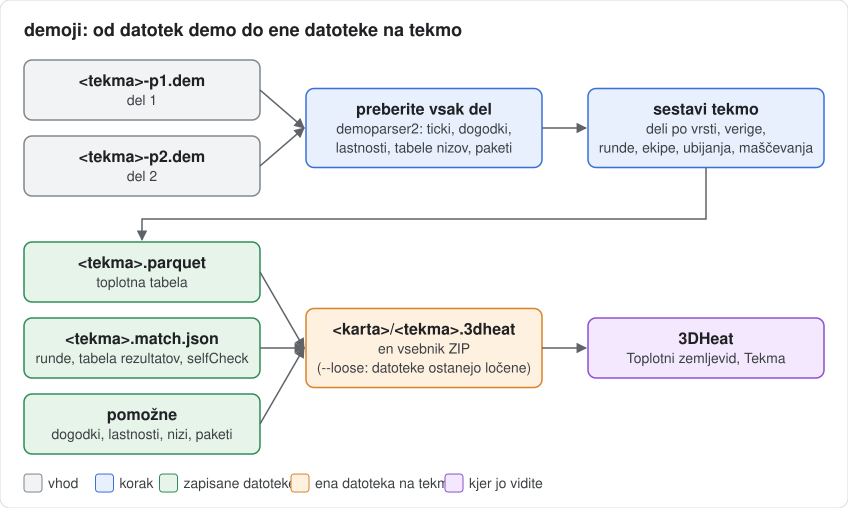

# 3DHeat CS2 {#dheat-cs2}

**Kaj je to?** Counter-Strike 2 lahko shrani posnetek tekme, imenovan *demo*. To orodje spremeni demo v
datoteke, ki jih pregledovalnik 3DHeat lahko prikaže v 3D: kje je vsak stal, umrl, vrgel in postavil bombo,
runda za rundo. Lahko pa tudi spremeni karto CS2 v 3D model, na katerem jih prikaže.

**Zakaj bi ga uporabil?** Da pregledate svoje tekme, da več tekem iste karte položite čez drug drugo kot en
toplotni zemljevid in za statistiko tekem, kot sta ADR (povprečna škoda na rundo) in KAST (delež rund, v katerih
je igralec ubil, asistiral, preživel ali bil maščevan).

**Primer:** `alpha-vs-bravo-m1.dem` noter, `out/de_x/alpha-vs-bravo-m1.3dheat` ven (`de_x` je izmišljeno ime
karte).



Podrobneje: 3DHeat CS2 spremeni **demoje Counter-Strike 2** v tabelo toplotnega zemljevida in dokument tekme na
vsako tekmo, **karto CS2** pa v geometrijo nivoja. Izhodi so narejeni za telemetrijski pregledovalnik
[3DHeat](https://holdi601.github.io/3DHeat/) ([izvorna koda](https://github.com/Holdi601/3DHeat)), vendar so
navadne datoteke - Parquet, JSON in binarni glTF -, ki jih lahko prebere tudi kaj drugega.

Gre za majhen paket Python, `heat3d_cs2`, ki se zažene iz ukazne vrstice. Demoje bere z diska (nobenega ne
prenese) s pomočjo [demoparser2](https://github.com/LaihoE/demoparser), karte pa izvozi iz nameščene igre z
ukazno različico Source2Viewer
([ValveResourceFormat](https://github.com/ValveResourceFormat/ValveResourceFormat)).

## Hitri začetek {#quick-start}

Še niste vajeni ukazne vrstice? Najprej preberite [Preden začneš](before-you-start.md).

```bash
pip install -r requirements.txt
python -m heat3d_cs2 demos <datoteke demo ali mape> -o out   # vsaka tekma v njih
python -m heat3d_cs2 map <karta> -o out/<karta>/<karta>.glb  # karta iz nameščene igre
python -m heat3d_cs2 scoreboard out/<karta>/<tekma>.3dheat   # tabela rezultatov tekme kot besedilo
```

**Videti bi moral** `1 match(es), 1 at a time ...`, nato eno vrstico na tekmo
(glejte [Ukazi](commands.md#what-is-printed)).

`demos` za vsako tekmo zapiše eno datoteko v mapo, poimenovano po karti:
`out/<karta>/<tekma>.3dheat`, [vsebnik `.3dheat`](output-container.md) - format pregledovalnika za eno
datoteko na tekmo ([specifikacija](https://holdi601.github.io/3DHeat/container.html)). Vsebuje te člene;
`--loose` jih zapiše kot ločene datoteke:

| Člen | Kaj vsebuje | Naložen v |
|---|---|---|
| `<tekma>.parquet` (vloga `table`) | vsak živ igralec osemkrat na sekundo s svojim stanjem (zdravje, denar, bliski, tarča, cona, inventar ...) in vsak dogodek, kjer se je zgodil (ubijanje, smrt, poškodba, strel, met, eksplozije granat, oslepitev, postavitev, deaktivacija, eksplozija in konec runde za vsakega igralca z nagrado, ki mu jo je runda prinesla), po ena vrstica za vsakega | zavihek Toplotni zemljevid |
| `<tekma>.match.json` (vloga `match`, dokument tekme) | ekipe, rezultat, vsaka runda (zmagovalec, kako, ekonomija, postavitev, ubijanja po vrsti, preobrati, preživeli) in vrstica tabele rezultatov za vsakega igralca | zavihek Tekma |
| `<tekma>.events/props/strings/packets.parquet` | vse drugo, kar demo vsebuje, v celoti (pomožne datoteke) | ohranjeno zaradi popolnosti |

`map` zapiše `<karta>.glb`: mrežo trkov karte - tla, stene, škatle, brez okrasja -, razdeljeno na tla in
konstrukcijo, v istem okvirju in enotah kot tabele, zato leži natančno pod toplotnim zemljevidom (plošča Ozadje / nivo).

## Zemljevid dokumentacije {#map-of-this-documentation}

| Stran | Kaj obravnava |
|---|---|
| [Preden začneš](before-you-start.md) | Python, terminal, nadomestila, kako izgledata uspeh in pogoste napake |
| [Namestitev](installing.md) | Python, paketi, ukazna vrstica Source2Viewer, kje mora biti CS2 |
| [Ukazi](commands.md) | `demos`, `map`, `scoreboard`: vsaka možnost, kaj se izpiše, izhodne kode |
| [Branje demoja](reading-demos.md) | kaj se bere iz datoteke demo: vzorčeni ticki, lastnosti igralcev, pravila igre, dogodki |
| [Gradnja tekme](building-matches.md) | deli in verige, ura tekme, runde, ekipe in strani, vrstice, ubijanja, maščevanja, začetki, škoda, bliski, ekonomija |
| [Statistika](statistics.md) | tabela rezultatov: K/D/A, ADR, KAST, HS%, začetki, maščevanja, večkratna ubijanja, preobrati, pripomočki, bliski |
| [Tabela toplotnega zemljevida](output-table.md) | datoteka Parquet: vsak stolpec, njegov tip, kateri dogodki ga polnijo, namigi v nogi `heat3d`, osi |
| [Dokument tekme](output-match-json.md) | dokument `.match.json`, polje za poljem |
| [Ena datoteka na tekmo](output-container.md) | vsebnik `.3dheat`, ki ga `demos` zapiše privzeto, `--loose` |
| [Izvoz karte](map-export.md) | kako se izvozi mreža trkov karte, okvir, imenovanje vozlišč, enote |
| [Uporaba s 3DHeat](using-with-3dheat.md) | nalaganje tabel, dokumentov tekem in kart v zavihka Toplotni zemljevid in Tekma pregledovalnika |
| [Omejitve](limits.md) | kaj je predpostavljeno, kaj ni obravnavano, kaj ni preverjeno |
| [Posodobitve](updates.md) | preverjanje izdaje ob zagonu in `python -m heat3d_update` |
| [Razvoj](development.md) | zgradba kode, testi, sintetični demo |
| [Priročnik ukazov](../cli-reference.md) | `--help` vsakega ukaza, ustvarjen iz kode |
| [Vzdrževanje](maintaining.md) | kontrolni seznam izdaje za te strani |

## Kaj je preverjeno {#what-it-is-checked-against}

Demoji z zunanjega sveta niso ena čista datoteka na tekmo. Pretvornik obravnava tekmo, razdeljeno na datoteke v
poljubnem vrstnem redu, strežnik, ponovno zagnan sredi tekme, dve različni tekmi, shranjeni pod enim imenom,
runde, obnovljene iz varnostne kopije, posnetek, ki se začne pozno ali konča zgodaj, premore in trenerje na strani
ekipe - glejte [Gradnja tekme](building-matches.md). Preverjeno na veliki zbirki turnirskih demojev: v vsaki tekmi
rezultat sledi zmagovalcem rund, ubijanja ene strani so smrti druge strani, in vsaka runda se začne s petimi proti
petim.

## Na kaj ga usmeriti {#what-to-point-it-at}

Demoje svojih tekem, demoje, ki ste jih ročno prenesli s turnirskega spletnega mesta, ali demoje iz API-ja, do
katerega imate dostop. Demo je posnetek, katerega vsebina pripada njegovemu izdajatelju in organizatorjem: rezultate
uporabi za svojo analizo in demojev ali podatkov iz njih ne deli naprej. Orodje bere posnetke z diska in nobenega ne
prenaša, iz igre pa ni priloženo nič: nobena datoteka igre, nobena koda igre, noben DLL.

3DHeat CS2 ni povezan z družbo Valve in ga Valve ne podpira. Counter-Strike 2 ter povezana imena in blagovne znamke
pripadajo svojim lastnikom. Imetniki pravic: odprite issue na
[github.com/Holdi601/3DHeat-CS2/issues](https://github.com/Holdi601/3DHeat-CS2/issues) - hitro odgovorimo in na
zahtevo odstranimo karkoli.

## Del 3DHeat {#part-of-3dheat}

3DHeat CS2 je eno od brezplačnih orodij okoli pregledovalnika 3DHeat, vsako s svojim repozitorijem, izdajami in
licenco:

| Orodje | Kaj počne | Dokumentacija |
|---|---|---|
| [3DHeat](https://github.com/Holdi601/3DHeat) | pregledovalnik: toplotni zemljevidi, analiza dirk in pregled tekem v 3D | [spletno mesto](https://holdi601.github.io/3DHeat/) |
| [GameFiles](https://github.com/Holdi601/3DHeat-GameFiles) | proge in nivoji iz datotek, ki jih igre prinašajo, kot 3D modeli | [spletno mesto](https://holdi601.github.io/3DHeat-GameFiles/) |
| [GameCapture](https://github.com/Holdi601/3DHeat-GameCapture) | telemetrija krogov iz dirkalnih iger; nivoji, obnovljeni iz videoposnetka igre | [spletno mesto](https://holdi601.github.io/3DHeat-GameCapture/) |
| [Unreal Exporter](https://github.com/Holdi601/3DHeat-UnrealExporter) | vtičnik za urejevalnik Unreal, ki izvozi nivo kot en 3D model | [spletno mesto](https://holdi601.github.io/3DHeat-UnrealExporter/) |
| [CS2](https://github.com/Holdi601/3DHeat-CS2) | demoji Counter-Strike 2 v tabele in dokumente tekem; karte v 3D modele | [spletno mesto](https://holdi601.github.io/3DHeat-CS2/) |
| [Watcher](https://github.com/Holdi601/3DHeat-Watcher) | v ozadju beleži, kaj igre objavijo o vaši igri | [spletno mesto](https://holdi601.github.io/3DHeat-Watcher/) |
| [Ext-WarThunder](https://github.com/Holdi601/3DHeat-Ext-WarThunder) | posnetki War Thunder v tabele in dokumente tekem | [spletno mesto](https://holdi601.github.io/3DHeat-Ext-WarThunder/) |
| [Ext-WoT](https://github.com/Holdi601/3DHeat-Ext-WoT) | posnetki World of Tanks v tabele in dokumente tekem | [spletno mesto](https://holdi601.github.io/3DHeat-Ext-WoT/) |
| [Ext-WoWs](https://github.com/Holdi601/3DHeat-Ext-WoWs) | posnetki World of Warships v tabele in dokumente tekem | [spletno mesto](https://holdi601.github.io/3DHeat-Ext-WoWs/) |
| [Ext-Squad](https://github.com/Holdi601/3DHeat-Ext-Squad) | demoji strežnikov Squad v tabele in dokumente tekem | [spletno mesto](https://holdi601.github.io/3DHeat-Ext-Squad/) |
| [Ext-DCS](https://github.com/Holdi601/3DHeat-Ext-DCS) | karte DCS World v 3D modele | [spletno mesto](https://holdi601.github.io/3DHeat-Ext-DCS/) |
| [Ext-IL2](https://github.com/Holdi601/3DHeat-Ext-IL2) | karte IL-2 Sturmovik v 3D modele | [spletno mesto](https://holdi601.github.io/3DHeat-Ext-IL2/) |

## Licenca {#licence}

MIT - glejte [`LICENSE`](https://github.com/Holdi601/3DHeat-CS2/blob/main/LICENSE) in
[`LICENSES.md`](https://github.com/Holdi601/3DHeat-CS2/blob/main/LICENSES.md) za pakete tretjih oseb.
