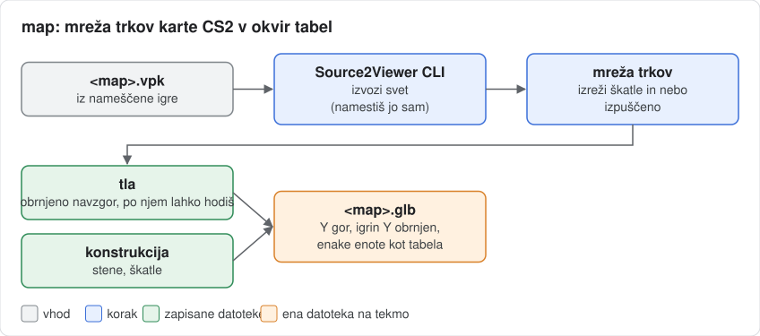

# Izvoz karte (`map`) {#map-export-map}

`python -m heat3d_cs2 map <karta> -o <datoteka.glb>` zapiše karto CS2 kot geometrijo nivoja: **mrežo trkov** sveta, v
okvirju in enotah, v katerih so narisane [toplotne tabele](output-table.md). Koda:
[`heat3d_cs2/mapexport.py`](https://github.com/Holdi601/3DHeat-CS2/blob/main/heat3d_cs2/mapexport.py),
[`heat3d_cs2/glb.py`](https://github.com/Holdi601/3DHeat-CS2/blob/main/heat3d_cs2/glb.py).
Možnosti in sporočila: [Ukazi](commands.md#map---a-maps-geometry-as-glb).



## Zakaj mreža trkov {#why-the-collision-mesh}

Mreža trkov je tisto, na kar igralci stojijo in za čimer se skrivajo – tla, stene, stopnice, zaboji – brez okrasja: brez
rekvizitov, ki le izgledajo kot nekaj, brez tekstur, bistveno manj trikotnikov kot upodobitvene mreže. Toplotni zemljevid
potrebuje prav to pod seboj: nekaj, glede na kar se beri položaje, ne upodobitev karte.

## Kako se pridobi {#how-it-is-obtained}

1. **Poiščite karto.** Pot, ki se konča z `.vpk` in obstaja, se uporabi tako, kot je podana. Sicer se `<ime>.vpk` išče v
   `<mapa CS2>\game\csgo\maps\`, kjer je mapa CS2 `--game`, ali `steamapps\common\Counter-Strike Global Offensive` v vsaki
   najdeni knjižnici Steama (glejte [Namestitev](installing.md#where-cs2-is-looked-for)).
2. **Poiščite ukazno vrstico Source2Viewer**: `--source2viewer`, nato `HEAT3D_SOURCE2VIEWER`, nato `Source2Viewer-CLI` /
   `Source2Viewer-CLI.exe` na `PATH`.
3. **Izvozite fiziko sveta.** Source2Viewer se požene kot

   ```text
   Source2Viewer-CLI -i <karta>.vpk -d -f maps/<karta>/world_physics.vmdl_c --gltf_export_format glb -o <začasna mapa>
   ```

   Dekodira prevedeno fiziko Source 2 iz lastnega arhiva karte in zapiše model (prazen: svet nima lastne upodobitvene
   mreže) in njegovo fiziko poleg. Največji zapisani `.glb` je fizika. Če Source2Viewer spodleti ali ne zapiše `.glb`, se
   ukaz ustavi in pokaže zadnjih 800 znakov njegovega izpisa in napak.
4. **Preberite.** Vsako vozlišče scene se prehodi s svojo transformacijo (matrika ali prevajanje-rotacija-merilo), vzame se
   vsak trikotniški primitiv, z ali brez indeksnega bufferja, v svetovnih položajih.
5. **Izločite, kar ni stena ali tla.** Vozlišče, katerega ime vsebuje `clip` – clipi igralcev, clipi NPC-jev, clipi granat:
   nevidne stene, ki zaustavljajo igralce in granate – ali `sky`, ne glede na velikost črk, se opusti.
6. **Poimenujte površino.** Fizične skupine so poimenovane po svoji površini; ime v malih črkah brez začetnega `physics`,
   `physics_group` ali `physics_passbullets` (in podčrtaja za njim) je površina: `physics_group_concrete` je `concrete`,
   `physics_passbullets_chainlink` je `chainlink`, goli `physics_group` pa `world`. Površine, skozi katere gredo naboji,
   se ohranijo.
7. **Nazaj v okvir igre.** Source2Viewer zapiše glTF v metrih z Y navzgor: igrin (Y, Z, X) pomnožen z 0,0254. To se
   razveljavi – vsaka točka postane igrin (X, Y, Z) v palcih.
8. **Ločite tla od konstrukcije**, trikotnik za trikotnikom: ploskev, katere normala kaže navzgor vsaj za 0,7 (njena
   komponenta Z, normalizirana) – nakloni do približno 45 stopinj, približno najstrmejše, po kateri hodi igralec CS2 – je
   **tla**; vse drugo, vključno s stenami in stropovi, je **konstrukcija**.
9. **V okvir pregledovalnika.** Vsaka točka se zapiše kot (X, Z, -Y): Y navzgor, igrin Y negiran – okvir, v katerem
   pregledovalnik riše tabele, kadar sledi njihovim namigom `heat3d`. Rotacija, ne zrcaljenje.
10. **Zapišite `.glb`.** Če nič ne ostane (samo clip-kosi), se ukaz ustavi z napako. Sicer izpiše datoteko, karto, število
    trikotnikov, koliko jih je tal in število delov.

Tu se ne bere nič razen lastnega `.vpk` karte, nič od Source2Viewer pa ni priloženo ali kopirano.

## Datoteka {#the-file}

Binarni glTF 2.0 (`.glb`), en medpomnilnik, zapisan z `heat3d_cs2` (`asset.generator`):

| Vidik | Kaj |
|---|---|
| Vozlišča | eno na del, vsa v korenu, brez transformacij, vsako s svojo mrežo istega imena |
| Imena vozlišč | `ground:<površina>` ali `structure:<površina>` (`ground:concrete`, `structure:metal`, `structure:world`), urejena po imenu |
| Primitivi | eden na mrežo, trikotniki, `POSITION` (float32, z min/max) in `NORMAL` (float32), indeksi `uint32` |
| Senčenje | ploskovno: en vrh na kot trikotnika, vsak nosi normalo svojega trikotnika |
| Materiali, teksture, UV, barve | nobeni |
| Enote | enote igre (**palci**), ne metri – drugače, kot glTF predpostavlja |
| Okvir | (X, Z, -Y) igre: Y glTF je višina igre, Z glTF je -Y igre |

Predpona `ground:` / `structure:` je konvencija vseh izvoznikov nivojev 3DHeat: pregledovalnik vzame del z
dano predpono za res, namesto da bi ugibal iz geometrije, zato tla dobijo senčenje tal, stene pa risbo konstrukcije brez
koraka klasifikacije.

Ker so enote palci, drugi pregledovalnik glTF prikaže karto približno 39-krat prevelik (bere jih kot metre); če je to
pomembno, pomnoži z 0,0254. V 3DHeat leži točno pod tabelo, ki je v istih enotah z merilom 1.

## Preverjanje, da je okvir pravilen {#the-check-that-the-frame-is-right}

Test `test_players_stand_on_the_exported_floor` (teče samo, ko sta dana demo in Source2Viewer, glejte
[Razvoj](development.md#tests)) izvozi karto, na kateri je bil demo igran, vzame 300 naključnih vzorcev položaja iz tekme
in za vsakega pogleda naravnost navzdol za najvišjo ploskev tal, največ 4 enote nad stopali igralca. Zahteva, da vsaj 98 %
vzorcev najde tla, in da je mediana višine nad njimi manjša od 5 enot. Zrcaljena karta ne uspe: pri karti, zrcaljeni z
napačno osjo, velik delež igralcev stoji nad praznim. README navaja številke tega preverjanja za karte trenutnega
tekmovalnega nabora.

## Česa ne naredi {#what-it-does-not-do}

- Ni upodobitvene geometrije, tekstur ali okrasja – glejte *zakaj* zgoraj.
- Izvozi se samo, kar je v modelu `world_physics` karte. Ali so v njem premični deli (vrata) ali rušljivi predmeti, ni
  preverjeno.
- Brez poenostavitve: pregledovalnik 3DHeat poenostavi ob uvozu z nastavitvijo za poenostavitev.
- Karte, ki niso v nameščeni igri (delavniške karte drugje na disku), delujejo, kadar je njihov `.vpk` podan kot pot in
  vsebuje `maps/<ime>/world_physics.vmdl_c`; ni preverjeno.
