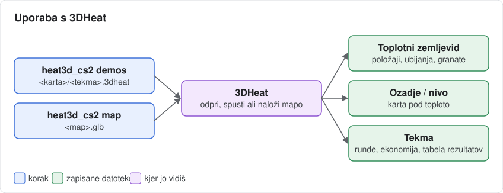

# Uporaba s 3DHeat {#using-it-with-3dheat}

Izhodi gredo na ta mesta v [pregledovalniku 3DHeat](https://holdi601.github.io/3DHeat):

| Datoteka | Kje | Kaj da |
|---|---|---|
| `<tekma>.3dheat` (privzeto) | zavihek **Toplotni zemljevid**, plošča **Vir**, ali zavihek **Tekma** | tabela in dokument tekme skupaj, ena datoteka na tekmo ([vsebnik](https://holdi601.github.io/3DHeat/container.html)) |
| `<tekma>.parquet` | zavihek **Toplotni zemljevid**, plošča **Vir** | položaji in dogodki kot toplotni zemljevid, predvajanje v škatli, poti |
| `<tekma>.match.json` | zavihek **Tekma**, **Naloži datoteke tekem…** | lestvica, runde, tok ubojev, statistika čez tekme, povezave v toplotni zemljevid |
| `<karta>.glb` | plošča **Ozadje / nivo**, **3D-model…** | karta pod toplotnim zemljevidom |

Dokumentacija pregledovalnika opisuje vsak zavihek v celoti: njegove strani
[Analiza tekme](https://holdi601.github.io/3DHeat/match-analysis.html),
[Nalaganje datotek](https://holdi601.github.io/3DHeat/loading-files.html),
[Preslikava stolpcev](https://holdi601.github.io/3DHeat/column-mapping.html) in
[Predvajanje v škatli](https://holdi601.github.io/3DHeat/box-replay.html). Ta stran je CS2 stran tega.



Pregledovalnik: [github.com/Holdi601/3DHeat](https://github.com/Holdi601/3DHeat),
dokumentacija [holdi601.github.io/3DHeat](https://holdi601.github.io/3DHeat/).

## Običajna seja {#a-typical-session}

```bash
python -m heat3d_cs2 demos D:\Demos\dogodek -o out
python -m heat3d_cs2 map <karta> -o out/<karta>/<karta>.glb
```

1. **Zavihek Toplotni zemljevid -> Vir:** izberite mapo `out/<karta>` (ali jo spustite). Vsaka `.parquet` v njej postane en
   nabor podatkov; datoteke `.json` in `.glb` v isti mapi se preskočijo kot »not a csv/parquet file«. Naložite jo.
2. **Ozadje / nivo -> 3D-model…:** izberite `out/<karta>/<karta>.glb`. **Shrani v knjižnico** jo hrani v brskalniku za
   naslednjič.
3. **Zavihek Tekma -> Naloži datoteke tekem…:** izberite datoteke `.match.json` iz iste mape (več hkrati), ali jih spustite na
   pregledovalnik, medtem ko je odprt zavihek Tekma.

Naložite samo tabele ene karte naenkrat: koordinate različnih kart se prekrivajo, toplotni zemljevid dveh kart hkrati pa
ne pomeni ničesar. Mapa na karto je zato.

## Tabela se odpre brez nastavitev {#the-table-opens-with-nothing-to-set}

Pregledovalnik prebere vnos `heat3d` v nogi prve izbrane datoteke ([Namigi v nogi heat3d](output-table.md#the-heat3d-footer-hints))
in ga položi čez svoje ugibe:

| Nastavitev pregledovalnika | Nastavi na |
|---|---|
| Položaj | `x`, `y`, `z` |
| Os navzgor v viru | Z je navzgor |
| Obrni Y | vklopljeno – da je karta prav obrnjena, ne zrcaljena |
| Merilo enot | 1 – razdalje v enotah igre (označene z »m«; 1 enota = 1 palec) |
| Čas | `time`, sekunde |
| Oseba | `player` |
| Skupina | `side` (T / CT) |
| Seja | `roundId` – vsaka runda je seja, `<tekma> #NN` |
| Smer pogleda | vektor, `dirX` / `dirY` / `dirZ` |
| Filtrirni stolpci | `event`, `match`, `round`, `roundTime`, `phase`, `weapon`, `place`, `won`, `buy`, `opening`, `team` |
| Velikost entitete | 32 – predvajanje v škatli nariše igralca 32 enot široko, z žarkom pogleda 4 x 32 |

Vsaka namigana vrednost je še vedno vidna v preslikavi stolpcev in jo je mogoče spremeniti. Druge stolpce (`headshot`,
`traded`, `other`, `steamid`, `health`, `money`, `damage`, `duration`, ...) lahko tam ročno dodate kot filtre.

Merilo enot pusti na 1, kadar je karta naložena: `.glb` je v istih enotah igre, nivo pa se s tabelo ne preoblikuje.

### Uporabni filtri {#useful-filters}

- `event` = `position` za to, kje so bili igralci; `kill` / `death` za to, kje so bili dvoboji dobljeni in izgubljeni;
  `smoke`, `flash`, `molotov`, `he` za to, kje so pristali pripomočki; `throw` za to, od koder so bili vrženi; `plant`
  za mesta postavitev.
- `side` (skupina) = `T` ali `CT`, `phase` = `live`, da se izpusti faza po koncu, `buy` = `eco` / `force` / `full` za runde
  enega ekonomskega stanja, `won` = 1 za runde, ki jih je stran vrstice dobila.
- `opening` = 1 z `kill` in `death` za dvoboje prvega ubijanja.
- `roundTime` kot obseg za trenutek runde: prvih 20 sekund, stanje po postavitvi.

## Zavihek Tekma {#the-match-tab}

Zavihek Tekma sprejme datoteko JSON, katere `format` je `heat3d-cs2-match` in ki ima nize `rounds`, `players` in `teams`
([Dokument tekme](output-match-json.md)). Prikaže rezultat in polčasa, trak rund, obarvan po zmagovalni strani z oznako,
kako je vsaka končala, ekonomijo vsake runde, postavitev, tok ubojev, clutche in preživele, lestvico in statistiko čez vse
naložene tekme.

Njegove povezave **Prikaži na toplotnem zemljevidu** ne naložijo ničesar. Nastavijo filtre na tabeli, ki je že naložena v
zavihku Toplotni zemljevid – `match`, `round` (in sejo runde `<tekma> #NN`), `event`, igralca, stran. To deluje, ker dokument
tekme in tabela nosita ista imena tekem, številke rund, imena igralcev in strani. **Posnetek runde** preklopi toplotni zemljevid
na predvajanje v škatli in predvaja sejo runde od njenega začetka.

Zato naložite oboje: tabele kart v zavihku Toplotni zemljevid in njihove dokumente tekem v zavihku Tekma. Dokument tekme brez
tabele še vedno prikaže lestvico in runde, povezave pa povedo, da ni naložen noben podatek toplotnega zemljevida.

## Brez 3DHeat {#without-3dheat}

- Tabela je navaden Parquet: pandas, Polars, DuckDB, Spark, R-jev `arrow` jo vsi preberejo; namig `heat3d` se prezre, besedilni
  stolpci pa se preberejo kot nizi ali kategorije.
- Dokument tekme je navaden JSON.
- Karta je veljaven binarni glTF, v palcih in ne v metrih: za orodja, ki predpostavljajo metre, pomnoži z 0,0254. Njen okvir
  je glTF-jev lasten (Y navzgor), zato za prekrivanje tabele drugje riši vsak vnos (x, y, z) kot (x, z, -y), kakor to počne
  3DHeat.
