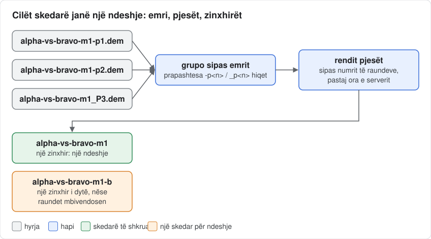

# Ndërtimi i një ndeshjeje {#building-a-match}

Si bëhet një ndeshje nga pjesët e demos së saj: cilat skedarë i përkasin njëri-tjetrit, një orë e vetme për të gjithë, raundet dhe si u fituan, ekipet dhe anët e tyre, dhe çdo rresht i tabelës së hartës së nxehtësisë me vrasje, shkëmbime, hapje, dëme, flashe dhe ekonomi. Kodi:
[`heat3d_cs2/match.py`](https://github.com/Holdi601/3DHeat-CS2/blob/main/heat3d_cs2/match.py).
Tabela e rezultateve e llogaritur prej tij është te [Statistikat](statistics.md).

## Përmbledhje {#overview}

1. Lexohet çdo skedar i një emri ndeshjeje ([Leximi i një demoje](reading-demos.md)).
2. Zgjidhen rreshtat e dyfishtë të lojtarëve në çdo skedar (raunde të rikthyera).
3. Skedarët renditen në **zinxhirë** - ndeshje - dhe çdo zinxhir vihet në
   rregull.
4. Çdo pjesë vendoset në **orën e ndeshjes**.
5. **Raundet** gjenden në çdo pjesë; përshkrimi i një pjese të mëvonshme për një raund
   zëvendëson atë të një pjese më të hershme.
6. **Lojtarët** dhe **ekipet** emërtohen, dhe anët e çdo raundi dhe rezultati
   jepen sipas emrit të ekipit. Kur anët dihen, vijojnë gjatësia e pjesës së lojës, raundet
   me pistoleta dhe **blerja** (buy) e secilës anë.
7. Ndërtohen **rreshtat**: pozicionet, të shtënat, hedhjet, shpërthimet, vendosjet e bombës,
   çaktivizimet, vrasjet, vdekjet, goditjet, verbimet, shpërthimet.
8. Çdo rresht shënohet me raundin, fazën, kohën e raundit, nëse ana e tij
   fitoi dhe blerjen e anës së tij; rreshtat jashtë çdo raundi hidhen tej.

## Raunde të rikthyera: një rresht për lojtar për tick {#restored-rounds-one-row-per-player-per-tick}

Kur një raund rikthehet nga një kopje rezervë brenda një skedari, demoja mban
trupat e vjetër të lojtarëve pranë të rinjve për disa sekonda: dy rreshta për një
lojtar në një tick, njëri ku e la raundi i anuluar, tjetri te pika e shfaqjes
së raundit të rikthyer. Për çdo lojtar të tillë, tick-et e dyfishuara përshkohen
**prapa**, duke nisur nga rreshti i parë i vetëm pas tyre: në çdo tick mbahet kandidati
më afër pozicionit që vijon, dhe ai bëhet referenca për
tick-un para tij. Pa asnjë rresht të vetëm pas tyre, mbahet kandidati i fundit.
Kështu çdo lojtar mban rreshtin që të çon te vendi ku shkon më pas.

## Pjesa live e një skedari {#the-live-part-of-a-file}

**Fillimi live** i një skedari është tick-u i ngjarjes së tij të fundit `round_announce_match_start`,
ose tick 0 nëse nuk ka asnjë (një pjesë e mëvonshme e një ndeshjeje të ndarë zakonisht
nuk ka). Gjithçka para fillimit live lihet jashtë, si dhe gjithçka
e shënuar me `is_warmup_period`. Një raund me thika ose një rinisje para
njoftimit lihet pra jashtë; një raund me thika që *nuk* ndiqet nga një njoftim
fillimi ndeshjeje nuk njihet si i tillë (shih [Kufizimet](limits.md)).

**Raundet** e një skedari janë ngjarjet `round_freeze_end` nga fillimi live e tutje,
jashtë ngrohjes, të identifikuara nga `total_rounds_played` (indeksi nga 0 i
raundit që do të luhet). Një skedar pa asnjë nuk ka raunde dhe
nuk i përket asnjë ndeshjeje.

## Ora {#the-clock}

Kohët janë në sekonda. Brenda një skedari, koha numërohet në **tick-e**: `game_time` i
serverit te tick-u i parë i marrë si mostër, plus tick-et që nga ai moment / 64.
Ora e vetë serverit ndalon gjatë një pauze ndërsa tick-et vazhdojnë;
të lexuara përmes orës, dy momente të një ndeshjeje në pauzë do të kishin të njëjtën kohë.

Çdo skedar ka një *orë të parë* (koha në fillimin e tij live) dhe një *orë të fundit*
(te tick-u i tij i fundit i marrë si mostër).

### Pjesët dhe zinxhirët {#parts-and-chains}

Skedarët me emër të njëjtë ndeshjeje ([Komandat](commands.md#which-files-are-one-match))
renditen së pari sipas indeksit të raundit të tyre të parë, pastaj sipas orës së parë.
Pastaj secili, sipas këtij rendi, bashkohet me zinxhirin e parë që e vazhdon, ose
hap një zinxhir të ri. Një pjesë e vazhdon një zinxhir kur indeksi i raundit të saj të parë është
të paktën indeksi i fundit i pjesës së fundit të zinxhirit, **dhe** ose

- ora e serverit vazhdon: ora e saj e parë nuk është më e hershme se ora e fundit
  e zinxhirit minus 5 s; ose
- numri i raundeve vazhdon: indeksi i raundit të saj të parë është indeksi i fundit i zinxhirit
  ose ai pas tij.

Numri vendos dhe ora zgjidh barazimet, sepse një server i rinisur për të
rikthyer një raund e nis orën përsëri, ndërsa dy ndeshje të ndryshme me një
emër (të njëjtat ekipe në të njëjtën hartë në dy ngjarje) kanë numra raundesh
që mbivendosen. Zinxhirët renditen sipas numrit të raundeve që mbulojnë, më i madhi së pari;
i pari mban emrin e ndeshjes, të tjerët shkruhen si `<name>-b`,
`<name>-c`, ...

### Ora e ndeshjes {#the-match-clock}

Zeroja e ndeshjes është ora e parë e pjesës së parë: **koha 0 e ndeshjes është fillimi live
i skedarit të parë**. Çdo pjesë e mëvonshme vendoset mbi të:

- ku ora e serverit vazhdon (ora e saj e parë nuk është më e hershme se ora e fundit
  e pjesës së mëparshme minus 5 s), ora e serverit përdoret siç është;
- ku është rinisur, pjesa vendoset të ndjekë **një sekondë** pasi
  pjesa e mëparshme mbaroi.

## Raundet {#rounds}

Për çdo `round_freeze_end` të një pjese (sipas rendit të tick-eve), dritarja e raundit
shkon deri te fundi i ngrirjes tjetër në atë pjesë, ose deri te fundi i skedarit. Brenda saj,
raundi **vendoset** te tick-u i parë i marrë si mostër ku gjendja e lojës tregon
`total_rounds_played` = indeksi i raundit + 1 dhe `round_win_status` 1 (një
barazim), 2 (fitoi T) ose 3 (fitoi CT). Një raund pa një mostër të tillë në dritaren e tij
u ndërpre nga fundi i skedarit; numri i tij hyn në listën **incomplete** të ndeshjes
(përveç nëse një pjesë tjetër e ka raundin të plotë).

| Fusha e raundit | Nga |
|---|---|
| `number` | indeksi + 1 (nga 1, siç e numëron loja) |
| `start` | koha e ndeshjes kur mbaron koha e ngrirjes - lojtarët mund të lëvizin |
| `end` | koha e ndeshjes e mostrës së parë që tregon raundin të vendosur |
| `until` | koha e ndeshjes e `round_prestart` të ardhshëm pas `end`, nëse është brenda dritares; përndryshe fundi i dritares ose tick-u i fundit i skedarit, cilido vjen i pari (dhe kurrë para `end`) |
| `winner` | `T` për statusin e fitores 2, `CT` për 3, bosh për 1: një barazim është i vendosur, pa fitues |
| `reason` | `round_win_reason` në atë mostër, emërtuar si më poshtë |
| `score` | emri i ekipit -> raundet e fituara pas këtij: `team_rounds_total` i secilës anë në mostrën vendimtare; ku demoja nuk ka, rezultati i raundit të mëparshëm plus një për fituesin |
| `sides` | emri i ekipit -> `T` / `CT` këtë raund |
| `equipment` | ana -> shuma e `current_equip_value` e lojtarëve **të gjallë** të asaj ane në mostrën e parë në ose pas fundit të ngrirjes |
| `buy` | ana -> `pistol`, `eco`, `force` ose `full` ([Ekonomia](#economy-and-buy-types)) |
| `plant` | `bomb_planted` i parë pas fundit të ngrirjes dhe deri në `end`, ose asnjë |
| `exploded` | koha e ndeshjes e `bomb_exploded` të parë pas atij vendosjeje dhe para fundit të ngrirjes tjetër, nëse ka (nuk është në dokumentin e ndeshjes; i jep kohën rreshtit `explode`) |

`reason`, nga `CSRoundEndReason` i lojës:

| Kodi | `reason` |
|---|---|
| 1 | `bomb` (objektivi u bombardua) |
| 7 | `defuse` |
| 8, 9 | `elimination` (CT fitojnë / T fitojnë me eliminim) |
| 10 | `draw` |
| 12 | `time` (objektivi u shpëtua) |
| 17, 18 | `surrender` |
| çdo gjë tjetër | `other` |

Kur disa pjesë mbajnë të njëjtin raund (sipas indeksit), mbahet versioni i pjesës
së mëvonshme. Raundet pastaj listohen sipas indeksit. Një ndeshje raundi i parë i së cilës nuk
është raundi 1 regjistron numrat që mungojnë (`missing` në dokumentin e ndeshjes); rreshti i
komandave thotë *recorded from round N*.

### Vendosja e bombës {#the-plant}

| Fusha | Nga |
|---|---|
| `site` | `A` ose `B`: zona e bombës ku loja thotë se qëndronte vendosësi (`which_bomb_zone`, 1 A, 2 B); pa të, emri i vendit të vendosësit (`BombsiteA`, `BombsiteB`); pa atë, shkronja që dha një vendosje tjetër e të njëjtit skedar në të njëjtën zonë (`site` i ngjarjes është numri i entitetit të zonës). Bosh kur asgjë nuk e tregon - kurrë numri. |
| `time` | sekonda **brenda raundit** (që nga fundi i ngrirjes), si koha e një vrasjeje |
| `player`, `steamid` | vendosësi |
| `x`, `y`, `z` | pozicioni i vendosësit, në njësi loje: ku ndodhet bomba |
| `place` | emri i vendit të vendosësit gjatë vendosjes |

### Fazat {#the-phases}

Koha nga `start` te `end` është faza **live** e raundit; nga `end` te
`until` faza e tij **after**, ku fituesit gjuajnë dhe humbësit shpëtojnë pajisjet. Një
rresht i përket raundit `[start, until)` i të cilit përmban kohën e tij, dhe është
`after` kur koha e tij është më e vonë se `end`. Koha e ngrirjes shtrihet midis raundeve
dhe nuk është në asnjë.

## Lojtarët dhe ekipet {#players-and-teams}

Një **lojtar** është secili që ishte i gjallë të paktën një herë në një anë (ekipi 2 ose 3),
jashtë kohës së ngrirjes dhe ngrohjes, pas fillimit live. Një trajner ose një komentues në
anën e një ekipi nuk është kurrë i gjallë dhe nuk është lojtar. Çdo lojtar identifikohet me Steam
ID; emri është i fundit i parë.

**Ekipi** i një lojtari është emri i klanit që loja i dha anës së tij
(`team_clan_name`), ai i parë më shpesh për të - demoja e pastron në
fund të fundit. Një ndeshje e luajtur pa emra klanesh i emërton ekipet e saj sipas anës
ku nisën: `Started T` dhe `Started CT`.

**Anët** e çdo raundi vijnë nga kush ishte në cilën anë midis fundit të ngrirjes
dhe fundit të raundit: çdo ana merr etiketën e ekipit që mbartin shumica e lojtarëve të saj.
Lista `teams` e ndeshjes është sipas renditjes së shfaqjes, raund pas raundi, ana T
para ana CT; zakonisht ekipi që nisi si T është i pari.

## Rreshtat {#the-rows}

Çdo mostër pozicioni dhe çdo ngjarje bëhet një rresht i
[tabelës së hartës së nxehtësisë](output-table.md). Lojtarët janë në një anë vetëm kur
`team_num` i tyre është 2 ose 3.

### Pozicionet {#positions}

Nga rreshtat e marrë si mostër të lojtarëve të gjallë në një anë, jashtë kohës së ngrirjes dhe
ngrohjes, pas fillimit live: pozicioni, drejtimi i shikimit, shëndeti, parzmorja,
paratë, vlera e pajisjeve, arma në dorë, vendi.

Drejtimi i shikimit është një vektor njësi në sistemin e lojës:
`(cos pitch * cos yaw, cos pitch * sin yaw, -sin pitch)` - pitch i lojës është
pozitiv kur shikon poshtë, kështu që shikimi poshtë jep një Z negative.

Arma në dorë është `active_weapon_name` siç e emërton loja, përveç që çdo
emër që përmban `Knife`, `Bayonet`, `Karambit` ose `Daggers` bëhet `Knife`.

### Të shtënat dhe hedhjet {#shots-and-throws}

Nga `weapon_fire`, te pozicioni i gjuajtësit. Thikat (`knife`, `bayonet` në
id-në e armës) dhe C4 lihen jashtë. Granatat (`smokegrenade`,
`flashbang`, `hegrenade`, `molotov`, `incgrenade`, `decoy`) janë rreshta **throw**,
gjithçka tjetër rreshta **shot**. Arma emërtohet siç e tregon loja
(më poshtë).

### Shpërthimet e granatave {#grenade-detonations}

| Ngjarja | Rreshti | `weapon` |
|---|---|---|
| `smokegrenade_detonate` | `smoke` | Smoke Grenade |
| `flashbang_detonate` | `flash` | Flashbang |
| `hegrenade_detonate` | `he` | High Explosive Grenade |
| `inferno_startburn` (molotov dhe incendiary) | `molotov` | Molotov |
| `decoy_detonate` | `decoy` | Decoy Grenade |

Pozicioni është **ku shpërtheu granata** (`x`, `y`, `z` të ngjarjes);
lojtari dhe ana janë të hedhësit. Demoja nuk emërton asnjë vend për një
granatë, vetëm për lojtarët, prandaj `place` lihet bosh: një rresht nuk pretendon një
vend ku nuk ishte. Vendi i hedhësit në atë moment mbahet si
`throwerPlace`.

### Vendosjet dhe çaktivizimet {#plants-and-defuses}

Rreshtat `plant` dhe `defuse` te pozicioni i lojtarit, arma `C4 Explosive`.
Një bombë e vendosur që shpërtheu merr një rresht **explode**: te pozicioni i
vendosjes, në kohën e `bomb_exploded`, vendosësi si lojtar (me Steam ID-në e tij),
ana `T`, ekipi T i raundit si `team`, dhe vendi i vendosjes. Kjo përfshin një bombë që shpërthen
pasi T-të kishin fituar tashmë me eliminim. Ku demoja nuk ka `bomb_exploded`,
një raund i fituar nga bomba (`reason` = `bomb`) me një vendosje merr rreshtin në `end`
të raundit.

### Vrasjet dhe vdekjet {#kills-and-deaths}

Çdo `player_death` në një raund jep një **regjistër vrasjeje** (tabela `kills` e ndeshjes) me:

| Fusha | Është |
|---|---|
| attacker, victim, assister | emrat, Steam ID-të, anët; sulmuesi është bosh për botën (dëmi nga rënia, bomba) |
| `weapon` | arma e ngjarjes e emërtuar siç e tregon loja |
| `headshot` | flamuri i ngjarjes |
| `wallbang` | `penetrated` > 0 |
| `throughSmoke` | `thrusmoke` |
| `flashAssist` | `assistedflash` |
| `noscope`, `attackerBlind` | flamujt e ngjarjes (`noscope`, `attackerblind`); kolona të rreshtave `kill` dhe `death`, dhe në vrasjet e dokumentit të ndeshjes |
| `suicide` | sulmuesi dhe viktima janë i njëjti lojtar: një granatë e vetë, të themi |
| `teamkill` | sulmuesi dhe viktima në të njëjtën anë, me një sulmues, dhe jo vetëvrasje |
| `opening` | vrasja e parë e një armiku në raund (më poshtë) |
| `traded`, `trade` | më poshtë |
| positions | pozicioni dhe vendi i sulmuesit dhe i viktimës |

Nga çdo regjistër tabela merr një rresht **death** te pozicioni i viktimës
(çdo vdekje, edhe ato të botës, vrasjet në ekip dhe vetëvrasjet) dhe - për vrasjet
nga një armik (një sulmues, jo teamkill, jo vetëvrasje) - një rresht **kill** te
pozicioni i vrasësit.

**Opening.** Vrasja e parë e një armiku në çdo raund ndërsa është live është
duelja e tij e hapjes. Një teamkill, një vetëvrasje ose një vdekje nga bota para saj
anashkalohen, kështu që hapja është prapë duelja e parë e raundit; një raund
pa vrasje armiku ndërsa është live nuk ka hapje.

**Traded** dhe **trade.** Një vdekje nga një armik është **traded** kur vrasësi i saj
vritet nga dikush i anës së viktimës brenda **5 sekondave** pas saj (më shumë se
0 dhe më së shumti 5 s më vonë, në të njëjtin raund); vrasja e parë e tillë është një
vrasje **trade**. Në tabelë, kolona `traded` e një rreshti `kill` është 1 për një vrasje
trade; ajo e një rreshti `death` është 1 për një vdekje që u hakmor. Vrasjet e fazës
after llogariten gjithashtu.

### Dëmi {#damage}

Nga `player_hurt`, vetëm midis **armiqve** (të dy në një anë, anë të ndryshme). Dëmi
është shëndeti që u **humb** realisht: për çdo viktimë në çdo raund,
shëndeti nis nga 100; çdo goditje llogarit `min(dmg_health, health before)`,
dhe `health` i ngjarjes (ai që mbetet) bëhet "para" e goditjes tjetër. Një
goditje në kokë me dëm 137 mbi një lojtar me 40 shëndet llogaritet 40, siç e llogarit
tabela e rezultateve e lojës. Goditjet nga `hegrenade`, `inferno`, `molotov` dhe
`incgrenade` janë dëm **utility**. Çdo goditje është një rresht **hurt** te
pozicioni i viktimës, sulmuesi si `other`. Dëmi ndaj ekipit dhe dëmi ndaj vetes
nuk janë as në tabelë as në statistika.

### Flashet {#flashes}

Nga `player_blind`, vetëm **armiqtë** (jo shokët e ekipit, dhe jo një trajner ose
komentues që shikon): një rresht **blind** për lojtar të verbuar, te pozicioni
i lojtarit të verbuar, flashuesi si `other`, koha e verbimit në sekonda si
`duration`. Çdo kohëzgjatje mbahet; statistikat numërojnë vetëm verbimet prej të paktën
një sekonde.

## Emrat e armëve {#weapon-names}

Një id arme nga një ngjarje (`ak47`, `weapon_ak47`, `knife_karambit`) shfaqet
siç e emërton loja te `active_weapon_name` i vetë lojtarëve, kështu që arma e një vrasjeje
dhe një armë në dorë lexohen njësoj: `ak47` -> `AK-47`, `m4a1` -> `M4A4`,
`m4a1_silencer` -> `M4A1-S`, `hkp2000` -> `P2000`, `taser` -> `Zeus x27`,
`inferno` dhe `molotov` -> `Molotov`, `incgrenade` -> `Incendiary Grenade`,
`c4` dhe `planted_c4` -> `C4 Explosive`, `world` -> `World`, dhe kështu me radhë për
çdo armë dhe granatë (tabela `WEAPONS` në `match.py`). Çdo gjë me
`knife` ose `bayonet` në id-në e saj është `Knife`. Një id që nuk është në tabelë mbahet siç
është.

## Ekonomia dhe llojet e blerjes {#economy-and-buy-types}

Në fund të kohës së ngrirjes, vlera e pajisjeve të çdo ane mblidhet mbi lojtarët
e saj të gjallë në mostrën e parë që nga ai moment, dhe pjesëtohet me sa ishin:

| Raundi | Pajisje mesatare për lojtar | `buy` |
|---|---|---|
| një raund pistoletash (i pari i çdo pjese rregullore) | çdo vlerë | `pistol` |
| tjetër | nën $1,500 | `eco` |
| tjetër | $1,500 deri nën $4,000 | `force` |
| tjetër | $4,000 ose më shumë | `full` |

Raundet e pistoletave ndjekin pjesën e lojës me të cilën u luajt ndeshja, jo një format
të fiksuar. Pjesa mbaron ku anët ndërrohen për herë të parë midis dy raundeve që
vijnë njëri pas tjetrit, të dyja në kohën rregullore: gjatësia e saj (`halfLength` në
dokumentin e ndeshjes) është raundi para ndërrimit - 12 në formatin me 24 raunde, 15 në
atë me 30. Raundi 1 dhe raundi pas pjesës janë raundet e pistoletave.
Një raund është kohë shtesë kur numri i kohës shtesë të lojës
(`m_nOvertimePlaying`) është mbi 0 në fundin e ngrirjes së tij; ku një demo nuk ka
një numër të tillë, çdo raund pas dy pjesësh është. Pjesët e kohës shtesë fillojnë me
para që i vendos serveri dhe nuk kanë raund pistoletash, megjithëse anët e tyre ndërrohen
gjithashtu. Një regjistrim që nuk e tregon kurrë ndërrimin e pjesës - nis pas tij, ose
mbaron para tij - e lë pjesën të panjohur, dhe vetëm raundi 1 është raund pistoletash.

## Shënimi dhe renditja {#labelling-and-order}

Në fund çdo rresht merr:

- `match` - emrin e ndeshjes; `map` - hartën e kokës së demos;
- `round` dhe `roundId` (`<match> #NN`, dy shifra);
- `phase` - `live` ose `after`;
- `roundTime` - sekonda që nga fundi i kohës së ngrirjes së raundit;
- `won` - 1 nëse ana e rreshtit fitoi raundin, 0 nëse jo, bosh për një rresht pa
  anë;
- `buy` - blerja e anës së rreshtit atë raund;
- `team` - ekipi i lojtarit të rreshtit, sipas Steam ID.

Rreshtat koha e të cilëve nuk është në asnjë raund - para fundit të ngrirjes së raundit të parë,
gjatë kohës së ngrirjes, pas raundit të fundit - hidhen tej. Rreshtat renditen
sipas kohës, dhe sipas emrit të ngjarjes brenda një kohe.
