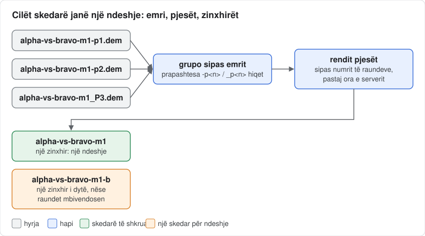

# Komandat {#commands}

Je i ri te rreshti i komandave? Lexo më parë [Para se të fillosh](before-you-start.md).
Shkruaji këto në një Terminal të hapur në dosjen që the shpaketuar ose klonuar;
`<...>` janë vendmbajtëse, dhe një shteg me hapësira vihet në thonjëza.

```text
python -m heat3d_cs2 demos <demo files or folders> -o <folder> [--every 8] [--jobs N] [--map TEXT] [--force] [--no-bulk] [--loose]
python -m heat3d_cs2 map <map name | path to its .vpk> -o <file.glb> [--game FOLDER] [--source2viewer EXE]
python -m heat3d_cs2 scoreboard <match.3dheat | match.json>
```

`python -m heat3d_cs2 --help` dhe `python -m heat3d_cs2 <verb> --help` listojnë të
njëjtat opsione; [Referenca e komandave](../cli-reference.md) i tregon të gjitha. Çdo nisje bën së pari kontrollin e botimit të përshkruar te
[Përditësimet](updates.md) (ndalet me `HEAT3D_NO_UPDATE=1`).

Kodi: [`heat3d_cs2/cli.py`](https://github.com/Holdi601/3DHeat-CS2/blob/main/heat3d_cs2/cli.py).

## `demos` - demo në tabela dhe dokumente ndeshjesh {#demos---demos-into-tables-and-match-documents}

```powershell
python -m heat3d_cs2 demos D:\Demos\event -o out
python -m heat3d_cs2 demos alpha-vs-bravo-m1-p1.dem alpha-vs-bravo-m1-p2.dem -o out
python -m heat3d_cs2 demos D:\Demos -o out --map final --jobs 4
```

| Argumenti | Parazgjedhja | Bën |
|---|---|---|
| `paths` (një ose më shumë) | - | skedarë dhe dosje demosh. Një skedar merret kur shtesa e tij është `.dem` (çdo shkronjë e madhe a e vogël). Një dosje kërkohet **rekursivisht** për skedarë që mbarojnë me `.dem`, në çdo shkrim, sipas renditjes. Demot e ngjeshura (`.dem.zst`, `.dem.bz2`, arkiva) nuk lexohen: shpaketoji më parë. |
| `-o`, `--out` | i detyrueshëm | dosja ku shkruhet; krijohet sipas nevojës |
| `--every N` | `8` | merr mostër të çdo lojtari çdo *N* tick-e. Demot e CS2 ecin me 64 tick-e në sekondë, kështu që 8 janë tetë mostra në sekondë, 4 janë gjashtëmbëdhjetë, 64 është një. Ngjarjet lexohen gjithmonë te tick-u i tyre, sido që të jetë *N*. |
| `--jobs N` | `0` = gjysma e bërthamave të CPU-së | sa ndeshje konvertohen njëherësh, secila në procesin e vet. Kurrë më pak se 1, kurrë më shumë se sa ndeshje ka për t'u bërë. |
| `--map TEXT` | - | vetëm ndeshjet **emri** i të cilave përmban *TEXT*, pa dallim shkronjash (`--map final`). Filtron sipas emrit të skedarit, jo sipas hartës që del se mban demoja. |
| `--force` | joaktiv | konverto ndeshjet që janë shkruar tashmë, duke i mbishkruar |
| `--loose` | joaktiv | mbaj çdo ndeshje si skedarë të ndarë - tabelë, `.match.json`, sidecar-ë - në vend që t'i paketosh në një kontejner të vetëm `.3dheat`. Shih [Një skedar për ndeshje](output-container.md). |
| `--container` | aktiv | paketo çdo ndeshje në një skedar `.3dheat`; parazgjedhja, prandaj është këtu vetëm për ta thënë qartë |
| `--no-bulk` | joaktiv | lë jashtë nga sidecar-i i paketave rrjedhën e entiteteve, komandat e lojtarëve dhe rrjedhën e animacionit - mbi gjysmën e madhësisë së një demoje edhe e ngjeshur. Vetëkontrolli i dokumentit të ndeshjes pastaj i numëron `lost`, me emër. |


### Cilët skedarë janë një ndeshje {#which-files-are-one-match}



Emri i ndeshjes është emri i skedarit të demos pa shtesën dhe pa
prapashtesë pjese: `-p<digits>` ose `_p<digits>` në fund, çdo shkronjë e madhe a e vogël. Pra
`alpha-vs-bravo-m1-p1.dem`, `alpha-vs-bravo-m1-p2.dem` dhe
`alpha-vs-bravo-m1_P3.dem` janë pjesët e një ndeshjeje, `alpha-vs-bravo-m1`.
Skedarët grupohen vetëm sipas këtij emri - dy skedarë me të njëjtin emër në
dosje të ndryshme grupohen gjithashtu.

Prapashtesa nuk thotë asgjë për renditjen: një `-p2` mund të jetë gjysma më e hershme. Pjesët
vendosen në rregull sipas numrit të raundeve që mbajnë, pastaj sipas orës
së serverit, dhe një grup që del se mban dy ndeshje të ndryshme (të njëjtat
ekipe në të njëjtën hartë në dy ngjarje, të themi) ndahet në **zinxhirë**: zinxhiri
me më shumë raunde shkruhet nën vetë emrin, tjetri si
`<name>-b`, pastaj `<name>-c`, e kështu me radhë. Një skedar pa asnjë raund (vetëm ngrohje,
një pauzë) nuk i përket asnjë zinxhiri. Si gjenden zinxhirët përshkruhet te
[Ndërtimi i një ndeshjeje](building-matches.md#parts-and-chains).

### Çfarë shkruhet {#what-is-written}

Për çdo ndeshje, në një dosje me emrin e hartës që e quan koka e demos
(`unknown` kur nuk quan asnjë), një skedar `.3dheat`:

```text
out/
  de_x/
    alpha-vs-bravo-m1.3dheat
    alpha-vs-bravo-m2.3dheat
  de_y/
    ...
```

Në demon sintetike me dy raunde të testeve:


Me `--loose` çdo ndeshje është tabela, dokumenti i saj i ndeshjes dhe katër sidecar-ë pranë njëri-tjetrit
([Një skedar për ndeshje](output-container.md)):


Një hartë e nxehtësisë është e një harte, kështu që ngarkimi i një dosjeje në shikues është ngarkimi i
ndeshjeve të një harte. Shih [Tabela e hartës së nxehtësisë](output-table.md) dhe
[Dokumenti i ndeshjes](output-match-json.md).

### Çfarë anashkalohet {#what-is-skipped}

Para se të lexohet ndonjë gjë, çdo `*.3dheat` kudo nën `--out` (një kontejner
shkruhet i tëri ose aspak), dhe çdo `*.parquet` që ka
dokumentin e vet të ndeshjes (`<name>.match.json`) pranë, listohet, dhe një ndeshje emri i së cilës
është i barabartë me emrin e njërit prej skedarëve të tyre (pa shtesë) anashkalohet, përveç nëse
`--force`. Një tabelë pa dokumentin e saj të ndeshjes - një ekzekutim i ndalur midis shkrimit të
të dyve - nuk llogaritet, kështu që ajo ndeshje konvertohet përsëri. Kontrolli bëhet vetëm sipas emrit:
një ndeshje e konvertuar në
një dosje tjetër harte, ose me një `--every` tjetër, prapë llogaritet e bërë.
Kur nuk ka asgjë për të bërë:

```text
nothing to do: no demos found, or every match already written (--force redoes them)
```

### Çfarë printohet {#what-is-printed}

Së pari sasia e punës, pastaj një rresht për ndeshje sa mbaron secila (sipas
renditjes së mbarimit, jo renditjes së skedarëve):

```text
3 match(es), 3 at a time
alpha-vs-bravo-m1: de_x, 21 rounds (Alpha 13 Bravo 8), 412,377 rows, lost 0
alpha-vs-bravo-m2: de_y, 30 rounds (Bravo 16 Alpha 14), 598,104 rows, 1 incomplete round(s) left out, lost 0
alpha-vs-bravo-m3: de_y, 18 rounds (Alpha 13 Bravo 5), 330,981 rows, recorded from round 3, lost 1,204,331 (svc_PacketEntities, svc_UserCmds, DEM_AnimationData)
```

(Numrat janë ilustrues.) Rezultati është ai i raundit të fundit, ekip pas ekipi
sipas renditjes që i liston dokumenti i ndeshjes. *incomplete round(s) left out* numëron
raundet që një demo i preu para se të vendoseshin; *recorded from round N* thotë se
regjistrimi nis vonë; *lost* është vetëkontrolli i dokumentit të ndeshjes - sa gjëra
të demos nuk shkuan askund, dhe të cilave llojeve (`--no-bulk` e bën pjesën e madhe lost).
Një ndeshje që nuk jep asgjë thotë pse:

```text
alpha-vs-bravo-m4: no round in 1 file(s) - nothing written
alpha-vs-bravo-m4-b: no complete round in 1 file(s) - nothing written
```

Një gabim në një ndeshje nuk i ndalon të tjerat; printohet si
`<name>: failed - <error>`.

### Kodi i daljes {#exit-code}

`0` kur çdo ndeshje u konvertua (ose nuk kishte asgjë për të bërë), `1` kur të paktën
një dështoi.

### Sa zgjat {#how-long-it-takes}

Çdo ndeshje lexohet dhe ndërtohet në një proces punëtor. Një dosje me disa qindra
demo zgjat minuta me `--jobs` të parazgjedhur. Kujtesa
për punë rritet me gjatësinë e ndeshjes dhe me një `--every` më të vogël: çdo punëtor
mban çdo rresht lojtari të marrë si mostër të ndeshjes së tij (afërsisht dhjetë lojtarë herë
64 / *N* rreshta për sekondë regjistrimi) para se të shkruajë.

Sidecar-ët zgjasin më shumë se tabela: çdo veti që lexon parseri
lexohet në çdo tick, një dritare tick-esh në një herë (rreth dy minuta për një
demo 40-minutëshe, afër 3 GB kujtesë më së shumti për punë), pastaj demoja
përshkohet edhe një herë për kuadrot dhe mesazhet e saj.

## `map` - gjeometria e një harte si `.glb` {#map---a-maps-geometry-as-glb}


```powershell
python -m heat3d_cs2 map <map> -o out/<map>/<map>.glb
python -m heat3d_cs2 map <map> -o <map>.glb --game "D:\Games\Steam\steamapps\common\Counter-Strike Global Offensive"
python -m heat3d_cs2 map "D:\maps\<map>.vpk" -o <map>.glb --source2viewer C:\Tools\Source2Viewer-CLI.exe
```

| Argumenti | Parazgjedhja | Bën |
|---|---|---|
| `name` | - | emri i hartës (si `de_x`), ose shtegu për te `.vpk` e saj. Një shteg që mbaron me `.vpk` dhe ekziston përdoret siç është; çdo gjë tjetër kërkohet sipas emrit të skedarit në lojën e instaluar. |
| `-o`, `--out` | i detyrueshëm | `.glb` që shkruhet; dosja e tij krijohet sipas nevojës |
| `--game FOLDER` | bibliotekat e Steam | dosja e instalimit të CS2 (ajo që përmban `game\csgo`), kur Steam nuk e njeh. Me `--game`, kërkohet vetëm ajo dosje. |
| `--source2viewer EXE` | `HEAT3D_SOURCE2VIEWER`, pastaj `PATH` | skedari ekzekutues i Source2Viewer CLI |

Printohet kur ia del:

```text
out/de_x/de_x.glb: de_x, 412,880 triangles (151,204 ground) in 14 parts
```

(numrat ilustrues). Shkrimi i `.glb` pranë tabelave të hartës
(`out/<map>/<map>.glb`) i mban të dhënat dhe gjeometrinë e një harte në një dosje. Si
funksionon eksporti: [Eksporti i hartës](map-export.md).

Gabimet, secili printohet si `error: ...` me kod dalje `2`:

| Mesazhi | Do të thotë |
|---|---|
| `no de_x.vpk found in an installed CS2 - pass --game <CS2 folder> or the .vpk path` | harta nuk është në asnjë bibliotekë Steam të gjetur, ose emri është gabim |
| `Source2Viewer-CLI not found: ...` | asnjë nga `--source2viewer`, `HEAT3D_SOURCE2VIEWER`, `PATH` nuk dha një skedar ekzistues |
| `Source2Viewer did not export de_x's collision mesh:` ndjekur nga fundi i daljes së tij | dështoi, ose nuk shkroi asnjë `.glb` |
| `de_x's collision mesh has nothing but clip brushes` | pasi u lanë jashtë clip-et dhe qielli nuk mbeti asgjë |

## `scoreboard` - një ndeshje si tekst {#scoreboard---a-match-as-text}

```bash
python -m heat3d_cs2 scoreboard out/de_x/alpha-vs-bravo-m1.3dheat
python -m heat3d_cs2 scoreboard out/de_x/alpha-vs-bravo-m1.match.json   # after demos --loose
```

Printon tabelën e rezultateve të ndeshjes nga [dokumenti i ndeshjes](output-match-json.md) i saj,
pa hapur shikuesin. Lexon dokumentin brenda një kontejneri `.3dheat`,
ose një `<match>.match.json` të lirë.
Në demon sintetike me dy raunde të testeve:


```text
alpha-vs-bravo-m1 - de_test  Alpha 2  Bravo 0

Alpha
player                 K   D   A  +/-    ADR   KAST   HS%  OK-OD  clutch
ash                    1   0   0   +1   50.0 100.0%    0%   0-0     1/1
ace                    1   1   0   +0   50.0 100.0%  100%   1-0     0/0

Bravo
player                 K   D   A  +/-    ADR   KAST   HS%  OK-OD  clutch
ben                    1   1   0   +0   50.0 100.0%    0%   0-0     0/1
bob                    0   1   0   -1    0.0 100.0%    0%   0-1     0/0

rounds  1:TK 2:TB
```

- Rreshti i parë: emri i ndeshjes, harta dhe rezultati përfundimtar për ekip.
- Një tabelë për ekip, sipas renditjes së `teams` të dokumentit të ndeshjes; lojtarët sipas
  renditjes së dokumentit të ndeshjes (vrasje minus vdekje, pastaj vrasje, më i miri i pari). Emrat
  priten në 19 shkronja.
- Kolonat: **K** vrasje, **D** vdekje, **A** asiste *përfshirë* asistet me flash,
  **+/-** vrasje minus vdekje, **ADR**, **KAST** (%), **HS%** (rrumbullakosur në përqind
  të plotë), **OK-OD** vrasje hapëse - vdekje hapëse, **clutch** clutch-e të fituara /
  clutch-e të luajtura. Përkufizimet: [Statistikat](statistics.md).
- Shiriti i raundeve: `<round>:<winning side><how>`, me **B** bomba shpërtheu,
  **D** u çaktivizua, **K** eliminim, **T** mbaroi koha, dhe **?** për çdo gjë
  tjetër (barazim, dorëzim, tjetër). Një barazim nuk ka anë fituese: `<round>:?`.

Një skedar që nuk është JSON i vlefshëm, ose nuk gjendet, ndalon me një gabim; një dokument
JSON pa fushat e dokumentit të ndeshjes dështon me një gabim Python (nuk
validohet më tej).
