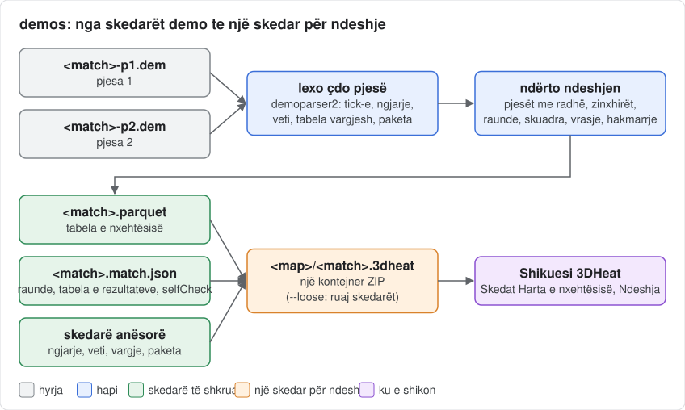

# 3DHeat CS2 {#dheat-cs2}

**Çfarë është?** Counter-Strike 2 mund të ruajë një regjistrim të një ndeshjeje, të quajtur
*demo*. Ky mjet e kthen një demo në skedarë që shikuesi 3DHeat mund t'i shfaqë në 3D:
ku qëndroi, vdiq, hodhi dhe vendosi bombën secili, raund pas raundi. Mund ta kthejë edhe
një hartë CS2 në një model 3D për t'i shfaqur mbi të.

**Pse ta përdor?** Për të rishikuar ndeshjet e tua, për të vendosur shumë ndeshje
të një harte mbi njëra-tjetrën si një hartë nxehtësie, dhe për statistika ndeshjesh si ADR
(dëmi mesatar në raund) dhe KAST (pjesa e raundeve ku një lojtar vrau,
asistoi, mbijetoi ose u hakmorr nga shokët).

**Shembull:** hyn `alpha-vs-bravo-m1.dem`, del `out/de_x/alpha-vs-bravo-m1.3dheat`
(`de_x` është një emër hartë i sajuar).



Më në detaje: 3DHeat CS2 i kthen **demot e Counter-Strike 2** në një tabelë nxehtësie dhe një
dokument ndeshjeje për çdo ndeshje, dhe një **hartë CS2** në gjeometri niveli. Daljet janë bërë
për shikuesin e telemetrisë [3DHeat](https://holdi601.github.io/3DHeat/)
([kodi](https://github.com/Holdi601/3DHeat)), por janë
skedarë të zakonshëm - Parquet, JSON dhe glTF binar - që mund t'i lexojë edhe çdo gjë tjetër.

Është një paketë e vogël Python, `heat3d_cs2`, e ekzekutuar nga rreshti i komandave. Lexon
demot nga disku (nuk shkarkon asnjë) me
[demoparser2](https://github.com/LaihoE/demoparser), dhe i eksporton hartat nga loja
e instaluar me ndërtimin me rresht komandash të Source2Viewer
([ValveResourceFormat](https://github.com/ValveResourceFormat/ValveResourceFormat)).

## Fillimi i shpejtë {#quick-start}

Je i ri me rreshtin e komandave? Lexo së pari [Para se të fillosh](before-you-start.md).

```bash
pip install -r requirements.txt
python -m heat3d_cs2 demos <demo files or folders> -o out   # every match in them
python -m heat3d_cs2 map <map> -o out/<map>/<map>.glb       # the map from the installed game
python -m heat3d_cs2 scoreboard out/<map>/<match>.3dheat    # a match's scoreboard as text
```

Duhet të shohësh `1 match(es), 1 at a time ...` dhe pastaj një rresht për çdo ndeshje
(shih [Komandat](commands.md#what-is-printed)).

`demos` shkruan, për çdo ndeshje, një skedar në një dosje me emrin e hartës:
`out/<map>/<match>.3dheat`, një [kontejner `.3dheat`](output-container.md) - formati i
shikuesit një-skedar-për-ndeshje ([specifikimi](https://holdi601.github.io/3DHeat/container.html)).
Mban këta anëtarë; `--loose` i shkruan si skedarë të veçantë në vend të kësaj:

| Anëtari | Çfarë mban | Ngarkohet në skedën e shikuesit |
|---|---|---|
| `<match>.parquet` (roli `table`) | çdo lojtar të gjallë tetë herë në sekondë me gjendjen e tij (shëndet, para, verbim, dylbi, zonë, inventar, ...), dhe çdo ngjarje aty ku ndodhi (vrasje, vdekje, lëndim, e shtënë, hedhje, shpërthime granatash, verbim, vendosje bombe, çaktivizim, shpërthim, dhe një fund raundi për lojtar me çfarë i pagoi raundi), nga një rresht secila | Harta e nxehtësisë |
| `<match>.match.json` (roli `match`, dokumenti i ndeshjes) | skuadrat, rezultati, çdo raund (fituesi, si, ekonomia, bomba, vrasjet me radhë, clutch-et, të mbijetuarit) dhe rreshti i tabelës së rezultateve të çdo lojtari | Ndeshja |
| `<match>.events/props/strings/packets.parquet` | gjithçka tjetër që mban demo, e plotë (skedarë anësorë) | ruhen për plotësi |

`map` shkruan `<map>.glb`: rrjetën e kolizionit të hartës - dysheme, mure, kuti,
pa dekor - të ndarë në tokë dhe strukturë, në të njëjtën kornizë dhe njësi si
tabelat, kështu që shtrihet saktësisht nën hartën e nxehtësisë (paneli Sfondi / niveli).

## Harta e këtij dokumentacioni {#map-of-this-documentation}

| Faqja | Çfarë mbulon |
|---|---|
| [Para se të fillosh](before-you-start.md) | Python, një terminal, vendmbajtësit, si duken suksesi dhe gabimet e zakonshme |
| [Instalimi](installing.md) | Python, paketat, CLI i Source2Viewer, ku duhet të jetë CS2 |
| [Komandat](commands.md) | `demos`, `map`, `scoreboard`: çdo opsion, çfarë shtypet, kodet e daljes |
| [Leximi i një demoje](reading-demos.md) | çfarë lexohet nga një skedar demo: tick-et e mostruara, vetitë e lojtarëve, rregullat e lojës, ngjarjet |
| [Ndërtimi i një ndeshjeje](building-matches.md) | pjesët dhe zinxhirët, ora e ndeshjes, raundet, skuadrat dhe anët, rreshtat, vrasjet, hakmarrjet, hapjet, dëmi, verbimet, ekonomia |
| [Statistikat](statistics.md) | tabela e rezultateve: K/D/A, ADR, KAST, HS%, hapjet, hakmarrjet, multi-kill, clutch-et, utility, verbimet |
| [Tabela e nxehtësisë](output-table.md) | skedari Parquet: çdo kolonë, lloji i saj, cilat ngjarje e mbushin, sugjerimet e fundit `heat3d`, boshtet |
| [Dokumenti i ndeshjes](output-match-json.md) | dokumenti `.match.json`, fushë pas fushe |
| [Një skedar për ndeshje](output-container.md) | kontejneri `.3dheat` që `demos` e shkruan si parazgjedhje, `--loose` |
| [Eksporti i hartës](map-export.md) | si eksportohet rrjeta e kolizionit të një harte, korniza, emërtimi i nyjeve, njësitë |
| [Përdorimi me 3DHeat](using-with-3dheat.md) | ngarkimi i tabelave, dokumenteve të ndeshjeve dhe hartave në skedat Harta e nxehtësisë dhe Ndeshja të shikuesit |
| [Kufizimet](limits.md) | çfarë supozohet, çfarë nuk trajtohet, çfarë nuk është verifikuar |
| [Përditësimet](updates.md) | kontrolli i botimit në nisje dhe `python -m heat3d_update` |
| [Zhvillimi](development.md) | struktura e kodit, testet, pajisja sintetike e demos |
| [Referenca e komandave](../cli-reference.md) | `--help` i çdo komande, e gjeneruar nga kodi |
| [Mirëmbajtja](maintaining.md) | lista e kontrollit të botimit për këto faqe |

## Kundrejt çfarë kontrollohet {#what-it-is-checked-against}

Demot e vërteta nuk janë një skedar i pastër për çdo ndeshje. Konvertuesi trajton një
ndeshje të ndarë në skedarë në çdo renditje, një server të rinisur në mes të ndeshjes, dy
ndeshje të ndryshme të ruajtura nën një emër, raunde të rikthyera nga një kopje rezervë, një
regjistrim që nis vonë ose mbaron herët, pauza, dhe trajnerë në anën e një skuadre -
shih [Ndërtimi i një ndeshjeje](building-matches.md). Të kontrolluara mbi një koleksion të madh
demosh turnirësh: në çdo ndeshje
rezultati ndjek fituesit e raundeve, vrasjet e çdo ane janë vdekjet e tjetrës,
dhe çdo raund nis pesë kundër pesë.

## Mbi çfarë ta drejto {#what-to-point-it-at}

Demot e ndeshjeve të tua, demo që i ke shkarkuar me dorë nga një faqe turnirësh,
ose demo nga një API që ke akses. Një demo është një regjistrim përmbajtja e të cilit
i përket botuesit dhe organizatorëve të saj: përdor çfarë del për analizën tënde,
dhe mos i ripërhap demot ose të dhënat e nxjerra prej tyre. Faqet që
ofrojnë demo shpesh e ndalojnë shkarkimin automatik në kushtet e tyre, prandaj
mjeti i lexon demot nga disku dhe nuk shkarkon asnjë.

## Pjesë e 3DHeat {#part-of-3dheat}

3DHeat CS2 është një nga mjetet falas përreth shikuesit 3DHeat, secili me depon
e vet, botimet dhe licencën e vet:

| Mjeti | Çfarë bën | Dokumentet |
|---|---|---|
| [3DHeat](https://github.com/Holdi601/3DHeat) | shikuesi: harta nxehtësie, analizë gare dhe rishikim ndeshjesh në 3D | [faqja](https://holdi601.github.io/3DHeat/) |
| [GameFiles](https://github.com/Holdi601/3DHeat-GameFiles) | piste dhe nivele nga skedarët që dërgojnë lojërat, si modele 3D | [faqja](https://holdi601.github.io/3DHeat-GameFiles/) |
| [GameCapture](https://github.com/Holdi601/3DHeat-GameCapture) | telemetri xhirosh nga lojëra garash; nivele të rindërtuara nga video loje | [faqja](https://holdi601.github.io/3DHeat-GameCapture/) |
| [Unreal Exporter](https://github.com/Holdi601/3DHeat-UnrealExporter) | një shtojcë e Unreal Editor që eksporton një nivel si një model 3D | [faqja](https://holdi601.github.io/3DHeat-UnrealExporter/) |
| [CS2](https://github.com/Holdi601/3DHeat-CS2) | demo të Counter-Strike 2 në tabela dhe dokumente ndeshjesh; harta në modele 3D | [faqja](https://holdi601.github.io/3DHeat-CS2/) |
| [Watcher](https://github.com/Holdi601/3DHeat-Watcher) | regjistron në sfond çfarë botojnë lojërat për lojën tënde | [faqja](https://holdi601.github.io/3DHeat-Watcher/) |
| [Ext-WarThunder](https://github.com/Holdi601/3DHeat-Ext-WarThunder) | riluajtje të War Thunder në tabela dhe dokumente ndeshjesh | [faqja](https://holdi601.github.io/3DHeat-Ext-WarThunder/) |
| [Ext-WoT](https://github.com/Holdi601/3DHeat-Ext-WoT) | riluajtje të World of Tanks në tabela dhe dokumente ndeshjesh | [faqja](https://holdi601.github.io/3DHeat-Ext-WoT/) |
| [Ext-WoWs](https://github.com/Holdi601/3DHeat-Ext-WoWs) | riluajtje të World of Warships në tabela dhe dokumente ndeshjesh | [faqja](https://holdi601.github.io/3DHeat-Ext-WoWs/) |
| [Ext-Squad](https://github.com/Holdi601/3DHeat-Ext-Squad) | demo serveri të Squad në tabela dhe dokumente ndeshjesh | [faqja](https://holdi601.github.io/3DHeat-Ext-Squad/) |
| [Ext-DCS](https://github.com/Holdi601/3DHeat-Ext-DCS) | harta të DCS World në modele 3D | [faqja](https://holdi601.github.io/3DHeat-Ext-DCS/) |
| [Ext-IL2](https://github.com/Holdi601/3DHeat-Ext-IL2) | harta të IL-2 Sturmovik në modele 3D | [faqja](https://holdi601.github.io/3DHeat-Ext-IL2/) |

## Licenca {#licence}

MIT - shih [`LICENSE`](https://github.com/Holdi601/3DHeat-CS2/blob/main/LICENSE),
dhe [`LICENSES.md`](https://github.com/Holdi601/3DHeat-CS2/blob/main/LICENSES.md)
për paketat e palëve të treta dhe çfarë detyrojnë lojërat që lexon.
