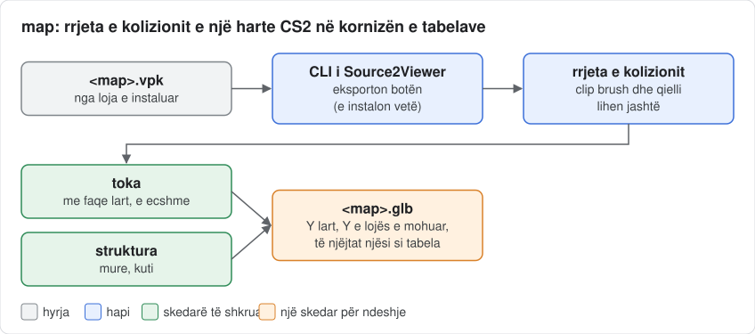

# Eksporti i hartës (`map`) {#map-export-map}

`python -m heat3d_cs2 map <map> -o <file.glb>` e shkruan një hartë të CS2 si gjeometri
niveli: **rrjeta e përplasjes** e botës, në sistemin dhe njësitë ku vizatohen
[tabelat e hartës së nxehtësisë](output-table.md). Kodi:
[`heat3d_cs2/mapexport.py`](https://github.com/Holdi601/3DHeat-CS2/blob/main/heat3d_cs2/mapexport.py),
[`heat3d_cs2/glb.py`](https://github.com/Holdi601/3DHeat-CS2/blob/main/heat3d_cs2/glb.py).
Opsionet dhe mesazhet: [Komandat](commands.md#map---a-maps-geometry-as-glb).



## Pse rrjeta e përplasjes {#why-the-collision-mesh}

Rrjeta e përplasjes është ajo mbi të cilën qëndrojnë lojtarët dhe pas së cilës fshihen - dyshemetë, muret,
shkallët, kutitë - pa dekorimin: pa objekte që vetëm duken si
diçka, pa tekstura, me shumë më pak trekëndësha se rrjetat e vizatimit. Kjo është
ajo që i duhet një hartë nxehtësie nën vete: diçka ndaj së cilës të lexohen pozicionet, jo një
vizatim i hartës.

## Si merret {#how-it-is-obtained}

1. **Gjej hartën.** Një shteg që mbaron me `.vpk` dhe ekziston përdoret siç është dhënë.
   Përndryshe `<name>.vpk` kërkohet në
   `<CS2 folder>\game\csgo\maps\`, ku dosja e CS2 është `--game`, ose
   `steamapps\common\Counter-Strike Global Offensive` në çdo bibliotekë Steam
   të gjetur (shih [Instalimi](installing.md#where-cs2-is-looked-for)).
2. **Gjej CLI të Source2Viewer**: `--source2viewer`, pastaj
   `HEAT3D_SOURCE2VIEWER`, pastaj `Source2Viewer-CLI` / `Source2Viewer-CLI.exe`
   në `PATH`.
3. **Eksporto fizikën e botës.** Source2Viewer xhirohet si

   ```text
   Source2Viewer-CLI -i <map>.vpk -d -f maps/<map>/world_physics.vmdl_c --gltf_export_format glb -o <temporary folder>
   ```

   Dekodon fizikën e kompiluar të Source 2 nga arkiva e vetë hartës dhe
   shkruan modelin (bosh: bota nuk ka rrjetë vizatimi të vetën) dhe fizikën e tij
   pranë tij. `.glb` më i madh i shkruar është fizika. Nëse
   Source2Viewer dështon ose nuk shkruan asnjë `.glb`, komanda ndalon dhe tregon
   800 shkronjat e fundit të daljes dhe të gabimeve të tij.
4. **Lexoje.** Çdo nyje e skenës përshkohet me transformimin e saj
   (matricë, ose translatim-rrotullim-shkallë), dhe çdo primitiv trekëndëshash
   merret, me ose pa një buffer indeksesh, në pozicione bote.
5. **Lë jashtë çfarë nuk është mur apo dysheme.** Një nyje emri i së cilës përmban
   `clip` - clip-et e lojtarëve, clip-et e NPC-ve, clip-et e granatave: muret e padukshëm që
   ndalojnë lojtarët dhe granatat - ose `sky`, në çdo shkrim, hidhet tej.
6. **Emërto sipërfaqen.** Grupet e fizikës emërtohen sipas sipërfaqes së tyre; emri
   me shkronja të vogla, pasi hiqet fillimi `physics`, `physics_group` ose
   `physics_passbullets` (dhe nënvija pas tij), është sipërfaqja:
   `physics_group_concrete` është `concrete`, `physics_passbullets_chainlink` është `chainlink`, një
   `physics_group` i thjeshtë është `world`. Sipërfaqet nëpër të cilat kalojnë plumbat mbahen.
7. **Prapa te sistemi i lojës.** Source2Viewer shkruan glTF në metra me Y
   lart: (Y, Z, X) i lojës shumëzuar me 0.0254. Kjo zhbëhet - çdo pikë
   bëhet (X, Y, Z) i lojës në inçe.
8. **Ndaj tokën nga struktura**, trekëndësh pas trekëndëshi: një faqe normalja e së cilës
   shikon lart të paktën 0.7 (përbërësja e saj Z, e normalizuar) - pjerrësi deri në
   rreth 45 gradë, afërsisht më e pjerrëta ku ecën një lojtar i CS2 - është **tokë (ground)**;
   gjithçka tjetër, muret dhe tavanet të përfshira, është **strukturë (structure)**.
9. **Në sistemin e shikuesit.** Çdo pikë shkruhet si (X, Z, -Y): Y lart,
   Y i lojës i mohuar - sistemi ku shikuesi i vizaton tabelat, kur
   ndjek sugjerimet e tyre `heat3d`. Një rrotullim, jo pasqyrim.
10. **Shkruaj `.glb`.** Nëse nuk mbetet asgjë (vetëm clip brush-e), komanda
    ndalon me një gabim. Përndryshe printon skedarin, hartën, numrin e
    trekëndëshave, sa janë tokë, dhe numrin e pjesëve.

Asgjë këtu nuk lexon tjetër veçse `.vpk` e vetë hartës, dhe asgjë nga
Source2Viewer nuk vjen i përfshirë apo i kopjuar.

## Skedari {#the-file}

Një glTF 2.0 binar (`.glb`), një buffer, shkruar nga `heat3d_cs2` (
`asset.generator`):

| Aspekti | Çfarë |
|---|---|
| Nyjet | një për pjesë, të gjitha në rrënjë, pa transformime, secila me rrjetën e vet me të njëjtin emër |
| Emrat e nyjeve | `ground:<surface>` ose `structure:<surface>` (`ground:concrete`, `structure:metal`, `structure:world`), të renditura sipas emrit |
| Primitivët | një për rrjetë, trekëndësha, `POSITION` (float32, me min/max) dhe `NORMAL` (float32), indekse `uint32` |
| Hijezimi | i sheshtë: një kulm për qoshe trekëndëshi, secili mban normalen e trekëndëshit të vet |
| Materiale, tekstura, UV, ngjyra | asnjë |
| Njësitë | njësi loje (**inçe**), jo metra - ndryshe nga ç'supozon glTF |
| Sistemi | (X, Z, -Y) i lojës: Y e glTF është lartësia e lojës, Z e glTF është -Y e lojës |

Parashtesa `ground:` / `structure:` është konventa e të gjithë eksportuesve të niveleve të 3DHeat:
shikuesi e merr një pjesë të emërtuar kështu fjalë për fjalë në vend që të hamendësojë nga gjeometria,
kështu dyshemetë marrin hijezimin e tokës dhe muret vizatimin e strukturës pa asnjë hap klasifikimi.

Meqë njësitë janë inçe, një shikues tjetër glTF e shfaq hartën rreth 39
herë më të madhe (i lexon si metra); shkallëzoje me 0.0254 atje nëse
ka rëndësi. Në 3DHeat shtrihet saktësisht nën tabelë, që është në të njëjtat
njësi me shkallë 1.

## Kontrolli që sistemi është i drejtë {#the-check-that-the-frame-is-right}

Testi `test_players_stand_on_the_exported_floor` (xhirohet vetëm kur jepen demo dhe
Source2Viewer, shih [Zhvillimi](development.md#tests)) eksporton
hartën ku u luajt një demo, merr 300 mostra të rastësishme pozicioni të ndeshjes, dhe
për secilën shikon drejt poshtë për trekëndëshin më të lartë të tokës më së shumti 4 njësi
mbi këmbët e lojtarit. Kërkon që të paktën 98 % e mostrave të gjejnë
tokë, dhe që lartësia mediane mbi të të jetë nën 5 njësi. Një hartë e pasqyruar
dështon: në një hartë të pasqyruar sipas boshtit të gabuar, një pjesë e madhe e lojtarëve
qëndron mbi asgjë. README raporton shifrat e këtij kontrolli mbi
hartat e grupit konkurrues aktual.

## Çfarë nuk bën {#what-it-does-not-do}

- Pa gjeometri vizatimi, tekstura apo dekorim - shih *pse* më sipër.
- Eksportohet vetëm ç'ka në modelin `world_physics` të hartës. Nëse
  pjesët lëvizëse (dyert) ose gjërat që thyhen janë në të nuk është kontrolluar.
- Pa thjeshtim: shikuesi 3DHeat thjeshton gjatë importit me cilësimin e tij
  **Simplification target**.
- Hartat që nuk janë në lojën e instaluar (harta workshop diku tjetër në disk) funksionojnë kur
  `.vpk` e tyre jepet si shteg dhe mban `maps/<name>/world_physics.vmdl_c`;
  nuk është verifikuar.
