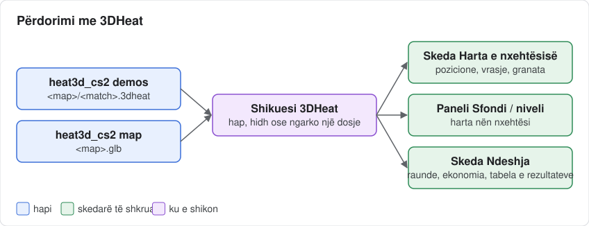

# Përdorimi me 3DHeat {#using-it-with-3dheat}

Daljet shkojnë në këto vende të
[shikuesit 3DHeat](https://holdi601.github.io/3DHeat):

| Skedari | Ku | Çfarë jep |
|---|---|---|
| `<match>.3dheat` (parazgjedhja) | skeda **Harta e nxehtësisë**, paneli **Burimi**, ose skeda **Ndeshja** | tabelën dhe dokumentin e ndeshjes së bashku, një skedar për ndeshje ([kontejneri](https://holdi601.github.io/3DHeat/container.html)) |
| `<match>.parquet` | skeda **Harta e nxehtësisë**, paneli **Burimi** | pozicionet dhe ngjarjet si hartë nxehtësie, riprodhim me kuti, rrugë |
| `<match>.match.json` | skeda **Ndeshja**, **Ngarko skedarët e ndeshjeve…** | tabelën e rezultateve, raundet, rrjedhën e vrasjeve, statistikat nëpër ndeshje, lidhje drejt hartës së nxehtësisë |
| `<map>.glb` | paneli **Sfondi / niveli**, **Model 3D…** | hartën nën hartën e nxehtësisë |

Dokumentimi i vetë shikuesit e përshkruan çdo skedë të plotë: faqet e tij
[Analiza e ndeshjes](https://holdi601.github.io/3DHeat/match-analysis.html),
[Ngarkimi i skedarëve](https://holdi601.github.io/3DHeat/loading-files.html),
[Përshtatja e kolonave](https://holdi601.github.io/3DHeat/column-mapping.html)
dhe [Riprodhimi me kuti](https://holdi601.github.io/3DHeat/box-replay.html).
Kjo faqe është ana e CS2 e tyre.



Shikuesi: [github.com/Holdi601/3DHeat](https://github.com/Holdi601/3DHeat),
dokumentimi [holdi601.github.io/3DHeat](https://holdi601.github.io/3DHeat/).

## Një sesion tipik {#a-typical-session}

```bash
python -m heat3d_cs2 demos D:\Demos\event -o out
python -m heat3d_cs2 map <map> -o out/<map>/<map>.glb
```

1. **Skeda Harta e nxehtësisë -> Burimi:** zgjidh dosjen `out/<map>` (ose hidhe aty).
   Çdo `.parquet` në të bëhet një bashkësi të dhënash; skedarët `.json` dhe `.glb` në
   të njëjtën dosje anashkalohen si "jo skedar csv/parquet". Ngarkoje.
2. **Sfondi / niveli -> Model 3D…:** zgjidh `out/<map>/<map>.glb`.
   **Ruaj në bibliotekë** e mban në shfletues për herën tjetër.
3. **Skeda Ndeshja -> Ngarko skedarët e ndeshjeve…:** zgjidh skedarët `.match.json` të
   së njëjtës dosje (disa njëherësh), ose hidhi mbi pamjen ndërsa skeda
   Ndeshja është e hapur.

Ngarko vetëm tabelat e një harte në një kohë: koordinatat e hartave të ndryshme
mbivendosen, dhe një hartë nxehtësie e dy hartave njëherësh nuk do të thotë asgjë. Dosja për hartë
është për këtë.

## Tabela hapet pa asgjë për të vendosur {#the-table-opens-with-nothing-to-set}

Shikuesi e lexon hyrjen `heat3d` në fund të skedarit të parë të zgjedhur
([Tabela e hartës së nxehtësisë](output-table.md#the-heat3d-footer-hints)) dhe e vendos
mbi hamendjet e veta:

| Cilësimi i shikuesit | Vendoset në |
|---|---|
| Pozicioni | `x`, `y`, `z` |
| Boshti lart në burim | Z është lart |
| Përmbys Y | aktiv - që harta të jetë në drejtimin e duhur, jo e pasqyruar |
| Shkalla e njësive | 1 - largësitë në njësi loje (etiketuar "m"; 1 njësi = 1 inç) |
| Koha | `time`, sekonda |
| ID e personit | `player` |
| Ekipi / grupi | `side` (T / CT) |
| Seanca / ndeshja | `roundId` - çdo raund është një sesion, `<match> #NN` |
| Drejtimi i shikimit | vektor, `dirX` / `dirY` / `dirZ` |
| Kolonat e filtrave | `event`, `match`, `round`, `roundTime`, `phase`, `weapon`, `place`, `won`, `buy`, `opening`, `team` |
| Madhësia e entitetit | 32 - riprodhimi me kuti vizaton një lojtar 32 njësi të gjerë, me një rreze shikimi 4 x 32 |

Çdo vlerë e sugjeruar prapë shfaqet te përshtatja e kolonave dhe mund të ndryshohet.
Kolonat e tjera (`headshot`, `traded`, `other`, `steamid`, `health`, `money`,
`damage`, `duration`, ...) mund të shtohen aty si filtra me dorë.

Mbaje shkallën e njësive 1 kur një hartë është e ngarkuar: `.glb` është në të njëjtat
njësi loje, dhe niveli nuk ri-shkallëzohet bashkë me tabelën.

### Filtra të dobishëm {#useful-filters}

- `event` = `position` për ku ishin lojtarët; `kill` / `death` për ku u fituan dhe
  u humbën duelet; `smoke`, `flash`, `molotov`, `he` për ku ra
  utility; `throw` për nga u hodh; `plant` për vendet e
  vendosjes së bombës.
- `side` (grupi) = `T` ose `CT`, `phase` = `live` për të lënë jashtë fazën
  after, `buy` = `eco` / `force` / `full` për raunde të një ekonomie,
  `won` = 1 për raunde që i fitoi ana e rreshtit.
- `opening` = 1 me `kill` dhe `death` për duelet hapëse.
- `roundTime` si diapazon për një moment të raundit: 20 sekondat e para,
  pas vendosjes së bombës.

## Skeda e ndeshjes {#the-match-tab}

Skeda Ndeshja pranon një skedar JSON `format` i të cilit është `heat3d-cs2-match` dhe
që ka vargjet `rounds`, `players` dhe `teams`
([Dokumenti i ndeshjes](output-match-json.md)). Tregon rezultatin dhe pjesët,
një shirit raundesh të ngjyrosur sipas anës fituese me një shenjë për si mbaroi secili,
ekonominë e çdo raundi, vendosjen e bombës, rrjedhën e vrasjeve, clutch-et dhe mbijetuesit, tabelën e rezultateve,
dhe statistikat nëpër të gjitha ndeshjet e ngarkuara.

Lidhjet e saj **Shfaq në hartën e nxehtësisë** nuk ngarkojnë asgjë: vendosin filtra mbi
tabelën e ngarkuar tashmë në skedën Harta e nxehtësisë - `match`, `round` (dhe
sesionin e raundit `<match> #NN`), `event`, lojtarin, anën. Kjo funksionon
sepse dokumenti i ndeshjes dhe tabela mbartin të njëjtat emra ndeshjesh, numra raundesh,
emra lojtarësh dhe anë. **Riluaj raundin** e kalon hartën e nxehtësisë te riprodhimi me kuti
dhe luan sesionin e raundit nga fillimi i tij.

Pra ngarko të dyja: tabelat e një harte te skeda Harta e nxehtësisë, dokumentet e tyre të ndeshjes te
skeda Ndeshja. Një dokument ndeshjeje pa tabelën e vet prapë tregon tabelën e rezultateve dhe raundet,
dhe lidhjet thonë se nuk është ngarkuar asnjë e dhënë e hartës së nxehtësisë.

## Pa 3DHeat {#without-3dheat}

- Tabela është Parquet i thjeshtë: pandas, Polars, DuckDB, Spark, `arrow` i R e
  lexojnë të gjithë, hyrja `heat3d` shpërfillet, dhe kolonat tekst lexohen si vargje
  ose kategorike.
- Dokumenti i ndeshjes është JSON i thjeshtë.
- Harta është një glTF binar i vlefshëm, në inçe dhe jo në metra: shkallëzoje me
  0.0254 për mjete që supozojnë metra. Sistemi i saj është ai i vetë glTF (Y lart), kështu që për të
  mbivendosur tabelën diku tjetër vizato (x, y, z) të çdo rreshti si (x, z, -y), siç
  bën 3DHeat.
