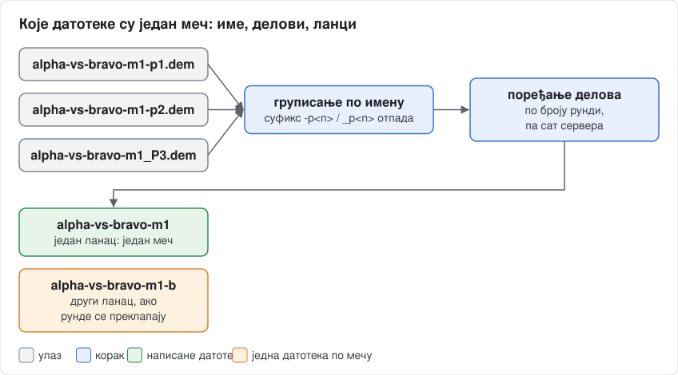

# Како се прави меч {#building-a-match}

Како се меч прави од својих демо-делова: које датотеке припадају заједно, један сат за све делове, рунде и како је која добијена, играчи и тимови с њиховим странама, и сваки ред табеле топлотне мапе, са убиствима, разменама, отварањима, штетом, блицевима и економијом. Код:
[`heat3d_cs2/match.py`](https://github.com/Holdi601/3DHeat-CS2/blob/main/heat3d_cs2/match.py).
Табела резултата која се из њега рачуна је на страни [Статистика](statistics.md).

## Преглед {#overview}

1. Чита се свака датотека са именом меча ([Читање демоа](reading-demos.md)).
2. Дупли редови играча сваке датотеке (враћене рунде) се разрешавају.
3. Датотеке се слажу у **ланце** - мечеве - и сваки ланац се ставља у редослед.
4. Сваки део се ставља на **сат меча**.
5. **Рунде** се налазе у сваком делу; његов приказ рунде замењује приказ из ранијег дела.
6. **Играчи** и **тимови** се именују, а стране и резултат сваке рунде се дају по имену тима. Кад су стране познате, одређују се дужина половине, пистол-рунде и **куповина** сваке стране.
7. Праве се **редови**: позиције, пуцњи, бацања, експлозије, постављања, деактивирања, убиства, смрти, повреде, блицеви, експлозије.
8. Сваки ред добија ознаку своје рунде, фазе, времена у рунди, да ли је његова страна победила и куповину своје стране; редови ван сваке рунде се одбацују.

## Враћене рунде: један ред по играчу по такту {#restored-rounds-one-row-per-player-per-tick}

Кад се рунда врати из резервне копије унутар једне датотеке, демо чува стара тела играча уз нова неко време: два реда за једног играча у једном такту, један тамо где га је поништена рунда оставила, и један на месту где се враћена рунда појављује. За сваког таквог играча дупли тактови се обилазе **уназад**, почевши од првог јединственог реда после њих: у сваком такту задржава се кандидат најближи позицији која следи, и он постаје референца за такт пре. Ако после њих нема јединственог реда, задржава се последњи кандидат. Тако сваки играч задржава ред који води у оном правцу у ком иде даље.

## Живи део датотеке {#the-live-part-of-a-file}

**Жив почетак** датотеке је такт њеног последњег догађаја `round_announce_match_start`, или такт 0 ако га нема (следећи део подељеног меча обично га нема). Све пре живог почетка се изоставља, као и све обележено са `is_warmup_period`. Рунда ножа или поновно покретање пре најаве се зато изостављају; рунда ножа која *није* праћена најавом почетка меча не препознаје се као таква (видите [Ограничења](limits.md)).

**Рунде** датотеке су догађаји `round_freeze_end` од живог почетка надаље, ван загревања, препознати по њиховом `total_rounds_played` (нултом индексу рунде која предстоји). Датотека без њих нема рунди и не припада ниједном мечу.

## Сат {#the-clock}

Време је у секундама. Унутар датотеке време се броји у **тактовима**: серверово `game_time` на првом узоркованом такту, плус протекли такти / 64. Серверов сопствени сат стоји за време паузе док тактови теку; кад се чита преко сата, два тренутка паузираног меча имала би исто време.

Свака датотека има *први сат* (време на њеном живом почетку) и *последњи сат* (на њеном последњем узоркованом такту).

### Делови и ланци {#parts-and-chains}

Датотеке именоване као један меч ([Команде](commands.md#које-датотеке-су-један-меч)) прво се сортирају по индексу своје прве рунде, па по првом сату. Затим се сваки, тим редом, придружује првом ланцу који наставља или започиње нови ланац. Део наставља ланац кад је индекс његове прве рунде најмање једнак последњем индексу последњег дела ланца, **и** важи једно од:

- серверов сат тече даље: његов први сат није раније од последњег сата ланца умањеног за 5 s; или
- бројање рунди тече даље: индекс његове прве рунде је последњи индекс ланца или онај одмах после.

Одлучује бројање рунди, а сат решава изједначења, јер се сервер поново покренут да врати рунду почиње поново са својим сатом, док два различита меча под истим именом (исти тимови на истој мапи на два догађаја) имају преклапајуће се бројеве рунди. Ланци се сортирају по броју рунди које обухватају, највише прво; први задржава име меча, остали се пишу као `<име>-b`, `<име>-c`, ...

### Сат меча {#the-match-clock}

Нула меча је први сат првог дела: **време меча 0 је жив почетак прве датотеке**. Сваки следећи део се ставља на њу:

- где серверов сат тече даље (његов први сат није раније од последњег сата претходног дела умањеног за 5 s), користи се серверов сат како јесте;
- где је био поново покренут, део се ставља тако да следи **једну секунду** после краја претходног дела.

## Рунде {#rounds}

За сваки `round_freeze_end` једног дела (по редоследу тактова), прозор рунде трају до следећег краја замрзавања у том делу, или до краја датотеке. Унутар њега рунда је **одлучена** у првом узоркованом такту где стање игре показује `total_rounds_played` = индекс рунде + 1 и `round_win_status` 1 (нерешено), 2 (победили су T) или 3 (победили су CT). Рунда без таквог узорка у свом прозору била је прекинута крајем датотеке; њен број иде на листу **непотпуних** рунди меча (осим ако други део има рунду комплетну).

| Поље рунде | Из |
|---|---|
| `number` | индекс + 1 (од 1, како игра броји) |
| `start` | време меча на крају замрзавања - играчи могу да се крећу |
| `end` | време меча на првом узорку који показује рунду одлучену |
| `until` | време меча следећег `round_prestart` после `end`, ако је унутар прозора; иначе крај прозора или последњи такт датотеке, шта прво наступи (и никад раније од `end`) |
| `winner` | `T` за статус 2, `CT` за 3, празно за 1: нерешено је одлучено, без победника |
| `reason` | `round_win_reason` на том узорку, именовано као испод |
| `score` | име тима -> рунде освојене после ове: `team_rounds_total` сваке стране на узорку који одлучује; где демо нема тога, претходни резултат плус један за победника |
| `sides` | име тима -> `T` / `CT` ове рунде |
| `equipment` | страна -> збир `current_equip_value` **живих** играча те стране на првом узорку на или после краја замрзавања |
| `buy` | страна -> `pistol`, `eco`, `force` или `full` ([Економија](#економија-и-врсте-куповине)) |
| `plant` | први `bomb_planted` после краја замрзавања и до `end`, или ништа |
| `exploded` | време меча првог `bomb_exploded` после тог постављања и пре следећег краја замрзавања, ако постоји (није у документу меча; временира ред `explode`) |

`reason`, из игрине `CSRoundEndReason`:

| Код | `reason` |
|---|---|
| 1 | `bomb` (циљ је дигнут бомбом) |
| 7 | `defuse` |
| 8, 9 | `elimination` (CT побеђују / T побеђују елиминацијом) |
| 10 | `draw` |
| 12 | `time` (циљ је спашен) |
| 17, 18 | `surrender` |
| све остало | `other` |

Кад више делова има исту рунду (по индексу), задржава се верзија каснијег дела. Рунде се затим наводе по индексу. Меч чија прва рунда није рунда 1 бележи недостајуће бројеве (`missing` у документу меча); ред наредби то каже као *recorded from round N*.

### Постављање бомбе {#the-plant}

| Поље | Из |
|---|---|
| `site` | `A` или `B`: зона бомбе у којој је игра рекла да је постављач стајао (`which_bomb_zone`, 1 A, 2 B); без тога, назив места постављача (`BombsiteA`, `BombsiteB`); без тога, слово које је друго постављање исте датотеке на истој зони дало (број ентитета зоне је `site` у догађају). Празно кад ништа не каже - никад број. |
| `time` | секунде **у рунди** (од њеног краја замрзавања), као време убиства |
| `player`, `steamid` | постављач |
| `x`, `y`, `z` | положај постављача, јединице игре: где бомба лежи |
| `place` | назив места постављача у тренутку постављања |

### Фазе {#the-phases}

Време од `start` до `end` је **жива** фаза рунде; од `end` до `until` је њена **после** фаза, у којој победници ловe, а губитници штеде. Ред припада рунди чији `[start, until)` садржи његово време, и јесте `after` кад је његово време касније од `end`. Време замрзавања лежи између рунди и ни у једној није.

## Играчи и тимови {#players-and-teams}

**Играч** је свако ко је био жив бар једном на некој страни (тим 2 или 3), ван времена замрзавања и загревања, после живог почетка. Тренер или каster на страни тима никад није жив и није играч. Сваки играч је кључан по Steam ID-ју; име је последње виђено.

**Тим** играча је клан-назив који му је игра дала на његовој страни (`team_clan_name`), онај који је виђен најчешће за њега - демо га брише на самом крају. Меч игран без клан-назива именује своје тимове по страни на којој су почели: `Started T` и `Started CT`.

**Стране** сваке рунде долазе из тога ко је био на којој страни између краја замрзавања и краја рунде: свакој страни се даје ознака тима коју већина њених играча носи. Листа `teams` меча је по редоследу појављивања, рунда по рунди, страна T пре CT; обично је тим који је почео на T први.

## Редови {#the-rows}

Сваки узорак позиције и сваки догађај постаје један ред [табеле топлотне мапе](output-table.md). Играчи су на страни само кад је њихов `team_num` 2 или 3.

### Позиције {#positions}

Из узоркованих редова живих играча на једној страни, ван времена замрзавања и загревања, после живог почетка: положај, смер погледа, здравље, оклоп, новац, вредност опреме, оружје у руци, место.

Смер погледа је јединични вектор у игровом систему: `(cos pitch * cos yaw, cos pitch * sin yaw, -sin pitch)` - игров pitch је позитиван кад се гледа надоле, па гледање надоле даје негативно Z.

Оружје у руци је `active_weapon_name` како га игра именује, с том разликом да сваки назив који садржи `Knife`, `Bayonet`, `Karambit` или `Daggers` постаје `Knife`.

### Пуцњи и бацања {#shots-and-throws}

Из `weapon_fire`, на положају пуцача. Ножеви (`knife`, `bayonet` у ИД-у оружја) и C4 се изостављају. Бацачи (`smokegrenade`, `flashbang`, `hegrenade`, `molotov`, `incgrenade`, `decoy`) су редови **throw**, све остало редови **shot**. Оружје је именовано као што га игра приказује (испод).

### Експлозије бацача {#grenade-detonations}

| Догађај | Ред | `weapon` |
|---|---|---|
| `smokegrenade_detonate` | `smoke` | Smoke Grenade |
| `flashbang_detonate` | `flash` | Flashbang |
| `hegrenade_detonate` | `he` | High Explosive Grenade |
| `inferno_startburn` (молотов и запаљива бомба) | `molotov` | Molotov |
| `decoy_detonate` | `decoy` | Decoy Grenade |

Положај је **где је бацач експлодирао** (`x`, `y`, `z` догађаја); играч и страна су бацачеви. Демо за бацач не даје место, само за играче, па је `place` празно: ред не тврди место на којем није био. Бацачево место у том тренутку чува се као `throwerPlace`.

### Постављања и деактивирања {#plants-and-defuses}

Редови `plant` и `defuse` на положају играча, оружје `C4 Explosive`. Постављена бомба која је експлодирала добија ред **explode**: на положају постављања, у времену `bomb_exploded`, постављач као играч (са својим Steam ID-јем), страна `T`, T-тим рунде као `team`, и место постављања. Укључује и бомбу која експлодира кад су T већ победили елиминацијом. Где демо нема `bomb_exploded`, рунда коју је победила бомба (`reason` = `bomb`) са постављањем добија ред на `end` рунде.

### Убиства и смрти {#kills-and-deaths}

Сваки `player_death` у рунди даје један **запис убиства** (табела `kills` меча) са:

| Поље | Је |
|---|---|
| attacker, victim, assister | имена, Steam ID-јеви, стране; нападач је празан за свет (пад, бомба) |
| `weapon` | оружје из догађаја, именовано како га игра приказује |
| `headshot` | ознака из догађаја |
| `wallbang` | `penetrated` > 0 |
| `throughSmoke` | `thrusmoke` |
| `flashAssist` | `assistedflash` |
| `noscope`, `attackerBlind` | ознаке догађаја (`noscope`, `attackerblind`); колоне редова `kill` и `death`, и у `kills` документа меча |
| `suicide` | нападач и жртва су исти играч: нпр. сопствени бацач |
| `teamkill` | нападач и жртва на истој страни, са нападачем, и није самоубиство |
| `opening` | прво убиство непријатеља у рунди (испод) |
| `traded`, `trade` | испод |
| положаји | положај и место нападача и жртве |

Из сваког записа табела добија ред **death** на положају жртве (свака смрт, и светска, тимска и самоубиства) и - за убиства од непријатеља (нападач, без тимског убиства, без самоубиства) - ред **kill** на положају убице.

**Отварање.** Прво убиство непријатеља у свакој рунди док је она жива је његов отварајући дуел. Тимско убиство, самоубиство или смрт од света пре њега се прескаче, па је отварање и даље први дуел рунде; рунда без убиства непријатеља док је жива нема отварање.

**Размењен** и **размена.** Смрт од непријатеља је **размењена** кад њеног убицу убије неко са жртвине стране у року од **5 секунди** после тога (више од 0 и највише 5 s касније, у истој рунди); прво такво убиство је **размена**. У табели, колона `traded` реда `kill` је 1 за размену; реда `death` је 1 за смрт која је освећена. Убиства после фазе се рачунају исто.

### Штета {#damage}

Из `player_hurt`, само између **непријатеља** (обоје на страни, различите стране). Штета је здравље стварно **изгубљено**: за сваку жртву у свакој рунди, здравље почиње од 100; сваки погодак рачуна `min(dmg_health, здравље пре)`, а догађајево `health` (што је остало) постаје "пре" за следећи погодак. Погодак у главу од 137 штете на играча са 40 здравља рачуна се као 40, како га рачуна игрина табела. Погоци од `hegrenade`, `inferno`, `molotov` и `incgrenade` су **штета од утилитија**. Сваки погодак је ред **hurt** на положају жртве, нападач као `other`. Штета од сауиграча и самоштета нису ни у табели ни у статистици.

### Блицеви {#flashes}

Из `player_blind`, само **непријатељи** (не сауиграчи, и не тренер или каster који гледа): један ред **blind** по ослепљеном играчу, на положају ослепљеног играча, блицер као `other`, време слепила у секундама као `duration`. Свако трајање се чува; статистика броји само слепила од најмање једне секунде.

## Називи оружја {#weapon-names}

Ид оружја из догађаја (`ak47`, `weapon_ak47`, `knife_karambit`) приказује се како га игра именује у `active_weapon_name` играча, па се оружје у убиству и оружје у руци читају исто: `ak47` -> `AK-47`, `m4a1` -> `M4A4`, `m4a1_silencer` -> `M4A1-S`, `hkp2000` -> `P2000`, `taser` -> `Zeus x27`, `inferno` и `molotov` -> `Molotov`, `incgrenade` -> `Incendiary Grenade`, `c4` и `planted_c4` -> `C4 Explosive`, `world` -> `World`, и тако за свако оружје и бацач (табела `WEAPONS` у `match.py`). Све чији ИД садржи `knife` или `bayonet` је `Knife`. Ид који није у табели задржава се као што јесте.

## Економија и врсте куповине {#economy-and-buy-types}

На крају замрзавања, вредност опреме сваке стране збројена је по њеним живим играчима на првом узорку од тада, и подељена бројем играча:

| Рунда | Просечна опрема по играчу | `buy` |
|---|---|---|
| пистол-рунда (прва сваке редовне половине) | било која | `pistol` |
| остале | испод $1.500 | `eco` |
| остале | од $1.500 до испод $4.000 | `force` |
| остале | $4.000 или више | `full` |

Пистол-рунде прате половину у којој је меч игран, а не фиксни формат. Половина се завршава где се стране први пут замене између две рунде које се надовезују, обе редовне: њена дужина (`halfLength` у документу меча) је рунда пре замене - 12 у формату од 24 рунде, 15 у оном од 30. Рунда 1 и рунда после половине су пистол-рунде. Рунда је продужетак кад је број продужетака игре (`m_nOvertimePlaying`) већи од 0 на њеном крају замрзавања; где демо нема тај број, продужетак је свака рунда после две половине. Продужене половине почињу с новцем који поставља сервер и немају пистол-рунду, иако се и у њима стране мењају. Снимак који никад не показује замену на полувремену - почиње после ње, или се завршава пре - оставља половину непознатом, и само рунда 1 је пистол-рунда.

## Ознаке и редослед {#labelling-and-order}

На крају се свакој врсти реда даје:

- `match` - име меча; `map` - мапа из заглавља демоа;
- `round` и `roundId` (`<match> #NN`, две цифре);
- `phase` - `live` или `after`;
- `roundTime` - секунде од краја замрзавања рунде;
- `won` - 1 ако је страна реда победила рунду, 0 ако није, празно за ред без стране;
- `buy` - куповина стране реда те рунде;
- `team` - тим играча реда, по Steam ID-ју.

Редови чије време није ни у једној рунди - пре краја замрзавања прве рунде, за време замрзавања, после последње рунде - се одбацују. Редови се сортирају по времену, а при истом времену по имену догађаја.
