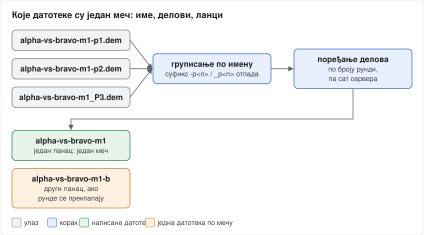

# Наредбе {#commands}

Први пут у командној линији? Прво прочитајте [Пре почетка](before-you-start.md). Ово куцајте у терминалу отвореном у фолдеру у који сте распаковали или клонирали пројекат; `<...>` су места за ваш унос, а путања са размацима иде под наводнике.

```text
python -m heat3d_cs2 demos <demo files or folders> -o <folder> [--every 8] [--jobs N] [--map TEXT] [--force] [--no-bulk] [--loose]
python -m heat3d_cs2 map <map name | path to its .vpk> -o <file.glb> [--game FOLDER] [--source2viewer EXE]
python -m heat3d_cs2 scoreboard <match.3dheat | match.json>
```

`python -m heat3d_cs2 --help` и `python -m heat3d_cs2 <verb> --help` исписују исте опције; [Референца наредби](../cli-reference.md) их све показује. Свако покретање прво проверава издање, како је описано у [Ажурирања](updates.md) (искључује се са `HEAT3D_NO_UPDATE=1`).

Код: [`heat3d_cs2/cli.py`](https://github.com/Holdi601/3DHeat-CS2/blob/main/heat3d_cs2/cli.py).

## `demos` - демои у табеле и документе мечева {#demos---demos-into-tables-and-match-documents}

```powershell
python -m heat3d_cs2 demos D:\Demos\event -o out
python -m heat3d_cs2 demos alpha-vs-bravo-m1-p1.dem alpha-vs-bravo-m1-p2.dem -o out
python -m heat3d_cs2 demos D:\Demos -o out --map final --jobs 4
```

| Аргумент | Подразумевано | Шта ради |
|---|---|---|
| `paths` (један или више) | - | демо-датотеке и фолдери. Датотека се узима кад јој је наставак `.dem` (било које величине слова). Фолдер се претражује **рекурзивно** за датотекама које се завршавају на `.dem`, било које величине слова, оним редом којим су сортиране. Компресовани демои (`.dem.zst`, `.dem.bz2`, архиве) се не читају: прво их распакујте. |
| `-o`, `--out` | обавезно | фолдер у који се пише; прави се по потреби |
| `--every N` | `8` | узорковати сваког играча на сваких *N* тактова. CS2 демои теку 64 такта у секунди, па је 8 осам узорака у секунди, 4 шеснаест, 64 један. Догађаји се увек читају на свом такту, ма колико било *N*. |
| `--jobs N` | `0` = половина CPU језгара | колико се мечева претвара истовремено, свако у свом процесу. Никад мање од 1, никад више од броја мечева за рад. |
| `--map TEXT` | - | само мечеви чије **име** садржи *TEXT*, без обзира на величину слова (`--map final`). Филтрира по имену датотеке, не по мапи коју демо заиста садржи. |
| `--force` | искључено | претвара мечеве који су већ написани, преписујући их |
| `--loose` | искључено | држи сваки меч као посебне датотеке - табелу, `.match.json`, пратеће датотеке - уместо да их спакује у један `.3dheat` контејнер. Видите [Једна датотека по мечу](output-container.md). |
| `--container` | укључено | пакује сваки меч у један `.3dheat` фајл; подразумевано, па је ту само да би било експлицитно |
| `--no-bulk` | искључено | оставља поток ентитета, команде играча и поток анимација ван пратеће датотеке пакета - више од половине величине демоа и кад је компресовано. Самопровера документа меча их тада броји као `lost`, по називу. |


### Које датотеке су један меч {#which-files-are-one-match}



Име меча је име демо-датотеке без наставка и без суфикса дела: `-p<цифре>` или `_p<цифре>` на крају, било које величине слова. Тако су `alpha-vs-bravo-m1-p1.dem`, `alpha-vs-bravo-m1-p2.dem` и `alpha-vs-bravo-m1_P3.dem` делови једног меча, `alpha-vs-bravo-m1`. Датотеке се групишу само по том имену - две датотеке истог имена у различитим фолдерима се такође групишу.

Суфикс ништа не каже о редоследу: `-p2` може бити раније полувреме. Делови се стављају у редослед по броју рунди које садрже, а затим по серверовом сату, а група која се испостави као два различита меча (исти тимови на истој мапи на два догађаја, рецимо) дели се на **ланце**: ланац са највише рунди носи само име, следећи се пише као `<име>-b`, затим `<име>-c`, и тако даље. Датотека без рунде у себи (само загревање, пауза) не припада ниједном ланцу. Како се ланци налазе описано је у [Како се прави меч](building-matches.md#делови-и-ланци).

### Шта се пише {#what-is-written}

За сваки меч, у фолдер назван по мапи коју заглавље демоа наводи (`unknown` ако не наводи ниједну), један `.3dheat` фајл:

```text
out/
  de_x/
    alpha-vs-bravo-m1.3dheat
    alpha-vs-bravo-m2.3dheat
  de_y/
    ...
```

На синтетичком демоу са две рунде из тестова:


Уз `--loose` сваки меч је табела, његов документ меча и четири пратеће датотеке једна поред друге ([Једна датотека по мечу](output-container.md)):


Топлотна мапа је једне мапе, па учитавање једног фолдера у приказивач значи учитавање мечева једне мапе. Видите [Табела топлотне мапе](output-table.md) и [Документ меча](output-match-json.md).

### Шта се прескаче {#what-is-skipped}

Пре читања било чега, наводи се сваки `*.3dheat` испод `--out` (контејнер се пише целиком или никако), и сваки `*.parquet` који поред себе има свој документ меча (`<name>.match.json`); меч чије је име једнако једном од њихових имена датотека (без наставка) се прескаче, осим ако је `--force`. Табела без свог документа меча - прекид између та два уписа - не рачуна се, па се тај меч поново претвара. Провера је само по имену: меч претворен у другу фолдер мапе, или с другим `--every`, и даље се рачуна као готов. Кад нема шта да се ради:

```text
nothing to do: no demos found, or every match already written (--force redoes them)
```

### Шта се исписује {#what-is-printed}

Прво количина посла, затим по један ред за сваки меч кад се заврши (оним редом којим се завршавају, а не редом датотека):

```text
3 match(es), 3 at a time
alpha-vs-bravo-m1: de_x, 21 rounds (Alpha 13 Bravo 8), 412,377 rows, lost 0
alpha-vs-bravo-m2: de_y, 30 rounds (Bravo 16 Alpha 14), 598,104 rows, 1 incomplete round(s) left out, lost 0
alpha-vs-bravo-m3: de_y, 18 rounds (Alpha 13 Bravo 5), 330,981 rows, recorded from round 3, lost 1,204,331 (svc_PacketEntities, svc_UserCmds, DEM_AnimationData)
```

(Бројеви су илустративни.) Резултат је последња рунда, тим по тим, редом којим документ меча наводи тимове. *incomplete round(s) left out* броји рунде које је демо прекинуо пре него што су одлучене; *recorded from round N* каже да снимак почиње касно; *lost* је самопровера документа меча - колико ставки демоа никуда није стигло, и каквих врста (`--no-bulk` чини велики део изгубљеним). Меч који не даје ништа каже зашто:

```text
alpha-vs-bravo-m4: no round in 1 file(s) - nothing written
alpha-vs-bravo-m4-b: no complete round in 1 file(s) - nothing written
```

Грешка у једном мечу не зауставља остале; исписује се као `<name>: failed - <error>`.

### Излазни код {#exit-code}

`0` кад је сваки меч претворен (или није било шта за рад), `1` кад је бар један пао.

### Колико траје {#how-long-it-takes}

Сваки меч се чита и прави у радном процесу. Фолдер од неколико стотина демоа траје минутима са подразумеваним `--jobs`. Меморија по послу расте с дужином меча и са мањим `--every`: сваки радник држи сваки узорковани ред играча свог меча (отприлике десет играча пута 64 / *N* редова у секунди снимка) пре писања.

Пратеће датотеке трају дуже од табеле: свако својство које парсер чита чита се на сваком такту, у прозору тактова (око два минута за демо од 40 минута, највише око 3 GB меморије по послу), па се демо још једном прелази ради оквира и порука.

## `map` - геометрија мапе као `.glb` {#map---a-maps-geometry-as-glb}


```powershell
python -m heat3d_cs2 map <map> -o out/<map>/<map>.glb
python -m heat3d_cs2 map <map> -o <map>.glb --game "D:\Games\Steam\steamapps\common\Counter-Strike Global Offensive"
python -m heat3d_cs2 map "D:\maps\<map>.vpk" -o <map>.glb --source2viewer C:\Tools\Source2Viewer-CLI.exe
```

| Аргумент | Подразумевано | Шта ради |
|---|---|---|
| `name` | - | назив мапе (као `de_x`), или путања до њеног `.vpk`. Путања која се завршава на `.vpk` и постоји користи се како јесте; све остало се тражи по имену фајла у инсталираној игри. |
| `-o`, `--out` | обавезно | `.glb` који се пише; његов фолдер се прави по потреби |
| `--game FOLDER` | Steam библиотеке | фолдер инсталације CS2 (онај који садржи `game\csgo`), кад Steam не зна за њега. Уз `--game` претражује се само тај фолдер. |
| `--source2viewer EXE` | `HEAT3D_SOURCE2VIEWER`, па `PATH` | извршна датотека Source2Viewer CLI |

Исписано при успеху:

```text
out/de_x/de_x.glb: de_x, 412,880 triangles (151,204 ground) in 14 parts
```

(бројеви су илустративни). Писање `.glb`-а поред табела мапе (`out/<map>/<map>.glb`) држи податке и геометрију мапе у једном фолдеру. Како извоз ради: [Извоз мапе](map-export.md).

Грешке, свака исписана као `error: ...` са излазним кодом `2`:

| Порука | Значи |
|---|---|
| `no de_x.vpk found in an installed CS2 - pass --game <CS2 folder> or the .vpk path` | мапа није ни у једној пронађеној Steam библиотеци, или је име погрешно |
| `Source2Viewer-CLI not found: ...` | ни `--source2viewer`, ни `HEAT3D_SOURCE2VIEWER`, ни `PATH` не дају постојећу датотеку |
| `Source2Viewer did not export de_x's collision mesh:` с репом излаза Source2Viewer-а | није успело, или није написало `.glb` |
| `de_x's collision mesh has nothing but clip brushes` | после изостављања клипова и неба ништа није остало |

## `scoreboard` - меч као текст {#scoreboard---a-match-as-text}

```bash
python -m heat3d_cs2 scoreboard out/de_x/alpha-vs-bravo-m1.3dheat
python -m heat3d_cs2 scoreboard out/de_x/alpha-vs-bravo-m1.match.json   # after demos --loose
```

Исписује табелу резултата меча из његовог [документа меча](output-match-json.md), без отварања приказивача. Чита документ унутар `.3dheat` контејнера, или самостални `<match>.match.json`. На синтетичком демоу са две рунде из тестова:


```text
alpha-vs-bravo-m1 - de_test  Alpha 2  Bravo 0

Alpha
player                 K   D   A  +/-    ADR   KAST   HS%  OK-OD  clutch
ash                    1   0   0   +1   50.0 100.0%    0%   0-0     1/1
ace                    1   1   0   +0   50.0 100.0%  100%   1-0     0/0

Bravo
player                 K   D   A  +/-    ADR   KAST   HS%  OK-OD  clutch
ben                    1   1   0   +0   50.0 100.0%    0%   0-0     0/1
bob                    0   1   0   -1    0.0 100.0%    0%   0-1     0/0

rounds  1:TK 2:TB
```

- Први ред: име меча, мапа и коначан резултат по тиму.
- Табела по тиму, редом којим документ меча наводи `teams`; играчи редом документа меча (по убиствима минус смрти, па по убиствима, најбољи први). Имена се скраћују на 19 знакова.
- Колоне: **K** убиства, **D** смрти, **A** асистенције *укључујући* асистенције блицем, **+/-** убиства минус смрти, **ADR**, **KAST** (%), **HS%** (заокружено на цео проценат), **OK-OD** отварајућа убиства - отварајуће смрти, **clutch** освојени клачеви / одиграни клачеви. Дефиниције: [Статистика](statistics.md).
- Трака рунди: `<рунда>:<страна која је победила><како>`, са **B** бомба експлодирала, **D** деактивирана, **K** елиминација, **T** истекло време, а **?** за било шта друго (нерешено, предаја, остало). Нерешено нема страну која је победила: `<рунда>:?`.

Фајл који није исправан JSON, или није нађен, зауставља се са грешком; JSON документ без поља документа меча пада с Python грешком (даље се не проверава).
