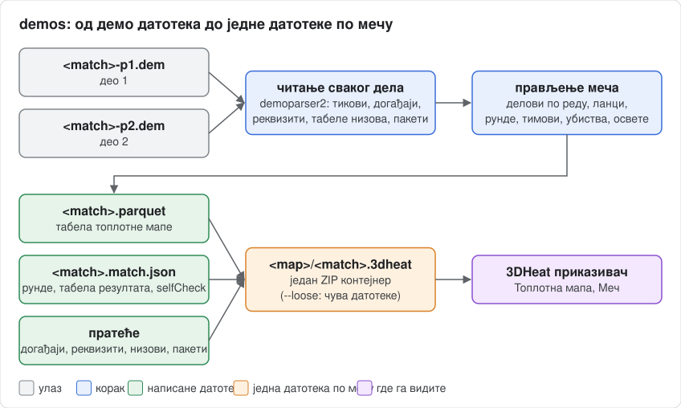

# 3DHeat CS2 {#dheat-cs2}

**Шта је то?** Counter-Strike 2 може да сачува снимак меча, који се зове
*демо*. Овај алат претвара демо у датотеке које 3DHeat приказивач може да прикаже у 3D:
где је свако стајао, умирао, бацао и постављао, рунду по рунду. Може и да
претвори CS2 мапу у 3D модел на којем их прикаже.

**Зашто бих га користио?** Да прегледате своје мечеве, да поређате више мечева
једне мапе преко других као једну топлотну мапу, и за статистику меча као што су ADR
(просечна штета по рунди) и KAST (удео рунди у којима је играч убио, асистирао,
преживео или био освећен).

**Пример:** `alpha-vs-bravo-m1.dem` на улазу, `out/de_x/alpha-vs-bravo-m1.3dheat`
на излазу (`de_x` је измишљено име мапе).



Детаљније: 3DHeat CS2 претвара **Counter-Strike 2 демое** у табелу топлотне мапе и документ о
мечу за сваки меч, а **CS2 мапу** у геометрију нивоа. Излази су направљени
за [3DHeat](https://holdi601.github.io/3DHeat/) телеметријски приказивач
([извор](https://github.com/Holdi601/3DHeat)), али су то обичне датотеке -
Parquet, JSON и glTF бинарни формат - које и било шта друго може да прочита.

То је мали Python пакет, `heat3d_cs2`, који се покреће из командне линије. Чита
демое с диска (ниједан не преузима) помоћу
[demoparser2](https://github.com/LaihoE/demoparser), а извози мапе из
инсталиране игре помоћу командне верзије Source2Viewer-а
([ValveResourceFormat](https://github.com/ValveResourceFormat/ValveResourceFormat)).

## Брзи почетак {#quick-start}

Први пут у командној линији? Прво прочитајте [Пре почетка](before-you-start.md).

```bash
pip install -r requirements.txt
python -m heat3d_cs2 demos <demo files or folders> -o out   # сваки меч у њима
python -m heat3d_cs2 map <map> -o out/<map>/<map>.glb       # мапа из инсталиране игре
python -m heat3d_cs2 scoreboard out/<map>/<match>.3dheat    # табела резултата меча као текст
```

Требало би да видите `1 match(es), 1 at a time ...` а затим по ред за сваки меч
(видите [Команде](commands.md#what-is-printed)).

`demos` пише, за сваки меч, по једну датотеку у фасцикли названој по мапи:
`out/<map>/<match>.3dheat`, [`.3dheat` контејнер](output-container.md) - формат
приказивача једна датотека по мечу ([спецификација](https://holdi601.github.io/3DHeat/container.html)).
Носи ове чланове; `--loose` их уместо тога пише као засебне датотеке:

| Члан | Шта држи | Учитава се на |
|---|---|---|
| `<match>.parquet` (улога `table`) | сваки жив играч осам пута у секунди са својим стањем (здравље, новац, блесак, нишан, зона, инвентар, ...), и сваки догађај где се десио (убиство, смрт, повреда, хитац, бацање, експлозије бомби, слепљење, постављање, деактивирање, експлозија, и крај рунде по играчу са оним што му је рунда донела), по један ред сваки | картица Топлотна мапа |
| `<match>.match.json` (улога `match`, документ о мечу) | тимови, резултат, свака рунда (победник, како, економија, постављање, убиства по реду, клачеви, преживели) и ред табеле резултата сваког играча | картица Меч |
| `<match>.events/props/strings/packets.parquet` | све остало што демо држи, цело (пратеће датотеке) | чува се ради потпуности |

`map` пише `<map>.glb`: мрежу судара мапе - подове, зидове, кутије,
без украса - подељену на тло и грађевине, у истом оквиру и
јединицама као табеле, па лежи тачно испод топлотне мапе (панел Позадина / ниво).

## Мапа документације {#map-of-this-documentation}

| Страница | Шта обухвата |
|---|---|
| [Пре почетка](before-you-start.md) | Python, терминал, места за попуњавање, како изгледају успех и уобичајене грешке |
| [Инсталација](installing.md) | Python, пакети, CLI Source2Viewer-а, где CS2 мора бити |
| [Команде](commands.md) | `demos`, `map`, `scoreboard`: свака опција, шта се исписује, излазни кодови |
| [Читање демоа](reading-demos.md) | шта се чита из демо датотеке: узорковани тикови, својства играча, правила игре, догађаји |
| [Прављење меча](building-matches.md) | делови и ланци, време меча, рунде, тимови и strane, редови, убиства, освете, отварања, штета, блесак, економија |
| [Статистика](statistics.md) | табела резултата: K/D/A, ADR, KAST, HS%, отварања, освете, вишеструка убиства, клачеви, помоћна средства, блесак |
| [Табела топлотне мапе](output-table.md) | Parquet датотека: свака колона, њен тип, који догађаји је пуне, савети у `heat3d` завршетку, осе |
| [Документ о мечу](output-match-json.md) | `.match.json` документ, поље по поље |
| [Једна датотека по мечу](output-container.md) | `.3dheat` контејнер који `demos` пише по основи, `--loose` |
| [Извоз мапе](map-export.md) | како се извози мрежа судара мапе, оквир, назив чворова, јединице |
| [Коришћење са 3DHeat-ом](using-with-3dheat.md) | учитавање табела, докумената о мечу и мапа у картице Топлотна мапа и Меч приказивача |
| [Ограничења](limits.md) | шта се претпоставља, шта није обрађено, шта није проверено |
| [Ажурирања](updates.md) | провера издања при покретању и `python -m heat3d_update` |
| [Развој](development.md) | распоред кода, тестови, синтетички демо |
| [Референца команди](../cli-reference.md) | `--help` сваке команде, генерисано из кода |
| [Одржавање](maintaining.md) | контролна листа издања за ове странице |

## На чему је проверено {#what-it-is-checked-against}

Демои са интернета нису по једна чиста датотека по мечу. Претварач подноси меч распоређен по
датотекама било којим редом, сервер поново покренут усред меча, два различита меча
сачувана под једним именом, рунде враћене из резервне копије, снимак који почиње касно
или се завршава рано, паузе, и тренере на страни тима -
видите [Прављење меча](building-matches.md). Проверено на великој збирци турнирских
демоа: у сваком мечу резултат прати победнике рунди, убиства једне стране су смрти
друге, и свака рунда почиње са пет против пет.

## На шта га усмерити {#what-to-point-it-at}

Демои из својих мечева, демои које сте сами преузели са сајта турнира, или
демои из API-ја до ког имате приступ. Демо је снимак чији садржај
припада његовом издавачу и организаторима: користите оно што изађе за своју
анализу, и немојте поново делити демое нити податке изведене из њих. Сајтови који
нуде демое често у својим условима забрањују аутоматско преузимање, због чега
алат чита демое с диска и ниједан не преузима.

## Део 3DHeat-а {#part-of-3dheat}

3DHeat CS2 је један од бесплатних алата око 3DHeat приказивача, сваки са својим
репозиторијумом, издањима и лиценцом:

| Алат | Шта ради | Документација |
|---|---|---|
| [3DHeat](https://github.com/Holdi601/3DHeat) | приказивач: топлотне мапе, анализа трке и преглед мечева у 3D | [сајт](https://holdi601.github.io/3DHeat/) |
| [GameFiles](https://github.com/Holdi601/3DHeat-GameFiles) | стазе и нивои из датотека које игре испоручују, као 3D модели | [сајт](https://holdi601.github.io/3DHeat-GameFiles/) |
| [GameCapture](https://github.com/Holdi601/3DHeat-GameCapture) | телеметрија кругова из тркачких игара; нивои реконструисани из снимка игре | [сајт](https://holdi601.github.io/3DHeat-GameCapture/) |
| [Unreal Exporter](https://github.com/Holdi601/3DHeat-UnrealExporter) | додатак за Unreal Editor који извози ниво као један 3D модел | [сајт](https://holdi601.github.io/3DHeat-UnrealExporter/) |
| [CS2](https://github.com/Holdi601/3DHeat-CS2) | Counter-Strike 2 демои у табеле и документе о мечу; мапе у 3D моделе | [сајт](https://holdi601.github.io/3DHeat-CS2/) |
| [Watcher](https://github.com/Holdi601/3DHeat-Watcher) | бележи оно што игре објављују о вашој игри, у позадини | [сајт](https://holdi601.github.io/3DHeat-Watcher/) |
| [Ext-WarThunder](https://github.com/Holdi601/3DHeat-Ext-WarThunder) | War Thunder репризе у табеле и документе о мечу | [сајт](https://holdi601.github.io/3DHeat-Ext-WarThunder/) |
| [Ext-WoT](https://github.com/Holdi601/3DHeat-Ext-WoT) | World of Tanks репризе у табеле и документе о мечу | [сајт](https://holdi601.github.io/3DHeat-Ext-WoT/) |
| [Ext-WoWs](https://github.com/Holdi601/3DHeat-Ext-WoWs) | World of Warships репризе у табеле и документе о мечу | [сајт](https://holdi601.github.io/3DHeat-Ext-WoWs/) |
| [Ext-Squad](https://github.com/Holdi601/3DHeat-Ext-Squad) | Squad демои са сервера у табеле и документе о мечу | [сајт](https://holdi601.github.io/3DHeat-Ext-Squad/) |
| [Ext-DCS](https://github.com/Holdi601/3DHeat-Ext-DCS) | DCS World мапе у 3D моделе | [сајт](https://holdi601.github.io/3DHeat-Ext-DCS/) |
| [Ext-IL2](https://github.com/Holdi601/3DHeat-Ext-IL2) | мапе IL-2 Sturmovik у 3D моделе | [сајт](https://holdi601.github.io/3DHeat-Ext-IL2/) |

## Лиценца {#licence}

MIT - видите [`LICENSE`](https://github.com/Holdi601/3DHeat-CS2/blob/main/LICENSE),
и [`LICENSES.md`](https://github.com/Holdi601/3DHeat-CS2/blob/main/LICENSES.md)
за пакете трећих страна и оно што игре које чита налажу.
