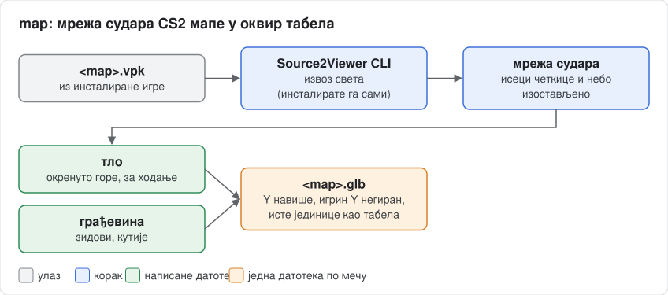

# Извоз мапе (`map`) {#map-export-map}

`python -m heat3d_cs2 map <map> -o <file.glb>` записује CS2 мапу као геометрију нивоа: **колизиону мрежу** света, у оквиру и јединицама у којима се цртају [табеле топлотне мапе](output-table.md). Код: [`heat3d_cs2/mapexport.py`](https://github.com/Holdi601/3DHeat-CS2/blob/main/heat3d_cs2/mapexport.py), [`heat3d_cs2/glb.py`](https://github.com/Holdi601/3DHeat-CS2/blob/main/heat3d_cs2/glb.py). Опције и поруке: [Наредбе](commands.md#map---геометрија-мапе-као-glb).



## Зашто колизиона мрежа {#why-the-collision-mesh}

Колизиона мрежа је оно по чему играчи ходају и за чим се кривe - подови, зидови, степенице, кутије - без украса: без пропова који само изгледају као нешто, без текстура, и далеко мање троуглова од мрежа за приказ. То је оно што топлотна мапа треба испод себе: нешто према чему се читају положаји, а не приказ мапе.

## Како се добија {#how-it-is-obtained}

1. **Нађите мапу.** Путања која се завршава на `.vpk` и постоји користи се како је дата. Иначе се тражи `<name>.vpk` у `<CS2 фолдер>\game\csgo\maps\`, где је CS2 фолдер `--game`, или `steamapps\common\Counter-Strike Global Offensive` у свакој пронађеној Steam библиотеци (видите [Инсталација](installing.md#где-се-тражи-cs2)).
2. **Нађите CLI Source2Viewer-а**: `--source2viewer`, па `HEAT3D_SOURCE2VIEWER`, па `Source2Viewer-CLI` / `Source2Viewer-CLI.exe` на `PATH`-у.
3. **Извезите физику света.** Source2Viewer се покреће као

   ```text
   Source2Viewer-CLI -i <map>.vpk -d -f maps/<map>/world_physics.vmdl_c --gltf_export_format glb -o <temporary folder>
   ```

   Декодира компилирану физику Source 2 из сопствене архиве мапе и записује модел (празан: свет нема сопствену мрежу за приказ) и његову физику поред њега. Највећи записани `.glb` је физика. Ако Source2Viewer не успе или не запише `.glb`, наредба се зауставља и показује последњих 800 знакова његовог излаза и грешака.
4. **Прочитајте га.** Сваки чвор сцене се обилази са својом трансформацијом (матрица, или translation-rotation-scale), и узима се сваки примитив троуглова, са или без индексног бафера, у светским положајима.
5. **Изоставите оно што није зид ни под.** Чвор чије име садржи `clip` - клипови играча, клипови NPC-ја, клипови бацача: невидљиви зидови који заустављају играче и бацаче - или `sky`, без обзира на величину слова, се одбацује.
6. **Именујте површину.** Групе физике су именоване по својој површини; име малим словима, без почетног `physics`, `physics_group` или `physics_passbullets` (и доње црте после тога), је површина: `physics_group_concrete` је `concrete`, `physics_passbullets_chainlink` је `chainlink`, а голо `physics_group` је `world`. Површине кроз које metci пролазе се чувају.
7. **Назад у оквир игре.** Source2Viewer записује glTF у метрима, са Y нагоре: игрин (Y, Z, X) помножен са 0,0254. То се поништава - свака тачка постаје игрин (X, Y, Z) у инчима.
8. **Одвојите под од конструкције**, троугао по троугао: лице чија нормала показује нагоре најмање 0,7 (његова Z компонента, нормализована) - нагиби до око 45 степени, отприлике најстрмије по којима CS2 играч хода - је **под**; све остало, зидови и плафони укључени, је **конструкција**.
9. **У оквир приказивача.** Свака тачка се записује као (X, Z, -Y): Y нагоре, игрин Y негиран - оквир у којем приказивач црта табеле кад следи њихове `heat3d` наговештаје. Ротација, не огледало.
10. **Запишите `.glb`.** Ако ништа не остане (само клип-четкице), наредба се зауставља са грешком. Иначе исписује фајл, мапу, број троуглова, колико их је под, и број делова.

Ништа овде не чита ништа осим сопственог `.vpk`-а мапе, и ништа од Source2Viewer-а није укључено или умножено.

## Фајл {#the-file}

Бинарни glTF 2.0 (`.glb`), један бафер, који пише `heat3d_cs2` (`asset.generator`):

| Аспект | Шта |
|---|---|
| Чворови | један по делу, сви у корену, без трансформација, сваки са својом мрежом истог имена |
| Називи чворова | `ground:<surface>` или `structure:<surface>` (`ground:concrete`, `structure:metal`, `structure:world`), сортирани по имену |
| Примитиви | један по мрежи, троуглови, `POSITION` (float32, са min/max) и `NORMAL` (float32), индекси `uint32` |
| Сенчење | равно: једно теме по углу троугла, свако са нормалом свог троугла |
| Материјали, текстуре, UV, боје | ништа |
| Јединице | игрине јединице (**инчи**), не метри - за разлику од онога што glTF претпоставља |
| Оквир | (X, Z, -Y) игре: glTF-ов Y је висина игре, glTF-ов Z је игрин -Y |

Префикс `ground:` / `structure:` је конвенција свих извозника нивоа 3DHeat-а: приказивач узима део тако именован здраво за готово, уместо да погађа из геометрије, па подови добију сенчење пода а зидови цртеж конструкције без икаквог корака класификације.

Пошто су јединице инчи, други glTF приказивач приказује мапу око 39 пута превелику (чита их као метре); ако је важно, скалирајте са 0,0254 тамо. У 3DHeat-у она лежи тачно испод табеле, која је у истим јединицама са размером 1.

## Провера да је оквир исправан {#the-check-that-the-frame-is-right}

Тест `test_players_stand_on_the_exported_floor` (покреће се само кад су дати демо и Source2Viewer, видите [Развој](development.md#тестови)) извози мапу на којој је демо игран, узима 300 случајних узорака положаја играча из меча, и за сваки гледа право надоле за највишим троуглом пода најдаље 4 јединице изнад стопала играча. Захтева да најмање 98 % узорака нађе под, и да медијана висине изнад њега буде мања од 5 јединица. Огледално пресликана мапа пада на овом тесту: на мапи пресликаној погрешном осом велики део играча стоји над ничим. README наводи бројеве ове провере за мапе тренутног такмичарског скупа.

## Шта не ради {#what-it-does-not-do}

- Нема геометрије за приказ, текстура или украса - видите *зашто* горе.
- Извози се само оно што је у моделу `world_physics` мапе. Да ли су у њему покретни делови (врата) или ломљиви предмети није проверено.
- Нема упрошћавања: приказивач 3DHeat га упрошћава при увозу према подешавању **Циљ поједностављивања**.
- Мапе које нису у инсталираној игри (радионичке мапе негде на диску) раде кад се њихов `.vpk` достави као путања и садржи `maps/<name>/world_physics.vmdl_c`; није проверено.
