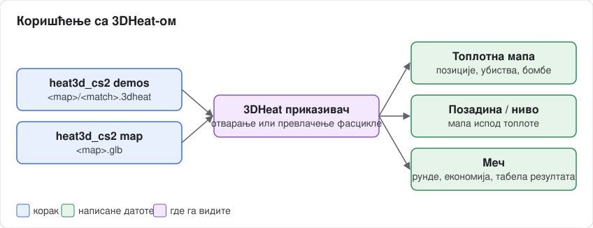

# Коришћење са 3DHeat-ом {#using-it-with-3dheat}

Излази иду на ова места у [прегледачу 3DHeat](https://holdi601.github.io/3DHeat):

| Фајл | Где | Шта даје |
|---|---|---|
| `<match>.3dheat` (подразумевано) | картица **Топлотна мапа**, панел **Извор**, или картица **Меч** | табела и документ меча заједно, један фајл по мечу ([контејнер](https://holdi601.github.io/3DHeat/container.html)) |
| `<match>.parquet` | картица **Топлотна мапа**, панел **Извор** | положаји и догађаји као топлотна мапа, реплеј кутијом, путање |
| `<match>.match.json` | картица **Меч**, **Учитај датотеке мечева…** | табела резултата, рунде, ток убистава, статистика преко мечева, везе у топлотну мапу |
| `<map>.glb` | панел **Позадина / ниво**, **3D модел…** | мапа испод топлотне мапе |

Сопствена документација прегледача потпуно описује сваку картицу: њене странице [Анализа меча](https://holdi601.github.io/3DHeat/match-analysis.html), [Учитавање фајлова](https://holdi601.github.io/3DHeat/loading-files.html), [Мапирање колона](https://holdi601.github.io/3DHeat/column-mapping.html) и [Реприза кутијом](https://holdi601.github.io/3DHeat/box-replay.html). Ова страница је CS2 страна тога.



Прегледач: [github.com/Holdi601/3DHeat](https://github.com/Holdi601/3DHeat), документација [holdi601.github.io/3DHeat](https://holdi601.github.io/3DHeat/).

## Типична сесија {#a-typical-session}

```bash
python -m heat3d_cs2 demos D:\Demos\event -o out
python -m heat3d_cs2 map <map> -o out/<map>/<map>.glb
```

1. **Топлотна мапа → Извор:** изаберите фолдер `out/<map>` (или га превуците). Сваки `.parquet` у њему постаје један скуп података; `.json` и `.glb` фајлови у истом фолдеру се прескачу као "not a csv/parquet file". Учитајте га.
2. **Позадина / ниво → 3D модел…:** изаберите `out/<map>/<map>.glb`. **Сачувај у библиотеку** га задржава у прегледачу за следећи пут.
3. **Картица Меч → Учитај датотеке мечева…:** изаберите `.match.json` фајлове из истог фолдера (више одједном), или их превуците на приказ док је картица Меч отворена.

Учитајте само табеле једне мапе истовремено: координате различитих мапа се преклапају, а топлотна мапа два мапе истовремено не значи ништа. Фолдер по мапи постоји баш због тога.

## Табела се отвара без ичега за подешавање {#the-table-opens-with-nothing-to-set}

Прегледач чита `heat3d` унос заглавља прве изабране датотеке ([Табела топлотне мапе](output-table.md#наговештаји-заглавља-heat3d)) и ставља га преко својих претпоставки:

| Подешавање прегледача | Постави на |
|---|---|
| Положај | `x`, `y`, `z` |
| Оса нагоре у извору | Z је нагоре |
| Окрени Y | укључено - да мапа буде окренута на исправну страну, а не пресликана |
| Размера јединица | 1 - даљине у игриним јединицама (означене са "m"; 1 јединица = 1 инч) |
| Време | `time`, секунде |
| Особа | `player` |
| Група | `side` (T / CT) |
| Сесија | `roundId` - свака рунда је сесија, `<match> #NN` |
| Смер погледа | вектор, `dirX` / `dirY` / `dirZ` |
| Колоне филтера | `event`, `match`, `round`, `roundTime`, `phase`, `weapon`, `place`, `won`, `buy`, `opening`, `team` |
| Величина ентитета | 32 - реплеј кутијом црта играча широког 32 јединице, са зраком погледа од 4 x 32 |

Свака наговештена вредност се и даље види у мапирању колона и може се променити. Остале колоне (`headshot`, `traded`, `other`, `steamid`, `health`, `money`, `damage`, `duration`, ...) могу се тамо додати као филтри ручно.

Размеру јединица оставите на 1 кад је мапа учитана: `.glb` је у истим игриним јединицама, и ниво се не мења размером заједно са табелом.

### Корисни филтри {#useful-filters}

- `event` = `position` за то где су играчи били; `kill` / `death` за то где су дуели добијени и изгубљени; `smoke`, `flash`, `molotov`, `he` за то где је слетео утилитиј; `throw` за то одакле је бачен; `plant` за места постављања.
- `side` (група) = `T` или `CT`, `phase` = `live` да се изостави после фаза, `buy` = `eco` / `force` / `full` за рунде једне економије, `won` = 1 за рунде које је страна реда освојила.
- `opening` = 1 уз `kill` и `death` за отварајуће дуеле.
- `roundTime` као опсег за тренутак рунде: првих 20 секунди, после постављања.

## Картица Меч {#the-match-tab}

Картица Меч прима JSON фајл чији је `format` `heat3d-cs2-match` и који има низове `rounds`, `players` и `teams` ([Документ меча](output-match-json.md)). Приказује резултат и половине, траку рунди обојену по страни која је победила са ознаком за то како се свака завршила, економију сваке рунде, постављање, ток убистава, клачеве и преживеле, табелу резултата, и статистику преко свих учитаних мечева.

Њене везе **Прикажи на топлотној мапи** ништа не учитавају: само постављају филтере на табели која је већ учитана у картици Топлотна мапа - `match`, `round` (и сесију рунде `<match> #NN`), `event`, играча, страну. То ради зато што документ меча и табела носе иста имена мечева, бројеве рунди, имена играча и стране. **Реприза рунде** прелази топлотну мапу на реприз кутијом и пушта сесију рунде од њеног почетка.

Зато учитајте оба: табеле мапе у картици Топлотна мапа, и њихове документе мечева у картици Меч. Документ меча без своје табеле и даље приказује табелу резултата и рунде, а везе кажу да нема података топлотне мапе.

## Без 3DHeat-а {#without-3dheat}

- Табела је обичан Parquet: pandas, Polars, DuckDB, Spark, R-ов `arrow` је све читају, `heat3d` унос се игнорише, а текстуалне колоне се читају као стрингови или категорије.
- Документ меча је обичан JSON.
- Мапа је валидан glTF бинарни формат, у инчима, не у метрима: скалирајте са 0,0254 за алате који претпостављају метре. Њен оквир је сопствени glTF оквир (Y нагоре), па да табелу преклопите негде другде, нацртајте сваки ред (x, y, z) као (x, z, -y), као што то ради 3DHeat.
