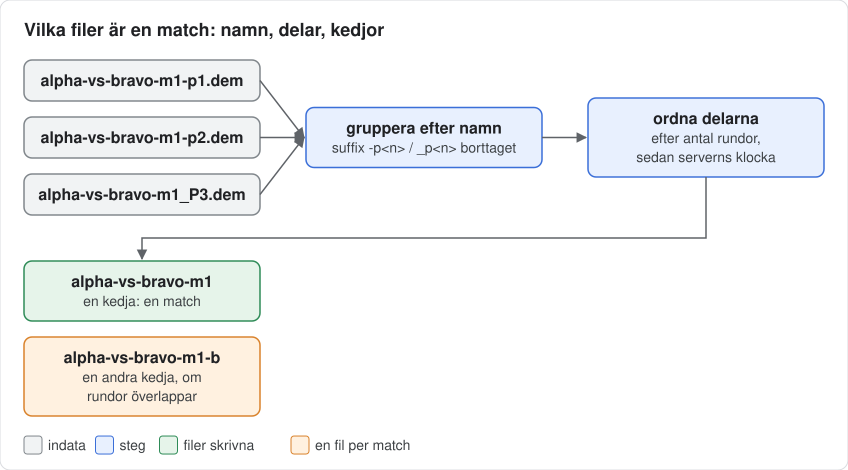

# Bygga en match {#building-a-match}

Så görs en match av sina demodelar: vilka filer som hör ihop, en gemensam klocka för
alla, rundorna och hur var och en vanns, lagen och deras sidor, och varje rad i
värmekartetabellen med kills, trades, öppningar, skada, flashar och ekonomi. Kod:
[`heat3d_cs2/match.py`](https://github.com/Holdi601/3DHeat-CS2/blob/main/heat3d_cs2/match.py).
Resultattavlan som räknas ut från den finns på [Statistik](statistics.md).

## Översikt {#overview}

1. Varje fil med ett matchnamn läses in ([Läsa en demo](reading-demos.md)).
2. Varje fils dubbla spelarrader (återställda rundor) görs entydiga.
3. Filerna sorteras i **kedjor** - matcher - och varje kedja sätts i ordning.
4. Varje del placeras på **matchklockan**.
5. **Rundorna** hittas i varje del; en senare dels beskrivning av en runda ersätter
   en tidigare dels.
6. **Spelarna** och **lagen** namnges, och varje rundas sidor och ställning ges med
   lagnamn. När sidorna är kända följer halvlekens längd, pistolrundorna och varje
   sidas **köp**.
7. **Raderna** byggs: positioner, skott, kast, detonationer, plantering,
   desarmering, kills, dödsfall, skador, blindningar, explosioner.
8. Varje rad märks med sin runda, fas, rondtid, om dess sida vann och sidans köp;
   rader utanför alla rundor tas bort.

## Återställda rundor: en rad per spelare och tick {#restored-rounds-one-row-per-player-per-tick}

När en runda återställs från en säkerhetskopia inne i en och samma fil har demon
spelarnas gamla kroppar kvar bredvid de nya i några sekunder: två rader för en
spelare vid ett och samma tick, en där den annullerade rundan lämnade dem och en vid
den återställda rundans spawn. För varje sådan spelare går de dubbla ticken
**baklänges** från den första enkla raden efter dem. Vid varje tick behålls den
kandidat som ligger närmast positionen som följer, och den blir referens för ticket
innan. Finns ingen enkel rad efter dem behålls den sista kandidaten. Så behåller varje
spelare den rad som leder vidare dit de går härnäst.

## Den levande delen av en fil {#the-live-part-of-a-file}

En fils **levande start** är ticket för dess sista händelse `round_announce_match_start`,
eller tick 0 om den saknar en sådan (en senare del av en delad match har oftast ingen).
Allt före den levande starten utelämnas, och så allt som är markerat med
`is_warmup_period`. En knivrunda eller en omstart före annonseringen utelämnas därför;
en knivrunda som *inte* följs av en annonsering om matchstart känns inte igen som en
sådan (se [Begränsningar](limits.md)).

En fils **rundor** är händelserna `round_freeze_end` från den levande starten och framåt,
utanför uppvärmningen, identifierade med sitt `total_rounds_played` (spelets 0-baserade
index för rundan som ska spelas). En fil utan sådana har inga rundor och hör till ingen
match.

## Klockan {#the-clock}

Tider anges i sekunder. Inom en fil räknas tiden i **ticks**: serverns `game_time` vid
första samplade ticket, plus antal ticks sedan dess / 64. Serverns egen klocka stannar
under en paus medan ticks fortsätter att räknas; läser man genom klockan skulle två
ögonblick i en pausad match få samma tid.

Varje fil har en *första klocka* (tiden vid dess levande start) och en *sista klocka*
(vid dess sista samplade tick).

### Delar och kedjor {#parts-and-chains}

Filer som anges som samma match ([Kommandon](commands.md#which-files-are-one-match))
sorteras först efter index för sin första runda, sedan efter sin första klocka. Sedan
går var och en, i den ordningen, med i den första kedja den fortsätter, eller startar
en ny kedja. En del fortsätter en kedja när dess första rundindex är minst kedjans sista
dels sista index, **och** antingen

- serverns klocka går vidare: dess första klocka är inte tidigare än kedjans sista
  klocka minus 5 s; eller
- rundräkningen går vidare: dess första rundindex är kedjans sista index eller det
  närmast efter.

Räkningen avgör och klockan bryter oavgjorda fall, eftersom en server som startats om
för att återställa en runda börjar räkna om sin klocka, medan två olika matcher under
samma namn (samma lag på samma karta vid två evenemang) har överlappande rundräkningar.
Kedjor sorteras efter hur många rundor de spänner över, flest först; den första behåller
matchnamnet, de övriga skrivs som `<namn>-b`, `<namn>-c` och så vidare.

### Matchklockan {#the-match-clock}

Matchens nollpunkt är första delens första klocka: **matchtid 0 är den levande starten
av första filen**. Varje senare del placeras på den:

- där serverns klocka går vidare (dess första klocka är inte tidigare än föregående dels
  sista klocka minus 5 s), används serverns klocka som den är;
- där den startats om, placeras delen så att den följer **en sekund** efter att
  föregående del slutade.

## Rundor {#rounds}

För varje `round_freeze_end` i en del (i tickordning) går rundans fönster till nästa
freeze end i samma del, eller till filens slut. Inom det avgörs rundan vid det första
samplade tick där spelläget visar `total_rounds_played` = rundans index + 1 och
`round_win_status` 1 (oavgjort), 2 (T vann) eller 3 (CT vann). En runda utan ett sådant
sampel i sitt fönster avbröts av filens slut; dess nummer läggs i matchens lista över
**ofullständiga** (om inte en annan del har rundan komplett).

| Rundfält | Från |
|---|---|
| `number` | index + 1 (1-baserat, som spelet räknar) |
| `start` | matchtid när freeze time tar slut - spelarna får röra sig |
| `end` | matchtid för det första sampel som visar rundan avgjord |
| `until` | matchtid för nästa `round_prestart` efter `end`, om den ligger inom fönstret; annars fönstrets slut eller filens sista tick, vad som kommer först (och aldrig före `end`) |
| `winner` | `T` för win status 2, `CT` för 3, tomt för 1: en oavgjord runda är avgjord, utan vinnare |
| `reason` | `round_win_reason` vid det sampelet, namngiven enligt nedan |
| `score` | lagnamn -> vunna rundor efter denna: varje sidas `team_rounds_total` vid det avgörande sampelet; där demon saknar det, föregående rundas ställning plus en för vinnaren |
| `sides` | lagnamn -> `T` / `CT` i denna runda |
| `equipment` | sida -> summan av `current_equip_value` för sidans **levande** spelare vid första sampel vid eller efter freeze end |
| `buy` | sida -> `pistol`, `eco`, `force` eller `full` ([Ekonomi](#economy-and-buy-types)) |
| `plant` | första `bomb_planted` efter freeze end och fram till `end`, eller ingen |
| `exploded` | matchtid för första `bomb_exploded` efter den plantningen och före nästa freeze end, om en sådan finns (inte i matchdokumentet; den tidsätter raden `explode`) |

`reason`, från spelets `CSRoundEndReason`:

| Kod | `reason` |
|---|---|
| 1 | `bomb` (målet bombat) |
| 7 | `defuse` |
| 8, 9 | `elimination` (CT vinner / T vinner genom att eliminera) |
| 10 | `draw` |
| 12 | `time` (målet räddat) |
| 17, 18 | `surrender` |
| annat | `other` |

När flera delar innehåller samma runda (med samma index) behålls den senare delens
version. Rundorna listas sedan efter index. En match vars första runda inte är runda 1
noterar de saknade numren (`missing` i matchdokumentet); kommandoraden skriver
*recorded from round N*.

### Plantering {#the-plant}

| Fält | Från |
|---|---|
| `site` | `A` eller `B`: bombzonen som spelet säger att planteraren stod i (`which_bomb_zone`, 1 = A, 2 = B); utan den planterarens platsnamn (`BombsiteA`, `BombsiteB`); utan det bokstaven som en annan plantering i samma fil i samma zon gav (händelsens `site` är zonens entitetsnummer). Tomt när ingenting anger det - aldrig siffran. |
| `time` | sekunder **in i rundan** (sedan dess freeze end), som en kills tid |
| `player`, `steamid` | planteraren |
| `x`, `y`, `z` | planterarens position, spelenheter: där bomben ligger |
| `place` | planterarens platsnamn vid planteringen |

### Faserna {#the-phases}

Tiden från `start` till `end` är rundans **levande** fas; från `end` till `until` dess
**efter**-fas, där vinnarna jagar och förlorarna sparar. En rad hör till den runda vars
`[start, until)` innehåller dess tid, och är `after` när dess tid är senare än `end`.
Freeze time ligger mellan rundor och hör till ingen.

## Spelare och lag {#players-and-teams}

En **spelare** är var och en som var levande minst en gång på en sida (lag 2 eller 3),
utanför freeze time och uppvärmning, efter den levande starten. En tränare eller
kommentator på en lags sida är aldrig levande och är ingen spelare. Varje spelare
identifieras med sitt Steam-ID; namnet är det sist sedda.

En spelares **lag** är klannamnet spelet gav deras sida (`team_clan_name`), det oftast
sedda för dem - demon rensar det i sitt allra sista. En match som spelats utan klannamn
namnger sina lag efter den sida de började på: `Started T` och `Started CT`.

Varje rundas **sidor** kommer av vilka som var på vilken sida mellan freeze end och
rundans slut: varje sida får den lagetikett de flesta av dess spelare bär. Matchens
lista `teams` är i ordning efter första förekomst, runda för runda, T-sidan före CT;
oftast är laget som började på T först.

## Raderna {#the-rows}

Varje positionssampel och varje händelse blir en rad i [värmekartetabellen](output-table.md).
Spelare är på en sida endast när deras `team_num` är 2 eller 3.

### Positioner {#positions}

Från de samplade raderna för levande spelare på en sida, utanför freeze time och
uppvärmning, efter den levande starten: position, blickriktning, hälsa, pansar, pengar,
utrustningsvärde, hållet vapen, plats.

Blickriktningen är en enhetsvektor i spelets koordinatsystem:
`(cos pitch * cos yaw, cos pitch * sin yaw, -sin pitch)` - spelets pitch är positiv när
man tittar neråt, så att titta neråt ger ett negativt Z.

Det hållna vapnet är `active_weapon_name` så som spelet namnger det, förutom att varje
namn som innehåller `Knife`, `Bayonet`, `Karambit` eller `Daggers` blir `Knife`.

### Skott och kast {#shots-and-throws}

Från `weapon_fire`, vid skyttens position. Knivar (`knife`, `bayonet` i vapen-id:t) och
C4 utelämnas. Granater (`smokegrenade`, `flashbang`, `hegrenade`, `molotov`,
`incgrenade`, `decoy`) blir **throw**-rader, allt annat **shot**-rader. Vapnet anges
så som spelet visar det (nedan).

### Granatdetonationer {#grenade-detonations}

| Händelse | Rad | `weapon` |
|---|---|---|
| `smokegrenade_detonate` | `smoke` | Smoke Grenade |
| `flashbang_detonate` | `flash` | Flashbang |
| `hegrenade_detonate` | `he` | High Explosive Grenade |
| `inferno_startburn` (molotov och incendiary) | `molotov` | Molotov |
| `decoy_detonate` | `decoy` | Decoy Grenade |

Positionen är **där granaten gick av** (händelsens `x`, `y`, `z`); spelaren och sidan är
kastarens. Demon anger ingen plats för en granat, bara för spelare, så `place` lämnas
tomt: en rad påstår inte en plats den inte var på. Kastarens plats i det ögonblicket
sparas som `throwerPlace`.

### Planteringar och desarmeringar {#plants-and-defuses}

Raderna `plant` och `defuse` ligger vid spelarens position, med vapnet `C4 Explosive`.
En planterad bomb som gick av får en **explode**-rad: vid planteringens position, vid
tiden för `bomb_exploded`, med planteraren som spelare (med sitt Steam-ID), sidan `T`,
rundans T-lag som `team` och planteringens plats. Det gäller även en bomb som går av
efter att Ts redan vunnit genom eliminering. Där demon saknar `bomb_exploded` får en
runda som vunnits av bomben (`reason` = `bomb`) med en plantering sin rad vid rundans
`end`.

### Kills och dödsfall {#kills-and-deaths}

Varje `player_death` i en runda ger en **killpost** (matchens tabell `kills`) med:

| Fält | Är |
|---|---|
| attacker, victim, assister | namn, Steam-ID, sidor; attacker är tomt för världen (fallskada, bomben) |
| `weapon` | händelsens vapen, namngivet så som spelet visar det |
| `headshot` | händelsens flagga |
| `wallbang` | `penetrated` > 0 |
| `throughSmoke` | `thrusmoke` |
| `flashAssist` | `assistedflash` |
| `noscope`, `attackerBlind` | händelsens flaggor (`noscope`, `attackerblind`); kolumner i raderna `kill` och `death`, och i matchdokumentets kills |
| `suicide` | attacker och victim är samma spelare: en egen granat, till exempel |
| `teamkill` | attacker och victim på samma sida, med en attacker, och inte ett suicide |
| `opening` | rundans första kill av en fiende (nedan) |
| `traded`, `trade` | nedan |
| positioner | attackerns och offrets position och plats |

Från varje post får tabellen en **death**-rad vid offrets position (alla dödsfall,
världens, lagkamrat-kills och suicide inräknade) och - för kills av en fiende (en
attacker, ingen teamkill, inget suicide) - en **kill**-rad vid mördarens position.

**Öppning.** Rundans första kill av en fiende medan den är levande är dess
öppningsduell. En teamkill, ett suicide eller ett dödsfall för världen före den
hoppas över, så öppningen är ändå rundans första duell; en runda utan någon fiendekill
medan den är levande har ingen öppning.

**Traded** och **trade.** Ett dödsfall genom en fiende är **traded** när dess mördare
dödas av någon från offrets sida inom **5 sekunder** efter det (mer än 0 och högst 5 s
senare, i samma runda); den första sådana kill är en **trade**-kill. I tabellen är en
`kill`-rads kolumn `traded` 1 för en trade-kill; en `death`-rads är 1 för ett dödsfall
som hämnades. Kills i efterfasen räknas också.

### Skada {#damage}

Från `player_hurt`, endast mellan **fiender** (båda på en sida, olika sidor). Skadan är
hälsa som faktiskt **förlorades**: för varje offer i varje runda startar hälsan på 100;
varje träff räknar `min(dmg_health, hälsa före)`, och händelsens `health` (vad som är
kvar) blir nästa träffs "före". Ett huvudskott på 137 skada mot en spelare med 40 hälsa
räknas som 40, så som spelets resultattavla räknar det. Träffar från `hegrenade`,
`inferno`, `molotov` och `incgrenade` är **utrustningsskada**. Varje träff blir en
**hurt**-rad vid offrets position, med attackern som `other`. Lagkamraters skada och
egen skada finns varken i tabellen eller i statistiken.

### Blindningar {#flashes}

Från `player_blind`, endast **fiender** (inte lagkamrater, och inte en tränare eller
kommentator som tittar på): en **blind**-rad per blindad spelare, vid den bländade
spelarens position, med den som blindade som `other`, och blindningstiden i sekunder som
`duration`. Varje varaktighet sparas; statistiken räknar bara blindningar på minst en
sekund.

## Vapennamn {#weapon-names}

Ett vapen-id från en händelse (`ak47`, `weapon_ak47`, `knife_karambit`) visas så som
spelet namnger det i spelarnas egen `active_weapon_name`, så att ett kills vapen och ett
hållet vapen läses lika: `ak47` -> `AK-47`, `m4a1` -> `M4A4`, `m4a1_silencer` ->
`M4A1-S`, `hkp2000` -> `P2000`, `taser` -> `Zeus x27`, `inferno` och `molotov` ->
`Molotov`, `incgrenade` -> `Incendiary Grenade`, `c4` och `planted_c4` -> `C4 Explosive`,
`world` -> `World`, och så vidare för varje vapen och granat (tabellen `WEAPONS` i
`match.py`). Allt med `knife` eller `bayonet` i sitt id är `Knife`. Ett id som inte finns
i tabellen behålls som det är.

## Ekonomi och köpetyper {#economy-and-buy-types}

I slutet av freeze time summeras varje sidas utrustningsvärde över dess levande spelare
vid första sampel från då, och delas med hur många det var:

| Runda | Genomsnittlig utrustning per spelare | `buy` |
|---|---|---|
| en pistolrunda (första i varje ordinarie halvlek) | vilken som helst | `pistol` |
| annars | under 1 500 $ | `eco` |
| annars | 1 500 $ till under 4 000 $ | `force` |
| annars | 4 000 $ eller mer | `full` |

Pistolrundorna följer det halvlek matchen spelades med, inte ett fast format. Halvleken
slutar där sidorna först byter plats mellan två rundor som följer på varandra, båda i
ordinarie tid: dess längd (`halfLength` i matchdokumentet) är rundan före bytet - 12 i
24-rundorsformatet, 15 i 30-rundorsformatet. Runda 1 och rundan efter halvleken är
pistolrundorna. En runda är övertid när spelets övertidsräknare (`m_nOvertimePlaying`) är
över 0 vid dess freeze end; där en demo saknar en sådan räknare är varje runda efter två
halvlekar det. Övertidshalvlekar börjar med pengar som servern bestämmer och har ingen
pistolrunda, även om sidorna också byter plats. En inspelning som aldrig visar bytet vid
halvtid - den börjar efter det, eller slutar före - lämnar halvleken okänd, och bara runda
1 är en pistolrunda.

## Märkning och ordning {#labelling-and-order}

Till sist får varje rad:

- `match` - matchnamnet; `map` - demohuvudets karta;
- `round` och `roundId` (`<match> #NN`, två siffror);
- `phase` - `live` eller `after`;
- `roundTime` - sekunder sedan rundans freeze time tog slut;
- `won` - 1 om radens sida vann rundan, 0 om inte, tomt för en rad utan sida;
- `buy` - radens sidas köp den rundan;
- `team` - radens spelares lag, via Steam-ID.

Rader vars tid ligger i ingen runda - före första rundans freeze end, under freeze time,
efter sista rundan - tas bort. Raderna sorteras efter tid, och inom samma tid efter
händelsens namn.
