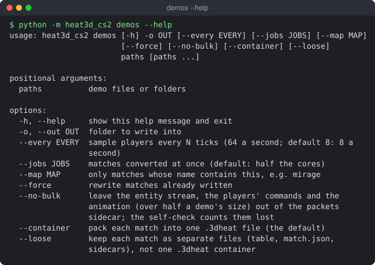
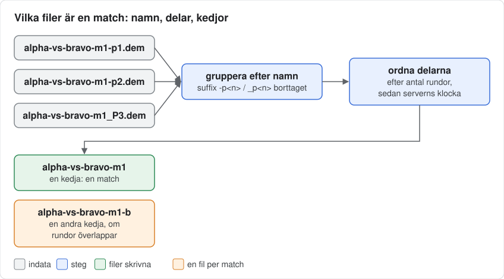

# Kommandon {#commands}

Ny på kommandoraden? Läs [Innan du börjar](before-you-start.md) först.
Skriv dessa i en terminal som öppnats i mappen du packade upp eller klonade;
`<...>` är platshållare, och en sökväg med mellanslag skrivs inom citattecken.

```text
python -m heat3d_cs2 demos <demofiler eller mappar> -o <mapp> [--every 8] [--jobs N] [--map TEXT] [--force] [--no-bulk] [--loose]
python -m heat3d_cs2 map <kartnamn eller sökväg till dess .vpk> -o <fil.glb> [--game MAPP] [--source2viewer EXE]
python -m heat3d_cs2 scoreboard <match.3dheat | match.json>
```

`python -m heat3d_cs2 --help` och `python -m heat3d_cs2 <kommando> --help` visar samma
alternativ; [Kommandoreferensen](../cli-reference.md) visar dem alla. Varje start kör först
versionskontrollen som beskrivs i [Uppdateringar](updates.md) (av med `HEAT3D_NO_UPDATE=1`).

Kod: [`heat3d_cs2/cli.py`](https://github.com/Holdi601/3DHeat-CS2/blob/main/heat3d_cs2/cli.py).

## `demos` - demos till tabeller och matchdokument {#demos---demos-into-tables-and-match-documents}

```powershell
python -m heat3d_cs2 demos D:\Demos\event -o out
python -m heat3d_cs2 demos alpha-vs-bravo-m1-p1.dem alpha-vs-bravo-m1-p2.dem -o out
python -m heat3d_cs2 demos D:\Demos -o out --map final --jobs 4
```

| Argument | Standard | Gör |
|---|---|---|
| `paths` (en eller flera) | - | demofiler och mappar. En fil tas när dess ändelse är `.dem` (oavsett versaler). En mapp söks **rekursivt** efter filer som slutar på `.dem`, oavsett versaler, i sorterad ordning. Komprimerade demos (`.dem.zst`, `.dem.bz2`, arkiv) läses inte: packa upp dem först. |
| `-o`, `--out` | krävs | mappen att skriva i; skapas vid behov |
| `--every N` | `8` | samplar varje spelare var *N*:e tick. CS2-demos går med 64 tick per sekund, så 8 ger åtta sampel per sekund, 4 ger sexton, 64 ger ett. Händelser läses alltid vid sitt eget tick, oavsett *N*. |
| `--jobs N` | `0` = hälften av processorkärnorna | hur många matcher som konverteras samtidigt, var och en i sin egen process. Aldrig färre än 1, aldrig fler än det finns matcher att göra. |
| `--map TEXT` | - | bara matcher vars **namn** innehåller *TEXT*, utan skillnad på versaler och gemener (`--map final`). Det filtrerar på filnamnet, inte på den karta demon visar sig innehålla. |
| `--force` | av | konvertera matcher som redan är skrivna, och skriv över dem |
| `--loose` | av | behåll varje match som separata filer - tabell, `.match.json`, sidofiler - i stället för att packa dem i en `.3dheat`-behållare. Se [En fil per match](output-container.md). |
| `--container` | på | packa varje match i en `.3dheat`-fil; standard, så den finns bara för att vara tydlig |
| `--no-bulk` | av | lämna entitetsströmmen, spelarnas kommandon och animationsströmmen utanför paketfilen - över hälften av en demos storlek även komprimerad. Matchdokumentets självkontroll räknar då dem som `lost`, med namn. |



### Vilka filer som är en match {#which-files-are-one-match}



Matchnamnet är demofilens namn utan ändelse och utan delsuffix: `-p<siffror>` eller
`_p<siffror>` i slutet, oavsett versaler. Så `alpha-vs-bravo-m1-p1.dem`,
`alpha-vs-bravo-m1-p2.dem` och `alpha-vs-bravo-m1_P3.dem` är delarna av en och samma match,
`alpha-vs-bravo-m1`. Filer grupperas enbart på det namnet - två filer med samma namn i
olika mappar grupperas också.

Suffixet säger ingenting om ordningen: en `-p2` kan vara den tidigare halvleken. Delarna
sätts i ordning efter hur många rundor de innehåller, och sedan efter serverns klocka, och
en grupp som visar sig innehålla två olika matcher (samma lag på samma karta vid två
evenemang, till exempel) delas upp i **kedjor**: kedjan med flest rundor skrivs under
namnet självt, nästa som `<namn>-b`, sedan `<namn>-c` och så vidare. En fil utan någon
runda i (bara uppvärmning, en paus) hör till ingen kedja. Hur kedjor hittas beskrivs i
[Bygga en match](building-matches.md#parts-and-chains).

### Vad som skrivs {#what-is-written}

För varje match, i en mapp uppkallad efter kartan som demohuvudet anger (`unknown` när
det inte anger någon), en `.3dheat`-fil:

```text
out/
  de_x/
    alpha-vs-bravo-m1.3dheat
    alpha-vs-bravo-m2.3dheat
  de_y/
    ...
```

På den syntetiska tvårundersdemon i testerna:


Med `--loose` blir varje match tabellen, dess matchdokument och fyra sidofiler sida vid
sida ([En fil per match](output-container.md)):


En värmekarta är över en karta, så att läsa in en mapp i visaren är att läsa in en kartas
matcher. Se [Värmekartetabellen](output-table.md) och [Matchdokumentet](output-match-json.md).

### Vad som hoppas över {#what-is-skipped}

Innan något läses listas varje `*.3dheat` var som helst under `--out` (en behållare skrivs
helt eller inte alls), och varje `*.parquet` som har sitt matchdokument (`<namn>.match.json`)
bredvid sig. En match vars namn är detsamma som ett av deras filnamn (utan ändelse) hoppas
över, om inte `--force` anges. En tabell utan sitt matchdokument - en körning som stoppades
mellan att skriva de två - räknas inte, så den matchen konverteras igen. Kontrollen sker
enbart på namn: en match som konverterats till en annan kartmapp, eller med ett annat
`--every`, räknas ändå som klar. När inget finns kvar att göra:

```text
nothing to do: no demos found, or every match already written (--force redoes them)
```

### Vad som skrivs ut {#what-is-printed}

Först mängden arbete, sedan en rad per match när den blir klar (i den ordning de blir
klara, inte filernas ordning):

```text
3 match(es), 3 at a time
alpha-vs-bravo-m1: de_x, 21 rounds (Alpha 13 Bravo 8), 412,377 rows, lost 0
alpha-vs-bravo-m2: de_y, 30 rounds (Bravo 16 Alpha 14), 598,104 rows, 1 incomplete round(s) left out, lost 0
alpha-vs-bravo-m3: de_y, 18 rounds (Alpha 13 Bravo 5), 330,981 rows, recorded from round 3, lost 1,204,331 (svc_PacketEntities, svc_UserCmds, DEM_AnimationData)
```

(Siffrorna är illustrativa.) Ställningen är den sista rundans, lag för lag i den ordning
matchdokumentet listar dem. *incomplete round(s) left out* räknar rundor som demon avbröt
innan de var avgjorda; *recorded from round N* säger att inspelningen startar sent;
*lost* är matchdokumentets självkontroll - hur många delar av demon som inte gick någonstans,
och av vilka slag (`--no-bulk` gör bulken förlorad). En match som inte ger något säger varför:

```text
alpha-vs-bravo-m4: no round in 1 file(s) - nothing written
alpha-vs-bravo-m4-b: no complete round in 1 file(s) - nothing written
```

Ett fel i en match stoppar inte de andra; det skrivs ut som `<namn>: failed - <fel>`.

### Avslutskod {#exit-code}

`0` när varje match konverterats (eller när inget fanns att göra), `1` när minst en
misslyckades.

### Hur lång tid det tar {#how-long-it-takes}

Varje match läses och byggs i en arbetsprocess. En mapp med några hundra demos tar minuter
med standardvärdet för `--jobs`. Minnet per jobb växer med matchens längd och med ett mindre
`--every`: varje arbetsprocess håller varje samplad spelarrad för sin match (ungefär tio
spelare gånger 64 / *N* rader per sekund inspelning) innan den skriver.

Sidofilerna tar längre tid än tabellen: varje egenskap parsern läser läses vid varje tick, i
ett fönster av ticks i taget (ungefär två minuter för en 40-minuters demo, och högst cirka
3 GB minne per jobb), sedan går demon igenom en gång till för sina bildrutor och meddelanden.

## `map` - en kartas geometri som `.glb` {#map---a-maps-geometry-as-glb}


```powershell
python -m heat3d_cs2 map <map> -o out/<map>/<map>.glb
python -m heat3d_cs2 map <map> -o <map>.glb --game "D:\Games\Steam\steamapps\common\Counter-Strike Global Offensive"
python -m heat3d_cs2 map "D:\maps\<map>.vpk" -o <map>.glb --source2viewer C:\Tools\Source2Viewer-CLI.exe
```

| Argument | Standard | Gör |
|---|---|---|
| `name` | - | kartans namn (som `de_x`), eller sökvägen till dess `.vpk`. En sökväg som slutar på `.vpk` och finns används som den är; allt annat letas upp efter sitt filnamn i det installerade spelet. |
| `-o`, `--out` | krävs | `.glb`-filen att skriva; dess mapp skapas vid behov |
| `--game MAPP` | Steams bibliotek | CS2-installationsmappen (den som innehåller `game\csgo`), när Steam inte känner till den. Med `--game` söks bara den mappen. |
| `--source2viewer EXE` | `HEAT3D_SOURCE2VIEWER`, sedan `PATH` | den körbara filen för Source2Viewers kommandoradsversion |

Utskrift vid lyckat resultat:

```text
out/de_x/de_x.glb: de_x, 412,880 triangles (151,204 ground) in 14 parts
```

(siffrorna är illustrativa). Att skriva `.glb`-filen bredvid kartans tabeller
(`out/<map>/<map>.glb`) håller en kartas data och geometri i samma mapp. Så fungerar
exporten: [Kartexport](map-export.md).

Fel, var och en utskrivet som `error: ...` med avslutskod `2`:

| Meddelande | Betyder |
|---|---|
| `no de_x.vpk found in an installed CS2 - pass --game <CS2 folder> or the .vpk path` | kartan finns inte i något Steam-bibliotek som hittats, eller namnet är fel |
| `Source2Viewer-CLI not found: ...` | ingen av `--source2viewer`, `HEAT3D_SOURCE2VIEWER` och `PATH` gav en befintlig fil |
| `Source2Viewer did not export de_x's collision mesh:` följt av slutet av dess utskrift | det misslyckades, eller skrev ingen `.glb` |
| `de_x's collision mesh has nothing but clip brushes` | efter att clip och himmel lämnats utanför fanns inget kvar |

## `scoreboard` - en match som text {#scoreboard---a-match-as-text}

```bash
python -m heat3d_cs2 scoreboard out/de_x/alpha-vs-bravo-m1.3dheat
python -m heat3d_cs2 scoreboard out/de_x/alpha-vs-bravo-m1.match.json   # efter demos --loose
```

Skriver ut matchens resultattavla från dess [matchdokument](output-match-json.md), utan att
öppna visaren. Den läser dokumentet inuti en `.3dheat`-behållare, eller en lös
`<match>.match.json`. På den syntetiska tvårundersdemon i testerna:


```text
alpha-vs-bravo-m1 - de_test  Alpha 2  Bravo 0

Alpha
player                 K   D   A  +/-    ADR   KAST   HS%  OK-OD  clutch
ash                    1   0   0   +1   50.0 100.0%    0%   0-0     1/1
ace                    1   1   0   +0   50.0 100.0%  100%   1-0     0/0

Bravo
player                 K   D   A  +/-    ADR   KAST   HS%  OK-OD  clutch
ben                    1   1   0   +0   50.0 100.0%    0%   0-0     0/1
bob                    0   1   0   -1    0.0 100.0%    0%   0-1     0/0

rounds  1:TK 2:TB
```

- Första raden: matchnamn, karta och slutställningen per lag.
- En tabell per lag, i matchdokumentets `teams`-ordning; spelare i matchdokumentets
  ordning (efter kills minus deaths, sedan kills, bäst först). Namn kapas till 19 tecken.
- Kolumner: **K** kills, **D** deaths, **A** assists *inklusive* flashassists, **+/-**
  kills minus deaths, **ADR**, **KAST** (%), **HS%** (avrundat till hela procent),
  **OK-OD** öppningskills - öppningsdöd, **clutch** vunna clutchar / spelade clutchar.
  Definitioner: [Statistik](statistics.md).
- Rundlistan: `<runda>:<vinnande sida><hur>`, med **B** bomb exploderade, **D** desarmerad,
  **K** eliminering, **T** tiden slut, och **?** för allt annat (oavgjort, kapitulation,
  annat). En oavgjord runda har ingen vinnande sida: `<runda>:?`.

En fil som inte är giltig JSON, eller inte finns, stoppar med ett fel; ett JSON-dokument
utan matchdokumentets fält misslyckas med ett Python-fel (det valideras inte vidare).
