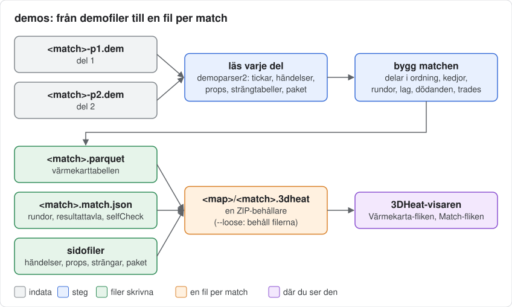

# 3DHeat CS2 {#dheat-cs2}

**Vad är det?** Counter-Strike 2 kan spara en inspelning av en match, kallad en
*demo*. Det här verktyget gör en demo till filer som 3DHeat-visaren kan visa i 3D:
var alla stod, dog, kastade och planterade, runda för runda. Det kan också
göra en CS2-karta till en 3D-modell att visa dem på.

**Varför skulle jag använda det?** För att granska dina egna matcher, för att lägga många matcher
på samma karta över varandra som en enda värmekarta, och för matchstatistik som ADR (genomsnittlig skada per runda)
och KAST (andelen rundor där en spelare dödade, assisterade, överlevde eller blev bytt).

**Exempel:** `alpha-vs-bravo-m1.dem` in, `out/de_x/alpha-vs-bravo-m1.3dheat`
ut (`de_x` är ett påhittat kartnamn).



Mer i detalj: 3DHeat CS2 gör **Counter-Strike 2-demos** till en värmekarttabell och ett matchdokument per match, och en **CS2-karta** till nivågeometri. Utdatan är gjord
för [3DHeat](https://holdi601.github.io/3DHeat/) telemetrivisaren
([källkod](https://github.com/Holdi601/3DHeat)), men det är vanliga filer - Parquet, JSON och
binär glTF - som vad som helst annat också kan läsa.

Det är ett litet Python-paket, `heat3d_cs2`, som körs från kommandoraden. Det läser
demos från disken (det laddar inte ner några) med
[demoparser2](https://github.com/LaihoE/demoparser), och exporterar kartor från det
installerade spelet med kommandoradsversionen av Source2Viewer
([ValveResourceFormat](https://github.com/ValveResourceFormat/ValveResourceFormat)).

## Snabbstart {#quick-start}

Har du aldrig använt kommandoraden förut? Läs [Innan du börjar](before-you-start.md) först.

```bash
pip install -r requirements.txt
python -m heat3d_cs2 demos <demo files or folders> -o out   # varje match i dem
python -m heat3d_cs2 map <map> -o out/<map>/<map>.glb       # kartan från det installerade spelet
python -m heat3d_cs2 scoreboard out/<map>/<match>.3dheat    # en matchs resultattavla som text
```

Du bör se `1 match(es), 1 at a time ...` och sedan en rad per match
(se [Kommandon](../commands.md#what-is-printed)).

`demos` skriver, per match, en fil i en mapp uppkallad efter kartan:
`out/<map>/<match>.3dheat`, en [`.3dheat`-behållare](../output-container.md) - visarens
format med en fil per match ([specifikation](https://holdi601.github.io/3DHeat/container.html)).
Den innehåller dessa delar; `--loose` skriver dem som separata filer i stället:

| Del | Vad den innehåller | Läses in i visarens |
|---|---|---|
| `<match>.parquet` (roll `table`) | varje levande spelare åtta gånger per sekund med deras tillstånd (hälsa, pengar, bländning, riktsikte, zon, inventarie, ...), och varje händelse där den skedde (dödande, död, skadad, skott, kast, granatexplosioner, bländning, plantering, desarmering, explosion, och en rundans slut per spelare med vad rundan gav dem), en rad var | fliken Värmekarta |
| `<match>.match.json` (roll `match`, matchdokumentet) | lag, poäng, varje runda (vinnare, hur, ekonomi, plantering, dödanden i ordning, clutches, överlevare) och varje spelares rad i resultattavlan | fliken Match |
| `<match>.events/props/strings/packets.parquet` | allt annat demon innehåller, helt (sidofiler) | sparas för fullständighetens skull |

`map` skriver `<map>.glb`: kartans kollisionsmesh - golv, väggar, lådor, utan dekoration - uppdelad i mark och konstruktion, i samma ram och enheter som tabellerna, så att den ligger exakt under värmekartan (nivåpanelen).

## Dokumentationens karta {#map-of-this-documentation}

| Sida | Vad den täcker |
|---|---|
| [Innan du börjar](before-you-start.md) | Python, en terminal, platshållare, hur lyckat och de vanliga felen ser ut |
| [Installera](../installing.md) | Python, paketen, Source2Viewers CLI, var CS2 måste ligga |
| [Kommandon](../commands.md) | `demos`, `map`, `scoreboard`: varje alternativ, vad som skrivs ut, avslutskoder |
| [Läsa en demo](../reading-demos.md) | vad som läses från en demofil: samplade tickar, spelaregenskaper, spelregler, händelser |
| [Bygga en match](../building-matches.md) | delar och kedjor, matchklockan, rundor, lag och sidor, rader, dödanden, trades, öppningar, skada, bländningar, ekonomi |
| [Statistik](../statistics.md) | resultattavlan: K/D/A, ADR, KAST, HS%, öppningar, trades, multikills, clutches, utility, bländningar |
| [Värmekarttabellen](../output-table.md) | Parquet-filen: varje kolumn, dess typ, vilka händelser som fyller den, `heat3d`-sidfotens tips, axlarna |
| [Matchdokumentet](../output-match-json.md) | `.match.json`-dokumentet, fält för fält |
| [En fil per match](../output-container.md) | `.3dheat`-behållaren `demos` skriver som standard, `--loose` |
| [Kartexport](../map-export.md) | hur en kartas kollisionsmesh exporteras, ramen, nodnamngivning, enheter |
| [Användning med 3DHeat](../using-with-3dheat.md) | läsa in tabeller, matchdokument och kartor i visarens flikar Värmekarta och Match |
| [Begränsningar](../limits.md) | vad som antas, vad som inte hanteras, vad som inte är verifierat |
| [Uppdateringar](../updates.md) | utgivningskontrollen vid start och `python -m heat3d_update` |
| [Utveckling](../development.md) | kodens layout, tester, den syntetiska demofixturen |
| [Kommandoreferens](../cli-reference.md) | varje kommandos `--help`, genererat från koden |
| [Underhålla](../maintaining.md) | utgivningschecklistan för de här sidorna |

## Vad det kontrolleras mot {#what-it-is-checked-against}

Demos från verkligheten är inte en ren fil per match. Konverteraren hanterar en match
delad över filer i valfri ordning, en server som startats om mitt i matchen, två olika matcher
lagrade under samma namn, rundor återställda från en säkerhetskopia, en inspelning som startar sent eller slutar tidigt, pauser och tränare på ett lags sida -
se [Bygga en match](../building-matches.md). Kontrollerat över en stor samling turneringsdemos: i varje match
följer poängen rundvinnarna, varje sidas dödanden är den andra sidans dödsfall, och varje runda startar fem mot fem.

## Vad du ska peka den på {#what-to-point-it-at}

Dina egna matchers demos, demos du laddat ner för hand från en turneringssida, eller demos från ett API du har åtkomst till. En demo är en inspelning vars innehåll tillhör dess utgivare och arrangörer: använd det som kommer ut för din egen analys, och sprid inte demos eller data som härletts från dem vidare. Sidor som erbjuder demos förbjuder ofta automatisk nedladdning i sina villkor, vilket är varför verktyget läser demos från disken och inte hämtar några.

## En del av 3DHeat {#part-of-3dheat}

3DHeat CS2 är ett av de fria verktygen runt 3DHeat-visaren, vart och ett med sitt eget
förråd, sina egna utgåvor och sin egen licens:

| Verktyg | Vad det gör | Dokumentation |
|---|---|---|
| [3DHeat](https://github.com/Holdi601/3DHeat) | visaren: värmekartor, racinganalys och matchgenomgång i 3D | [webbplats](https://holdi601.github.io/3DHeat/) |
| [GameFiles](https://github.com/Holdi601/3DHeat-GameFiles) | banor och nivåer ur de filer spel levererar, som 3D-modeller | [webbplats](https://holdi601.github.io/3DHeat-GameFiles/) |
| [GameCapture](https://github.com/Holdi601/3DHeat-GameCapture) | varvtelemetri från racingspel; nivåer återskapade från spelvideo | [webbplats](https://holdi601.github.io/3DHeat-GameCapture/) |
| [Unreal Exporter](https://github.com/Holdi601/3DHeat-UnrealExporter) | ett Unreal Editor-tillägg som exporterar en nivå som en 3D-modell | [webbplats](https://holdi601.github.io/3DHeat-UnrealExporter/) |
| [CS2](https://github.com/Holdi601/3DHeat-CS2) | Counter-Strike 2-demos till tabeller och matchdokument; kartor till 3D-modeller | [webbplats](https://holdi601.github.io/3DHeat-CS2/) |
| [Watcher](https://github.com/Holdi601/3DHeat-Watcher) | spelar in vad spel publicerar om ditt spel, i bakgrunden | [webbplats](https://holdi601.github.io/3DHeat-Watcher/) |
| [Ext-WarThunder](https://github.com/Holdi601/3DHeat-Ext-WarThunder) | War Thunder-repriser till tabeller och matchdokument | [webbplats](https://holdi601.github.io/3DHeat-Ext-WarThunder/) |
| [Ext-WoT](https://github.com/Holdi601/3DHeat-Ext-WoT) | World of Tanks-repriser till tabeller och matchdokument | [webbplats](https://holdi601.github.io/3DHeat-Ext-WoT/) |
| [Ext-WoWs](https://github.com/Holdi601/3DHeat-Ext-WoWs) | World of Warships-repriser till tabeller och matchdokument | [webbplats](https://holdi601.github.io/3DHeat-Ext-WoWs/) |
| [Ext-Squad](https://github.com/Holdi601/3DHeat-Ext-Squad) | Squad-serverdemos till tabeller och matchdokument | [webbplats](https://holdi601.github.io/3DHeat-Ext-Squad/) |
| [Ext-DCS](https://github.com/Holdi601/3DHeat-Ext-DCS) | DCS World-kartor till 3D-modeller | [webbplats](https://holdi601.github.io/3DHeat-Ext-DCS/) |
| [Ext-IL2](https://github.com/Holdi601/3DHeat-Ext-IL2) | IL-2 Sturmovik-kartor till 3D-modeller | [webbplats](https://holdi601.github.io/3DHeat-Ext-IL2/) |

## Licens {#licence}

MIT - se [`LICENSE`](https://github.com/Holdi601/3DHeat-CS2/blob/main/LICENSE),
och [`LICENSES.md`](https://github.com/Holdi601/3DHeat-CS2/blob/main/LICENSES.md)
för tredjepartspaketen och vad spelen den läser kräver.
