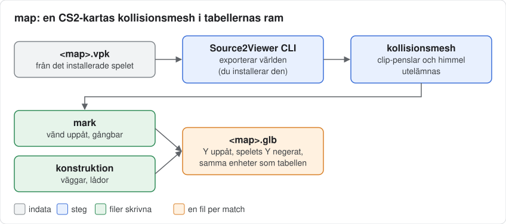

# Kartexport (`map`) {#map-export-map}

`python -m heat3d_cs2 map <karta> -o <fil.glb>` skriver en CS2-karta som banans geometri: världens
**kollisionsnät**, i det koordinatsystem och de enheter som [värmekartetabellerna](output-table.md)
ritas i. Kod:
[`heat3d_cs2/mapexport.py`](https://github.com/Holdi601/3DHeat-CS2/blob/main/heat3d_cs2/mapexport.py),
[`heat3d_cs2/glb.py`](https://github.com/Holdi601/3DHeat-CS2/blob/main/heat3d_cs2/glb.py).
Alternativ och meddelanden: [Kommandon](commands.md#map---a-maps-geometry-as-glb).



## Varför kollisionsnätet {#why-the-collision-mesh}

Kollisionsnätet är det spelare står på och gömmer sig bakom - golv, väggar, trappor, lådor - utan
dekoren: inga rekvisita som bara ser ut som något, inga texturer, betydligt färre trianglar än
renderingsnäten. Det är vad en värmekarta behöver under sig: något att läsa positioner mot, inte en
rendering av kartan.

## Hur det hämtas {#how-it-is-obtained}

1. **Hitta kartan.** En sökväg som slutar på `.vpk` och finns används som den anges. Annars letas
   `<namn>.vpk` upp i `<CS2-mappen>\game\csgo\maps\`, där CS2-mappen är `--game`, eller
   `steamapps\common\Counter-Strike Global Offensive` i varje Steam-bibliotek som hittas (se
   [Installera](installing.md#where-cs2-is-looked-for)).
2. **Hitta Source2Viewers CLI**: `--source2viewer`, sedan `HEAT3D_SOURCE2VIEWER`, sedan
   `Source2Viewer-CLI` / `Source2Viewer-CLI.exe` på `PATH`.
3. **Exportera världens fysik.** Source2Viewer körs så här:

   ```text
   Source2Viewer-CLI -i <karta>.vpk -d -f maps/<karta>/world_physics.vmdl_c --gltf_export_format glb -o <tillfällig mapp>
   ```

   Det avkodar Source 2:s kompilerade fysik ur kartans eget arkiv och skriver modellen (tom: världen
   har inget eget renderingsnät) och dess fysik bredvid. Den största skrivna `.glb`-filen är fysiken.
   Misslyckas Source2Viewer, eller skrivs ingen `.glb`, stoppar kommandot och visar de sista 800
   tecknen av dess utdata och fel.
4. **Läs den.** Varje nod i scenen går igenom med sin transform (matris, eller translation-rotation-
   skala), och varje triangelprimitiv tas, med eller utan indexbuffert, i världskoordinater.
5. **Lämna utanför det som inte är vägg eller golv.** En nod vars namn innehåller `clip` - spelar-clip,
   NPC-clip, granat-clip: de osynliga väggarna som stoppar spelare och granater - eller `sky`, oavsett
   versaler, släpps.
6. **Namnge ytan.** Fysikgrupperna namnges efter sin yta; namnet i gemener, utan inledande `physics`,
   `physics_group` eller `physics_passbullets` (och understrecket efter det), är ytan:
   `physics_group_concrete` blir `concrete`, `physics_passbullets_chainlink` blir `chainlink`, och en
   bar `physics_group` blir `world`. Ytor som kulor passerar genom behålls.
7. **Tillbaka till spelets koordinatsystem.** Source2Viewer skriver glTF i meter med Y uppåt: spelets
   (Y, Z, X) multiplicerat med 0,0254. Det ångras - varje punkt blir spelets (X, Y, Z) i tum.
8. **Dela upp mark och konstruktion**, triangel för triangel: en yta vars normal pekar uppåt minst 0,7
   (dess Z-komponent, normaliserad) - lutningar upp till omkring 45 grader, ungefär den brantaste en
   CS2-spelare går på - är **mark**; allt annat, väggar och tak inräknade, är **konstruktion**.
9. **In i visarens koordinatsystem.** Varje punkt skrivs som (X, Z, -Y): Y uppåt, spelets Y negerat -
   det koordinatsystem visaren ritar tabellerna i, när den följer deras `heat3d`-tips. En rotation, inte
   en spegling.
10. **Skriv `.glb`-filen.** Finns inget kvar (bara clip-volymer), stoppar kommandot med ett fel. Annars
    skriver det ut filen, kartan, antalet trianglar, hur många som är mark, och antalet delar.

Ingenting här läser något annat än kartans egen `.vpk`, och inget av Source2Viewer ingår eller kopieras.

## Filen {#the-file}

En glTF 2.0-binär (`.glb`), en buffert, skriven av `heat3d_cs2` (`asset.generator`):

| Egenskap | Vad |
|---|---|
| Noder | en per del, alla på roten, utan transformer, var och en med sitt eget nät med samma namn |
| Nodnamn | `ground:<yta>` eller `structure:<yta>` (`ground:concrete`, `structure:metal`, `structure:world`), sorterade efter namn |
| Primitiver | en per nät, trianglar, `POSITION` (float32, med min/max) och `NORMAL` (float32), `uint32`-index |
| Skuggning | platt: en vertex per triangelhörn, var och en med sin triangels normal |
| Material, texturer, UV, färger | inga |
| Enheter | spelenheter (**tum**), inte meter - till skillnad från vad glTF förutsätter |
| Koordinatsystem | (X, Z, -Y) i spelet: glTF:s Y är spelets höjd, glTF:s Z är spelets -Y |

Prefixet `ground:` / `structure:` är konventionen för alla 3DHeat-nivåexportörer: visaren tar en del
som heter så för sanningen, i stället för att gissa från geometrin, så golven får markskuggningen och
väggarna konstruktionsritningen utan något klassificeringssteg.

Eftersom enheterna är tum visar en annan glTF-visare kartan ungefär 39 gånger för stor (den läser dem
som meter); skala med 0,0254 där det spelar roll. I 3DHeat ligger den exakt under tabellen, som är i
samma enheter med skala 1.

## Kontrollen att koordinatsystemet är rätt {#the-check-that-the-frame-is-right}

Testet `test_players_stand_on_the_exported_floor` (körs bara när en demo och Source2Viewer anges, se
[Utveckling](development.md#tests)) exporterar kartan en demo spelades på, tar 300 slumpmässiga
positionssampel ur matchen, och för varje letar rakt nedåt efter den högsta markytan högst 4 enheter
över spelarens fötter. Det kräver att minst 98 % av sampelen hittar mark, och att medianhöjden över den
är under 5 enheter. En spegelvänd karta klarar inte: på en karta som speglats fel axel står en stor andel
av spelarna över ingenting. READMEn anger siffrorna för denna kontroll över kartorna i den aktuella
tävlingspoolen.

## Vad den inte gör {#what-it-does-not-do}

- Ingen renderingsgeometri, inga texturer eller dekor - se *varför* ovan.
- Bara det som finns i kartans `world_physics`-modell exporteras. Om rörliga delar (dörrar) eller
  krossbara föremål finns med är inte kontrollerat.
- Ingen förenkling: 3DHeat-visaren förenklar vid import med sin inställning **Förenklingsmål**.
- Kartor som inte finns i det installerade spelet (verkstadskartor någon annanstans på disken) fungerar
  när deras `.vpk` anges som sökväg och innehåller `maps/<namn>/world_physics.vmdl_c`; inte verifierat.
