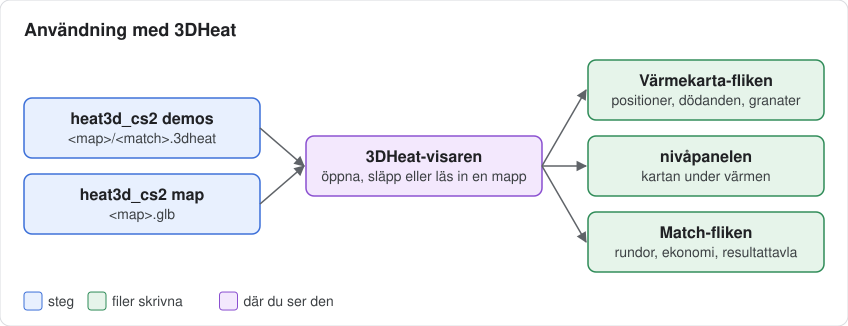

# Använda med 3DHeat {#using-it-with-3dheat}

Utdata hamnar på dessa ställen i [3DHeat-visaren](https://holdi601.github.io/3DHeat):

| Fil | Var | Vad den ger |
|---|---|---|
| `<match>.3dheat` (standard) | fliken **Värmekarta**, panelen **Källa**, eller fliken **Match** | tabellen och matchdokumentet tillsammans, en fil per match ([behållaren](https://holdi601.github.io/3DHeat/container.html)) |
| `<match>.parquet` | fliken **Värmekarta**, panelen **Källa** | positioner och händelser som värmekarta, boxuppspelning, rutter |
| `<match>.match.json` | fliken **Match**, **Läs in matchfiler…** | resultattavlan, rundorna, kill-flödet, statistik över matcher, länkar in i värmekartan |
| `<map>.glb` | panelen **Bakgrund / nivå**, **3D-modell…** | kartan under värmekartan |

Visaren har egen dokumentation som beskriver varje flik i detalj: sidorna
[Matchanalys](https://holdi601.github.io/3DHeat/match-analysis.html),
[Läsa in filer](https://holdi601.github.io/3DHeat/loading-files.html),
[Kolumnmappning](https://holdi601.github.io/3DHeat/column-mapping.html)
och [Boxuppspelning](https://holdi601.github.io/3DHeat/box-replay.html). Den här sidan är CS2-delen av det.



Visaren: [github.com/Holdi601/3DHeat](https://github.com/Holdi601/3DHeat), dokumentationen
[holdi601.github.io/3DHeat](https://holdi601.github.io/3DHeat/).

## En typisk session {#a-typical-session}

```bash
python -m heat3d_cs2 demos D:\Demos\event -o out
python -m heat3d_cs2 map <map> -o out/<map>/<map>.glb
```

1. **Värmekarta-fliken -> Källa:** välj mappen `out/<map>` (eller släpp den där). Varje `.parquet` i den
   blir ett dataset; `.json`- och `.glb`-filerna i samma mapp hoppas över som "inte en csv/parquet-fil".
   Läs in den.
2. **Bakgrund / nivå -> 3D-modell…:** välj `out/<map>/<map>.glb`. **Spara i biblioteket** behåller den i
   webbläsaren till nästa gång.
3. **Match-fliken -> Läs in matchfiler…:** välj `.match.json`-filerna i samma mapp (flera på en gång), eller
   släpp dem på vyn medan Match-fliken är öppen.

Läs bara in en kartas tabeller åt gången: koordinaterna för olika kartor överlappar, och en värmekarta över
två kartor samtidigt betyder ingenting. Mappen per karta finns för just det.

## Tabellen öppnas utan något att ställa in {#the-table-opens-with-nothing-to-set}

Visaren läser det första valda filens `heat3d`-post i sidfoten
([Värmekartetabellen](output-table.md#the-heat3d-footer-hints)) och lägger den över sina egna gissningar:

| Visarinställning | Ställs till |
|---|---|
| Position | `x`, `y`, `z` |
| Uppåtaxel i källan | Z är uppåt |
| Vänd Y | på - så att kartan står rätt, inte spegelvänd |
| Enhetsskala | 1 - avstånd i spelenheter (märkta "m"; 1 enhet = 1 tum) |
| Tid | `time`, sekunder |
| Person | `player` |
| Grupp | `side` (T / CT) |
| Session | `roundId` - varje runda är en session, `<match> #NN` |
| Blickriktning | vektor, `dirX` / `dirY` / `dirZ` |
| Filterkolumner | `event`, `match`, `round`, `roundTime`, `phase`, `weapon`, `place`, `won`, `buy`, `opening`, `team` |
| Entitetsstorlek | 32 - boxuppspelningen ritar en spelare 32 enheter bred, med en blickstråle på 4 x 32 |

Varje tipsat värde syns fortfarande i kolumnmappningen och kan ändras där. De andra kolumnerna (`headshot`,
`traded`, `other`, `steamid`, `health`, `money`, `damage`, `duration`, ...) kan läggas till som filter där för
hand.

Behåll enhetsskalan på 1 när en karta är inläst: `.glb`-filen är i samma spelenheter, och nivån skalas inte
om med tabellen.

### Användbara filter {#useful-filters}

- `event` = `position` för var spelarna var; `kill` / `death` för var duellerna vanns och förlorades; `smoke`,
  `flash`, `molotov`, `he` för var utrustningen landade; `throw` för var den kastades från; `plant` för
  planteringsplatser.
- `side` (gruppen) = `T` eller `CT`, `phase` = `live` för att utesluta efterfasen, `buy` = `eco` / `force` /
  `full` för rundor med en viss ekonomi, `won` = 1 för rundor radens sida vann.
- `opening` = 1 med `kill` och `death` för öppningsduellerna.
- `roundTime` som ett intervall för ett ögonblick i rundan: de första 20 sekunderna, efter plantering.

## Match-fliken {#the-match-tab}

Match-fliken tar emot en JSON-fil vars `format` är `heat3d-cs2-match` och som har arrayerna `rounds`,
`players` och `teams` ([Matchdokumentet](output-match-json.md)). Den visar ställningen och halvlekarna, en
rad med rundor färgade efter vinnande sida med en markering för hur var och en slutade, varje rundas ekonomi,
plantering, kill-flöde, clutchar och överlevare, resultattavlan och statistik över alla inlästa matcher.

Dess länkar **Visa i värmekartan** läser inte in något: de sätter filter på tabellen som redan är inläst i
fliken Värmekarta - `match`, `round` (och rundans session `<match> #NN`), `event`, spelaren, sidan. Det
fungerar eftersom matchdokumentet och tabellen bär samma matchnamn, rundnummer, spelarnamn och sidor.
**Spela upp runda** byter värmekartan till boxuppspelning och spelar rundans session från dess början.

Så läs in båda: en kartas tabeller i fliken Värmekarta, och deras matchdokument i fliken Match. Ett
matchdokument utan sin tabell visar fortfarande resultattavlan och rundor, och länkarna säger att ingen
värmekartedata är inläst.

## Utan 3DHeat {#without-3dheat}

- Tabellen är vanlig Parquet: pandas, Polars, DuckDB, Spark, R:s `arrow` läser den alla; `heat3d`-posten
  ignoreras, och textkolumnerna läses som strängar eller kategorier.
- Matchdokumentet är vanligt JSON.
- Kartan är en giltig glTF-binär, i tum i stället för meter: skala med 0,0254 för verktyg som antar meter.
  Dess koordinatsystem är glTF:s eget (Y uppåt), så för att lägga tabellen över den någon annanstans ritar du
  varje rads (x, y, z) som (x, z, -y), precis som 3DHeat gör.
