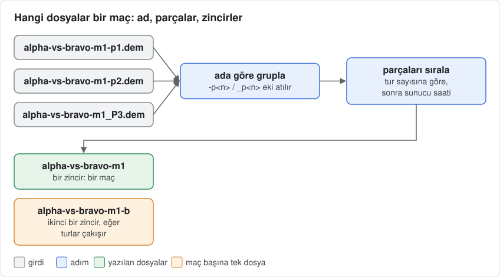

# Maç oluşturma {#building-a-match}

Bir maç, demo parçalarından nasıl yapılır: hangi dosyalar birlikte aittir, hepsinde
tek bir saat, raundlar ve her birinin nasıl kazanıldığı, takımlar ve tarafları, ve
ısı haritası tablosunun her satırı - öldürmeler, takaslar, açılışlar, hasar,
flaşlar ve ekonomi. Kod:
[`heat3d_cs2/match.py`](https://github.com/Holdi601/3DHeat-CS2/blob/main/heat3d_cs2/match.py).
Bundan hesaplanan skor tablosu [İstatistikler](statistics.md) sayfasında.

## Genel bakış {#overview}

1. Bir maç adının her dosyası okunur ([Demo okuma](reading-demos.md)).
2. Her dosyadaki çift oyuncu satırları (geri yüklenen raundlar) çözülür.
3. Dosyalar **zincirlere** - maçlara - ayrılır ve her zincir sıraya konur.
4. Her parça **maç saatine** yerleştirilir.
5. **Raundlar** her parçada bulunur; sonraki bir parçanın bir raunt hakkındaki
   kaydı, öncekinin yerini alır.
6. **Oyuncular** ve **takımlar** adlandırılır; her raundun tarafları ve skoru takım
   adına göre verilir. Taraflar bilindiğinde yarının uzunluğu, tabanca raundları ve
   her tarafın **alımı** belli olur.
7. **Satırlar** oluşturulur: konumlar, atışlar, atışlar (fırlatmalar), patlamalar,
   bomba kurulumları, bomba etkisiz hale getirmeler, öldürmeler, ölümler, yaralanmalar,
   körleşmeler, patlamalar.
8. Her satır raundu, aşamayı, raunt süresini, tarafının kazanıp kazanmadığını ve
   tarafının alımını alır; hiçbir raundun dışında kalan satırlar atılır.

## Geri yüklenen raundlar: her oyuncu için tik başına bir satır {#restored-rounds-one-row-per-player-per-tick}

Bir raunt bir dosya içinde bir yedekten geri yüklendiğinde, demo bir süre boyunca
oyuncuların eski bedenlerini yenilerinin yanında taşır: bir oyuncu için aynı tikte iki
satır - biri iptal edilen raundun onları bıraktığı yerde, biri geri yüklenen raundun
doğma noktasında. Böyle her oyuncu için, çiftli tikler, kendilerinden sonraki ilk tekil
satırdan **geriye doğru** izlenir: her tikte, izleyen konuma en yakın aday tutulur ve
bu, bir önceki tik için referans olur. Sonrasında tekil satır yoksa, son aday tutulur.
Böylece her oyuncu, bir sonra nereye gittiğine doğru ilerleyen satırı tutar.

## Bir dosyanın canlı kısmı {#the-live-part-of-a-file}

Bir dosyanın **canlı başlangıcı**, son `round_announce_match_start` olayının tikidir;
hiç yoksa 0. tik (bölünmüş bir maçın sonraki bir parçasında genelde yoktur). Canlı
başlangıçtan önce ne varsa dışarıda bırakılır, `is_warmup_period` ile işaretlenen her
şey de. Açıklamadan önceki bir bıçak raundu veya yeniden başlatma bu yüzden dışarıda
kalır; maç başlangıç açıklaması *izlemeyen* bir bıçak raundu ise bıçak raundu olarak
tanınmaz (bkz. [Sınırlar](limits.md)).

Bir dosyanın **raundları**, canlı başlangıçtan itibaren ve ısınma dışında kalan
`round_freeze_end` olaylarıdır; bunlar `total_rounds_played` ile tanımlanır (oyunun,
oynanmak üzere olan raundun 0'dan başlayan sırası). Hiç raundu olmayan bir dosya
hiçbir maça ait değildir.

## Saat {#the-clock}

Zamanlar saniye cinsindendir. Bir dosyada zaman **tik** olarak sayılır: ilk örneklenen
tikteki sunucunun `game_time` değeri, artı o zamandan beri geçen tikler / 64. Sunucunun
kendi saati bir duraklatma boyunca durur, tikler ise devam eder; saate göre okunursa,
duraklatılmış bir maçın iki anı aynı zamanı paylaşırdı.

Her dosyanın bir *ilk saati* (canlı başlangıcındaki zaman) ve bir *son saati* (son
örneklenen tikindeki zaman) vardır.

### Parçalar ve zincirler {#parts-and-chains}

Aynı maç olarak adlandırılan dosyalar ([Komutlar](commands.md#which-files-are-one-match))
önce ilk raund sıralarına, sonra ilk saatlerine göre sıralanır. Sonra her biri, bu
sırayla, devam ettiği ilk zincire katılır ya da yeni bir zincir başlatır. Bir parça bir
zinciri şu iki koşul sağlandığında sürdürür: ilk raund sırası zincirin son parçasının son
sırasından küçük olmamalı **ve** şunlardan biri doğru olmalı:

- sunucunun saati devam eder: ilk saati, zincirin son saatinin 5 saniye eksiğinden daha
  erken değildir; veya
- raund sayımı devam eder: ilk raund sırası, zincirin son sırası ya da bir sonrakidir.

Karar raund sayımınındır, eşitlik bozmayı saat yapar; çünkü bir raundu geri yüklemek için
yeniden başlatılan bir sunucu saatini sıfırdan başlatır, öte yandan aynı adla anılan iki
farklı maç (aynı takımlar, aynı haritada, iki farklı etkinlikte) raund sayımları çakışır.
Zincirler kaç raund kapsadıklarına göre sıralanır, en çok olan başta; ilki maç adını alır,
diğerleri `<ad>-b`, `<ad>-c`, ... olarak yazılır.

### Maç saati {#the-match-clock}

Maçın sıfırı ilk parçanın ilk saatidir: **maç zamanı 0, ilk dosyanın canlı başlangıcıdır**.
Sonraki her parça bu saate yerleştirilir:

- sunucunun saati devam ettiği yerde (ilk saati, önceki parçanın son saatinin 5 saniye
  eksiğinden daha erken değil), sunucunun saati olduğu gibi kullanılır;
- yeniden başlatıldığı yerde, parça önceki parça bittikten **bir saniye** sonra gelecek
  şekilde yerleştirilir.

## Raundlar {#rounds}

Bir parçadaki her `round_freeze_end` için (tik sırasıyla), raundun penceresi o parçadaki
bir sonraki freeze end'e veya dosyanın sonuna kadar uzanır. Pencere içinde raunt, oyun
durumunun `total_rounds_played` = raundun sırası + 1 ve `round_win_status` 1 (berabere),
2 (T kazandı) veya 3 (CT kazandı) gösterdiği ilk örneklenen tikte **karara bağlanır**.
Pencerede böyle bir örnek olmayan bir raund dosyanın sonuyla kesilmiştir; numarası maçın
**eksik** listesine girer (başka bir parça raundu tam olarak tutmuyorsa).

| Raund alanı | Nereden |
|---|---|
| `number` | sıra + 1 (1'den başlar, oyunun saydığı gibi) |
| `start` | dondurma süresinin bitişinin maç zamanı - oyuncular hareket edebilir |
| `end` | raundun karara bağlandığını gösteren ilk örneğin maç zamanı |
| `until` | `end` sonrasındaki bir sonraki `round_prestart`'ın maç zamanı, eğer pencerenin içindeyse; aksi halde pencerenin sonu veya dosyanın son tiki, hangisi önceyse (ve asla `end`'den önce değil) |
| `winner` | win status 2 için `T`, 3 için `CT`, 1 için boş: berabere karara bağlanır, kazanan yoktur |
| `reason` | o örnekteki `round_win_reason`, aşağıda adlandırıldığı gibi |
| `score` | takım adı -> bu raundan sonra kazanılan raund sayısı: her tarafın o karar veren örnekteki `team_rounds_total` değeri; demoda yoksa, bir önceki raundun skoru artı kazanana bir |
| `sides` | takım adı -> bu raundaki `T` / `CT` |
| `equipment` | taraf -> dondurma süresinin bitişinde veya sonrasındaki ilk örnekte, o tarafın **yaşayan** oyuncularının `current_equip_value` toplamı |
| `buy` | taraf -> `pistol`, `eco`, `force` veya `full` ([Ekonomi ve alım türleri](#economy-and-buy-types)) |
| `plant` | dondurma süresinin bitişinden sonra ve `end`'e kadar olan ilk `bomb_planted`, yoksa hiçbiri |
| `exploded` | bu kurulumdan sonraki ve bir sonraki freeze end'den önceki ilk `bomb_exploded`'ın maç zamanı, varsa (maç belgesinde yok; `explode` satırının zamanını belirler) |

`reason`, oyunun `CSRoundEndReason` değerlerinden:

| Kod | `reason` |
|---|---|
| 1 | `bomb` (hedef patlatıldı) |
| 7 | `defuse` (etkisiz hale getirildi) |
| 8, 9 | `elimination` (CT kazandı / T'ler eleme ile kazandı) |
| 10 | `draw` (berabere) |
| 12 | `time` (hedef korundu) |
| 17, 18 | `surrender` (teslim) |
| diğer | `other` |

Birden çok parça aynı raundu tutuyorsa (sıraya göre), sonraki parçanın sürümü tutulur.
Raundlar sıraya göre listelenir. İlk raundu 1 olmayan bir maç eksik sayıları kaydeder
(maç belgesindeki `missing`); komut satırı *N. raundan kaydedildi* yazar.

### Kurulum {#the-plant}

| Alan | Nereden |
|---|---|
| `site` | `A` veya `B`: kurucunun durduğunu oyunun söylediği bomba bölgesi (`which_bomb_zone`, 1 A, 2 B); bu yoksa kurucunun yer adı (`BombsiteA`, `BombsiteB`); o da yoksa, aynı dosyada aynı bölgeden başka bir kurulumun verdiği harf (olayın `site`'ı bölgenin varlık numarasıdır). Hiçbir şey söylemiyorsa boş - asla numara değil. |
| `time` | raundun **içindeki** saniye (dondurma süresinin bitişinden beri), bir öldürmenin zamanı gibi |
| `player`, `steamid` | kurucu |
| `x`, `y`, `z` | kurucunun konumu, oyun birimlerinde: bombanın durduğu yer |
| `place` | kurulum anındaki kurucunun yer adı |

### Aşamalar {#the-phases}

`start`'tan `end`'e kadar olan süre raundun **canlı** aşamasıdır; `end`'den `until`'e kadar
olan ise **sonrası** aşaması, kazananların avlandığı ve kaybedenlerin kurtardığı yerdir. Bir
satır zamanı `[start, until)` içinde olan raunda aittir ve zamanı `end`'den sonra ise
`after`'dır. Dondurma süresi raundlar arasında kalır ve hiçbirinde değildir.

## Oyuncular ve takımlar {#players-and-teams}

Bir **oyuncu**, canlı başlangıçtan sonra, dondurma süresi ve ısınma dışında, en az bir kez
bir tarafta (takım 2 veya 3) yaşamış herkestir. Bir takımın tarafındaki bir antrenör veya
yayıncı hiçbir zaman yaşamamıştır ve oyuncu değildir. Her oyuncu Steam kimliğiyle anahtarlanır;
adı en son görülendir.

Bir oyuncunun **takımı**, oyunun onların tarafına verdiği klan adıdır (`team_clan_name`), onlar
için en sık görülen - demo en sonunda bunu temizler. Klan adı olmadan oynanan bir maç, takımlarını
başladıkları tarafa göre adlandırır: `Started T` ve `Started CT`.

Her raundun **tarafları**, freeze end ile raundun sonu arasında kimin hangi tarafta olduğundan
gelir: her taraf, oyuncularının çoğunun taşıdığı takım etiketini alır. Maç belgesinin `teams`
listesi, raund raund, görünüş sırasındadır; önce T tarafı, sonra CT; genelde T'de başlayan takım
ilktir.

## Satırlar {#the-rows}

Her konum örneği ve her olay, [ısı haritası tablosunun](output-table.md) bir satırı olur.
Oyuncular yalnızca `team_num` değerleri 2 veya 3 olduğunda bir taraftadır.

### Konumlar {#positions}

Canlı başlangıçtan sonra, dondurma süresi ve ısınma dışında, bir taraftaki yaşayan oyuncuların
örneklenmiş satırlarından: konum, bakış yönü, can, zırh, para, ekipman değeri, elde tutulan silah,
yer.

Bakış yönü, oyunun çerçevesinde bir birim vektördür:
`(cos pitch * cos yaw, cos pitch * sin yaw, -sin pitch)` - oyunun pitch değeri aşağı bakınca
pozitiftir, dolayısıyla aşağı bakmak negatif bir Z verir.

Elde tutulan silah, oyunun adlandırdığı şekliyle `active_weapon_name`'dir; tek fark, adında `Knife`,
`Bayonet`, `Karambit` veya `Daggers` geçen her ad `Knife` olur.

### Atışlar ve fırlatmalar {#shots-and-throws}

`weapon_fire` olayından, nişancının konumunda. Bıçaklar (silah kimliğinde `knife`, `bayonet`) ve C4
dışarıda bırakılır. Bombalar (`smokegrenade`, `flashbang`, `hegrenade`, `molotov`, `incgrenade`,
`decoy`) **fırlatma** satırı olur, diğer her şey **atış** satırı. Silah, oyunun gösterdiği adıyla
yazılır (aşağıda).

### Bomba patlamaları {#grenade-detonations}

| Olay | Satır | `weapon` |
|---|---|---|
| `smokegrenade_detonate` | `smoke` | Smoke Grenade |
| `flashbang_detonate` | `flash` | Flashbang |
| `hegrenade_detonate` | `he` | High Explosive Grenade |
| `inferno_startburn` (molotov ve incendiary) | `molotov` | Molotov |
| `decoy_detonate` | `decoy` | Decoy Grenade |

Konum, bombanın **patladığı yerdir** (olayın `x`, `y`, `z` değerleri); oyuncu ve taraf fırlatanın
oyuncusu ve tarafıdır. Demo bomba için bir yer adı vermez, yalnızca oyuncular için verir; bu yüzden
`place` boş bırakılır: bir satır sahip olmadığı bir yeri iddia etmez. Fırlatanın o andaki yeri
`throwerPlace` olarak tutulur.

### Kurulumlar ve etkisiz hale getirmeler {#plants-and-defuses}

`plant` ve `defuse` satırları, oyuncunun konumunda, silah `C4 Explosive`. Patlayan kurulu bir bomba
bir **explode** satırı alır: kurulumun konumunda, `bomb_exploded` zamanında, kurucu oyuncu olarak
(Steam kimliğiyle), taraf `T`, raundun T takımı `team` olarak ve kurulumun yeri. Bu, T'lerin zaten
eleme ile kazanmasından sonra patlayan bir bombayı da kapsar. Demoda `bomb_exploded` yoksa, bomba
ile kazanılan (`reason` = `bomb`) ve kurulumu olan bir raund için satır, raundun `end` zamanına
yazılır.

### Öldürmeler ve ölümler {#kills-and-deaths}

Bir raunttaki her `player_death` bir **öldürme kaydı** verir (maçın `kills` tablosu) şunlarla:

| Alan | Nedir |
|---|---|
| attacker, victim, assister | adlar, Steam kimlikleri, taraflar; dünya için (düşme hasarı, bomba) saldırgan boştur |
| `weapon` | olayın silahı, oyunun gösterdiği adla |
| `headshot` | olayın bayrağı |
| `wallbang` | `penetrated` > 0 |
| `throughSmoke` | `thrusmoke` |
| `flashAssist` | `assistedflash` |
| `noscope`, `attackerBlind` | olayın bayrakları (`noscope`, `attackerblind`); `kill` ve `death` satırlarının sütunları ve maç belgesinin öldürmelerinde |
| `suicide` | saldırgan ve kurban aynı oyuncu: örneğin kendi bombası |
| `teamkill` | saldırgan ve kurban aynı tarafta, bir saldırgan var, intihar değil |
| `opening` | raundun bir düşmanın ilk öldürmesi (aşağıda) |
| `traded`, `trade` | aşağıda |
| konumlar | saldırganın ve kurbanın konumu ve yeri |

Her kayıttan tabloya bir **death** satırı gelir, kurbanın konumunda (her ölüm, dünyanınki, takım
arkadaşı öldürmeleri ve intiharlar dahil) ve - bir düşman tarafından yapılan öldürmeler için
(bir saldırgan var, takım arkadaşı öldürmesi değil, intihar değil) - katilin konumunda bir **kill**
satırı.

**Açılış.** Canlı bir raundtaki bir düşmanın ilk öldürmesi, o raundun açılış düellosudur. Bundan önce
gelen bir takım arkadaşı öldürmesi, intihar veya dünyaya ölüm atlanır, yani açılış yine raundun ilk
düellosudur; canlıyken hiçbir düşman öldürmesi olmayan bir raundun açılışı yoktur.

**Takas edildi** ve **takas.** Bir düşman tarafından yapılan bir ölüm, katili kurbanın tarafından biri
tarafından **5 saniye** içinde öldürülürse **takas edilmiş** sayılır (aynı raundda, 0'dan büyük ve en
fazla 5 s sonra); bu ilk öldürme bir **takas öldürmesidir**. Tabloda, bir `kill` satırının `traded`
sütunu takas öldürmesi için 1'dir; bir `death` satırınınki, intikamı alınmış ölüm için 1'dir. Sonrası
aşamasındaki öldürmeler de sayılır.

### Hasar {#damage}

`player_hurt` olayından, yalnızca **düşmanlar** arasında (ikisi de bir tarafta, farklı taraflar). Hasar,
gerçekten **kaybedilen** candır: her raunttaki her kurban için can 100'den başlar; her vuruş
`min(dmg_health, önceki can)` sayılır ve olayın `health` değeri (geriye kalan) bir sonraki vuruşun
"önceki"si olur. 40 cana sahip bir oyuncuya 137 hasarlı bir kafa vuruşu 40 sayılır, oyunun skor tablosunun
saydığı gibi. `hegrenade`, `inferno`, `molotov` ve `incgrenade`'den gelen vuruşlar **yardımcı hasar**dır.
Her vuruş, kurbanın konumunda bir **hurt** satırıdır, saldırgan `other` olarak. Takım hasarı ve kendine
hasar ne tabloda ne istatistiklerde yer alır.

### Flaşlar {#flashes}

`player_blind` olayından, yalnızca **düşmanlar** (takım arkadaşları değil, bir antrenör veya izleyen bir
yayıncı değil): körleşen her oyuncu için bir **blind** satırı, flaşlanan oyuncunun konumunda, flaşı
atan `other` olarak, saniye cinsinden körleşme süresi `duration` olarak. Her süre tutulur; istatistikler
yalnızca en az bir saniyelik körleşmeleri sayar.

## Silah adları {#weapon-names}

Bir olaydan gelen bir silah kimliği (`ak47`, `weapon_ak47`, `knife_karambit`), oyuncuların kendi
`active_weapon_name` değerinde oyunun adlandırdığı şekilde gösterilir; böylece bir öldürmenin silahı ve
elde tutulan bir silah aynı görünür: `ak47` -> `AK-47`, `m4a1` -> `M4A4`, `m4a1_silencer` -> `M4A1-S`,
`hkp2000` -> `P2000`, `taser` -> `Zeus x27`, `inferno` ve `molotov` -> `Molotov`, `incgrenade` ->
`Incendiary Grenade`, `c4` ve `planted_c4` -> `C4 Explosive`, `world` -> `World`, ve her silah ve bomba
için aynı şekilde (`match.py` içindeki `WEAPONS` tablosu). Kimliğinde `knife` veya `bayonet` geçen her şey
`Knife`'dır. Tabloda olmayan bir kimlik olduğu gibi tutulur.

## Ekonomi ve alım türleri {#economy-and-buy-types}

Dondurma süresinin sonunda, her tarafın ekipman değeri, o andan itibaren ilk örnekte yaşayan oyuncuları
üzerinden toplanır ve oyuncu sayısına bölünür:

| Raund | Oyuncu başına ortalama ekipman | `buy` |
|---|---|---|
| bir tabanca raundu (her normal yarının ilki) | fark etmez | `pistol` |
| diğer | 1.500 $'ın altı | `eco` |
| diğer | 1.500 $ - 4.000 $'ın altı | `force` |
| diğer | 4.000 $ veya üstü | `full` |

Tabanca raundları, maçın oynandığı yarıya göre belirlenir, sabit bir formata göre değil. Yarı, taraflar
normal raundlardan ardışık ikisi arasında ilk kez yer değiştirdiğinde biter: uzunluğu (maç belgesindeki
`halfLength`) yer değiştirmeden önceki raunttur - 24 raundluk formatta 12, 30 raundlukta 15. 1. raund ve
yarıdan sonraki raund tabanca raundlarıdır. Bir raund, oyunun uzatma sayacı (`m_nOvertimePlaying`)
dondurma süresinin bittiğinde 0'dan büyükse uzatmadır; bu sayacın olmadığı demolarda, iki yarıdan sonraki
her raund öyledir. Uzatma yarıları sunucunun belirlediği parayla başlar ve tabanca raundu yoktur, ama
taraflar onlarda da yer değiştirir. Yarı değişimini hiç göstermeyen bir kayıt - ondan sonra başlayan veya
önce biten - yarıyı bilinmez bırakır ve yalnızca 1. raund tabanca raundu olur.

## Etiketleme ve sıra {#labelling-and-order}

Son olarak her satıra şunlar verilir:

- `match` - maç adı; `map` - demo başlığının haritası;
- `round` ve `roundId` (`<match> #NN`, iki basamaklı);
- `phase` - `live` veya `after`;
- `roundTime` - raundun dondurma süresi bittikten sonra geçen saniye;
- `won` - satırın tarafı raundu kazandıysa 1, kazanmadıysa 0, taraf yoksa boş;
- `buy` - satırın tarafının o raunttaki alımı;
- `team` - satırın oyuncusunun takımı, Steam kimliğine göre.

Zamanı hiçbir raunda düşmeyen satırlar - ilk raundun dondurma süresinin bitişinden önce, dondurma süresi
sırasında, son raundan sonra - atılır. Satırlar zamana göre sıralanır, bir zamanın içinde olay adına göre.
