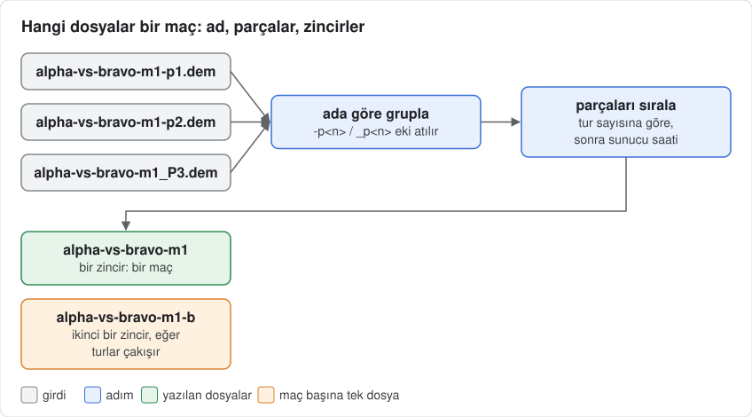

# Komutlar {#commands}

Komut satırına yeni misiniz? Önce [Başlamadan önce](before-you-start.md) sayfasını okuyun.
Bunları, açtığınız klasörde veya klonladığınız klasörde açılan bir terminale yazın;
`<...>` yer tutuculardır, boşluk içeren bir yol tırnak içine alınır.

```text
python -m heat3d_cs2 demos <demo dosyaları veya klasörler> -o <klasör> [--every 8] [--jobs N] [--map TEXT] [--force] [--no-bulk] [--loose]
python -m heat3d_cs2 map <harita adı veya .vpk yolu> -o <dosya.glb> [--game KLASÖR] [--source2viewer EXE]
python -m heat3d_cs2 scoreboard <match.3dheat | match.json>
```

`python -m heat3d_cs2 --help` ve `python -m heat3d_cs2 <komut> --help` aynı seçenekleri listeler;
[Komut başvurusu](../cli-reference.md) hepsini gösterir. Her başlatmada önce [Güncellemeler](updates.md)
sayfasında anlatılan sürüm kontrolü çalışır (`HEAT3D_NO_UPDATE=1` ile kapatılır).

Kod: [`heat3d_cs2/cli.py`](https://github.com/Holdi601/3DHeat-CS2/blob/main/heat3d_cs2/cli.py).

## `demos` - demoları tablolara ve maç belgelerine çevirme {#demos---demos-into-tables-and-match-documents}

```powershell
python -m heat3d_cs2 demos D:\Demos\etkinlik -o out
python -m heat3d_cs2 demos alpha-vs-bravo-m1-p1.dem alpha-vs-bravo-m1-p2.dem -o out
python -m heat3d_cs2 demos D:\Demos -o out --map final --jobs 4
```

| Argüman | Varsayılan | Ne yapar |
|---|---|---|
| `paths` (bir veya daha fazla) | - | demo dosyaları ve klasörler. Uzantısı `.dem` olan bir dosya alınır (büyük-küçük harf farketmez). Bir klasör, `.dem` ile biten dosyalar için **özyinelemeli** olarak, sıralı biçimde taranır, büyük-küçük harf farketmez. Sıkıştırılmış demolar (`.dem.zst`, `.dem.bz2`, arşivler) okunmaz: önce açın. |
| `-o`, `--out` | zorunlu | yazılacak klasör; gerektiğinde oluşturulur |
| `--every N` | `8` | her oyuncuyu her *N* tikte bir örnekler. CS2 demoları saniyede 64 tikle çalışır; yani 8 saniyede sekiz örnek, 4 saniyede on altı, 64 saniyede bir. Olaylar *N* ne olursa olsun kendi tikinde her zaman okunur. |
| `--jobs N` | `0` = CPU çekirdeklerinin yarısı | aynı anda kaç maçın çevrileceği; her biri kendi işleminde. Asla 1'den az değil, asla yapılacak maç sayısından fazla değil. |
| `--map TEXT` | - | yalnızca **adı** TEXT içeren maçlar, büyük-küçük harf farketmeksizin (`--map final`). Dosya adına göre filtreler, demonun içinde çıkan haritaya göre değil. |
| `--force` | kapalı | zaten yazılmış maçları da çevirir, üzerine yazar |
| `--loose` | kapalı | her maçı ayrı dosyalar olarak tutar - tablo, `.match.json`, yan dosyalar - tek bir `.3dheat` kapsayıcısına paketlemek yerine. Bkz. [Her maç için tek dosya](output-container.md). |
| `--container` | açık | her maçı tek bir `.3dheat` dosyasına paketler; varsayılan, bu yüzden yalnızca açıkça belirtmek için var |
| `--no-bulk` | kapalı | varlık akışını, oyuncuların komutlarını ve animasyon akışını paket yan dosyasının dışında bırakır - sıkıştırılmış hâlinde bile bir demonun boyutunun yarısından fazlası. Maç belgesinin öz denetimi bunları adlarıyla `lost` sayar. |


### Hangi dosyalar tek bir maçtır {#which-files-are-one-match}



Maç adı, demo dosyasının uzantısız adı ve sonundaki parça ekinden (`-p<rakamlar>` veya
`_p<rakamlar>`, büyük-küçük harf farketmez) temizlenmiş haliyle belirlenir. Yani
`alpha-vs-bravo-m1-p1.dem`, `alpha-vs-bravo-m1-p2.dem` ve `alpha-vs-bravo-m1_P3.dem`, `alpha-vs-bravo-m1`
maçının parçalarıdır. Dosyalar yalnızca bu ada göre gruplanır - farklı klasörlerdeki aynı adlı iki dosya
da gruplanır.

Ek sıra hakkında bir şey söylemez: bir `-p2` daha erken yarı olabilir. Parçalar tuttukları raund
sayısına, sonra sunucunun saatine göre sıralanır; iki farklı maç barındıran bir grup (örneğin iki farklı
etkinlikte aynı haritada aynı takımlar) **zincirlere** ayrılır: en çok raundu olan zincir adın kendisiyle,
sonrakiler `<ad>-b`, sonra `<ad>-c` ... diye yazılır. İçinde hiç raund olmayan bir dosya (yalnızca
ısınma, bir duraklatma) hiçbir zincire ait değildir. Zincirlerin nasıl bulunduğu
[Maç oluşturma](building-matches.md#parts-and-chains) sayfasında anlatılır.

### Ne yazılır {#what-is-written}

Her maç için, demo başlığının adını taşıdığı haritanın adıyla anılan bir klasöre (başlık ad vermiyorsa
`unknown`), bir `.3dheat` dosyası:

```text
out/
  de_x/
    alpha-vs-bravo-m1.3dheat
    alpha-vs-bravo-m2.3dheat
  de_y/
    ...
```

Testlerdeki sentetik iki raundluk demoda:


`--loose` ile her maç, tablo, maç belgesi ve dört yan dosya yan yana olur
([Her maç için tek dosya](output-container.md)):


Bir ısı haritası tek bir haritanın olduğundan, bir klasörü görüntüleyiciye yüklemek tek bir haritanın
maçlarını yüklemek demektir. Bkz. [Isı haritası tablosu](output-table.md) ve
[Maç belgesi](output-match-json.md).

### Neler atlanır {#what-is-skipped}

Hiçbir şey okunmadan önce, `--out` altındaki her `*.3dheat` (bir kapsayıcı ya tamamen yazılır ya hiç
yazılmaz) ve belgesi (`<ad>.match.json`) yanında olan her `*.parquet` listelenir; adı bu dosya adlarından
birine (uzantısız) eşit olan bir maç, `--force` yoksa atlanır. Yalnızca tablo olan - belgesi olmayan bir
çalıştırma, ikisini yazarken durdurulmuşsa - sayılmaz, yani o maç yeniden çevrilir. Denetim yalnızca ada
göre yapılır: başka bir harita klasörüne veya farklı bir `--every` ile çevrilmiş bir maç da bitmiş sayılır.
Yapılacak iş kalmadığında:

```text
nothing to do: no demos found, or every match already written (--force redoes them)
```

### Ne yazdırılır {#what-is-printed}

Önce iş miktarı, sonra her maç bittikçe bir satır (dosyaların sırasına göre değil, bitiş sırasına göre):

```text
3 match(es), 3 at a time
alpha-vs-bravo-m1: de_x, 21 rounds (Alpha 13 Bravo 8), 412,377 rows, lost 0
alpha-vs-bravo-m2: de_y, 30 rounds (Bravo 16 Alpha 14), 598,104 rows, 1 incomplete round(s) left out, lost 0
alpha-vs-bravo-m3: de_y, 18 rounds (Alpha 13 Bravo 5), 330,981 rows, recorded from round 3, lost 1,204,331 (svc_PacketEntities, svc_UserCmds, DEM_AnimationData)
```

(Sayılar örnektir.) Skor, son raundunkidir; takımlar maç belgesinin listelediği sırada. *incomplete
round(s) left out* (eksik raund(lar) bırakıldı), demoların karara bağlanmadan kesilen raundları sayar;
*recorded from round N* (N. raundan kaydedildi), kaydın geç başladığını söyler; *lost* maç belgesinin öz
denetimidir - demonun kaç öğesi hiçbir yere gitmedi ve bunlar ne türdendi (`--no-bulk` bulk verilerini
kayıp yapar). Hiçbir şey üretmeyen bir maç nedenini söyler:

```text
alpha-vs-bravo-m4: no round in 1 file(s) - nothing written
alpha-vs-bravo-m4-b: no complete round in 1 file(s) - nothing written
```

Bir maçtaki hata diğerlerini durdurmaz; `<ad>: failed - <hata>` olarak yazdırılır.

### Çıkış kodu {#exit-code}

Her maç çevrildiğinde (veya yapılacak iş yoksa) `0`, en az biri başarısız olduğunda `1`.

### Ne kadar sürer {#how-long-it-takes}

Her maç bir çalışan işlemde okunur ve kurulur. Birkaç yüz demodan oluşan bir klasör, varsayılan `--jobs`
ile birkaç dakika sürer. İş başına bellek, maçın uzunluğuyla ve daha küçük bir `--every` ile büyür: her
çalışan, yazmadan önce maçının örneklenmiş her oyuncu satırını tutar (kayıt saniyesi başına yaklaşık on
oyuncu x 64 / *N* satır).

Yan dosyalar tablodan daha uzun sürer: çözümleyicinin okuduğu her özellik her tikte okunur; bir seferde bir
tik penceresi (40 dakikalık bir demo için yaklaşık iki dakika, iş başına en fazla yaklaşık 3 GB bellek) ve
sonra kareler ve mesajlar için demo bir kez daha yürünür.

## `map` - bir haritanın geometrisi `.glb` olarak {#map---a-maps-geometry-as-glb}


```powershell
python -m heat3d_cs2 map <map> -o out/<map>/<map>.glb
python -m heat3d_cs2 map <map> -o <map>.glb --game "D:\Games\Steam\steamapps\common\Counter-Strike Global Offensive"
python -m heat3d_cs2 map "D:\maps\<map>.vpk" -o <map>.glb --source2viewer C:\Tools\Source2Viewer-CLI.exe
```

| Argüman | Varsayılan | Ne yapar |
|---|---|---|
| `name` | - | haritanın adı (`de_x` gibi) veya `.vpk` yolu. Var olan ve `.vpk` ile biten bir yol olduğu gibi kullanılır; başka her şey, yüklü oyunda dosya adının kökünden aranır. |
| `-o`, `--out` | zorunlu | yazılacak `.glb`; klasörü gerektiğinde oluşturulur |
| `--game KLASÖR` | Steam'in kütüphaneleri | CS2 kurulum klasörü (`game\csgo` içeren), Steam onu bilmiyorsa. `--game` ile yalnızca bu klasör aranır. |
| `--source2viewer EXE` | `HEAT3D_SOURCE2VIEWER`, sonra `PATH` | Source2Viewer CLI programı |

Başarıyla bittiğinde yazdırılan:

```text
out/de_x/de_x.glb: de_x, 412,880 triangles (151,204 ground) in 14 parts
```

(sayılar örnektir). `.glb` dosyasını haritanın tablolarının yanına yazmak (`out/<harita>/<harita>.glb`)
bir haritanın verisini ve geometrisini tek klasörde tutar. Dışa aktarımın nasıl çalıştığı:
[Harita dışa aktarımı](map-export.md).

Hatalar, her biri `error: ...` olarak yazdırılır ve çıkış kodu `2`'dir:

| Mesaj | Anlamı |
|---|---|
| `no de_x.vpk found in an installed CS2 - pass --game <CS2 folder> or the .vpk path` | harita bulunan hiçbir Steam kütüphanesinde yok veya ad yanlış |
| `Source2Viewer-CLI not found: ...` | `--source2viewer`, `HEAT3D_SOURCE2VIEWER`, `PATH` hiçbiri var olan bir dosya vermedi |
| `Source2Viewer did not export de_x's collision mesh:` ve çıktısının sonu | başarısız oldu veya hiç `.glb` yazmadı |
| `de_x's collision mesh has nothing but clip brushes` | klip ve gökyüzü çıkarıldıktan sonra hiçbir şey kalmadı |

## `scoreboard` - bir maç metin olarak {#scoreboard---a-match-as-text}

```bash
python -m heat3d_cs2 scoreboard out/de_x/alpha-vs-bravo-m1.3dheat
python -m heat3d_cs2 scoreboard out/de_x/alpha-vs-bravo-m1.match.json   # --loose ile demolardan sonra
```

Bir maçın skor tablosunu, [maç belgesinden](output-match-json.md) yazdırır; görüntüleyiciyi açmadan. Bir
`.3dheat` kapsayıcısının içindeki belgeyi ya da ayrı bir `<maç>.match.json` dosyasını okur.
Testlerdeki sentetik iki raundluk demoda:


```text
alpha-vs-bravo-m1 - de_test  Alpha 2  Bravo 0

Alpha
player                 K   D   A  +/-    ADR   KAST   HS%  OK-OD  clutch
ash                    1   0   0   +1   50.0 100.0%    0%   0-0     1/1
ace                    1   1   0   +0   50.0 100.0%  100%   1-0     0/0

Bravo
player                 K   D   A  +/-    ADR   KAST   HS%  OK-OD  clutch
ben                    1   1   0   +0   50.0 100.0%    0%   0-0     0/1
bob                    0   1   0   -1    0.0 100.0%    0%   0-1     0/0

rounds  1:TK 2:TB
```

- İlk satır: maç adı, harita ve takım başına son skor.
- Her takım için bir tablo, maç belgesindeki `teams` sırasında; oyuncular maç belgesindeki sırada
  (öldürme eksi ölüm, sonra öldürme, en iyisi başta). Adlar 19 karaktere kısaltılır.
- Sütunlar: **K** öldürme, **D** ölüm, **A** asist *flaş asistleri dahil*, **+/-** öldürme eksi ölüm,
  **ADR**, **KAST** (%), **HS%** (tam yüzdeye yuvarlanmış kafa vuruşu oranı), **OK-OD** açılış öldürmeleri -
  açılış ölümleri, **clutch** kazanılan clutch / oynanan clutch. Tanımlar: [İstatistikler](statistics.md).
- Raund şeridi: `<raund><kazanan taraf><nasıl>`, burada **B** bomba patladı, **D** etkisiz hale getirildi,
  **K** eleme, **T** süre doldu, ve başka her şey (berabere, teslim, diğer) için **?**. Berabere raundun
  kazanan tarafı yoktur: `<raund>:?`.

JSON olmayan veya bulunamayan bir dosya bir hatayla durur; maç belgesinin alanlarından yoksun bir JSON
belgesi bir Python hatasıyla başarısız olur (daha ileri doğrulanmaz).
