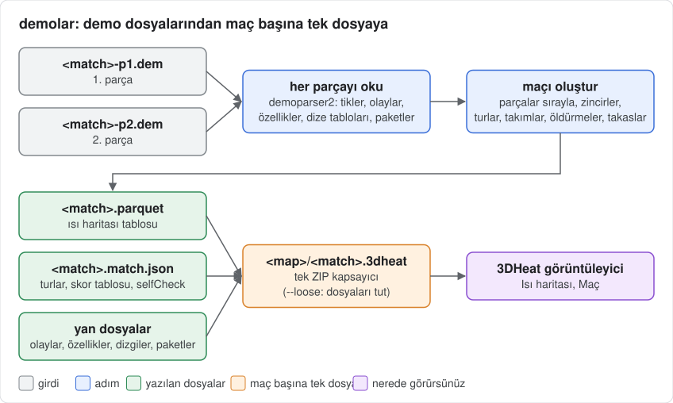

# 3DHeat CS2 {#dheat-cs2}

**Nedir?** Counter-Strike 2, bir maçın kaydını *demo* adıyla saklayabilir. Bu araç bir demoyu, 3DHeat görüntüleyicisinin 3B olarak gösterebileceği dosyalara çevirir: herkesin nerede durduğunu, öldüğünü, bomba attığını ve kurduğunu, tur tur. Ayrıca bir CS2 haritasını, bunları gösterebileceğiniz 3B bir modele çevirebilir.

**Neden kullanmalıyım?** Kendi maçlarınızı incelemek, aynı haritanın birçok maçını tek bir ısı haritasında üst üste bindirmek ve ADR (tur başına ortalama hasar) ile KAST (bir oyuncunun öldürdüğü, asist yaptığı, hayatta kaldığı ya da takas edildiği turların payı) gibi maç istatistikleri için.

**Örnek:** `alpha-vs-bravo-m1.dem` girer, `out/de_x/alpha-vs-bravo-m1.3dheat` çıkar (`de_x` uydurma bir harita adıdır).



Daha ayrıntılı olarak: 3DHeat CS2, **Counter-Strike 2 demolarını** maç başına bir ısı haritası tablosuna ve bir maç belgesine, bir **CS2 haritasını** ise seviye geometrisine çevirir. Çıktılar [3DHeat](https://holdi601.github.io/3DHeat/) telemetri görüntüleyicisi için yapılmıştır ([kaynak](https://github.com/Holdi601/3DHeat)); ama bunlar sıradan dosyalardır (Parquet, JSON ve glTF ikilisi), başka herhangi bir program da okuyabilir.

Komut satırından çalışan küçük bir Python paketidir: `heat3d_cs2`. Demoları diskten okur (hiçbirini indirmez); [demoparser2](https://github.com/LaihoE/demoparser) ile okur ve haritaları kurulu oyundan, Source2Viewer'ın komut satırı sürümüyle ([ValveResourceFormat](https://github.com/ValveResourceFormat/ValveResourceFormat)) dışa aktarır.

## Hızlı başlangıç {#quick-start}

Komut satırında yeni misiniz? Önce [Başlamadan önce](before-you-start.md) sayfasını okuyun.

```bash
pip install -r requirements.txt
python -m heat3d_cs2 demos <demo files or folders> -o out   # içlerindeki her maç
python -m heat3d_cs2 map <map> -o out/<map>/<map>.glb       # kurulu oyundaki harita
python -m heat3d_cs2 scoreboard out/<map>/<match>.3dheat    # bir maçın skor tablosu, metin olarak
```

`1 match(es), 1 at a time ...` ve ardından her maç için bir satır görmelisiniz (bkz. [Komutlar](commands.md#what-is-printed)).

`demos`, her maç için bir dosyayı, haritanın adını taşıyan bir klasöre yazar: `out/<map>/<match>.3dheat`, bir [`.3dheat` kapsayıcısı](output-container.md); görüntüleyicinin maç başına tek dosya biçimi ([belirtim](https://holdi601.github.io/3DHeat/container.html)). Bu, şu üyeleri tutar; `--loose` bunları ayrı dosyalar olarak yazar:

| Üye | Ne tutar | Görüntüleyicide yüklendiği yer |
|---|---|---|
| `<match>.parquet` (rolü `table`) | her canlı oyuncu saniyede sekiz kez, durumuyla birlikte (can, para, flaş, dürbün, bölge, envanter, ...), ve her olay olduğu yerde (öldürme, ölüm, hasar, atış, fırlatma, el bombası patlamaları, kör etme, bomba kurma, etkisizleştirme, patlatma ve her oyuncu için tur sonu, o turda kazandırdıklarıyla); satır başına bir | Isı haritası sekmesi |
| `<match>.match.json` (rolü `match`, maç belgesi) | takımlar, skor, her tur (kazanan, nasıl, ekonomi, bomba kurma, öldürmeler sırayla, clutch'lar, hayatta kalanlar) ve her oyuncunun skor tablosu satırı | Maç sekmesi |
| `<match>.events/props/strings/packets.parquet` | demonun tuttuğu diğer her şey, bütün olarak (yan dosyalar) | bütünlük için saklanır |

`map`, `<map>.glb` yazar: haritanın çarpışma ağı (zeminler, duvarlar, kutular, süslemesiz), zemin ve yapı olarak bölünmüş; tabloların çerçevesi ve birimleriyle aynı, bu yüzden tam olarak ısı haritasının altına oturur (Arka plan / bölüm paneli).

## Bu belgelerin haritası {#map-of-this-documentation}

| Sayfa | Neyi anlatır |
|---|---|
| [Başlamadan önce](before-you-start.md) | Python, bir terminal, yer tutucular, başarının ve sık hataların nasıl göründüğü |
| [Kurulum](installing.md) | Python, paketler, Source2Viewer'ın CLI'si, CS2'nin nerede olması gerektiği |
| [Komutlar](commands.md) | `demos`, `map`, `scoreboard`: her seçenek, ne yazdırıldığı, çıkış kodları |
| [Bir demoyu okumak](reading-demos.md) | Bir demo dosyasından ne okunur: örneklenmiş tikler, oyuncu özellikleri, oyun kuralları, olaylar |
| [Bir maç kurmak](building-matches.md) | Parçalar ve zincirler, maç saati, turlar, takımlar ve taraflar, satırlar, öldürmeler, takaslar, açılışlar, hasar, flaşlar, ekonomi |
| [İstatistikler](statistics.md) | Skor tablosu: K/D/A, ADR, KAST, HS%, açılışlar, takaslar, çoklu öldürmeler, clutch'lar, yardımcı öğeler, flaşlar |
| [Isı haritası tablosu](output-table.md) | Parquet dosyası: her sütun, türü, hangi olayların doldurduğu, `heat3d` altbilgi ipuçları, eksenler |
| [Maç belgesi](output-match-json.md) | `.match.json` belgesi, alan alan |
| [Maç başına tek dosya](output-container.md) | `demos`'un varsayılan olarak yazdığı `.3dheat` kapsayıcısı, `--loose` |
| [Harita dışa aktarımı](map-export.md) | Bir haritanın çarpışma ağının nasıl dışa aktarıldığı, çerçeve, düğüm adlandırma, birimler |
| [3DHeat ile kullanmak](using-with-3dheat.md) | Tabloları, maç belgelerini ve haritaları görüntüleyicinin Isı haritası ve Maç sekmelerine yüklemek |
| [Sınırlar](limits.md) | Ne varsayılıyor, neler ele alınmıyor, neler doğrulanmadı |
| [Güncellemeler](updates.md) | Başlangıçtaki sürüm denetimi ve `python -m heat3d_update` |
| [Geliştirme](development.md) | Kod düzeni, testler, sentetik demo örneği |
| [Komut başvurusu](../cli-reference.md) | Her komutun `--help` çıktısı, koddan üretilmiş |
| [Bakım](maintaining.md) | Bu sayfalar için sürüm kontrol listesi |

## Neye karşı denetlendi {#what-it-is-checked-against}

Dışarıdan gelen demolar, maç başına tek temiz bir dosya değildir. Dönüştürücü, bir maçın dosyalar arasında herhangi bir sırayla bölünmüş olmasını, maç ortasında yeniden başlatılan bir sunucuyu, bir ad altında saklanan iki farklı maçı, bir yedekten geri yüklenen turları, geç başlayan ya da erken biten bir kaydı, duraklamaları ve bir takımın yanındaki koçları ele alır; bkz. [Bir maç kurmak](building-matches.md). Büyük bir turnuva demo koleksiyonunda denetlendi: her maçta skor tur kazananlarını izler, her tarafın öldürmeleri diğer tarafın ölümleridir ve her tur beşe karşı beş başlar.

## Neye yönlendirilir {#what-to-point-it-at}

Kendi maçlarınızın demoları, bir turnuva sitesinden elle indirdiğiniz demolar ya da erişiminiz olan bir API'nin demoları. Bir demo, içeriği yayımcısına ve düzenleyicilerine ait bir kayıttır: çıkan şeyi kendi analiziniz için kullanın; demoları ya da onlardan türetilmiş verileri yeniden dağıtmayın. Araç demoları diskten okur ve hiçbirini indirmez; oyundan hiçbir şey onunla birlikte dağıtılmaz: oyun dosyası yok, oyun kodu yok, DLL yok.

3DHeat CS2, Valve ile bağlantılı değildir ve Valve tarafından onaylanmamıştır. Counter-Strike 2 ve ilgili adlar ve ticari markalar sahiplerine aittir. Hak sahipleri: [github.com/Holdi601/3DHeat-CS2/issues](https://github.com/Holdi601/3DHeat-CS2/issues) adresinde bir issue açın - hızlı yanıt veririz ve istek üzerine her şeyi kaldırırız.

## 3DHeat'in parçası {#part-of-3dheat}

3DHeat CS2, 3DHeat görüntüleyicisinin etrafındaki ücretsiz araçlardan biridir; her biri kendi deposu, sürümleri ve lisansıyla ayrı bir projedir:

| Araç | Ne yapar | Belgeler |
|---|---|---|
| [3DHeat](https://github.com/Holdi601/3DHeat) | görüntüleyici: 3B olarak ısı haritaları, yarış analizi ve maç incelemesi | [site](https://holdi601.github.io/3DHeat/) |
| [GameFiles](https://github.com/Holdi601/3DHeat-GameFiles) | oyunların gönderdiği dosyalardan kurslar ve seviyeler, 3B modeller olarak | [site](https://holdi601.github.io/3DHeat-GameFiles/) |
| [GameCapture](https://github.com/Holdi601/3DHeat-GameCapture) | yarış oyunlarından tur telemetrisi; oynanış videosundan yeniden kurulan seviyeler | [site](https://holdi601.github.io/3DHeat-GameCapture/) |
| [Unreal Exporter](https://github.com/Holdi601/3DHeat-UnrealExporter) | bir seviyeyi tek bir 3B model olarak dışa aktaran bir Unreal Editor eklentisi | [site](https://holdi601.github.io/3DHeat-UnrealExporter/) |
| [CS2](https://github.com/Holdi601/3DHeat-CS2) | Counter-Strike 2 demolarını tablolara ve maç belgelerine; haritaları 3B modellere | [site](https://holdi601.github.io/3DHeat-CS2/) |
| [Watcher](https://github.com/Holdi601/3DHeat-Watcher) | oyunların oynamanız hakkında yayımladıklarını arka planda kaydeder | [site](https://holdi601.github.io/3DHeat-Watcher/) |
| [Ext-WarThunder](https://github.com/Holdi601/3DHeat-Ext-WarThunder) | War Thunder tekrarlarını tablolara ve maç belgelerine | [site](https://holdi601.github.io/3DHeat-Ext-WarThunder/) |
| [Ext-WoT](https://github.com/Holdi601/3DHeat-Ext-WoT) | World of Tanks tekrarlarını tablolara ve maç belgelerine | [site](https://holdi601.github.io/3DHeat-Ext-WoT/) |
| [Ext-WoWs](https://github.com/Holdi601/3DHeat-Ext-WoWs) | World of Warships tekrarlarını tablolara ve maç belgelerine | [site](https://holdi601.github.io/3DHeat-Ext-WoWs/) |
| [Ext-Squad](https://github.com/Holdi601/3DHeat-Ext-Squad) | Squad sunucu demolarını tablolara ve maç belgelerine | [site](https://holdi601.github.io/3DHeat-Ext-Squad/) |
| [Ext-DCS](https://github.com/Holdi601/3DHeat-Ext-DCS) | DCS World haritalarını 3B modellere | [site](https://holdi601.github.io/3DHeat-Ext-DCS/) |
| [Ext-IL2](https://github.com/Holdi601/3DHeat-Ext-IL2) | IL-2 Sturmovik haritalarını 3B modellere | [site](https://holdi601.github.io/3DHeat-Ext-IL2/) |

## Lisans {#licence}

MIT - üçüncü taraf paketler için [`LICENSE`](https://github.com/Holdi601/3DHeat-CS2/blob/main/LICENSE) ve [`LICENSES.md`](https://github.com/Holdi601/3DHeat-CS2/blob/main/LICENSES.md) dosyalarına bakın.
