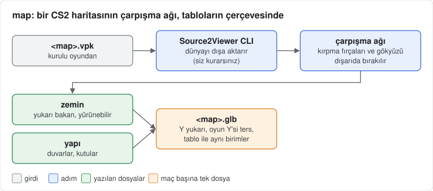

# Harita dışa aktarımı (`map`) {#map-export-map}

`python -m heat3d_cs2 map <map> -o <file.glb>`, bir CS2 haritasını seviye geometrisi olarak yazar: dünyanın
**çarpışma ağı**, [ısı haritası tablolarının](output-table.md) çizildiği çerçevede ve birimlerde. Kod:
[`heat3d_cs2/mapexport.py`](https://github.com/Holdi601/3DHeat-CS2/blob/main/heat3d_cs2/mapexport.py),
[`heat3d_cs2/glb.py`](https://github.com/Holdi601/3DHeat-CS2/blob/main/heat3d_cs2/glb.py).
Seçenekler ve iletiler: [Komutlar](commands.md#map---a-maps-geometry-as-glb).



## Neden çarpışma ağı {#why-the-collision-mesh}

Çarpışma ağı, oyuncuların üzerinde durduğu ve arkasına saklandığı şeydir - zeminler, duvarlar, merdivenler,
kutular - süslemesiz: yalnızca görünen ama bir şey olmayan props yok, doku yok, işleme ağlarından çok daha az
üçgen. Bir ısı haritasının altında ihtiyaç duyduğu şey budur: konumları karşılaştırmak için bir referans, haritanın
bir resmi değil.

## Nasıl elde edilir {#how-it-is-obtained}

1. **Haritayı bulun.** Var olan ve `.vpk` ile biten bir yol olduğu gibi kullanılır. Değilse, `<name>.vpk`,
   `<CS2 klasörü>\game\csgo\maps\` içinde aranır; burada CS2 klasörü `--game`'dir veya bulunan her Steam
   kütüphanesindeki `steamapps\common\Counter-Strike Global Offensive` (bkz.
   [Kurulum](installing.md#where-cs2-is-looked-for)).
2. **Source2Viewer'ın CLI'sini bulun**: önce `--source2viewer`, sonra `HEAT3D_SOURCE2VIEWER`, sonra `PATH` üzerindeki
   `Source2Viewer-CLI` / `Source2Viewer-CLI.exe`.
3. **Dünyanın fiziğini dışa aktarın.** Source2Viewer şöyle çalıştırılır:

   ```text
   Source2Viewer-CLI -i <map>.vpk -d -f maps/<map>/world_physics.vmdl_c --gltf_export_format glb -o <temporary folder>
   ```

   Source 2'nin derlenmiş fizik verisini haritanın kendi arşivinden çözer ve modeli (boş: dünyanın kendi işleme
   ağı yoktur) ve fiziğini yanına yazar. Yazılan en büyük `.glb` fiziktir. Source2Viewer başarısız olur veya hiç
   `.glb` yazmazsa, komut durur ve çıktısının ve hatalarının son 800 karakterini gösterir.
4. **Okuyun.** Sahnenin her düğümü dönüşümüyle (matris veya öteleme-döndürme-ölçek) gezilir ve her üçgen ilkel
   alınır, indeks tamponlu veya tamponsuz, dünya konumlarında.
5. **Duvar veya zemin olmayanı çıkarın.** Adında `clip` - oyuncu klipleri, NPC klipleri, bomba klipleri: oyuncuları
   ve bombaları durduran görünmez duvarlar - veya `sky` (harf durumundan bağımsız) geçen bir düğüm atılır.
6. **Yüzeyi adlandırın.** Fizik grupları yüzeyleriyle adlandırılır; küçük harfe çevrilmiş ad, başındaki `physics`,
   `physics_group` veya `physics_passbullets` (ve ardından gelen alt çizgi) kaldırıldığında yüzeydir:
   `physics_group_concrete` `concrete`, `physics_passbullets_chainlink` `chainlink` olur, çıplak bir `physics_group`
   ise `world`. Mermilerin geçtiği yüzeyler tutulur.
7. **Oyunun çerçevesine dönün.** Source2Viewer, Y yukarı olacak şekilde glTF'yi metre cinsinden yazar: oyunun
   (Y, Z, X) değerleri 0.0254 ile çarpılmış. Bu geri alınır - her nokta, inç cinsinden oyunun (X, Y, Z) değeri olur.
8. **Zemin ile yapıyı, üçgen üçgen ayırın**: normali yukarı en az 0.7 (normalize edilmiş Z bileşeni) olan bir yüz -
   yaklaşık 45 dereceye kadar eğimler, bir CS2 oyuncusunun yürüyebildiği en dik eğim - **zemindir**; geri kalan her
   şey, duvarlar ve tavanlar dahil, **yapıdır**.
9. **Görüntüleyicinin çerçevesine.** Her nokta (X, Z, -Y) olarak yazılır: Y yukarı, oyunun Y'si negatif - görüntüleyicinin
   `heat3d` ipuçlarını izlediğinde tabloları çizdiği çerçeve. Bu bir döndürmedir, ayna değil.
10. **`.glb`'yi yazın.** Hiçbir şey kalmadıysa (yalnızca klip fırçaları), komut bir hatayla durur. Aksi halde dosyayı,
    haritayı, üçgen sayısını, kaçının zemin olduğunu ve parça sayısını yazdırır.

Buradaki hiçbir şey haritanın kendi `.vpk`'sinden başka bir şeyi okumaz ve Source2Viewer'ın hiçbir parçası paketlenmez
ya da kopyalanmaz.

## Dosya {#the-file}

Bir glTF 2.0 ikili (`.glb`), bir tampon, `heat3d_cs2` tarafından yazılmış (`asset.generator`):

| Yön | Ne |
|---|---|
| Düğümler | parça başına bir, hepsi kökte, dönüşüm yok, her biri aynı adlı kendi ağıyla |
| Düğüm adları | `ground:<surface>` veya `structure:<surface>` (`ground:concrete`, `structure:metal`, `structure:world`), ada göre sıralı |
| İlkeller | ağ başına bir, üçgenler, `POSITION` (float32, min/max ile) ve `NORMAL` (float32), `uint32` indeksler |
| Gölgelendirme | düz: üçgen köşesi başına bir tepe noktası, her biri kendi üçgeninin normaliyle |
| Malzemeler, dokular, UV'ler, renkler | yok |
| Birimler | oyun birimleri (**inç**), metre değil - glTF'nin varsaydığının aksine |
| Çerçeve | oyunun (X, Z, -Y) değeri: glTF'nin Y'si oyunun yüksekliği, glTF'nin Z'si oyunun -Y'si |

`ground:` / `structure:` öneki, tüm 3DHeat seviye dışa aktarıcılarının kuralıdır: görüntüleyici, bu biçimde
adlandırılmış bir parçayı geometriden tahmin etmek yerine sözüne göre alır; böylece zeminler zemin gölgelendirmesini,
duvarlar yapı çizimini, bir sınıflandırma adımı olmadan alır.

Birimler inç olduğundan, başka bir glTF görüntüleyici haritayı yaklaşık 39 kat büyük gösterir (metre sanır); önemliyse
orada 0.0254 ile ölçekleyin. 3DHeat'te, aynı birimlerde ve 1 ölçekle olan tablonun tam altına oturur.

## Çerçevenin doğru olduğunun kontrolü {#the-check-that-the-frame-is-right}

`test_players_stand_on_the_exported_floor` testi (yalnızca bir demo ve Source2Viewer verildiğinde çalışır, bkz.
[Geliştirme](development.md#tests)) bir demonun oynandığı haritayı dışa aktarır, maçın 300 rastgele konum
örneğini alır ve her biri için oyuncunun ayaklarının en fazla 4 birim üstündeki en yüksek zemin üçgenini dikey olarak
arar. Örneklerin en az %98'inin zemin bulmasını ve zeminin üstündeki medyan yüksekliğin 5 birimin altında olmasını
ister. Yansıtılmış bir harita başarısız olur: yanlış eksenle yansıtılmış bir haritada oyuncuların büyük bir kısmı
hiçbir şeyin üstünde durur. README, bu kontrolün mevcut rekabetçi havuzdaki haritalar üzerindeki sonuçlarını bildirir.

## Yapmadıkları {#what-it-does-not-do}

- Işleme geometrisi, dokular veya süsleme yok - neden için yukarıya bakın.
- Yalnızca haritanın `world_physics` modelindeki şeyler dışa aktarılır. Hareketli parçaların (kapılar) veya kırılabilir
  şeylerin bu modelde olup olmadığı kontrol edilmedi.
- Sadeleştirme yok: 3DHeat görüntüleyicisi içe aktarırken **Sadeleştirme hedefi** ayarıyla sadeleştirir.
- Yüklü oyunda olmayan haritalar (diskte başka yerdeki atölye haritaları), `.vpk`'sı bir yol olarak verildiğinde ve
  `maps/<name>/world_physics.vmdl_c` içerdiğinde çalışır; doğrulanmadı.
