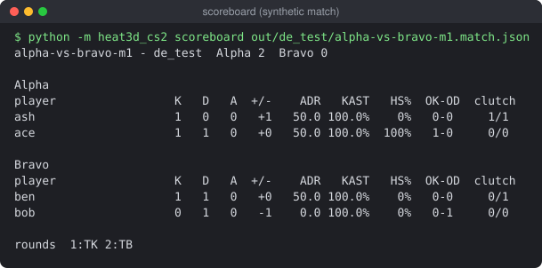

# İstatistikler {#statistics}

Her oyuncunun bir maçta ne yaptığı ve her raundun nasıl geçtiği: [maç belgesinin](output-match-json.md) skor tablosu ve raund
listesi. Kod: [`heat3d_cs2/stats.py`](https://github.com/Holdi601/3DHeat-CS2/blob/main/heat3d_cs2/stats.py).
Her şey [Maç oluşturma](building-matches.md) sayfasındaki gibi kurulan maçtan sayılır: öldürme kayıtları, hasarı (kaybedilen can,
yalnızca düşmanlar), körleşmeleri (yalnızca düşmanlar) ve satırları.

## Tanımlar {#the-conventions}

Oyunun kendisinin tanımlamadığı sayılar için, tanımlar bunlardır. Ayrıca her maç belgesinde `conventions` altına yazılırlar.

| Terim | Tanım |
|---|---|
| **Takas** | Bir ölüm, katili kurbanın takım arkadaşlarından biri **5 s** içinde öldürdüğünde *takas edilmiş* sayılır; bu öldürme bir *takas öldürmesidir*. |
| **Açılış** | Raundun canlıyken bir düşmanın ilk öldürmesi. Bundan önce gelen bir takım arkadaşı öldürmesi, intihar veya dünyaya ölüm atlanır. |
| **KAST** | Bir oyuncunun bir **K**illi (öldürme), bir **A**sistinin (flaş asisti sayılır), **S**urvived (hayatta kalma) veya **T**raded (takas edilmiş ölümü) olduğu raundların payı. |
| **Hasar** | Kaybedilen gerçek can, yalnızca düşmanlar: 40 canlı birine 137 hasarlı bir kafa vuruşu 40'tır. |
| **Clutch** | Tarafının son hayatta kalan oyuncusu olmak ve hâlâ ayakta düşmanlar varken; tarafı raundu kazanırsa kazanılmış sayılır. |
| **Alım** | Taraf başına, dondurma süresinin sonundaki ortalama ekipman değerinden: her normal yarının ilk raundu bir tabanca raundudur (1. raund ve yarıdan sonraki raund, maç onu oynadığı sürece), uzatmanın tabanca raundu yoktur; sonra 1.500 $'ın altı eco, 4.000 $'ın altı force, aksi halde full. |

## Her raundu kimlerin başlattığı {#who-started-each-round}

Birkaç sayı, bir raundu kimin oynadığını bilmeyi gerektirir. Bir raundun **başlangıç oyuncuları**, taraf başına, o raundun en erken
konumundan itibaren bir saniye içinde canlı bir konum satırı olan her oyuncudur (yani dondurma süresi bittikten sonraki ilk saniye).
Bir oyuncunun **oynadığı raundlar**, başlattıkları raundların sayısıdır. Hiç başlatmadıysa (böyle bir satırı hiç olmadıysa),
sıfıra bölmemek için maçın raund sayısı kullanılır.

## Skor tablosu satırı {#the-scoreboard-line}

Oyuncu başına bir giriş (alan adları için [maç belgesine](output-match-json.md#players) bakın). Aşağıda "Düşman öldürmesi", saldırgan
olan ve takım arkadaşı öldürmesi veya intihar (kurbanın kendisi) olmayan öldürme anlamına gelir.

| Alan | Sayar |
|---|---|
| `kills` | düşman öldürmeleri, canlı ve sonrası aşamaları |
| `deaths` | her ölüm: düşmanlar, takım arkadaşları, kendisi veya dünya tarafından |
| `assists` | bu oyuncunun flaşsız asist ettiği düşman öldürmeleri (asistçi katil olmamalı) |
| `flashAssists` | bu oyuncunun flaşla asist ettiği düşman öldürmeleri |
| `diff` | öldürme - ölüm |
| `adr` | hasar (kaybedilen can, yalnızca düşmanlar, her iki aşama) / oynanan raund, bir ondalıkla |
| `kast` | 100 x (bir öldürmesi, bir asisti veya flaş asisti, hayatta kalması ya da takas edilmiş bir ölümü olan raundlar) / oynanan raund, bir ondalıkla. *Hayatta kalma*: raundun bir başlangıç oyuncusu, her iki aşamada da ölmediyse. |
| `headshotPct` | 100 x kafa vuruşu öldürmeleri / öldürmeler, bir ondalıkla; öldürme yoksa 0 |
| `openingKills`, `openingDeaths` | kazanılan ve kaybedilen açılış düelloları |
| `tradeKills` | bir takım arkadaşının ölümünün intikamını alan öldürmeler |
| `tradedDeaths` | takas edilen ölümler |
| `multiKills` | 2, 3, 4 ve 5 düşman öldürmesi olan raundlar (`2k`, `3k`, `4k`, `5k`); beşten fazlası `5k` sayılır. Her iki aşama da sayılır. |
| `clutches`, `clutchesWon` | oynanan ve kazanılan clutch'lar (aşağıda) |
| `utilityDamage` | HE bombaları, molotoflar ve incendiary'lerle yapılan hasar, bir ondalıkla |
| `enemiesFlashed` | bu oyuncunun flaşlarıyla **en az 1,0 s** körleşen düşmanlar |
| `plants`, `defuses` | bomba kurulumları ve etkisizleştirmeler (tablonun satırları) |
| `teamkills` | öldürülen takım arkadaşları. İntihar - saldırgan ve kurban aynı oyuncu, kendi bombası gibi - bunlardan biri değildir: yalnızca bir ölümdür. |
| `roundsPlayed` | başlatılan raundlar, yukarıdaki gibi |

Oyuncular takım adına göre (alfabetik) listelenir, bir takımın içinde `diff`'e göre, sonra `kills`'e göre, en iyisi başta.

Kenar durumları hakkında notlar:

- Sonrası aşamasında bir öldürme - kazananların kurtaran bir oyuncuyu avlaması - diğer her öldürme gibi, ADR, çoklu öldürme ve KAST için
  bir öldürme, bir ölüm sayılır.
- Duvar delme öldürmeleri oyuncu başına içeride sayılır ama maç belgesine yazılmaz; raund listesindeki her öldürme bunun olup olmadığını söyler.
- KAST'ın *takas* kısmı, o raunddaki takas edilmiş bir ölümün kurbanına kredi verir.
- Takım arkadaşı öldürmeleri ve intiharlar, kurbana bir ölüm ekler ama kimseye bir öldürme eklemez; bir takım arkadaşı öldürmesi katilin
  `teamkills`'ine ekler, bir intihar başka hiçbir şeye eklemez.

## Clutch'lar {#clutches}

Her raund için, iki tarafın başlangıç oyuncuları hayatta sayılır ve raundun canlı öldürmeleri sırayla gezilir. Her ölümden sonra kurban
çıkarılır ve her taraf incelenir: tarafta tam olarak **bir** oyuncu kalmışsa ve en az bir düşman hâlâ ayaktaysa, bu oyuncu o anda hayatta olan
düşman sayısına **karşı** bir clutch'tır. Her oyuncunun raund başına en fazla bir clutch'ı vardır; tarafı raundu kazanırsa **kazanılmış** olur.

Tanımın sonuçları:

- Bir raundda iki tarafın da clutch'ı olabilir. Bir taraf önce bir kişiye düşerse (örneğin 1v3) ve diğer taraf da bir kişiye indirilirse,
  ikinci oyuncu kendi 1v1 clutch'ında olur.
- `against`, oyuncunun son kalan olduğu andaki sayıdır, sonundaki değil.
- Sonrası aşamasının öldürmeleri gezilmez, bu yüzden bir clutch başlatmazlar veya değiştirmezler.

## Hayatta kalanlar {#survivors}

Bir raundun **hayatta kalanları**, taraf başına, başlangıç oyuncularının canlıyken ölen herkes çıkarılmış hâlidir. Sonrası aşamasında
kurtarırken öldürülen bir oyuncu, raund listesinde hâlâ hayatta kalan sayılır - ama KAST için *hayatta kalmış* sayılmaz.

## Raund listesi {#the-round-list}

Maç belgesinin her raundu sonucunu, skorunu, taraflarını, ekonomisini, kurulumunu, hayatta kalanlarını, clutch'larını ve öldürmelerini sırayla
taşır; bkz. [Maç belgesi](output-match-json.md#rounds).

## Metin skor tablosu {#the-text-scoreboard}

`python -m heat3d_cs2 scoreboard <match.json>` bu sayıları takım başına yazdırır; bkz. [Komutlar](commands.md#scoreboard---a-match-as-text).
