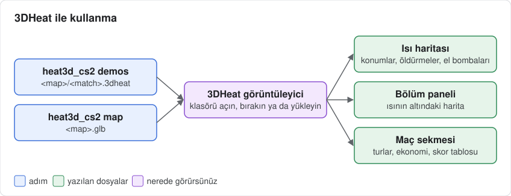

# 3DHeat ile kullanım {#using-it-with-3dheat}

Çıktılar [3DHeat görüntüleyicisinin](https://holdi601.github.io/3DHeat) şu yerlerine gider:

| Dosya | Yer | Ne sağlar |
|---|---|---|
| `<match>.3dheat` (varsayılan) | **Isı haritası** sekmesi, **Kaynak** paneli veya **Maç** sekmesi | tablo ve maç belgesi birlikte, maç başına bir dosya ([kapsayıcı](https://holdi601.github.io/3DHeat/container.html)) |
| `<match>.parquet` | **Isı haritası** sekmesi, **Kaynak** paneli | konumlar ve olaylar ısı haritası, kutu tekrarı, rotalar olarak |
| `<match>.match.json` | **Maç** sekmesi, **Maç dosyalarını yükle…** | skor tablosu, raundlar, öldürme akışı, maçlar arası istatistikler, ısı haritasına bağlantılar |
| `<map>.glb` | **Arka plan / bölüm** paneli, **3B model…** | ısı haritasının altındaki harita |

Görüntüleyicinin kendi belgeleri her sekmeyi tam olarak anlatır: [Maç analizi](https://holdi601.github.io/3DHeat/match-analysis.html),
[Dosya yükleme](https://holdi601.github.io/3DHeat/loading-files.html),
[Sütun eşlemesi](https://holdi601.github.io/3DHeat/column-mapping.html)
ve [Kutu tekrarı](https://holdi601.github.io/3DHeat/box-replay.html) sayfaları. Bu sayfa, onun CS2 tarafıdır.



Görüntüleyici: [github.com/Holdi601/3DHeat](https://github.com/Holdi601/3DHeat),
belgeler [holdi601.github.io/3DHeat](https://holdi601.github.io/3DHeat/).

## Tipik bir oturum {#a-typical-session}

```bash
python -m heat3d_cs2 demos D:\Demos\event -o out
python -m heat3d_cs2 map <map> -o out/<map>/<map>.glb
```

1. **Isı haritası sekmesi -> Kaynak:** `out/<map>` klasörünü seçin (ya da bırakın).
   Oradaki her `.parquet` bir veri kümesi olur; aynı klasördeki `.json` ve `.glb` dosyaları "csv/parquet dosyası değil" diye atlanır. Yükleyin.
2. **Arka plan / bölüm -> 3B model…:** `out/<map>/<map>.glb` dosyasını seçin.
   **Kitaplığa kaydet**, bir dahaki sefere için tarayıcıda tutar.
3. **Maç sekmesi -> Maç dosyalarını yükle…:** aynı klasördeki `.match.json` dosyalarını seçin (birkaçını birden), ya da Maç sekmesi
   açıkken görünüme bırakın.

Bir seferde yalnızca bir haritanın tablolarını yükleyin: farklı haritaların koordinatları üst üste biner ve iki haritanın ısı haritası
bir anlam ifade etmez. Her harita için bir klasör bunun için vardır.

## Tablo hiçbir ayar yapmadan açılır {#the-table-opens-with-nothing-to-set}

Görüntüleyici, seçilen ilk dosyanın `heat3d` alt bilgisi girişini okur
([Isı haritası tablosu](output-table.md#the-heat3d-footer-hints)) ve kendi tahminlerinin üstüne yerleştirir:

| Görüntüleyici ayarı | Şuna ayarla |
|---|---|
| Konum | `x`, `y`, `z` |
| Kaynaktaki yukarı ekseni | Z yukarıdır |
| Y'yi çevir | açık - harita doğru yönde olsun, ayna görüntüsü değil |
| Birim ölçeği | 1 - mesafeler oyun birimleri (`m` olarak etiketli; 1 birim = 1 inç) |
| Zaman | `time`, saniye |
| Kişi | `player` |
| Grup | `side` (T / CT) |
| Oturum | `roundId` - her raund bir oturumdur, `<match> #NN` |
| Bakış yönü | vektör, `dirX` / `dirY` / `dirZ` |
| Filtre sütunları | `event`, `match`, `round`, `roundTime`, `phase`, `weapon`, `place`, `won`, `buy`, `opening`, `team` |
| Varlık boyutu | 32 - kutu tekrarı bir oyuncuyu 32 birim genişlikte, 4 x 32 bakış ışınıyla çizer |

Ipucu verilen her değer hâlâ sütun eşlemesinde görünür ve değiştirilebilir. Diğer sütunlar (`headshot`, `traded`, `other`, `steamid`,
`health`, `money`, `damage`, `duration`, ...) orada elle filtre olarak eklenebilir.

Bir harita yüklendiğinde birim ölçeğini 1'de tutun: `.glb` aynı oyun birimlerindedir ve bölüm tabloyla birlikte yeniden ölçeklenmez.

### Kullanışlı filtreler {#useful-filters}

- `event` = `position` oyuncuların nerede olduğu için; `kill` / `death` düellolarının kazanıldığı ve kaybedildiği yerler için; `smoke`, `flash`,
  `molotov`, `he` yardımcı bombaların düştüğü yerler için; `throw` nereden atıldıkları için; `plant` kurulum noktaları için.
- `side` (grup) = `T` veya `CT`, `phase` = `live` sonrası aşamasını dışarıda bırakmak için, `buy` = `eco` / `force` / `full` tek bir ekonomideki
  raundlar için, `won` = 1 satırın tarafının kazandığı raundlar için.
- `opening` = 1, `kill` ve `death` ile birlikte açılış düelloları için.
- Bir raundun bir anı için `roundTime` bir aralık olarak: ilk 20 saniye, bomba kurulumundan sonrası.

## Maç sekmesi {#the-match-tab}

Maç sekmesi, `format`'ı `heat3d-cs2-match` olan ve `rounds`, `players` ve `teams` dizileri olan bir JSON dosyasını kabul eder
([Maç belgesi](output-match-json.md)). Skoru ve yarıları, raundların bir şeridini - kazanan tarafa göre renklendirilmiş, her birinin nasıl
bittiğini gösteren bir işaretle - her raundun ekonomisini, kurulumunu, öldürme akışını, clutch'larını ve hayatta kalanlarını, skor tablosunu
ve yüklü tüm maçlar arasındaki istatistikleri gösterir.

Onun **Isı haritasında göster** bağlantıları hiçbir şey yüklemez: Isı haritası sekmesinde zaten yüklü tablo üzerinde filtre ayarlarlar -
`match`, `round` (ve raundun oturumu `<match> #NN`), `event`, oyuncu, taraf. Bu, maç belgesi ve tablonun aynı maç adlarını, raund numaralarını,
oyuncu adlarını ve tarafları taşımasından dolayı çalışır. **Raundu tekrar oynat** ısı haritasını kutu tekrarına çevirir ve raundun oturumunu
başından oynatır.

Bu yüzden ikisini de yükleyin: bir haritanın tablolarını Isı haritası sekmesine, maç belgelerini Maç sekmesine. Tablosu olmayan bir maç
belgesi yine skor tablosunu ve raundları gösterir; bağlantılar ise ısı haritası verisi yüklenmediğini söyler.

## 3DHeat olmadan {#without-3dheat}

- Tablo düz Parquet'tir: pandas, Polars, DuckDB, Spark, R'nin `arrow`'u hepsi okur, `heat3d` girişi yok sayılır ve metin sütunları
  dizge veya kategorik olarak okunur.
- Maç belgesi düz JSON'dur.
- Harita geçerli bir glTF ikilisidir, metre yerine inç cinsinden: metre varsayan araçlar için 0.0254 ile ölçekleyin. Çerçevesi glTF'nin
  kendisidir (Y yukarı), bu yüzden tabloyu başka bir yerde üst üste çizmek için her satırın (x, y, z) değerini (x, z, -y) olarak çizin, 3DHeat'in
  yaptığı gibi.
