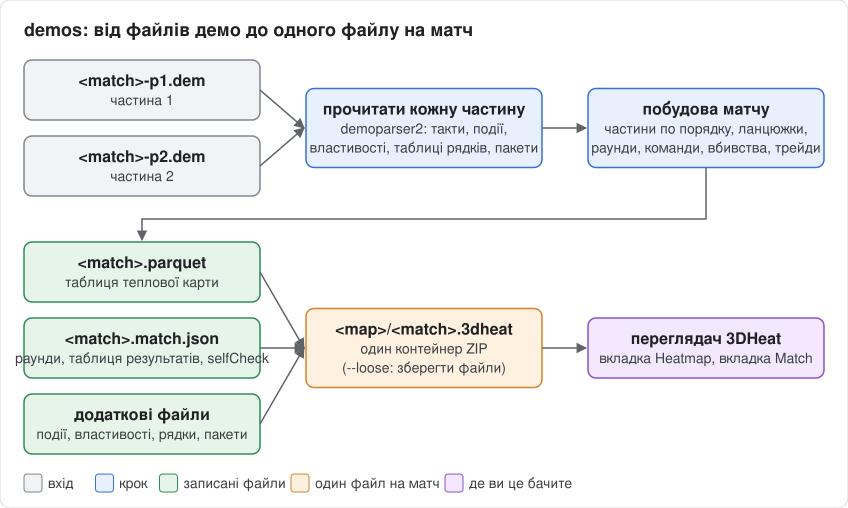

# 3DHeat CS2 {#dheat-cs2}

**Що це?** Counter-Strike 2 може зберегти запис матчу, який називається
*демо*. Цей інструмент перетворює демо на файли, які переглядач 3DHeat може показати в 3D:
де кожен стояв, гинув, кидав гранати і закладав або знешкоджував бомбу, раунд за раундом.
Він також може перетворити карту CS2 на 3D-модель, на якій це показувати.

**Навіщо це потрібно?** Щоб переглянути власні матчі, накласти багато матчів однієї
карти один на одного як одну теплову карту, а також для статистики матчів, наприклад ADR
(середня шкода за раунд) і KAST (частка раундів, у яких гравець вбив, допоміг, вижив або його
відомстили союзники).

**Приклад:** `alpha-vs-bravo-m1.dem` на вході, `out/de_x/alpha-vs-bravo-m1.3dheat` на виході
(`de_x` — вигадана назва карти).



Докладніше: 3DHeat CS2 перетворює **демо Counter-Strike 2** на таблицю теплової карти і документ
матчу для кожного матчу, а **карту CS2** — на геометрію рівня. Результати призначено для
телеметричного переглядача [3DHeat](https://holdi601.github.io/3DHeat/)
([джерело](https://github.com/Holdi601/3DHeat)), але це звичайні файли — Parquet, JSON і двійковий
glTF, які може прочитати будь-що інше.

Це невеликий пакет Python, `heat3d_cs2`, який запускається з командного рядка. Він читає демо з диска
(нічого не завантажує) за допомогою [demoparser2](https://github.com/LaihoE/demoparser), а карти
експортує з встановленої гри за допомогою консольної збірки Source2Viewer
([ValveResourceFormat](https://github.com/ValveResourceFormat/ValveResourceFormat)).

## Швидкий старт {#quick-start}

Ви лише починаєте працювати з командним рядком? Спершу прочитайте [Перш ніж почати](before-you-start.md).

```bash
pip install -r requirements.txt
python -m heat3d_cs2 demos <demo files or folders> -o out   # кожен матч у них
python -m heat3d_cs2 map <map> -o out/<map>/<map>.glb       # карта з встановленої гри
python -m heat3d_cs2 scoreboard out/<map>/<match>.3dheat    # таблиця результатів матчу як текст
```

Ви маєте побачити `1 match(es), 1 at a time ...`, а потім по одному рядку на кожен матч
(див. [Команди](../commands.md#what-is-printed)).

`demos` записує для кожного матчу один файл у папку, названу за картою:
`out/<map>/<match>.3dheat`, [контейнер `.3dheat`](../output-container.md) — формат переглядача
один файл на матч ([специфікація](https://holdi601.github.io/3DHeat/container.html)).
Він містить такі елементи; `--loose` записує їх як окремі файли:

| Елемент | Що містить | Де завантажується в переглядачі |
|---|---|---|
| `<match>.parquet` (роль `table`) | кожен живий гравець вісім разів на секунду з його станом (здоров'я, гроші, засліплення, приціл, зона, інвентар, ...) і кожна подія, де вона сталася (вбивство, смерть, поранення, постріл, кидок, вибухи гранат, засліплення, закладка, знешкодження, підрив, і кінець раунду для кожного гравця з тим, що раунд йому приніс), по одному рядку кожна | вкладка Heatmap |
| `<match>.match.json` (роль `match`, документ матчу) | команди, рахунок, кожен раунд (переможець, як, економіка, закладка, вбивства по порядку, клатчі, ті, хто вижив) і рядок таблиці результатів кожного гравця | вкладка Match |
| `<match>.events/props/strings/packets.parquet` | усе інше, що містить демо, цілком (супутні файли) | зберігаються для повноти |

`map` записує `<map>.glb`: сітку колізій карти — підлоги, стіни, ящики, без оздоблення — розділену на
землю і споруди, у тих самих системі координат і одиницях, що й таблиці, тож вона лежить точно під
тепловою картою (панель «Тло / рівень»).

## Карта документації {#map-of-this-documentation}

| Сторінка | Що в ній |
|---|---|
| [Перш ніж почати](before-you-start.md) | Python, термінал, заповнювачі, як виглядають успіх і поширені помилки |
| [Встановлення](../installing.md) | Python, пакети, CLI Source2Viewer, де має бути CS2 |
| [Команди](../commands.md) | `demos`, `map`, `scoreboard`: кожен параметр, що виводиться, коди виходу |
| [Читання демо](../reading-demos.md) | що читається з файлу демо: вибіркові такти, властивості гравців, правила гри, події |
| [Побудова матчу](../building-matches.md) | частини і ланцюжки, ігровий годинник матчу, раунди, команди і сторони, рядки, вбивства, трейди, відкриття, шкода, засліплення, економіка |
| [Статистика](../statistics.md) | таблиця результатів: K/D/A, ADR, KAST, HS%, відкриття, трейди, мультивбивства, клатчі, утиліти, засліплення |
| [Таблиця теплової карти](../output-table.md) | файл Parquet: кожна колонка, її тип, які події її заповнюють, підказки в підвалі `heat3d`, осі |
| [Документ матчу](../output-match-json.md) | документ `.match.json`, поле за полем |
| [Один файл на матч](../output-container.md) | контейнер `.3dheat`, який `demos` записує за замовчуванням, `--loose` |
| [Експорт карти](../map-export.md) | як експортується сітка колізій карти, система координат, назви вузлів, одиниці |
| [Використання з 3DHeat](../using-with-3dheat.md) | завантаження таблиць, документів матчу і карт у вкладки «Теплова карта» і «Матч» переглядача |
| [Обмеження](../limits.md) | що припускається, що не обробляється, що не перевірено |
| [Оновлення](../updates.md) | перевірка випусків під час запуску і `python -m heat3d_update` |
| [Розробка](../development.md) | структура коду, тести, синтетичний фікстур демо |
| [Довідка з команд](../cli-reference.md) | `--help` кожної команди, створений з коду |
| [Підтримка](../maintaining.md) | контрольний список випуску для цих сторінок |

## Перевірка на реальних даних {#what-it-is-checked-against}

Демо з реального світу — це не один чистий файл на матч. Конвертер обробляє матч, розділений між
файлами в будь-якому порядку, сервер, перезапущений посеред матчу, два різні матчі, збережені під
однією назвою, раунди, відновлені з резервної копії, запис, який починається пізно або закінчується
рано, паузи і тренерів на боці команди — див. [Побудова матчу](../building-matches.md). Перевірено на
великій колекції турнірних демо: у кожному матчі рахунок іде за переможцями раундів, вбивства однієї
сторони — це смерті іншої, і кожен раунд починається з п'яти проти п'яти.

## Для чого призначено {#what-to-point-it-at}

Демо ваших власних матчів, демо, які ви завантажили вручну з сайту турніру, або демо з API, до якого
маєте доступ. Демо — це запис, зміст якого належить його видавцеві та організаторам: використовуйте
результат для власного аналізу, і не розповсюджуйте демо або дані, отримані з них. Інструмент читає
демо з диска й нічого не завантажує, і нічого з гри з ним не постачається: жодних файлів гри,
жодного коду гри, жодних DLL.

3DHeat CS2 не пов'язаний з Valve і не схвалений Valve. Counter-Strike 2 та пов'язані з нею назви й
торговельні марки належать їхнім власникам. Правовласники: відкрийте issue на
[github.com/Holdi601/3DHeat-CS2/issues](https://github.com/Holdi601/3DHeat-CS2/issues) - ми швидко
відповідаємо й на запит видаляємо що завгодно.

## Частина 3DHeat {#part-of-3dheat}

3DHeat CS2 — один з безкоштовних інструментів навколо переглядача 3DHeat, кожен у власному
репозиторії з власними випусками та ліцензією:

| Інструмент | Що робить | Документація |
|---|---|---|
| [3DHeat](https://github.com/Holdi601/3DHeat) | переглядач: теплові карти, аналіз заїздів і огляд матчів у 3D | [сайт](https://holdi601.github.io/3DHeat/) |
| [GameFiles](https://github.com/Holdi601/3DHeat-GameFiles) | траси і рівні з файлів, які постачають ігри, як 3D-моделі | [сайт](https://holdi601.github.io/3DHeat-GameFiles/) |
| [GameCapture](https://github.com/Holdi601/3DHeat-GameCapture) | телеметрія кіл з гоночних ігор; рівні, відтворені з відео ігрового процесу | [сайт](https://holdi601.github.io/3DHeat-GameCapture/) |
| [Unreal Exporter](https://github.com/Holdi601/3DHeat-UnrealExporter) | плагін для Unreal Editor, який експортує рівень як одну 3D-модель | [сайт](https://holdi601.github.io/3DHeat-UnrealExporter/) |
| [CS2](https://github.com/Holdi601/3DHeat-CS2) | демо Counter-Strike 2 у таблиці та документи матчів; карти в 3D-моделі | [сайт](https://holdi601.github.io/3DHeat-CS2/) |
| [Watcher](https://github.com/Holdi601/3DHeat-Watcher) | записує те, що ігри публікують про вашу гру, у фоновому режимі | [сайт](https://holdi601.github.io/3DHeat-Watcher/) |
| [Ext-WarThunder](https://github.com/Holdi601/3DHeat-Ext-WarThunder) | повтори War Thunder у таблиці та документи матчів | [сайт](https://holdi601.github.io/3DHeat-Ext-WarThunder/) |
| [Ext-WoT](https://github.com/Holdi601/3DHeat-Ext-WoT) | повтори World of Tanks у таблиці та документи матчів | [сайт](https://holdi601.github.io/3DHeat-Ext-WoT/) |
| [Ext-WoWs](https://github.com/Holdi601/3DHeat-Ext-WoWs) | повтори World of Warships у таблиці та документи матчів | [сайт](https://holdi601.github.io/3DHeat-Ext-WoWs/) |
| [Ext-Squad](https://github.com/Holdi601/3DHeat-Ext-Squad) | демо серверів Squad у таблиці та документи матчів | [сайт](https://holdi601.github.io/3DHeat-Ext-Squad/) |
| [Ext-DCS](https://github.com/Holdi601/3DHeat-Ext-DCS) | карти DCS World у 3D-моделі | [сайт](https://holdi601.github.io/3DHeat-Ext-DCS/) |
| [Ext-IL2](https://github.com/Holdi601/3DHeat-Ext-IL2) | карти IL-2 Sturmovik у 3D-моделі | [сайт](https://holdi601.github.io/3DHeat-Ext-IL2/) |

## Ліцензія {#licence}

MIT — див. [`LICENSE`](https://github.com/Holdi601/3DHeat-CS2/blob/main/LICENSE) і
[`LICENSES.md`](https://github.com/Holdi601/3DHeat-CS2/blob/main/LICENSES.md) про сторонні
пакети.
