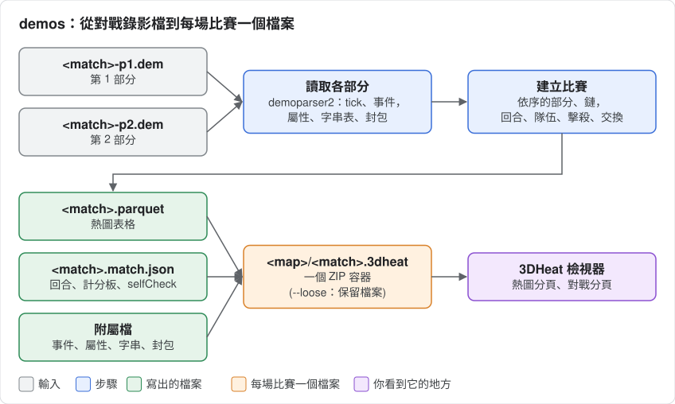

# 3DHeat CS2 {#dheat-cs2}

**這是什麼？** Counter-Strike 2 可以儲存一場比賽的錄製，稱為*對戰錄影（demo）*。本工具會把對戰錄影轉換成 3DHeat 檢視器能以 3D 顯示的檔案：每個人在哪裡站立、死亡、投擲與安放炸彈，逐回合呈現。它也能把 CS2 地圖轉換成 3D 模型，供上述內容顯示於其上。

**為什麼要用它？** 用來檢視你自己的比賽，把同一張地圖的多場比賽疊在一起，成為一張熱圖，並取得比賽統計，例如 ADR（每回合平均傷害）與 KAST（玩家擊殺、助攻、存活或被交換的回合比例）。

**範例：** 輸入 `alpha-vs-bravo-m1.dem`，輸出 `out/de_x/alpha-vs-bravo-m1.3dheat`（`de_x` 是虛構的地圖名稱）。



更詳細地說：3DHeat CS2 會把 **Counter-Strike 2 對戰錄影**轉換為每場比賽的熱圖表格與比賽文件，並把 **CS2 地圖**轉換為關卡幾何。輸出是為 [3DHeat](https://holdi601.github.io/3DHeat/) 遙測檢視器（[原始碼](https://github.com/Holdi601/3DHeat)）所製作的，但它們是一般的檔案——Parquet、JSON 與 glTF 二進位格式——其他工具也能讀取。

它是一個小型 Python 套件，`heat3d_cs2`，從命令列執行。它從磁碟讀取對戰錄影（不會下載任何東西），使用 [demoparser2](https://github.com/LaihoE/demoparser)；並以命令列版的 Source2Viewer（[ValveResourceFormat](https://github.com/ValveResourceFormat/ValveResourceFormat)），從已安裝的遊戲中匯出地圖。

## 快速開始 {#quick-start}

第一次使用命令列？請先閱讀[開始之前](before-you-start.md)。

```bash
pip install -r requirements.txt
python -m heat3d_cs2 demos <demo files or folders> -o out   # every match in them
python -m heat3d_cs2 map <map> -o out/<map>/<map>.glb       # the map from the installed game
python -m heat3d_cs2 scoreboard out/<map>/<match>.3dheat    # a match's scoreboard as text
```

你應該會看到 `1 match(es), 1 at a time ...`，接著每場比賽一行
（見[命令：印出的內容](../commands.md#what-is-printed)）。

`demos` 會依每場比賽，寫出一個檔案到以地圖名稱命名的資料夾中：`out/<map>/<match>.3dheat`，這是一個
[`.3dheat` 容器](../output-container.md)——檢視器的每場比賽一個檔案格式（[規格](https://holdi601.github.io/3DHeat/container.html)）。
它包含以下成員；`--loose` 則會改為分別寫成獨立檔案：

| 成員 | 內容 | 在檢視器中載入於 |
|---|---|---|
| `<match>.parquet`（角色 `table`） | 每位在線玩家每秒八次的紀錄，包含其狀態（生命值、金錢、閃光、開鏡、區域、物品欄……），以及每個事件發生的位置（擊殺、死亡、受傷、射擊、投擲、手榴彈爆炸、致盲、安放、拆除、爆炸，以及每位玩家的回合結束，附上該回合為其帶來的收益），每筆一列 | 熱圖分頁 |
| `<match>.match.json`（角色 `match`，比賽文件） | 隊伍、比分、每一回合（勝者、方式、經濟、安放、依序的擊殺、關鍵回合、倖存者），以及每位玩家的計分板列 | 對戰分頁 |
| `<match>.events/props/strings/packets.parquet` | 對戰錄影中其餘的所有內容，完整保留（附屬檔） | 為完整性而保留 |

`map` 會寫出 `<map>.glb`：地圖的碰撞網格——地板、牆壁、箱子，不含裝飾——分為地面與結構，與表格使用相同的座標系與單位，因此它會精確地位於熱圖之下（關卡面板）。

## 文件地圖 {#map-of-this-documentation}

| 頁面 | 內容 |
|---|---|
| [開始之前](before-you-start.md) | Python、終端機、佔位符，以及成功與常見錯誤的樣子 |
| [安裝](../installing.md) | Python、套件、Source2Viewer 的 CLI，以及 CS2 必須位於何處 |
| [命令](../commands.md) | `demos`、`map`、`scoreboard`：每個選項、印出的內容、結束代碼 |
| [讀取對戰錄影](../reading-demos.md) | 從對戰錄影檔中讀取什麼：取樣的 tick、玩家屬性、遊戲規則、事件 |
| [建立比賽](../building-matches.md) | 部分與鏈、比賽時鐘、回合、隊伍與陣營、列、擊殺、交換、開局、傷害、閃光、經濟 |
| [統計](../statistics.md) | 計分板：K/D/A、ADR、KAST、HS%、開局、交換、多殺、關鍵回合、道具、閃光 |
| [熱圖表格](../output-table.md) | Parquet 檔案：每一欄、其型別、哪些事件會填入它、`heat3d` footer 提示、座標軸 |
| [比賽文件](../output-match-json.md) | `.match.json` 文件，逐欄位說明 |
| [每場比賽一個檔案](../output-container.md) | `demos` 預設寫出的 `.3dheat` 容器，以及 `--loose` |
| [地圖匯出](../map-export.md) | 地圖的碰撞網格如何匯出、座標系、節點命名、單位 |
| [在 3DHeat 中使用](../using-with-3dheat.md) | 將表格、比賽文件與地圖載入檢視器的熱圖與對戰分頁 |
| [限制](../limits.md) | 做了哪些假設、哪些情況未處理、哪些未經驗證 |
| [更新](../updates.md) | 啟動時的發行版本檢查，以及 `python -m heat3d_update` |
| [開發](../development.md) | 程式碼結構、測試、合成對戰錄影的測試資料 |
| [命令參考](../cli-reference.md) | 每個命令的 `--help`，由程式碼產生 |
| [維護](../maintaining.md) | 這些頁面的發行檢查清單 |

## 經過什麼檢驗 {#what-it-is-checked-against}

來自各處的對戰錄影，並不是每場比賽一個乾淨的檔案。本轉換器能處理以任何順序分散在多個檔案中的比賽、比賽中途重新啟動的伺服器、以相同名稱儲存的兩場不同比賽、從備份還原的回合、太晚開始或太早結束的錄製、暫停，以及位於某隊陣營中的教練——請見[建立比賽](../building-matches.md)。經過大量錦標賽對戰錄影的檢驗：在每一場比賽中，比分都依循回合勝者，每一方的擊殺都是另一方的死亡，而且每回合都以五對五開始。

## 適合用來處理什麼 {#what-to-point-it-at}

你自己比賽的對戰錄影、你手動從錦標賽網站下載的對戰錄影，或你有權存取的 API 中的對戰錄影。對戰錄影是一份內容屬於其發布者與主辦單位的紀錄：請把輸出用於你自己的分析，不要散布對戰錄影或由其衍生的資料。提供對戰錄影的網站，其條款通常禁止自動下載，這也是本工具從磁碟讀取對戰錄影、而不擷取任何東西的原因。

## 屬於 3DHeat 的一部分 {#part-of-3dheat}

3DHeat CS2 是圍繞 3DHeat 檢視器的免費工具之一，每一個都有自己的儲存庫、發行版本與授權：

| 工具 | 功能 | 文件 |
|---|---|---|
| [3DHeat](https://github.com/Holdi601/3DHeat) | 檢視器：在 3D 中呈現熱圖、賽車分析與對戰回顧 | [網站](https://holdi601.github.io/3DHeat/) |
| [GameFiles](https://github.com/Holdi601/3DHeat-GameFiles) | 從遊戲所出貨的檔案中取得賽道與關卡，輸出為 3D 模型 | [網站](https://holdi601.github.io/3DHeat-GameFiles/) |
| [GameCapture](https://github.com/Holdi601/3DHeat-GameCapture) | 賽車遊戲的圈速遙測；從遊戲影片重建關卡 | [網站](https://holdi601.github.io/3DHeat-GameCapture/) |
| [Unreal Exporter](https://github.com/Holdi601/3DHeat-UnrealExporter) | Unreal Editor 外掛，將關卡匯出為單一 3D 模型 | [網站](https://holdi601.github.io/3DHeat-UnrealExporter/) |
| [CS2](https://github.com/Holdi601/3DHeat-CS2) | 將 Counter-Strike 2 對戰錄影轉為表格與比賽文件；將地圖轉為 3D 模型 | [網站](https://holdi601.github.io/3DHeat-CS2/) |
| [Watcher](https://github.com/Holdi601/3DHeat-Watcher) | 在背景中記錄遊戲所發布的關於你遊玩的內容 | [網站](https://holdi601.github.io/3DHeat-Watcher/) |
| [Ext-WarThunder](https://github.com/Holdi601/3DHeat-Ext-WarThunder) | 將 War Thunder 錄影轉為表格與比賽文件 | [網站](https://holdi601.github.io/3DHeat-Ext-WarThunder/) |
| [Ext-WoT](https://github.com/Holdi601/3DHeat-Ext-WoT) | 將 World of Tanks 錄影轉為表格與比賽文件 | [網站](https://holdi601.github.io/3DHeat-Ext-WoT/) |
| [Ext-WoWs](https://github.com/Holdi601/3DHeat-Ext-WoWs) | 將 World of Warships 錄影轉為表格與比賽文件 | [網站](https://holdi601.github.io/3DHeat-Ext-WoWs/) |
| [Ext-Squad](https://github.com/Holdi601/3DHeat-Ext-Squad) | 將 Squad 伺服器對戰錄影轉為表格與比賽文件 | [網站](https://holdi601.github.io/3DHeat-Ext-Squad/) |
| [Ext-DCS](https://github.com/Holdi601/3DHeat-Ext-DCS) | 將 DCS World 地圖轉為 3D 模型 | [網站](https://holdi601.github.io/3DHeat-Ext-DCS/) |
| [Ext-IL2](https://github.com/Holdi601/3DHeat-Ext-IL2) | 將 IL-2 Sturmovik 地圖轉為 3D 模型 | [網站](https://holdi601.github.io/3DHeat-Ext-IL2/) |

## 授權 {#licence}

MIT——見 [`LICENSE`](https://github.com/Holdi601/3DHeat-CS2/blob/main/LICENSE)，
以及 [`LICENSES.md`](https://github.com/Holdi601/3DHeat-CS2/blob/main/LICENSES.md)，
其中列出第三方套件，以及它所讀取的遊戲需要遵守的規定。
