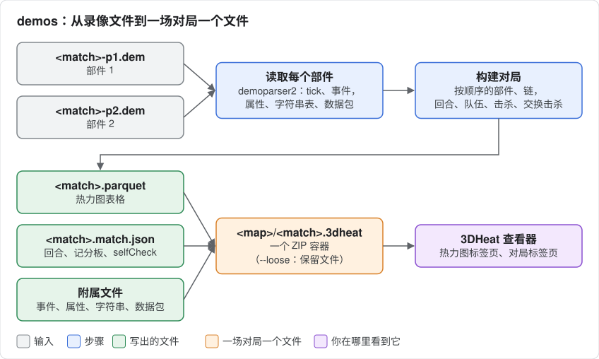

# 3DHeat CS2 {#dheat-cs2}

**这是什么？** 反恐精英 2 可以把一场对局保存为录像，称为 *demo*（录像文件）。本工具把录像转换成 3DHeat 查看器可以以 3D 形式显示的文件：每个人在每一回合中站在哪里、在哪里死亡、投掷了什么、在哪里安放或拆除炸弹。它还可以把 CS2 地图转换成 3D 模型，供这些数据显示在其上。

**我为什么要用它？** 用来回顾你自己的对局；把同一张地图上的多场对局叠加成一张热力图；以及获取对局统计数据，例如 ADR（每回合平均伤害）和 KAST（一名玩家在回合中击杀、助攻、存活或被交换击杀的回合占比）。

**示例：** 输入 `alpha-vs-bravo-m1.dem`，输出 `out/de_x/alpha-vs-bravo-m1.3dheat`（`de_x` 是虚构的地图名）。



更详细地说：3DHeat CS2 把**反恐精英 2 录像**转换为热力图表格和每场对局一份对局文档，并把 **CS2 地图**转换为关卡几何数据。输出结果是为 [3DHeat](https://holdi601.github.io/3DHeat/) 遥测查看器（[源代码](https://github.com/Holdi601/3DHeat)）制作的，但它们只是普通文件——Parquet、JSON 和 glTF 二进制——其他任何程序也都可以读取。

它是一个小型 Python 包，名为 `heat3d_cs2`，从命令行运行。它从磁盘读取录像（它不下载任何东西），使用 [demoparser2](https://github.com/LaihoE/demoparser)；并使用命令行版的 Source2Viewer（[ValveResourceFormat](https://github.com/ValveResourceFormat/ValveResourceFormat)），从已安装的游戏中导出地图。

## 快速开始 {#quick-start}

第一次使用命令行？请先阅读 [开始之前](before-you-start.md)。

```bash
pip install -r requirements.txt
python -m heat3d_cs2 demos <demo files or folders> -o out   # 其中的每场对局
python -m heat3d_cs2 map <map> -o out/<map>/<map>.glb       # 来自已安装游戏的地图
python -m heat3d_cs2 scoreboard out/<map>/<match>.3dheat    # 一场对局的记分板，以文本显示
```

你应该会看到 `1 match(es), 1 at a time ...`，然后每场对局输出一行（参见 [命令](../commands.md#what-is-printed)）。

`demos` 会为每场对局在一个以地图名称命名的文件夹中写出一个文件：
`out/<map>/<match>.3dheat`，这是一个 [`.3dheat` 容器](../output-container.md)，即查看器的一场对局一个文件的格式（[规范](https://holdi601.github.io/3DHeat/container.html)）。
它包含以下成员；`--loose` 则会把它们分别写成独立的文件：

| 成员 | 内容 | 在查看器的哪里加载 |
|---|---|---|
| `<match>.parquet`（角色 `table`） | 每位在场玩家每秒八次的数据及其状态（生命值、金钱、致盲、开镜、区域、物品栏……），以及每一个事件发生的地点（击杀、死亡、受伤、射击、投掷、手雷爆炸、致盲、安放、拆除、爆炸，以及每位玩家的回合结束记录，包括该回合给他们带来的收益），每个事件一行 | 热力图标签页 |
| `<match>.match.json`（角色 `match`，即对局文档） | 队伍、比分、每一回合（胜者、方式、经济、安放、按顺序的击杀、关键回合、幸存者），以及每位玩家的记分板行 | 对局标签页 |
| `<match>.events/props/strings/packets.parquet` | 录像中的其他一切，完整保留（附属文件） | 为完整性而保留 |

`map` 会写出 `<map>.glb`：即地图的碰撞网格（地板、墙壁、箱子，不含装饰），分为地面和结构两部分，并采用与表格相同的坐标系和单位，因此它恰好位于热力图之下（背景/关卡面板）。

## 本文档的地图 {#map-of-this-documentation}

| 页面 | 内容 |
|---|---|
| [开始之前](before-you-start.md) | Python、终端、占位符，以及成功和常见错误是什么样子 |
| [安装](../installing.md) | Python、软件包、Source2Viewer 的命令行版、CS2 必须位于何处 |
| [命令](../commands.md) | `demos`、`map`、`scoreboard`：每个选项、输出内容、退出代码 |
| [读取录像](../reading-demos.md) | 从录像文件中读取什么：采样的 tick、玩家属性、游戏规则、事件 |
| [构建对局](../building-matches.md) | 部件与链、对局时钟、回合、队伍与阵营、行、击杀、交换击杀、开局、伤害、闪光、经济 |
| [统计](../statistics.md) | 记分板：K/D/A、ADR、KAST、爆头率、开局、交换击杀、多杀、残局、道具、闪光 |
| [热力图表格](../output-table.md) | Parquet 文件：每一列、其类型、哪些事件填充它、`heat3d` 页脚提示、坐标轴 |
| [对局文档](../output-match-json.md) | `.match.json` 文档，逐字段说明 |
| [一场对局一个文件](../output-container.md) | `demos` 默认写出的 `.3dheat` 容器，以及 `--loose` |
| [地图导出](../map-export.md) | 地图的碰撞网格如何导出：坐标系、节点命名、单位 |
| [在 3DHeat 中使用](../using-with-3dheat.md) | 将表格、对局文档和地图加载到查看器的热力图与对局标签页 |
| [限制](../limits.md) | 做了哪些假设，哪些情况未处理，哪些尚未验证 |
| [更新](../updates.md) | 启动时的发布检查，以及 `python -m heat3d_update` |
| [开发](../development.md) | 代码结构、测试、合成录像测试数据 |
| [命令参考](../cli-reference.md) | 每条命令的 `--help`，由代码生成 |
| [维护](../maintaining.md) | 这些页面的发布检查清单 |

## 验证方法 {#what-it-is-checked-against}

野外获得的录像并不是每场对局一个干净的文件。转换器能够处理：跨多个文件、以任意顺序存放的同一场对局；对局中途重启的服务器；两场不同的对局存放在同一个名称下；从备份恢复的回合；开始较晚或结束较早的录制；暂停；以及站在某一队一侧的教练。参见 [构建对局](../building-matches.md)。在一大批锦标赛录像上进行的检查显示：在每一场对局中，比分都与回合胜者一致，每一方的击杀数都等于另一方的死亡数，并且每一回合都以五对五开始。

## 适合用于哪些录像 {#what-to-point-it-at}

你自己对局的录像，你从锦标赛网站手动下载的录像，或者你有权访问的 API 中的录像。录像的内容属于其发布者和主办方：请仅将输出用于你自己的分析，不要再分发录像或由其衍生的数据。该工具从磁盘读取录像，从不下载任何录像；也不随附游戏的任何内容：没有游戏文件、没有游戏代码、没有 DLL。

3DHeat CS2 与 Valve 没有关联，也未获得 Valve 认可。Counter-Strike 2 及相关名称和商标归其各自所有者所有。权利人：请在 [github.com/Holdi601/3DHeat-CS2/issues](https://github.com/Holdi601/3DHeat-CS2/issues) 提交 issue——我们会迅速回复，并按要求删除任何内容。

## 属于 3DHeat 的一部分 {#part-of-3dheat}

3DHeat CS2 是 3DHeat 查看器周围的免费工具之一，每个工具都有自己的代码仓库、发布版本和许可证：

| 工具 | 作用 | 文档 |
|---|---|---|
| [3DHeat](https://github.com/Holdi601/3DHeat) | 查看器：在 3D 中显示热力图、赛车分析和对局回顾 | [站点](https://holdi601.github.io/3DHeat/) |
| [GameFiles](https://github.com/Holdi601/3DHeat-GameFiles) | 从游戏附带的文件中提取赛道和关卡，输出为 3D 模型 | [站点](https://holdi601.github.io/3DHeat-GameFiles/) |
| [GameCapture](https://github.com/Holdi601/3DHeat-GameCapture) | 赛车游戏的圈速遥测；从游戏视频重建的关卡 | [站点](https://holdi601.github.io/3DHeat-GameCapture/) |
| [Unreal Exporter](https://github.com/Holdi601/3DHeat-UnrealExporter) | 一个 Unreal 编辑器插件，将一个关卡导出为一个 3D 模型 | [站点](https://holdi601.github.io/3DHeat-UnrealExporter/) |
| [CS2](https://github.com/Holdi601/3DHeat-CS2) | 将反恐精英 2 录像转为表格和对局文档；将地图转为 3D 模型 | [站点](https://holdi601.github.io/3DHeat-CS2/) |
| [Watcher](https://github.com/Holdi601/3DHeat-Watcher) | 在后台记录你的游戏过程，根据游戏公开的数据 | [站点](https://holdi601.github.io/3DHeat-Watcher/) |
| [Ext-WarThunder](https://github.com/Holdi601/3DHeat-Ext-WarThunder) | 将战争雷霆的录像转为表格和对局文档 | [站点](https://holdi601.github.io/3DHeat-Ext-WarThunder/) |
| [Ext-WoT](https://github.com/Holdi601/3DHeat-Ext-WoT) | 将坦克世界的录像转为表格和对局文档 | [站点](https://holdi601.github.io/3DHeat-Ext-WoT/) |
| [Ext-WoWs](https://github.com/Holdi601/3DHeat-Ext-WoWs) | 将战舰世界的录像转为表格和对局文档 | [站点](https://holdi601.github.io/3DHeat-Ext-WoWs/) |
| [Ext-Squad](https://github.com/Holdi601/3DHeat-Ext-Squad) | 将 Squad 服务器录像转为表格和对局文档 | [站点](https://holdi601.github.io/3DHeat-Ext-Squad/) |
| [Ext-DCS](https://github.com/Holdi601/3DHeat-Ext-DCS) | 将 DCS World 地图转为 3D 模型 | [站点](https://holdi601.github.io/3DHeat-Ext-DCS/) |
| [Ext-IL2](https://github.com/Holdi601/3DHeat-Ext-IL2) | 将 IL-2 Sturmovik 地图转为 3D 模型 | [站点](https://holdi601.github.io/3DHeat-Ext-IL2/) |

## 许可证 {#licence}

MIT——见 [`LICENSE`](https://github.com/Holdi601/3DHeat-CS2/blob/main/LICENSE)；第三方软件包见
[`LICENSES.md`](https://github.com/Holdi601/3DHeat-CS2/blob/main/LICENSES.md)。
